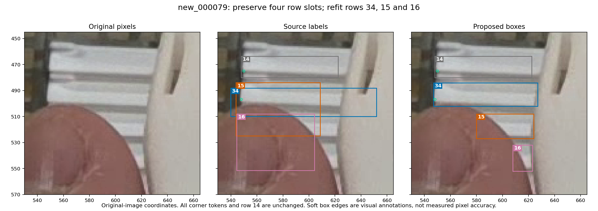

# Three visible-front box corrections in one existing training image

**Status: separately reviewed annotation proposal; no new model has been trained.** This closes the recorded geometry review for `new_000079` source rows 15, 16 and 34. The selected PR35 model and its explicit confidence 0.13 workflow remain in use. The proposal is a standalone overlay on the original labels, with no automatic combination with earlier annotation candidates.

The [earlier review](../annotations-2026-11-10/review.json) retained four row slots while deferring their crowded-front geometry. The current pass inspected the full original before labels, then original-pixel crops. Two independent assistant reviewers and the root reviewer support four visible front bands. The broad source boxes do not prove the source author's intended identities; the reassociation below is explicit.

## Supported correction

Coordinates are `[left, top, right, bottom]` in the original 1280 × 720 image. Source values are rounded here for reading; the manifest preserves their exact original tokens.

| Retained row | Observed front | Source box | Proposed box |
| --- | --- | --- | --- |
| 34 | Second band, with visible left corner | `[539.81, 488.10, 651.91, 509.92]` | **`[547, 484, 627, 502]`** |
| 15 | Third band, triangular fragment beside the thumb | `[543.93, 483.98, 608.59, 524.95]` | **`[580, 508, 624, 527]`** |
| 16 | Fourth band, narrow fragment beside the gripper | `[544.54, 507.98, 604.16, 551.56]` | **`[608, 532, 623, 552]`** |



The source boxes overlap neighboring bands or large hand/gripper regions while missing parts of the observed fragments. The proposed rectangles bound the observed front fragments. A rectangular box around a triangular fragment still encloses some occluder pixels; it is not a segmentation mask or a reconstruction of hidden cassette width.

All **34 rows** remain. The **31 other rows are byte-identical**, including row 14, which supplies first-band context without receiving a new extent certification. Every class and corner token is preserved. Row 34 retains its supported left point at approximately `(547.92, 496.73)` and a missing right point. Rows 15 and 16 retain both actual lower corners as `0 0 0`; their intersections with the hand or gripper do not identify the physical corners.

## Remaining uncertainty

The front/rim and occlusion transitions are soft. Reviewers agreed on the reassociation but gave somewhat different edge estimates. The [review record](review.json) preserves those differences and their acceptance of the final figure. The selected integer bounds are reviewable annotation choices, not a measured one-pixel accuracy claim. Row 34's right edge may include a narrow blurred occlusion boundary.

The thin pale material below the fourth band, around y557 onward, does not support a securely identifiable fifth front. No additional row is accepted. Unrelated source rows retain their original bytes and any previous uncertainty. This is a controlled incremental correction, not certification of every label in the image or a newly qualified complete dataset.

## Verification and use

```bash
python -B scripts/verify_pose_annotation_candidate.py \
  --candidate data/candidates/visible-extent-079-2026-11-11/manifest.json
```

The existing verifier passes all 157 original label identities, exact three-row reconstruction, row accounting, point-token preservation, geometry and unchanged validation labels. The [verification record](verification.json) also records a separate check of the actual original PNG bytes and the unchanged source TXT. No new verifier or inference implementation is introduced.

Because this is a standalone overlay on the originals, totals remain 137 training images / 3,772 objects / 6,839 visible endpoints / 705 missing endpoints, and 20 original validation images / 664 objects / 1,227 visible endpoints. The separate corrected 663-object evaluation reference is untouched.

The next learning hypothesis is specific: misplaced boxes on hand/gripper and neighboring-band regions may weaken supervision for partial fronts. This proposal makes three such corrections inspectable; it does not establish that training on them improves detections. Keep it separate from the completed negative PR40 experiment and the successful operating-threshold change. No new GPU run, seed search or model replacement is requested by this review.
