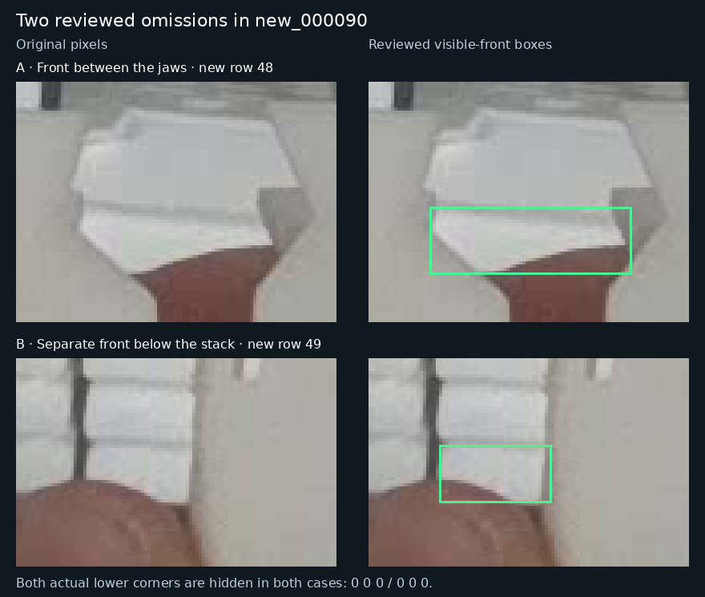

# Reviewed validation reference: 2026-11-11

Reference ID: **`baomai-visible-front-2026-11-11`**. This complete 20-image label set inherits the [PR30 reference](../visible-front-2026-11-10/README.md) and adds two visible partial cassette fronts in `new_000090`. The user delegated original-image review and supported label amendments. The [review and comparison report](../../../docs/low-confidence-review-2026-11-11.md) records the decisions and rescoring.

| Change from the PR30 reference | Result |
| --- | --- |
| Label files changed | One: `new_000090.txt` |
| Existing rows changed or removed | Zero; all existing row bytes and IDs remain intact |
| New rows | 48 and 49 |
| New locatable corners | Zero; both slots remain `0 0 0` in both new instances |
| Current objects / locatable corners / unavailable corners | 663 / 1,228 / 98 |
| Objects with zero / one / two locatable corners | 19 / 60 / 584 |
| Previously unresolved reference dispositions | All 19 retained |

## Accepted additions

- **Row 48:** the exposed lower front facet between the gripper jaws, below the broad upper surface. Original-image box: `[674, 474, 737, 495]`.
- **Row 49:** the separate lower front below existing row 42, with its visible top seam near y526–528. Original-image box: `[572, 527, 607, 545]`.

Both actual outer lower corners are hidden. Visible intersections with the jaws or thumb are not substituted as physical corners. Bounds were selected from the original pixels and fixed before amended-reference scoring. Independent reviewers agreed on the two instances and missing-corner states; their chosen edges differed by approximately 1–2 pixels along soft boundaries. No subpixel certainty is claimed.



The [manifest](manifest.json) records the parent reference hash, cumulative original-to-current row mappings, exact added rows, source image and label hashes, and review limits. The [complete corrected labels](labels/val/) are directly compatible with the existing 11-field YOLO-Pose editor.

The manifest's `change_summary` is cumulative from the original reference; `delta_from_parent` describes this two-row amendment. Its five-model replay wording is inherited from the PR30 study. The present report makes new-reference comparisons only for epoch173, the seed46 control and the seed46 candidate, all three rescored on identical current labels. Older models would also need rescoring before including them in a new-reference comparison.

## Use and reproduce

Use the existing [cassette labeler](../../../tools/cassette_labeler/README.md). Follow the [earlier reference's working-copy instructions](../visible-front-2026-11-10/README.md#open-the-reviewed-labels-in-the-existing-html-editor), replacing its label source with `data/references/visible-front-2026-11-11/labels` and choosing a new working-directory name. Original image paths remain unchanged.

The focused standard-library replay compares epoch173, the seed46 control and the seed46 candidate against both reference versions at all three saved confidence thresholds:

```bash
python3 results/verification/baomai-low-confidence-20261111/rescore_reference.py --check
```

These are validation/development labels. Do not add these images to training or interpret a changed reference score as a newly learned model improvement. Original labels, PR30 evidence, training labels and checkpoints remain preserved. The prior boundary/identity caveat for `011:61` is not resolved by adding distinct, more clearly exposed fronts in `090`.
