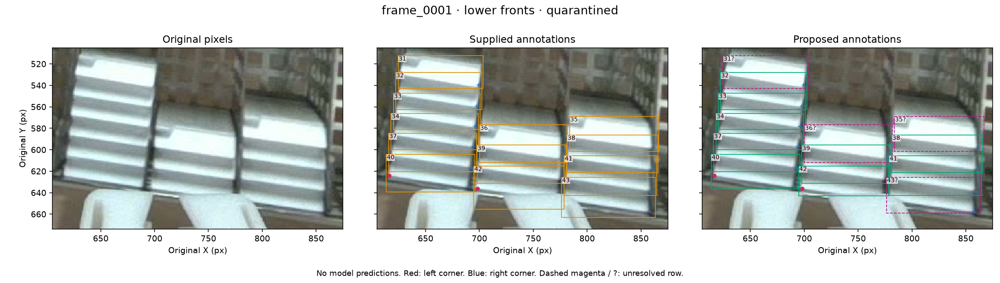
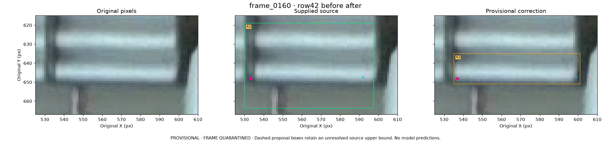
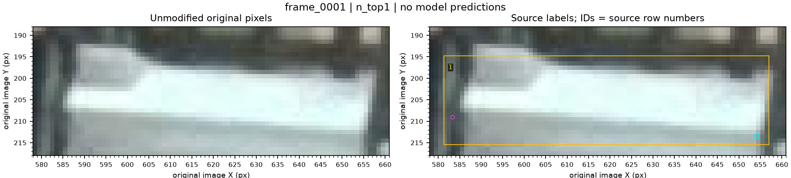

# Additional-frame annotation pilot

**2026-11-07.** This separately versioned proposal saves supported changes to **87 boxes and five corner positions across three selected images**. It preserves all 129 identifiable fronts and every visibility state. **All three images remain quarantined:** 36 rows still have an unresolved physical box boundary, so these partial corrections do not release an evaluation or training set.

The pilot follows [PR #18](https://github.com/Siuuuers/dl/pull/18), which recovered 320 additional originals and identified annotation-policy questions before scoring. This review covers `frame_0001`, `frame_0160` and `frame_0383`, selected during that earlier inspection. They are not a random sample or a prevalence estimate. **317 images have not received complete annotation review.** Two further originals were viewed for surface context only; their labels were not reviewed and coordinates were not transferred.

## Scope and accounting

The [candidate manifest](../data/candidates/additional-pilot-2026-11-07/manifest.json) preserves source hashes, exact before/after rows, unresolved fields and disposition. The [per-image review records](../data/candidates/additional-pilot-2026-11-07/reviews/) contain judgments for every row and whole-image coverage checks.

| Image | Source / proposed objects | Box rows changed | Corner slots changed | Unresolved rows | Disposition |
| --- | ---: | ---: | ---: | ---: | --- |
| `frame_0001` | 43 / 43 | 6 | 1 | 13 | Quarantined |
| `frame_0160` | 43 / 43 | 39 | 4 | 11 | Quarantined |
| `frame_0383` | 43 / 43 | 42 | 0 | 12 | Quarantined |
| **Total** | **129 / 129** | **87** | **5** | **36** | **No eligible images** |

The five corner changes affect four object rows already included in the 87 box rows. There are no additions, deletions or visibility changes: **256 endpoints remain visible and two remain canonical missing points**. Each complete image was checked for omitted, extra and duplicate fronts, including apparently empty rack cells and foreground gripper regions.

Assistant visual review used unmodified 1280×720 originals and raw/source/provisional comparisons with pixel axes. Independent second assistant checks covered all nine final comparison figures and detailed side, corner and occlusion crops. These review records do not claim human approval. The [existing policy](annotation-policy.md), `baomai-visible-front-v1`, is unchanged. The files remain reviewed proposals; no model predictions, new inference or training were used.

## Corrections supported by the original pixels

### frame_0001: six bounded changes

This view has pronounced slanted faces. Their axis-aligned boxes can overlap vertically while representing different objects; overlap alone did not justify trimming or deletion. Six specific corrections remain supported:

| Source row | Manual proposal in original pixels | Physical reason |
| --- | --- | --- |
| 3 | `xmin=582.0` | Remove dark rack margin left of the observed front. |
| 5 | `xmax=809.0` | Retain the shaded sloping side while excluding rack beyond it. |
| 30 | `ymax=465.0`; relocate right corner | The source lower extent and point reach beyond the softened front corner into rack/dark pixels. |
| 40 | `ymax=636.5` | Exclude support material below the visible lower contour. |
| 42 | `ymax=643.0` | Remove foreground gripper from the source box's outer extent. |
| 43 | `ymax=659.0` | Exclude rack below the visible right lower contour. |

The remaining 37 rows are byte-identical to their source lines. Row 42 retains its visible left corner and missing right corner; row 43 retains its missing left corner and visible right corner. Neither hidden corner is reconstructed from the other endpoint, a box edge or stack spacing. Row 43's **left box edge remains unresolved**, independently of its supported bottom correction.



### frame_0160: exclude rack while preserving the shaded face

This review changes 39 boxes and four corner slots. The corrections preserve gray front material as well as its bright lower strip. Some source rectangles include a preceding front, a divider or the metal base; others omit an exposed side. Each edge was judged from the physical surface, rather than applying a fixed inset or using brightness to define the target.

Row 42 illustrates both problems. Its source bottom reaches approximately 663.675 px into the base. The manual proposed rectangle is `(535, 635, 601, 651)`. Its source left point lies in the dark separator and its right point lies inside the front; their X coordinates move to the observed outer junctions. Their supported Y coordinates and visible states remain unchanged. The other two changes are the left corner of row 34 and right corner of row 40. [Detailed judgments](../data/candidates/additional-pilot-2026-11-07/reviews/frame_0160.json) distinguish each case.



### Exact five corner changes

These pixel values are calculated directly from the stored normalized TXT decimals, multiplying X by 1280 and Y by 720. **They describe file contents, not measurement accuracy.** The manual target for `frame_0001` is approximately `(954.5, 464.0)`; the small differences below result from serialization. The four `frame_0160` edits preserve the original Y tokens. All five points retain `v=2`.

| Image / source row / side | Source `(x,y)` px | Provisional `(x,y)` px |
| --- | --- | --- |
| `frame_0001` /30 /right | `(956.2312064, 466.7175)` | `(954.5000064, 463.9999968)` |
| `frame_0160` /34 /left | `(542.9299968, 597.6174024)` | `(537, 597.6174024)` |
| `frame_0160` /40 /right | `(593.8029952, 632.0907)` | `(599, 632.0907)` |
| `frame_0160` /42 /left | `(533.2851968, 648.1456992)` | `(537, 648.1456992)` |
| `frame_0160` /42 /right | `(592.0081024, 647.5092984)` | `(599, 647.5092984)` |

## What the second review changed

In `frame_0383`, an early proposal expanded the tops of rows 9, 10, 25 and 30. A critical second review challenged the assumption behind those expansions: a gray patch connected to the cassette is not necessarily part of its front-facing plane. It could include a raised rim or upper surface. Brightness, continuity, or the absence of another sharp seam does not settle that distinction.

**Those four top expansions were withdrawn.** The source top is retained only as an unresolved placeholder on all 12 affected rows. Independently supported side/bottom corrections remain in the 42 changed boxes, and all 86 visible endpoint coordinates remain unchanged. The [review record](../data/candidates/additional-pilot-2026-11-07/reviews/frame_0383.json) preserves the withdrawn alternatives and their reasons.

The same issue is visible in `frame_0001` row 1: a raised gray patch reaches about y=192–193 px, above the source top at 194.734 px. If it belongs to the front, that box clips target material; if it belongs to the roof/rim, expanding around it would be wrong. No unresolved replacement is forced.



The unresolved fields are **35 upper edges (`ymin`) plus one left edge (`xmin`)**:

| Image | Unresolved upper-edge source rows | Other unresolved edge |
| --- | --- | --- |
| `frame_0001` | 1, 2, 4, 9, 10, 15, 21, 23, 30, 31, 35, 36 | Row 43 `xmin`, beside the gripper |
| `frame_0160` | 1, 2, 4, 6, 15, 24, 25, 26, 31, 34, 37 | None |
| `frame_0383` | 1, 2, 5, 9, 10, 15, 24, 25, 30, 31, 33, 36 | None |

An unchanged uncertain coordinate is not an accepted boundary. Supported changes to other fields can be preserved while the entire image remains quarantined.

## Evidence and reproduction

The [candidate README](../data/candidates/additional-pilot-2026-11-07/README.md) describes the layout. The [review capsule](../results/review/baomai-additional-annotation-20261107/review.zip) packages the manifest, proposed and source labels, reviews of every row, verifier, renderer and nine comparison plots; the pinned source manifest and three original JPEG/label pairs; and reviewer records.

It also contains PNGs for the editor with same-stem TXT files. These PNGs are lossless exports of the decoded original RGB pixels, with no resizing. They are not new captures or byte-identical copies of the JPEG files. `PNG-export.json` records that relationship. The capsule's `verification.json` holds candidate consistency checks, and `inventory.json` lists its files. Use the [structured verification record](additional-annotation-pilot-2026-11-07.json) for the final archive identity, extraction checks and rendering readback; no archive hash or completed archive check is inferred here.

Verification completed on the exported bytes: all source/proposal row transformations and geometry checks passed; fresh extraction reproduced the candidate verification and all nine comparison figures byte-for-byte. All three PNG exports have exactly the same decoded RGB pixels as their source JPEGs. Archive CRC, path safety, inventory and payload hashes passed. The capsule contains **50 files**, has **6,155,796 bytes**, and SHA256 `9cbb0bfcd731dd9d67f2e891a278cf293edc31f335019531aabce6ab6a8190fd`. These checks establish file integrity and faithful reproduction, not resolution of the physical ambiguities.

From the repository root, after unpacking the capsule:

```bash
python data/candidates/additional-pilot-2026-11-07/verify.py \
  --root . \
  --candidate /path/unpacked/candidate \
  --source-root /path/unpacked/source
```

The verifier checks provenance, row accounting, geometry, retained unresolved fields and quarantine gates. A mechanical pass cannot decide which physical plane a gray patch belongs to.

## Next decision

Resolve the exposed front-versus-roof/rim boundary using an unequivocal view or a physical part reference under the current target semantics. Resolve the occluded-side extent of `frame_0001` row 43 separately. If the evidence still cannot distinguish them, continue quarantine.

After those decisions, review complete revised images and freeze exact label bytes and eligible IDs before supplementary scoring. Do not score a selection of corrected rows while omitting unresolved objects. The selected-three scope, neighboring-frame correlation and prior upstream use remain limits even after annotation qualification; this pilot establishes no independent-test result. No new training is required for the remaining annotation work.
