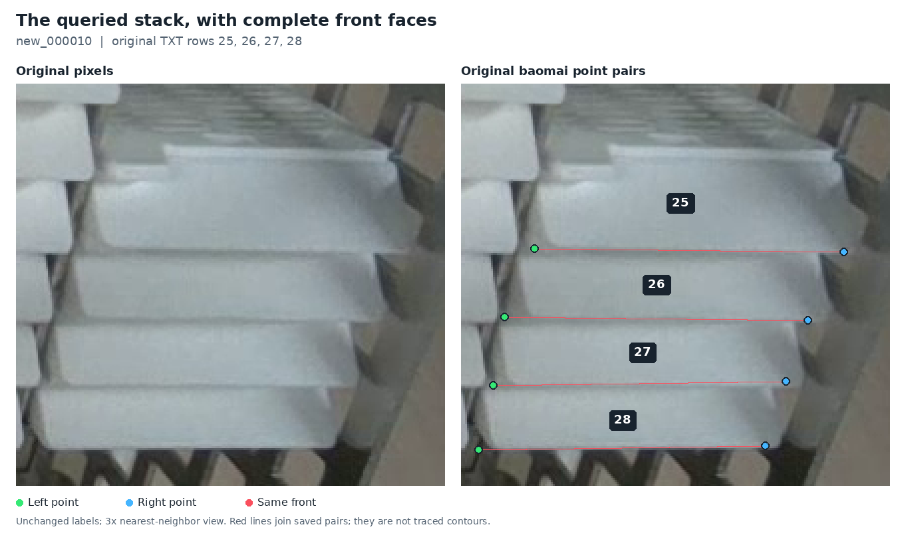
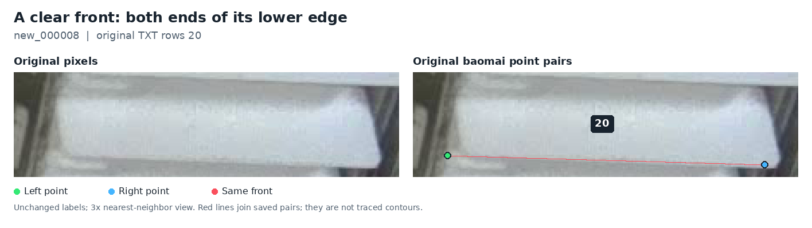
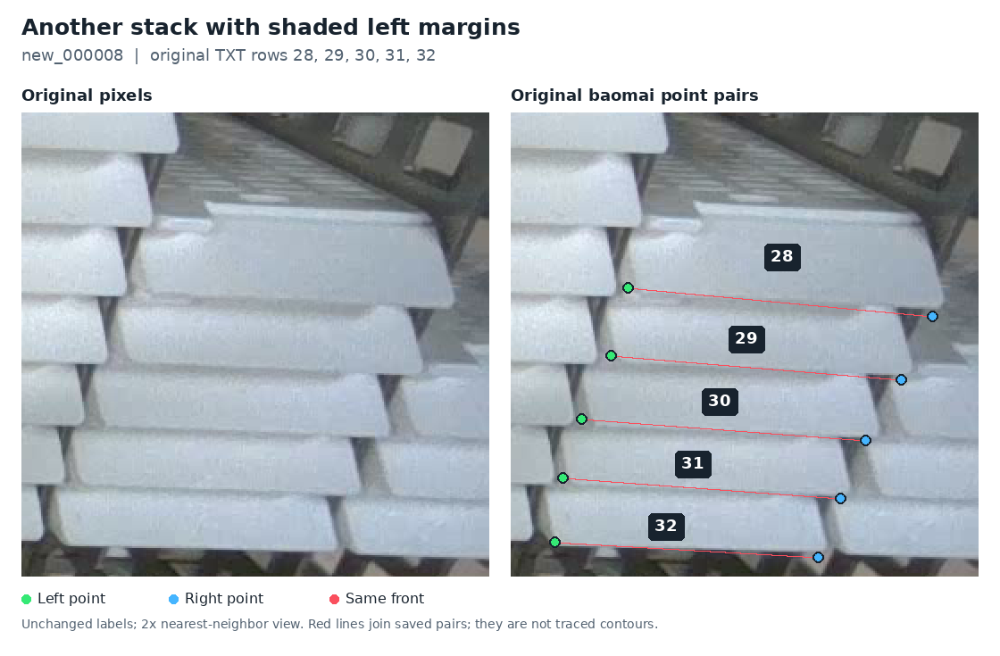
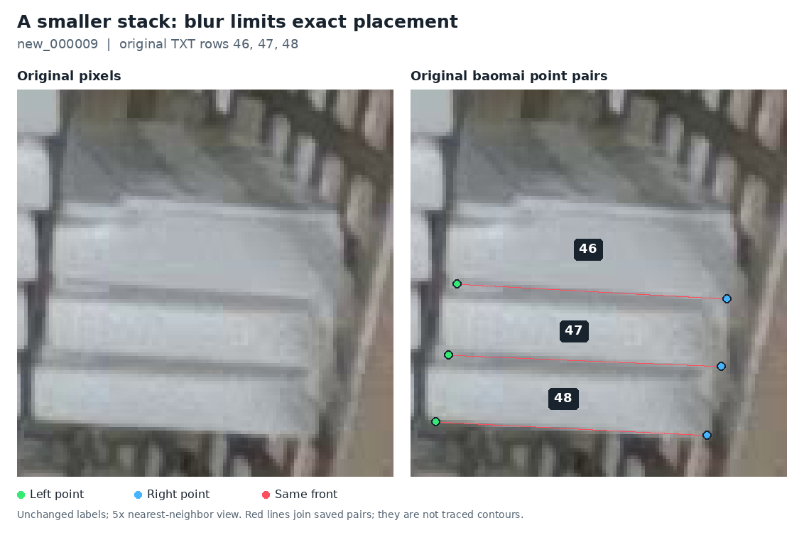

# Original baomai examples: shaded turns and complete fronts

The original baomai annotations include the exact rightmost stack discussed in `new_000010`. They generally identify the two ends of each front's lower edge. In this stack, the saved left points lie near the shaded outer ends of those seams. The examples do not support a general rule that every point should move to the beginning of the brighter interior surface.

**A shared stack junction needs an owning front.** The lower-left corner of the front above and the upper-left shoulder of the front below are close together, but they are not automatically the same physical feature. The existing guidance fixes the target as the former. The thick orange marks in the user's crop identify that general neighborhood; they do not establish exact coordinates or override the lower-front definition.

The user reaffirmed that existing guidance after reviewing these examples. The [follow-up compliance audit](lower-front-guidance-audit-2026-11-12.md) applies it directly: the target definition is settled, while a few shaded or occluded locations remain unresolved. No choice of a new landmark is needed.

## Source and display method

The upstream `baomai` branch was checked on 2026-11-12 and points to commit [`351eb3cf960ccc34829e2bc72e1fa4645acc6295`](https://github.com/an94-doll/embedding_vision/tree/351eb3cf960ccc34829e2bc72e1fa4645acc6295). Its [data README](https://github.com/an94-doll/embedding_vision/blob/351eb3cf960ccc34829e2bc72e1fa4645acc6295/data/README.md) defines the points as the actual left and right corners of the white front's **lower edge**, ordered by image X. It excludes the upper lip and base/tray corners. It also specifies `v=2` for visible points and `0 0 0` for points that cannot be reliably located.

All figures below are **newly rendered displays of the unchanged original baomai annotations**. The original source PNGs and TXT labels were verified against the upstream manifest. Original editor-export preview paths exist, but the available downloads returned Git LFS pointer text, so their PNG payloads were not inspected. The displays below reconstruct the saved geometry; they do not claim to reproduce the editor's styling or rasterization byte for byte.

- Left panel: original image pixels, enlarged with nearest-neighbor sampling.
- Right panel: the same pixels with original green left points, blue right points and red joining lines.
- Numbers: one-based lines in the original TXT file, shown inside the owning fronts for clarity.
- Red lines: an association between the two saved points of one object, not a traced contour or a segmentation boundary.

No model prediction, revised reference coordinate, inferred hidden point or synthetic image is used in these examples. Magnification does not add image detail. All 13 selected original rows have two visible endpoints.

## 1. The exact queried stack: new_000010, rows 25–28



Each green point belongs to the numbered front immediately above its red line. The blue point on the other side belongs to that same front. This view includes the top front that was mostly cut away in the earlier narrow crop.

| Original TXT row | Original left point, pixels | Original right point, pixels |
| --- | --- | --- |
| 25 | (946.82, 392.82) | (1101.97, 394.34) |
| 26 | (931.78, 427.17) | (1083.81, 428.93) |
| 27 | (926.07, 461.64) | (1072.75, 459.56) |
| 28 | (918.92, 493.90) | (1062.38, 491.71) |

The decimals come from the normalized TXT representation; they do not imply comparable physical accuracy. Coordinates are decoded with the original **1280×720** dimensions. The editor's **1280×750** preview includes a 30-pixel footer and must not be used as the normalization size.

The earlier narrow crop was `[910,395,981,500]` in source pixels. Both row-25 points are just above its top boundary, at `y<395`. Consequently, a cross at the top of that crop cannot be treated as an exact match to the original row-25 point.

| Orange mark in the user's narrow crop | Nearby junction | Original lower-front endpoint to compare |
| --- | --- | --- |
| Top | Front 25 / front 26 | Front 25's lower-left point, just outside the earlier crop |
| Middle | Front 26 / front 27 | Front 26's lower-left point |
| Bottom | Front 27 / front 28 | Front 27's lower-left point |

This is a mapping of nearby junctions, not an extraction of precise positions from the thick crosses. Front 28's original lower-left point is at the bottom of the stack, around `y=494`, below those three junctions. Assigning the bottom cross to front 28's lower corner merely because its face appears beneath the cross would mix two different edges.

The saved left points are near the shaded outer seam ends. A blanket shift to the bright interior rounding would change the selected image feature. This supports retaining the original points while discussing their exact physical meaning; it does not prove the material identity of every dark pixel.

[Original full image](https://github.com/an94-doll/embedding_vision/blob/351eb3cf960ccc34829e2bc72e1fa4645acc6295/data/images/val/new_000010.png) · [Original TXT](https://github.com/an94-doll/embedding_vision/blob/351eb3cf960ccc34829e2bc72e1fa4645acc6295/data/labels/val/new_000010.txt) · [Original exported-preview path](https://github.com/an94-doll/embedding_vision/blob/351eb3cf960ccc34829e2bc72e1fa4645acc6295/data/annotated/val/new_000010_annotated.png)

## 2. A clear complete front: new_000008, row 20



This is the clearest example for naming the target. The two saved points sit near the left and right ends of the front's lower edge. The upper lip remains visible above them and is a separate feature.

The original pair is left `(930.29,240.39)`, right `(1114.63,245.90)`. Their small inset from the extreme antialiased silhouette pixels also shows why an automatic “outermost pixel” rule would be too crude. This original annotation is evidence of the intended feature, not a guarantee of exact geometric truth.

## 3. A similar shaded stack: new_000008, rows 28–32



This view shows the same repeated lower-edge relationship at a different viewpoint. The last front, row 32, is especially useful because its lower edge has no further cassette immediately beneath it.

There is visible annotation variation. Some left points on rows 28–31 appear slightly above or inward from the lowest visible turn. Their saved positions should remain visible in this source comparison instead of being silently corrected to make the convention look more uniform. These are illustrations selected for shape and visibility, not a random sample or a statistical audit of label quality.

[Original full image for examples 2 and 3](https://github.com/an94-doll/embedding_vision/blob/351eb3cf960ccc34829e2bc72e1fa4645acc6295/data/images/val/new_000008.png) · [Original TXT](https://github.com/an94-doll/embedding_vision/blob/351eb3cf960ccc34829e2bc72e1fa4645acc6295/data/labels/val/new_000008.txt) · [Original exported-preview path](https://github.com/an94-doll/embedding_vision/blob/351eb3cf960ccc34829e2bc72e1fa4645acc6295/data/annotated/val/new_000008_annotated.png)

## 4. A smaller view: new_000009, rows 46–48



The three original pairs again belong to the lower edges of their respective fronts. Rows 46 and 47 have left points somewhat inward from the darkest exterior edge. Blur and rounding make this a weaker example for deciding a one-pixel placement, while the complete fronts still establish which object each pair belongs to.

[Original full image](https://github.com/an94-doll/embedding_vision/blob/351eb3cf960ccc34829e2bc72e1fa4645acc6295/data/images/val/new_000009.png) · [Original TXT](https://github.com/an94-doll/embedding_vision/blob/351eb3cf960ccc34829e2bc72e1fa4645acc6295/data/labels/val/new_000009.txt) · [Original exported-preview path](https://github.com/an94-doll/embedding_vision/blob/351eb3cf960ccc34829e2bc72e1fa4645acc6295/data/annotated/val/new_000009_annotated.png)

## What this clarifies for the review

The source examples support a consistent semantic target: **find one front, follow its lower edge, and locate the two actual terminal turns using the visible contour**. The upper shoulder of the next front can be close to that endpoint. Calling it a “top tip” is therefore insufficient on its own to specify which object and feature the point belongs to.

Apply the existing lower-front target to the outward termination of the lower edge of the front above. A nearby upper corner of the front below is excluded by that same guidance. Neither brightness alone nor a neighboring cassette's dimensions establishes the exact hidden or ambiguous point. The remaining issue is identifying the physical feature in the pixels, not choosing an annotation convention.

For the existing review, keep `new_000010` rows 25–28 unchanged. The original lower-front pairs are useful precedents, and the shaded material boundary remains open to physical clarification. No further coordinate change follows merely from the orange marks. The earlier six accepted visible-point refinements and their frozen replay are unaffected by this guide.

The relevant comparison is the green point on the **bottom-left of front 26** versus the nearby **upper-left shoulder of front 27**. The former is the required feature. If the pixels do not locate it reliably, record that uncertainty under the existing policy. In the subsequent audit, row 25's point remains defensible; left points 26–28 remain unresolved at exact-pixel level. Retaining inherited values for a bounded historical reference is not certification that those values are correct.

## Verification and reproduction

The [case specification](../results/review/baomai-source-examples-20261112/cases.json) preserves the original TXT rows, exact decoded point coordinates, source hashes, crop bounds and row-ID text positions. The [figure index](images/baomai-corner-examples-index-20261112.json) records verified input hashes, renderer and font identities, Pillow version and output hashes. A separate visual check confirmed all four figures, all 13 source rows and all 26 point coordinates.

With the actual source PNGs present, run the [renderer](../scripts/render_baomai_corner_examples.py) from the repository:

```bash
python scripts/render_baomai_corner_examples.py \
  --repo-root . \
  --spec results/review/baomai-source-examples-20261112/cases.json \
  --output-dir /tmp/baomai-original-corner-examples
```

Use an empty output directory. The script verifies the pinned manifest, all three source PNG/TXT pairs and the selected normalized coordinates before rendering. It requires Pillow and DejaVu Sans. It reads no model output or revised label file and performs no training or inference.
