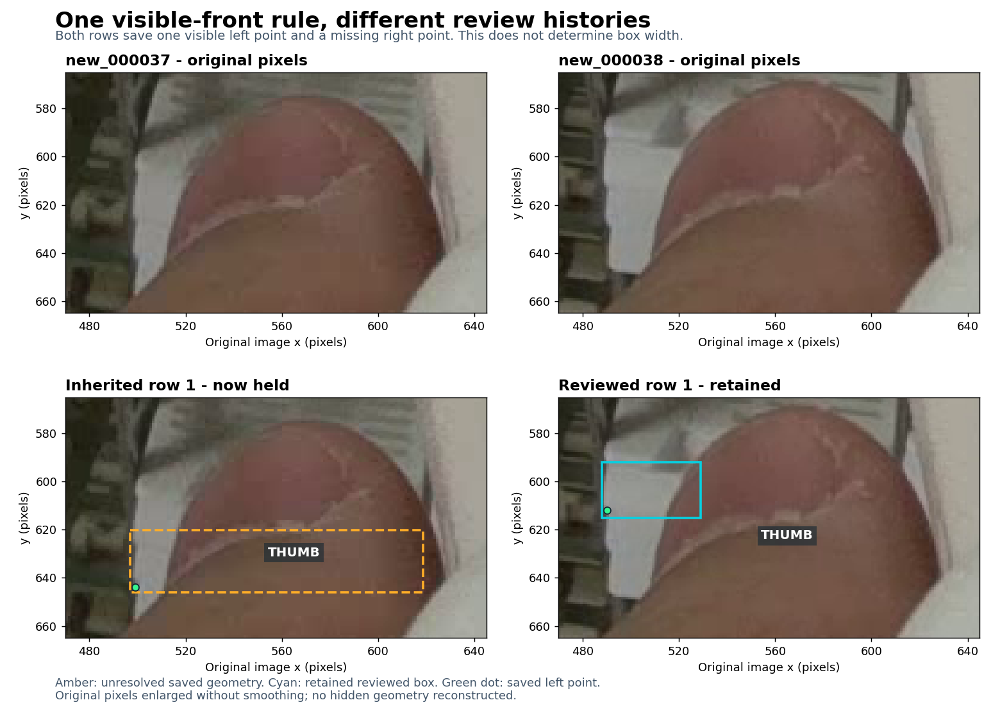

# Why new037 and new038 row 1 have different boxes

> Historical review snapshot. The [complete visible-front sweep and prepared handoff](complete-label-review-2026-11-14.md) supersedes the current-status counts in this report; its original evidence remains preserved.

**The comparison exposes an inherited annotation inconsistency. Missing-corner count does not select a full-width versus visible-only box rule.** `new_000037` row 1 still has its original broad box; `new_000038` row 1 received an explicit observed-front correction. This review flags the unsupported new037 geometry without guessing replacement coordinates.



## What the original images support

| Row 1 | Saved box `[left, top, right, bottom]`, original pixels | Saved corners | Decision |
| --- | --- | --- | --- |
| `new_000037` | `[497.00, 620.04, 618.82, 646.00]` | Left `(499,644,v2)`; right missing | Hold the visible extent and existing left-point ownership. Most of the rightward box extension covers the thumb. |
| `new_000038` | `[488,592,529,615]` | Left `(490,612,v2)`; right missing | Retain the previously reviewed upper-front annotation. Its observed right extent meets the thumb. |

In new037, the white wedge immediately left of the thumb is visible, but there is no supported portion of the same front on the right side of the old box to justify its width. The white material also continues above and below the saved vertical interval. A soft transition around y640-644 does not confidently settle which boundary belongs to the front, lip or neighbouring surface, or whether the saved left point is the required actual corner. An arbitrary trim to x518-520 would leave those questions unresolved.

In new038, the accepted row owns the upper of the three exposed fronts beside the thumb. The far-right light strip around x614-622 follows the gripper bevel; it does not supply another exposed portion of this front. The visible-front/hand boundary near x529 is an occlusion boundary, so it must not become a right-corner label. The existing [accepted adjudication](../results/review/label-refinement-20261114/visual/new_000038-accepted-adjudication.json) records approximately 3 px box-boundary and 2 px point-placement uncertainty. The saved coordinates are manual representatives, not subpixel physical measurements.

## Why the old atlas showed new037 in cyan

New037 row 1 is byte-identical in the original labels, fixed-geometry parent and current candidate. The [earlier reviewer](../results/review/remaining-training-20261114/reviewer-3.json) corrected row 11, while preserving missing endpoints elsewhere. The [ledger](../results/review/label-refinement-20261114/unresolved/ledger.json) explicitly states that resolving case `new_000037-101` by retaining missing points does not certify unrelated box fields.

The earlier cyan rendering therefore reflected the absence of a recorded row-level hold. It did not establish that this inherited rectangle complied with the observed-front rule. This pass adds the separate case `new_000037-row1-visible-extent`, affecting row 1 only. The unrelated `new_000037-100` question about the upper-border white assembly stays separate.

## One box rule and independent corner decisions

Use the tight axis-aligned rectangle enclosing all **observed portions of one identified front surface**. This is the [adopted local policy](annotation-policy.md#2-box-the-observed-front-face-extent), informed by the [historical upstream editor's visible-front instruction](https://github.com/an94-doll/embedding_vision/blob/6f7112a553e1759fc755bda1f18ee56cb34dd315/detect/data/data_last/picture/work/ANNOTATION_EDITOR.md#L19-L20). The current baomai README defines the actual corner target and missing-point representation but does not itself fully specify box extent.

- If only a narrow front fragment is visible, enclose that fragment.
- If visible portions of the same front establish both outer limits, their enclosing box can span an occluder between them.
- A broadly visible front can still have an unreliable corner because of local obstruction, blur or glare. Decide that corner separately.
- Do not expand outer bounds to an assumed hidden width because cassettes have equal physical size or because one corner is missing.

Complete projected extent including hidden areas would be a separate amodal target. It can be useful for a deliberately specified task, but it is not a better default for the present observed-reference dataset. Mixing these meanings would give similar images different target definitions. Preserve the present rule and keep context-derived geometry distinguishable, as already documented in [visible fronts and hidden predictions](visible-and-hidden-2026-11-14.md).

## Saved result and checks

The [new status revision](../results/review/extent-comparison-20261114/review-status.json) preserves every previous case and adds one held row. The candidate, all label bytes, source images and model weights remain unchanged. New038 stays as reviewed; new037 row 1 becomes amber on **PDF page 36**. Its saved left point remains visible in the preview as existing data under review, not as a newly accepted landmark. Page 37 remains new038.

Current review bookkeeping is **60 unresolved groups across 46 training photos**, with 102 amber rows. There are now 511 cyan rows with fewer than two saved visible corners. These counts describe review state, not model accuracy. The extra group does not add an unresolved photo because new037 already had a separate upper-assembly question.

The [comparison evidence](../results/review/extent-comparison-20261114/comparison.json), [atlas audit](../results/review/extent-comparison-20261114/atlas-audit.json) and [bounded verification](../results/review/extent-comparison-20261114/verification.json) record the exact images, labels and change. The atlas still covers 157 working photos in 163 pages. The candidate remains unreleased; no training or inference was run.

```bash
python -B scripts/render_label_atlas.py --root . \
  --candidate data/candidates/aperture-reviewed-labels-2026-11-14 \
  --status results/review/extent-comparison-20261114/review-status.json \
  --output /path/outside/repo/cassette-label-atlas-2026-11-14.pdf \
  --audit /path/outside/repo/atlas-audit.json
```
