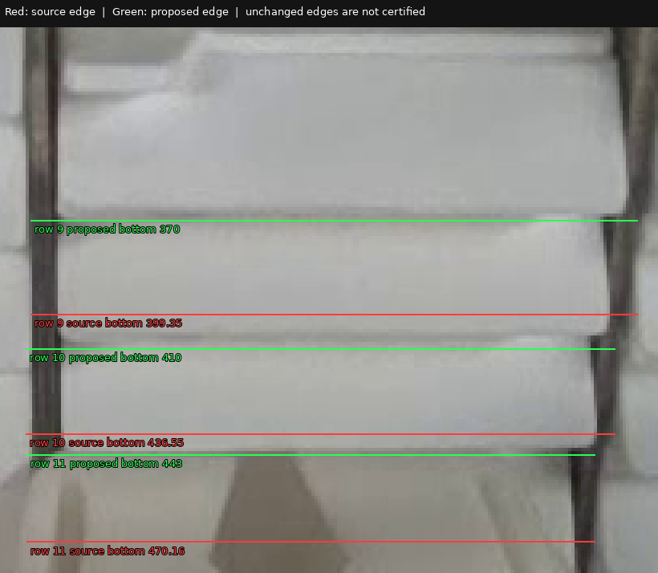

# Bounded training-box refinement — 2026-11-07

**Keep epoch173 as the working model.** The next concrete experiment corrects 16 supported box edges in three existing training images. The review and training path are prepared; a complete GPU comparison is still required before claiming model improvement. NMS remains 0.70 by default; the earlier 0.68 setting remains optional and is not mixed into this training experiment.

**Next action:** open the [GPU notebook](https://colab.research.google.com/github/Siuuuers/dl/blob/codex/baomai-training-supervision-20261107/notebooks/baomai_box_supervision.ipynb), select a GPU runtime, and run all cells. It downloads the required inputs itself and returns one `baomai-box-supervision-results.zip`. Its immutable training source is [`918b2fd`](https://github.com/Siuuuers/dl/commit/918b2fdb811bd595fc09de9a423df6c40258c55a). The notebook and this guide are published separately from that pinned training source.

## What the image review established

The reviewers examined all 104 rows in `new_000030` (29), `new_000012` (38) and `new_000128` (37), plus the empty `new_000131` control. Raw images were inspected before annotations. Every object identity, all 416 box edges and all 208 endpoint states were reviewed; the whole images were scanned for missing, extra or duplicate instances. The root reviewer independently inspected every proposed correction. No model predictions were used as annotation truth.

The [separate candidate](../data/candidates/box-refinement-2026-11-07/README.md) contains three label overlays. Its manifest preserves the source hashes, exact old/new rows, numerical coordinates and reasons; its review record preserves the complete primary ledgers and final adjudications. The [evidence archive](../results/review/baomai-box-supervision-20261107/evidence.zip) preserves originals and crops for later review.

| Image / original row | Edge | Source px | Proposed px | Supported correction |
| --- | --- | ---: | ---: | --- |
| `new_000030` / 9 | Bottom | 399.348504 | 370 | Exclude the next central-stack front |
| `new_000030` / 10 | Bottom | 436.545004 | 410 | Exclude the next front |
| `new_000030` / 11 | Bottom | 470.159399 | 443 | Exclude the gripper below the face |
| `new_000030` / 23 | Bottom | 437.183096 | 416 | Exclude the next right-stack front |
| `new_000030` / 24 | Bottom | 467.511199 | 449 | Exclude the next front |
| `new_000030` / 25 | Bottom | 500.262800 | 483 | Exclude the next front |
| `new_000030` / 26 | Bottom | 526.572004 | 514 | Exclude the rack below the last front |
| `new_000030` / 29 | Top | 381.019997 | 418 | Separate its box from the distinct row-6 front above |
| `new_000012` / 15 | Bottom | 180.029398 | 167 | Exclude a band of the next front |
| `new_000012` / 16 | Bottom | 227.025500 | 214 | Exclude a band of the next front |
| `new_000012` / 26 | Left | 772.731002 | 813 | Exclude gripper material outside the visible fragment |
| `new_000012` / 27 | Left | 767.356205 | 831 | Exclude gripper material outside the visible fragment |
| `new_000012` / 37 | Right | 609.611795 | 509 | Exclude thumb beyond the visible fragment |
| `new_000012` / 38 | Right | 607.340301 | 497 | Exclude thumb beyond the visible fragment |
| `new_000128` / 10 | Bottom | 90.799999 | 64 | Exclude the neighboring lower front |
| `new_000128` / 11 | Bottom | 126.159998 | 118 | Exclude the metal rack below the front |

The proposed integers are conservative original-pixel boundary estimates, not subpixel measurements. All 104 row identities, all class tokens and all endpoint tokens remain unchanged. Neither overlap nor missing corners were used to delete objects. The empty control retains its original zero-byte label.



In this preserved review crop, red marks the original lower edges and green marks the proposed edges. The original boxes extend into the next front or the gripper. The proposal changes only those reviewed edges; the figure does not certify the unchanged edges. The full-resolution original and the other review crops remain in the physical-evidence archive.

**Complete inspection does not mean complete certification.** Seven identities remain unresolved: `new_000030:12`, `new_000012:23`, and `new_000128:1,6,9,12,19`. Several upper and occlusion boundaries remain uncertain, including tops that visibly clip the face. These legacy fields remain explicitly recorded under the policy's incremental-experiment provision. The candidate does not claim full compliance, human approval or a new scoring reference. The selected images are a targeted review, not a random annotation-error sample.

## The experiment declared before full training

The question is whether these 16 corrections improve the final model relative to the same training run on the original labels. Both arms initialize freshly from the original epoch173 checkpoint. The prior eleven-row deletion overlay is not combined with this change.

| Setting | Reference arm | Candidate arm |
| --- | --- | --- |
| Labels | Original frozen labels | Original labels plus these 16 box edges |
| Recipe ID | `box-supervision-warmup-v1` | Same |
| Initial weights | Original epoch173 | Same original bytes |
| Training set | 137 images; 3,772 objects; 6,839 visible corners | Same counts and image bytes |
| Validation | Original 20 images and all labels | Byte-identical |
| Schedule | 30 epochs; final `last.pt`; seed 42 | Same |
| Optimizer and resolution | AdamW; batch 4; image size 1280; FP32 | Same |
| Nominal LR / bias warmup LR | 0.0001 / 0.0001 | Same |
| Software / GPU / backend | One pinned source and shared session | Same |

The low bias-warmup schedule is the already studied numeric recipe from the [warmup experiment](warmup-comparison-2026-11-07.md), now held equal across both label arms. This is an experimental control choice; it does not adopt the prior warmup checkpoint or retrospectively change its result. The new recipe ID distinguishes the label question while intentionally sharing the numeric recipe SHA with that schedule. The original default recipe and historical reference-only warmup guard remain unchanged.

Keep every other setting fixed, including augmentation, losses, gradient accumulation and checkpoint selection. Both arms use the same software and GPU session. A resource trial preserves the 30-epoch schedule but stops after four actual batches and yields no eligible checkpoint. No inference threshold tuning is part of the experiment.

## Run the GPU comparison

Open [baomai_box_supervision.ipynb](../notebooks/baomai_box_supervision.ipynb) in Colab, select a GPU runtime, and run the cells in order. The notebook pins an immutable training source, clones a fresh checkout, obtains only the original images and epoch173 through Git LFS, preserves the existing CUDA PyTorch installation, installs `ultralytics==8.4.182`, verifies the inputs, runs the resource trial and then the two full runs sequentially. It packages one `baomai-box-supervision-results.zip` to return for evaluation.

The notebook refuses to reuse its output directory. If a run fails, retain its log/receipt and start a fresh comparison directory after resolving the error. Do not silently lower image size, batch size or epochs to fit a device; that would change this experiment. RAM and wall-time settings are stop budgets, not expected usage or a completion promise. A short trial does not establish full validation/finalization memory requirements.

For an already prepared clean checkout at the notebook's pinned revision, the core commands are:

```bash
python scripts/train_pose_comparison.py \
  --trial --arm candidate --recipe box-supervision-warmup-v1 \
  --candidate data/candidates/box-refinement-2026-11-07/manifest.json \
  --device 0 --threads 4 --trial-batches 4 \
  --max-seconds 600 --max-rss-mib 12000 \
  --output ../box-supervision-trial-001

python scripts/train_pose_comparison.py \
  --train --arm reference --recipe box-supervision-warmup-v1 \
  --candidate data/candidates/box-refinement-2026-11-07/manifest.json \
  --device 0 --threads 4 --max-seconds 21600 --max-rss-mib 12000 \
  --output ../box-supervision-reference-001

python scripts/train_pose_comparison.py \
  --train --arm candidate --recipe box-supervision-warmup-v1 \
  --candidate data/candidates/box-refinement-2026-11-07/manifest.json \
  --device 0 --threads 4 --max-seconds 21600 --max-rss-mib 12000 \
  --output ../box-supervision-candidate-001

python scripts/package_gpu_results.py \
  --reference ../box-supervision-reference-001 \
  --candidate ../box-supervision-candidate-001 \
  --output ../baomai-box-supervision-results.zip
```

Both full runs start from epoch173, not from the trial or each other. The packer checks the source, runtime, selected inputs, recipe, completed epochs and exact archived artifacts. It refuses incomplete or mismatched pairs. The ZIP contains final weights, provenance, results and logs for both arms; return it unchanged.

## What was actually executed before the handoff

The interrupted work was recovered without treating its last progress message as a successful run. Two saved reference-arm CPU attempts each reached one parameter-changing optimizer update but failed before their requested four batches. A new, explicitly one-batch candidate smoke check then completed at the clean, published training source.

| CPU execution | Requested / completed batches | Result | Sampled peak host RAM |
| --- | --- | --- | ---: |
| Recovered reference trial 001 | 4 / 1 | Failed; configured 6,000 MiB RSS guard stopped it | 6,238.46 MiB |
| Recovered reference trial 002 | 4 / 1 | Failed; process exit -9, cause not established by the receipt | 6,297.60 MiB |
| New candidate smoke 001 | 1 / 1 | `trial-complete`, exit 0; one actual optimizer update | 5,767.55 MiB |

The successful candidate check processed four images in 17.05 seconds under a 120-second, 6,500 MiB stop budget, using two CPU threads, FP32 and the unchanged numerical recipe. It verified the complete selected-arm train and validation loaders against the staged file hashes and counts. Its first batch did **not** contain any of the three edited images: this proves candidate input routing and a working optimizer path, not a changed-label gradient or a learning benefit. No epoch, validation pass or eligible checkpoint completed. The actual trial receipt is rejected by the completed-checkpoint writer without changing the receipt or creating a manifest.

The two recovered failures recorded source `aa75df96abc31cf9f15fa23136dce342504b9cc7`, whose complete Git tree equals published `918b2fdb811bd595fc09de9a423df6c40258c55a`. Their original receipts retain the actual executed SHA. All seven recorded training-source file hashes match the published source. The new successful candidate run directly records the published SHA.

Independent review passed 63 existing focused checks, two checks of the new notebook's actual setup cell, and a synthetic matched-box package/restore probe. The embedded notebook preflight verified all 157 original images and the original checkpoint bytes. All seven delivered code cells compile, and the source placeholder is resolved. The packaging probe uses synthetic artifacts; it is not evidence of completed GPU training.

The [execution verification record](../results/verification/baomai-box-supervision-20261107/verification.json) and [compact evidence ZIP](../results/verification/baomai-box-supervision-20261107/execution.zip) preserve commands, raw receipts, logs, staged YAMLs and review checks. The notebook still requires its four-batch resource trial on the actual GPU before full training. Colab execution and full validation/finalization resource usage have not been qualified here.

## Decide after the returned models are evaluated

Run epoch173, the fresh reference arm and the corrected-label arm together in one evaluator environment on the unchanged development reference. Preserve image size 1280, rectangular preprocessing, batch 1, FP32, ordinary NMS IoU 0.70, `max_det=300`, matching IoU 0.50, endpoint confidence 0.50 and box thresholds 0.15/0.25/0.40. The primary decision uses 0.25.

Before adoption, require the corrected-label model to be no worse on all five unrounded primary measures and better on at least one **against both epoch173 and the matched reference arm**: missed objects, total false positives, missing visible endpoints, conditional median endpoint error and conditional p95 endpoint error. Missing statistics fail the rule. Do not replace this with the trainer's `best.pt` or console pose metric.

Also report common-endpoint comparisons, both-corner radius success with missed objects in the denominator, empty-image false detections and output points on reference-unlocatable corners, each with its denominator. Five-pixel summaries remain descriptive, not a deployment requirement. If results trade misses against extras, preserve the current model and report the tradeoff; the user has not assigned a cost preference.

This is one seed on a repeatedly used development set. Passing this gate supports a bounded candidate decision, not independent generalization or deployment certification. Correcting existing supervision can be tested without collecting new data; it cannot supply unseen-scene evidence or recover corners absent from the pixels.
