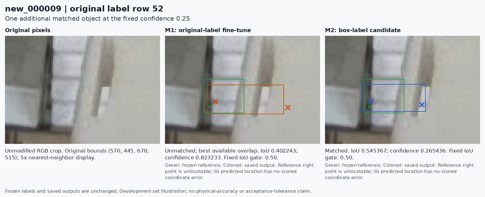
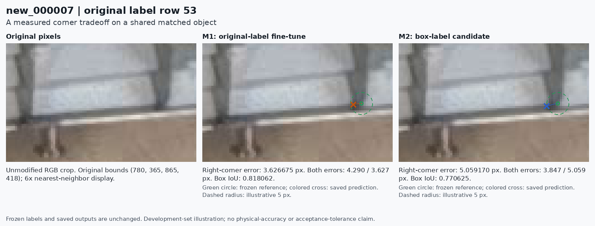

# Reviewed training boxes: detection gains with a corner tradeoff

**Decision, 2026-11-07: retain M0 epoch173 as the default. Preserve the corrected-box model as a promising candidate.** The returned GPU pair is complete and internally consistent. The corrected-box model improves all five primary measures against M0, but its 95th-percentile corner error is worse than the matched original-label reference. It therefore does not pass the requirement declared before training: no worsening on all five measures and at least one improvement against **both** comparators.

The difference is small: **+0.092074 pixels in p95 against the matched reference**. This is a measured difference on this development reference, not proof of a physically meaningful or repeatable regression. Its size does not authorize adding a tolerance after seeing the result. No default model, inference threshold, reference label or historical experiment decision changes.

The completed GPU results are in [PR #23](https://github.com/Siuuuers/dl/pull/23), pinned at [`161f5f2`](https://github.com/Siuuuers/dl/commit/161f5f20f3aef543cbe2a291db8d510b1123e769). The [pre-training plan](https://github.com/Siuuuers/dl/blob/99c8df3116a17984dcf5d0e0421495b6c633b95d/docs/box-supervision-2026-11-07.md) remains the selection contract. The successful GPU pair does not need to be rerun to complete this evaluation.

## The comparison that isolates the label change

| Model | Role | Evaluated checkpoint |
| --- | --- | --- |
| M0 | Current working model; no new training | Original epoch173 |
| M1 | Fresh reference using original labels and the low-bias recipe | Finalized epoch-30 `reference/fit/weights/last.pt` |
| M2 | Same recipe with the reviewed box overlay | Finalized epoch-30 `candidate/fit/weights/last.pt` |

Both training arms start from the same epoch173 bytes and use `box-supervision-warmup-v1`: seed 42, 30 epochs, batch 4, image size 1280, AdamW, nominal learning rate 0.0001 and bias warmup learning rate 0.0001. The intervention changes 16 box edges in three existing training images. All object rows, classes and endpoint tokens remain identical; neither the earlier deletion overlay nor the quarantined additional images is included.

**M2 versus M1 isolates the label intervention.** M2 versus M0 combines further training and the label intervention. The larger gains over M0 must not all be attributed to the corrected boxes.

Both arms retain 137 training images, 3,772 objects and 6,839 visible endpoints. The frozen development reference retains 20 images, 664 objects and 1,227 visible endpoints. Of the objects, 584 have both reference corners locatable, 59 have one and 21 have neither. All still count in object detection. Three images are empty.

## Primary measured result

Fresh inference used one shared CPU environment and identical settings for all three models: original 1280 × 720 images, `imgsz=1280`, rectangular preprocessing, batch 1, FP32, ordinary NMS with IoU 0.70 and `max_det=300`. The primary box confidence is **0.25**, matching IoU **0.50**, and endpoint confidence **0.50**. All 180 image/model/threshold records completed, including diagnostic box thresholds 0.15 and 0.40.

Corner errors are conditional on a reference-visible endpoint being returned on a matched object. The missing-endpoint count separately includes visible reference endpoints lost through detection or endpoint filtering.

| Measure | M0 epoch173 | M1 original-label reference | M2 corrected boxes |
| --- | ---: | ---: | ---: |
| Missed objects, FN | 39 | 37 | **36** |
| Extra detections, total FP | 63 | 60 | **59** |
| Missing visible endpoints | 43 | 37 | **36** |
| Conditional median corner error, px | 1.611790 | 1.610761 | **1.602810** |
| Conditional p95 corner error, px | 5.161683 | **5.004297** | 5.096371 |
| Matched objects / 664 | 625 | 627 | 628 |
| Returned visible endpoints / 1,227 | 1,184 | 1,190 | 1,191 |
| Duplicate FP, already included in total FP | 17 | 13 | 14 |
| False detections across the three empty images | 0 | 0 | 0 |

M2 has **three fewer misses, four fewer extras and seven fewer missing endpoints than M0**. Its median and p95 are also lower. Against M1, it has **one fewer miss, one fewer extra and one fewer missing endpoint**, and a median improvement of 0.007951 px, but a p95 increase of 0.092074 px. That last measure fails the second required comparison.

The machine-readable decision is `retain-M0`; `candidate_meets_rule_against_both_controls` is false and `predeclared_adoption_eligible` is empty. M1 is a control in this experiment. Its pass against M0 does not newly authorize adopting the earlier warmup result, whose own experiment did not meet its declared requirement.

The [comparison JSON](box-supervision-comparison-2026-11-07.json) preserves unrounded values, all thresholds, model identities and the exact decision. Display rounding does not determine eligibility.

### Detection gains are modest and threshold-sensitive

M2 retains all **627 objects matched by M1** and gains exactly one: `new_000009`, original label row 52. The qualifying M2 box has confidence **0.265436** and IoU **0.545367**. At the primary threshold, M1's strongest available overlap has confidence 0.823233 but IoU 0.402243, below the fixed 0.50 matching gate. This reference object has only one locatable corner; the other lies behind the gripper and receives no coordinate-error score.



The candidate box is narrower and overlaps the visible fragment enough to pass the gate. Both displayed model boxes still include occluder material. This figure supports the measured match change, not a claim that the candidate has found the exact physical face boundary. Its confidence is close to the operating threshold.

Both M1 and M2 output 687 predictions at the primary setting. Duplicate extras increase from 13 to 14 while other extras decrease from 47 to 45. Describe the net result as **one fewer extra detection**, not one duplicate removed.

| Box confidence | M1 FN / FP | M2 FN / FP | M1 p95, px | M2 p95, px | M2 passes against M1? |
| --- | ---: | ---: | ---: | ---: | --- |
| 0.15, diagnostic | 30 / 83 | 30 / 82 | 5.017441 | 5.115893 | No |
| **0.25, primary** | **37 / 60** | **36 / 59** | **5.004297** | **5.096371** | **No** |
| 0.40, diagnostic | 40 / 44 | 41 / 44 | 5.004953 | 5.091912 | No |

The detection advantage is not uniform across thresholds. The diagnostic settings do not replace the primary rule, and the optional NMS 0.68 experiment remains separate.

## The corner tradeoff survives an identical-endpoint comparison

Comparing conditional errors can be misleading if a model recovers additional difficult endpoints. Here, M2 retains **all 1,190 visible endpoints returned by M1** and adds one with error **3.485439 px**, below either model's p95.

On those exact same 1,190 endpoint IDs, M1 p95 is **5.004297 px** and M2 p95 is **5.096383 px**. Thus the tail increase is not caused by the newly returned endpoint. Across the shared endpoints, **599 errors improve and 591 worsen**. Mean paired error change is **+0.002290 px**, while median paired change is **−0.000694 px**. These mixed changes do not support uniform coordinate improvement.

The three-model intersection contains 1,184 endpoints:

| Error on the identical 1,184 endpoints | M0 | M1 | M2 |
| --- | ---: | ---: | ---: |
| Mean, px | 1.990022 | 1.997294 | 1.999793 |
| Median, px | 1.611790 | 1.610431 | 1.601532 |
| p95, px | 5.161683 | 5.005608 | 5.096459 |

### Both corners on the same object

These diagnostics require both corners to be returned within the stated radius. The denominator is **all 584 objects with two locatable reference corners**, including missed objects. The radii remain illustrative, not application acceptance tolerances.

| Both corners within radius | M0 | M1 | M2 |
| --- | ---: | ---: | ---: |
| 2 px | 263 / 584 | 270 / 584 | 272 / 584 |
| 5 px | 521 / 584 | 524 / 584 | 519 / 584 |
| 10 px | 568 / 584 | 573 / 584 | 573 / 584 |

At 5 px, six M1 object successes become failures under M2, while one failure becomes a success: a net decrease of five. Nine shared endpoints cross above 5 px and two cross below it. The newly recovered one-corner object adds one individual endpoint success but cannot add a two-corner success.



In `new_000007`, original row 53, the right-corner error increases from **3.626675 to 5.059170 px**, while the left corner improves. This selected example illustrates a measured tradeoff. The raw contour is soft, and the frozen reference is not a certified subpixel physical measurement. The complete result uses all reference objects, not just the pictured examples.

The reference also contains 101 unlocatable endpoint slots. On matched objects, M0 emits a threshold-qualified point for 61 of 66 such slots; M1 for 59 of 64; M2 for 60 of 65. These counts do not score hidden coordinates or certify physical visibility. A confident output on an occluded corner remains a prediction.

## What the returned artifacts establish

The original ZIP has **39,775,283 bytes**, SHA-256 `20d3138d5dcc35b03ab218f9cdd7e6e9b7cc327795f34f26be225a765b2c3009`. All 13 members have safe, unique paths and valid CRCs; all 12 payload hashes and sizes match the archive manifest. Both checkpoint bundles pass the pinned completion, pairing, identity and final-checkpoint checks.

| Recorded completion, corroborated by logs and CSV | Reference | Candidate |
| --- | ---: | ---: |
| Completed epochs | 30 | 30 |
| Batches | 1,050 | 1,050 |
| Image presentations | 4,110 | 4,110 |
| Recorded actual optimizer updates | 78 | 78 |
| Supervisor wall time, seconds | 394.47 | 391.23 |
| Sampled peak host memory, MiB | 3,026.70 | 3,034.04 |
| Process exit code | 0 | 0 |

Both runs record clean training source [`918b2fd`](https://github.com/Siuuuers/dl/commit/918b2fdb811bd595fc09de9a423df6c40258c55a), the same NVIDIA A100-SXM4-40GB runtime, Python 3.13.16, Torch 2.14.1+cu130, CUDA 13.0 and Ultralytics 8.4.182. All 114 resolved training settings agree except three output/data paths. The 157-image inventories and both label variants were reconciled with the pinned originals and the exact three overlays. All seven recorded source-file hashes match the pinned Git blobs.

The third sampled batch contains corrected images `new_000012` and `new_000030` in both arms. Its loss differs between arms and both record a parameter-changing optimizer update. This closes the earlier one-batch CPU smoke's limitation: the returned evidence now shows changed supervision reaching training. Lower sampled training loss does not establish better validation performance.

The recorded configuration disables AMP, but enables cuDNN TF32 and deterministic algorithms in warning-only mode. The matched environment is verified; uniformly full IEEE FP32 arithmetic or guaranteed bitwise GPU reproducibility is not claimed. The ZIP omits staged images/labels and the remote environment. Recorded inventories were independently reconciled and YAML bytes reconstructed from pinned code and recorded paths; this is not direct reinspection of every omitted remote file or hardware attestation.

The evaluated checkpoint SHA-256 values are:

| Checkpoint | SHA-256 |
| --- | --- |
| M0 epoch173 | `e0aab1b377491700318e0b14cd4c558ec3c1684087a13b7dde2298ebdbf2847e` |
| M1 reference | `5090f3cd4b064a48e188ffb6e00d0113f77f8910215c5fa5c006b2b62cefcb41` |
| M2 candidate | `da4a31ec6f468ca3503d786c0790d0e63b229a9a71d237eae60636895ef01bc5` |

## Independent verification and replay

All three models were evaluated from clean source `918b2fd` in a common CPU runtime: Python 3.12.14, Torch 2.10.0+cpu, torchvision 0.25.0+cpu and Ultralytics 8.4.182. A separate standard-library implementation independently parsed frozen labels, performed matching and recomputed all 180 per-image count/match records, nine aggregates and corresponding radius diagnostics. The final comparison was replayed from clean published summarizer source [`66ba976`](https://github.com/Siuuuers/dl/commit/66ba9760935701694ce115b4b6c14ffeb146e5d9).

The added `scripts/summarize_box_comparison.py` reuses the existing scorer and completion audit. It additionally requires this exact box recipe, candidate identity and unchanged training-source hashes, and treats M1 as control-only. Focused negative probes reject altered saved scores, an older recipe identity with the same numerical recipe hash, and mismatched inference settings. Missing or inconsistent evidence cannot qualify a candidate.

The fresh M0 matches all 60 prior M0 prediction records, and the fresh M1 matches all 60 previous warmup prediction records, excluding only the two timing fields. This confirms continuity in the recorded outputs. Checkpoint-file byte identity and independent-seed replication do not follow from that parity.

The [verification record](../results/evaluation/baomai-box-supervision-a100-001/verification.json), [compact evaluation ZIP](../results/evaluation/baomai-box-supervision-a100-001/evaluation.zip) and [archive checksum](../results/evaluation/baomai-box-supervision-a100-001/evaluation.zip.sha256) preserve raw predictions, quality records, small checkpoint bundles, training-artifact audit, commands, independent calculations and figure coordinates. Model weights remain in the original PR #23 return.

With a checkout containing the summarizer and the original validation PNGs hydrated through Git LFS, extract the capsule into a new directory and replay its saved predictions:

```bash
python scripts/summarize_box_comparison.py \
  --root /path/to/hydrated-dl \
  --evidence /path/to/extracted/evidence \
  --output /path/to/new-comparison.json
```

The replay uses the standard library, does not deserialize weights and refuses an existing output path. Use the recorded Python version for the closest floating-point reproduction; last-bit differences across numerical runtimes do not create an application tolerance. The archive's README gives the exact restore and verification procedure.

## Readiness and the next bounded question

**The supported use remains human-reviewed localization of supplied still images.** At the primary box confidence of 0.25, all 17 nonempty validation images still have at least one measured miss or extra detection for every model. All three empty images have zero detections at all three thresholds, but three empty scenes cannot establish a general false-alarm rate. The dataset is small, related observations are not independent trials, and the development images have already been used repeatedly for selection.

This experiment has answered its declared question for seed 42. Keep the 16 reviewed corrections and M2's artifacts; a failed conservative adoption gate does not show that the corrections were wrong. Do not edit validation labels to make this candidate pass, invent hidden corner coordinates, add a post-result p95 tolerance, or select an alternative confidence threshold after seeing the comparison.

**Recommended next experiment: test whether the detection/corner tradeoff repeats across a small, predeclared set of matched seeds.** Preserve this completed seed-42 result. Before any new training, fix the additional seeds, run both original and corrected labels for each seed, hold the current recipe and final-checkpoint rule constant, and specify how all runs will be summarized. Report every paired difference; do not select the best seed or reinterpret this round as a pass. This proposal measures training variability on the same development set and does not supply unseen-scene evidence. It is a next experiment proposal, not an already executed study or a replacement adoption rule.

There is no evidence here that a larger model, more epochs or a new architecture is the next necessary step. Resolving remaining annotation uncertainty can continue through image-first review with explicit unresolved fields. A future unattended-use decision additionally needs an application error budget and genuinely independent evidence. The existing still-image workflow, target definition and default epoch173 remain sufficient to continue the current human-reviewed work.
