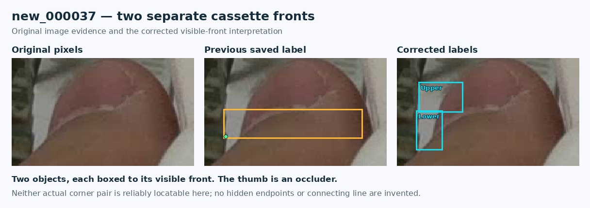

# Complete visible-front sweep and prepared training handoff

**The analogous-label sweep is complete. Accepted repairs are composed; physical questions remain, so GPU training is blocked.** The user-confirmed two cassettes beside the thumb in `new_000037` now have separate cyan boxes. This report supersedes the earlier extent-comparison status without rewriting its historical evidence.

## What changed

Every one of the **137 training originals** was inspected in full context, together with **all 577 input rows having fewer than two locatable corners** and all **60 previously open training groups**. Obvious analogous full-point box errors encountered in context were also reviewed. This is not a precise independent certification of every other endpoint, every empty label, or future deployment scenes.

Relative to the preceding aperture-reviewed candidate:

| Accepted change | Count |
| --- | ---: |
| Existing rows refined | 364 |
| Distinct observed fronts added | 22 |
| Duplicate rows removed | 1 |
| Training photos with a new label change | 80 |
| Effective overlay files, including compatible earlier repairs | 92 |
| Previous open groups resolved | 45 of 60 |
| Newly recorded unresolved groups | 11 |
| Remaining training groups / photos | 26 / 23 |

The cumulative composition against the frozen fixed-geometry parent contains **513 replacement, 26 addition and 8 deletion operations**. These cumulative counts differ from this pass's delta because later edits are combined by stable original-row or addition identity. Earlier manifests, source PNGs, source labels and model artifacts are preserved.

### new037: two real fronts, two independent boxes

| Current row | Accepted box in original 1280 x 720 pixels | Actual lower corners |
| --- | --- | --- |
| 16, newly added upper front | `[499,596,538,623]` | Both unlocatable: `0 0 0` |
| 1, corrected lower front | `[497,621,520,656]` | Both unlocatable: `0 0 0` |

The former row1 box extended across the thumb. Its old left point did not reliably identify the actual lower-front corner and is now missing. The confirmed count supports two instances; it does not create visible hidden corners. The separate broad white assembly above the rack remains a different physical-identification question.

Other accepted examples include two aperture fronts each in new094/new127, the lower aperture front in new012, thumb-side omissions, and the duplicate new112 top row. For new112, old current10 is removed; old current36/original37 is retained with its two existing corners and becomes **current35**. New026's previous `(468,665)` point was the hand intersection; the observed lower-left junction is nominally `(450,679)`.

The disputed lower triangle in new030 was **not added**. Two reviewers and the root inspection could not distinguish a second front from the same cassette's underside/shadow using that transition. Its existing row12 stays held; the separately supported border and right-front repairs were accepted.

## The physical rule and what cyan means

The [current upstream baomai README](https://github.com/an94-doll/embedding_vision/blob/351eb3cf960ccc34829e2bc72e1fa4645acc6295/data/README.md) defines the two actual lower-front corners and independent missing slots. The [historical editor instruction](https://github.com/an94-doll/embedding_vision/blob/6f7112a553e1759fc755bda1f18ee56cb34dd315/detect/data/data_last/picture/work/ANNOTATION_EDITOR.md) informs the project's [observed-front box policy](annotation-policy.md). The older editor is not a replacement for the current lower-front point target.

Use one tight axis-aligned rectangle enclosing the observed portions of one identifiable front. If the same front is visible on both sides of a jaw, its rectangle can legitimately contain jaw pixels between them. A fragment visible only on one side does not justify extending the box through hidden material. Equal physical sizes and fixed seating help assign the visible pieces; perspective and occlusion still change their image extents.

A cyan box can have zero, one or two locatable corners. Amber denotes an unresolved identity, extent or point-ownership question. Making a correct missing slot `0 0 0` does not require retaining amber. The atlas now has **27 amber training rows across 21 photos**, down from 102 across 36. It contains **568 cyan training rows with zero or one locatable corner**. Image-level questions can concern an omitted object without an amber row.

Coordinates are nominal manual choices on a finite raster. Recorded pixel uncertainties are review estimates, not calibrated metrology. In particular, new053's narrowed upper-frame sliver is supported, but its blurred termination around x690-700 has no certified four-pixel bound.

## Data identities and counts

| Training supervision | Photos | Objects | Locatable slots | Missing slots | Empty photos |
| --- | ---: | ---: | ---: | ---: | ---: |
| Actual retained PR35 inputs | 137 | 3,771 | 6,841 | 701 | 13 |
| Previous aperture-reviewed candidate | 137 | 3,770 | 6,854 | 686 | 13 |
| New complete-visible-fronts candidate | 137 | **3,791** | **6,861** | **721** | 13 |

The increase in missing slots mostly reflects newly included partly occluded objects. It is an annotation inventory change, not a model miss rate or accuracy result. Seven existing rows receive explicitly reviewed endpoint changes; three new additions contain directly observed left corners. Other added corners remain missing.

The original in-training validation split stays **20 photos / 664 objects / 1,227 locatable / 101 missing / 3 empty** in both arms. A separate [development reference](../data/references/visible-front-completion-2026-11-14/README.md) contains nine accepted bbox refinements across nine photos, no count/endpoint changes, and **663 objects / 1,227 locatable / 99 missing / 3 empty**. Its **13 held rows across nine photos** remain explicit. This reused development reference is not an independent final test.

Candidate SHA-256: `9d138930b523fc8d124e116a58aa584a23c30a81d874551fcb5625a1978639a8`.

Protocol SHA-256: `a501eddce8fcf9b0361583e64b1a308a85ddef223f72d9f6788927ecba0278ef`.

## All-photo atlas

The **166-page PDF** covers all **157 original working photos**, including 16 empty-label photos, with native-resolution photo review copies, vector boxes/points/lines, clickable indices and bookmarks. The original PNGs remain authoritative for individual-pixel decisions. Focus pages use lossless original-pixel crops.

| PDF pages | Contents |
| --- | --- |
| 1-4 | Scope, legend and complete photo index |
| 5 | Accepted new037 two-front correction |
| 6 | Separate new037 upper assembly question |
| 7 | new030 aperture plane/count question |
| 8 | new117 underside versus separate-front question |
| 9 | new128 clipped-strip ownership question |
| 10-166 | Every training/development photo |

The full new037 photo is **page 39**. The [remaining-questions table](remaining-physical-questions-2026-11-14.md) maps all unresolved families to current row numbers and PDF pages.

PDF SHA-256: `94c5956535b137d8009021162a65154747879c1b2fe6ec1eef012b3acdd34bc4`. The PDF is delivered separately; the [atlas audit](../results/review/complete-labels-20261114/atlas-audit.json) records every source/label identity and page.

## Prepared notebook and exact next experiment

Use [baomai_observed_fronts.ipynb](../notebooks/baomai_observed_fronts.ipynb), not the PR62 occlusion notebook. **The notebook is prepared but blocked by 26 training groups and 13 development-reference rows.** Resolving them requires reviewed labels and a newly pinned protocol; changing a color/status field or deleting a review record does not pass the inventory checks.

The resumed notebook pins implementation commit `283beafb6e93b231e035a2a28cda82bd76d911d0`, which contains the exact recovered candidate and protocol above. Its source tree is identical to the reviewed interrupted implementation. The notebook is added in a later commit so the pinned implementation can be fetched independently. These fixed inputs still contain the recorded review holds; resolving them requires a new reviewed and pinned revision.

After the physical questions are resolved, the handoff performs one four-batch candidate resource trial and one matched pair:

- Reference: exact eight-file `annotations-2026-11-10` supervision used for retained PR35.
- Candidate: the new reviewed composition.
- Both: independently initialized original epoch173, seed 46, 30 epochs, batch 4, input 1280, FP32, AdamW at 0.0001, same runtime and frozen validation.
- Preselected checkpoint: each final `last.pt`. Completed results and receipts are preserved in Drive; failed results are kept for diagnosis. No automatic model promotion occurs.

The current PR35 weights still reflect the older labels. Editing labels does not change them. The next comparison tests object recovery, duplicates/false proposals, zero/one/two-locatable groups, all-object denominators and both-corner success within 5/10 original-image pixels. The established first comparison uses box 0.13 and endpoint 0.5; these are experiment settings, not calibrated probabilities or established application tolerances. Prediction lines require both endpoint scores to pass their gate; predicted scores do not prove physical visibility.

### Verification and implementation

The frozen composer and historical validators remain unchanged. An isolated replay restores the exact archived versions of its two historically pinned support scripts, allowing the live training integration to add the new recipe without weakening old evidence checks. The previous candidate reconstructs byte-for-byte. The new candidate also reconstructs exactly, and all 157 source image/label identities, canonical missing states, bounds and retained-point containment are checked.

The runtime adapter reconciles every prior case and discovered issue against hash-bound batch evidence; recomputes all 577 input partial rows from actual label bytes; verifies exact PR35 control labels; and blocks when training or development questions remain. The actual staging call was checked to fail **before creating a staging directory**. Twenty-eight focused guard tests and eight legacy composed-training checks pass. All seven notebook code cells parse, with no execution outputs. The GPU path has not been executed.

All 157 PDF photo pages have exact vector box/point/line counts matching their labels, native 1280x720 photo dimensions, source hashes and return links. Selected guide, focus, repaired, empty and final pages receive visual layout QA. Full records are in [verification](../results/review/complete-labels-20261114/verification.json) and [atlas QA](../results/review/complete-labels-20261114/atlas-qa.json).

No GPU training, new inference, merge, model replacement or improvement claim is made. PR35 remains selected while the concrete questions are resolved.
