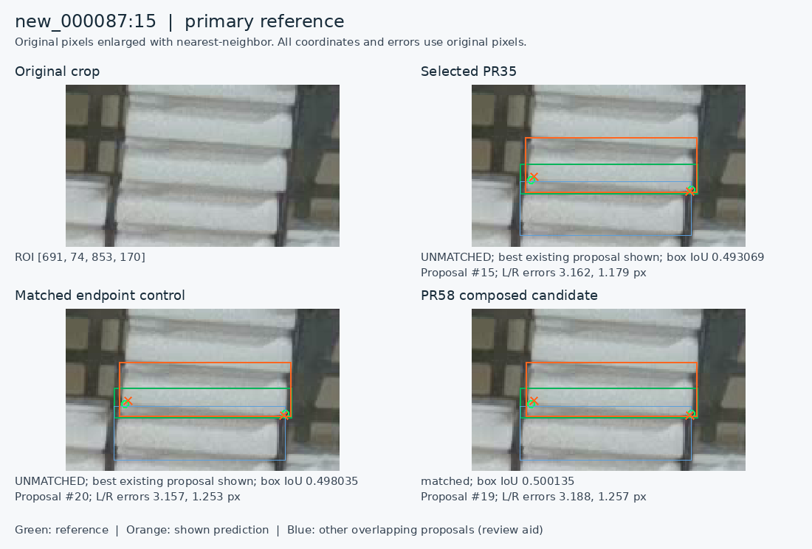
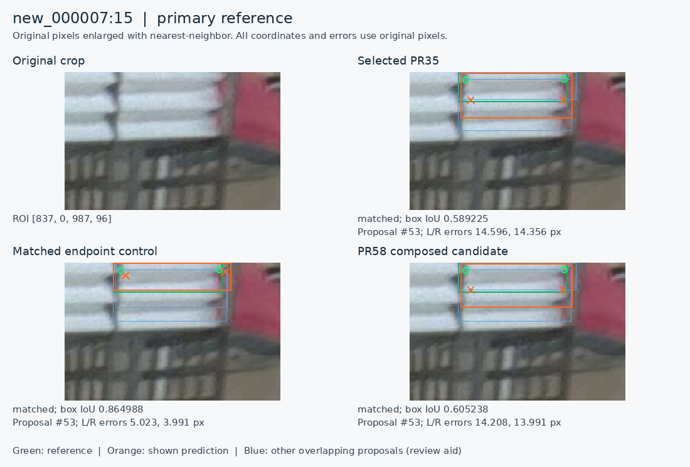

# PR58 composed-label result: keep PR35 selected

**Decision, 2026-11-13: keep the PR35 checkpoint at `imgsz=1280`, box confidence `0.13`, ordinary NMS IoU `0.70`, and endpoint confidence `0.50`.** PR58 completed its fixed L4 experiment. Its small numerical improvements do not meet the prospective promotion rule. No further run of the same experiment is needed.

The current supported use is reviewed, offline localization of cassette fronts in original images. The evidence does not establish complete unattended detection or accuracy on unseen acquisition sessions.

- [Working instructions](predict-pose-folder.md)
- [Evidence, hashes and offline replay](../results/verification/baomai-composed-results-20261113/README.md)
- [Frozen experiment](training-composed-fronts-2026-11-12.md) and [protocol](../experiments/composed-fronts-2026-11-12.json)
- [PR58 returned training archive](https://github.com/Siuuuers/dl/pull/58), [PR57 preparation](https://github.com/Siuuuers/dl/pull/57), [selected PR35](https://github.com/Siuuuers/dl/pull/35)

## What was compared

PR58 is a two-arm training experiment, with PR35 added separately as the operational comparator. Each training arm started independently from the same epoch173 initialization, used seed46 and the same recipe, and returned the final checkpoint after all 30 epochs. Both receipts record 1,050 batches and 78 actual optimizer updates on NVIDIA L4. An epoch, a batch and an optimizer update are different quantities.

| Role in this report | Meaning |
| --- | --- |
| **Current / PR35** | The checkpoint selected for the existing workflow. It is not a third PR58 training arm. |
| **Matched control / reference** | Prior reviewed labels plus the already fixed ten endpoint-slot corrections. |
| **Candidate / PR58** | The same control labels, plus 17 box corrections and one duplicate removal in three training images. No additional endpoint edits. |

The control contains 3,771 training objects and the candidate 3,770; both contain 6,842 locatable endpoints across the same 137 images, including 13 empty images. The experiment asks what adding the box corrections and duplicate removal does **on top of** the endpoint control.

The evaluation ran all three verified checkpoints on all 20 verified original `1280 × 720` validation PNGs: 60 fresh image predictions and three excluded blank warmups. It used FP32 on CPU, four Torch threads, the frozen confidence/NMS settings, matching IoU `0.50`, and the fixed 5/10 px corner criteria. There was no threshold, resolution, seed, epoch or image-subset search and no training rerun. The inference process recorded no network attempts.

All 20 fresh PR35 prediction arrays exactly reproduce the prior PR53 PR35 arrays. All 20 fresh matched-control arrays exactly reproduce the prior PR53 endpoint-candidate arrays. This is prediction-array agreement on these inputs, not a claim that differently packaged checkpoints are byte-identical.

## Main results, using the prospectively fixed primary reference

The primary reference has **663 objects: 584 with two locatable corners, 59 with one, and 20 with neither**. It contains 1,227 locatable endpoint slots. Its original-image adjudication predates PR58 training.

| Measure | PR35 current | Matched endpoint control | PR58 candidate |
| --- | ---: | ---: | ---: |
| Predictions after fixed filtering | 728 | 729 | 728 |
| Matched reference objects | 643 / 663 | 643 / 663 | 644 / 663 |
| Missed reference objects | 20 | 20 | 19 |
| Scored extra predictions | 85 | 86 | 84 |
| Scored duplicate extras | 31 | 29 | 32 |
| Other scored extras | 54 | 57 | 52 |
| Returned locatable endpoints | 1,207 / 1,227 | 1,207 / 1,227 | 1,209 / 1,227 |
| Both corners within 5 px | 529 / 584 | 528 / 584 | 531 / 584 |
| Both corners within 10 px | 577 / 584 | 578 / 584 | 578 / 584 |
| Conditional endpoint median error | 1.558 px | 1.560 px | 1.557 px |
| Conditional endpoint 95th-percentile error | 5.105 px | 5.010 px | 5.113 px |
| Miss-free nonempty images | 3 / 17 | 3 / 17 | 4 / 17 |
| Nonempty images with neither misses nor extras | 0 / 17 | 0 / 17 | 0 / 17 |
| Predictions on the three empty images | 0 | 0 | 0 |

“Extra” and “duplicate” are classifications under the frozen reference and matching rules. They are not automatically proof of a nonexistent physical cassette or a redundant physical detection. Original-image review is needed to interpret them.

The median and percentile are conditional on returned, locatable endpoints of matched objects. They omit unmatched objects and unlocatable endpoints. Likewise, the appealing PR35 result **577/584 = 98.8% within 10 px** applies only to the two-corner subset; it is not 98.8% complete-scene accuracy.

### Where the missed objects remain

| Locatable corners in the reference | Objects | PR35 misses | Control misses | Candidate misses |
| --- | ---: | ---: | ---: | ---: |
| Zero | 20 | 7 | 7 | 7 |
| One | 59 | 7 | 7 | 7 |
| Two | 584 | 6 | 6 | 5 |

**Fourteen of PR35's 20 misses are in the partial/zero-corner groups, and PR58 changes none of those 14.** The two-corner statistic excludes all 79 partial/zero-corner objects.

On common matched objects, every model returns 70 of 78 endpoint slots that the primary reference marks unlocatable. There is no hidden-coordinate error to measure for those slots. A returned endpoint's confidence is not proof of visibility or geometric accuracy.

## Why one fewer scored miss is not a newly recovered cassette

The sole gained match is `new_000087:15`. The same proposal already exists in all three outputs:

| Box compared with the fixed reference | IoU |
| --- | ---: |
| PR35 | 0.493069 |
| Matched control | 0.498035 |
| PR58 candidate | 0.500135 |

The scorer requires IoU at least `0.50`. Between control and candidate, the largest box-coordinate change is only **0.0981 original-image pixels**; the two predicted boxes have IoU about `0.99434` with each other. The corners are already near the same physical front before that cutoff is crossed.

The official gain is retained in the table. Its physical interpretation is a boundary crossing in the matching rule. The associated increase in returned endpoints and miss-free images, and part of the decrease in extras, follow from reclassifying that existing proposal. They are not independent evidence of several separate improvements.

## Corner gains and regressions: name the comparator

| Comparison on the primary reference | 5 px pair successes gained | 5 px pair successes lost | 10 px pair successes gained | 10 px pair successes lost |
| --- | --- | --- | --- | --- |
| Candidate versus matched control | `008:21`, `058:1`, `059:2`, `087:15` | `008:22` | `087:15` | `007:15` |
| Candidate versus PR35 | `087:15`, `087:53` | None | `087:15` | None |

IDs in this table abbreviate `new_000…`; rows are one-based in the stated reference. **The two lost-success cases are relative to the matched control, not PR35.** The candidate has no lost primary-reference pair success against PR35.

At `008:22`, the candidate's left-corner error is approximately 6.024 px versus the control's 4.512 px. PR35 already fails 5 px here. At `007:15`, both thin and tall proposals survive. Their confidence ordering changes, so the confidence-ordered matcher selects the tall alternative for candidate and PR35. The control instead matches the thin alternative: its corner errors are about 5.023/3.991 px, versus the candidate's 14.208/13.991 px.

The remaining gains are small movements near a fixed boundary. For example, `087:53` changes from a PR35 right-corner error of about 5.009 px to candidate 4.847 px; the control was already within 5 px. These are valid measured changes, but they do not justify a claim of a large practical jump.

Originals were inspected before the explanatory overlays. The public capsule includes the geometry, source-image hashes, crop extents and explicit review decisions for all eight identities changed in matching or pair-success status across the three reference versions. The original record also contains the exact crops; the public derivative omits those duplicated PNGs. This is original-first assistant review, not a fully blinded independent human assessment.

### Added and removed proposals were also inspected

A separate same-class, greedy IoU `0.50` association is a review aid, not the official prediction-to-reference scorer. It pairs 721 outputs in each comparison. Against PR35, seven outputs are unpaired on each side; against the control, eight control and seven candidate outputs are unpaired. Across both comparisons this selects 23 outputs: eight candidate, seven PR35 and eight control outputs. An unpaired box can still overlap another surviving box, so these are not counts of distinct physical objects appearing or disappearing.

All 23 were reviewed from original pixels before their overlays. Some surplus alternatives are removed, while candidate adds clear redundant wide boxes in `new_000053` (prediction indexes 21 and 22) and `new_000057` (index 21). These are zero-based saved-output indexes. Two removed control extents cover a non-front surface or rail, but surviving candidate boxes still cover those patches. Border-truncated and heavily occluded cases remain unresolved. Within this review scope, no addition establishes a newly recovered distinct physical cassette front, and no broad clean-suppression claim is supported. The public capsule preserves exact associations, source identities, geometry and case decisions. Raw crop sheets and overlays remain in the historical original record and are omitted from the public derivative; the two selected comparison figures above are published separately.

## Reference sensitivity remains visible

Three reference versions are reported separately. No validation label was changed after observing this experiment.

| Reference | Objects / locatable endpoints | PR35 / control / candidate misses | PR35 / control / candidate both within 5 px | PR35 / control / candidate both within 10 px |
| --- | --- | --- | --- | --- |
| Primary: final visible-front adjudication | 663 / 1,227 | 20 / 20 / 19 | 529 / 528 / 531 | 577 / 578 / 578 |
| Sensitivity: preceding visible-corner reference | 663 / 1,228 | 20 / 20 / 19 | 529 / 528 / 530 | 577 / 578 / 578 |
| Original training-era validation labels | 664 / 1,227 | 32 / 32 / 31 | 522 / 521 / 523 | 570 / 571 / 571 |

For `new_000010:28`, the earlier sensitivity reference puts the left endpoint farther left: errors are about 4.871/4.927/5.143 px for PR35/control/candidate. Under the primary reference's pre-experiment physical-corner correction, all three pass, with left errors about 1.966/2.065/2.101 px. The public capsule includes both sets of geometry and review records. The older reference adds a candidate 5 px regression relative to both comparators; reporting it preserves the label-sensitivity limit.

## Promotion decision

The frozen protocol requires original-image-supported completeness or fewer duplicate/false proposals, no higher misses, preservation of existing supported 5/10 px successes, locatable-endpoint coverage and empty-scene behavior. It requires assessing the matched control and the currently selected model separately.

PR58 improves several aggregate counts, but:

1. Its only new match is an existing proposal crossing a box-overlap cutoff.
2. It loses a supported 5 px success and a supported 10 px success relative to its matched control.
3. Scored duplicate extras rise from 29 to 32 versus control and 31 to 32 versus PR35.
4. The partial/zero-corner misses and common-object unlocatable endpoint returns do not improve.
5. The reused development set cannot establish generalization to new scenes.

**Retain PR35.** This is a completed, informative mixed/negative experiment. Correcting a label can be justified by the pixels without guaranteeing that one finite training run improves every downstream prediction. Repeating this same run or shopping for a threshold would not resolve the present evidence gap.

## Useful work without new images

### A bounded review already found concrete issues

**Same-day follow-up:** the [border-front adjudication](readiness-and-border-review-2026-11-13.md) has since completed the two `027` additions and the `old_000010` top-bound repair in a separately verified annotation candidate. The pilot findings below and the evidence capsule preserve their original pending state; no evaluation score, frozen reference, or model changed.

A six-image cohort was selected from previously uncovered training images using filename/count metadata before opening pixels or predictions: `new_000001`, `new_000013`, `new_000027`, `old_000004`, `old_000010`, and empty `new_000133`. All six originals and their 117 existing object rows were reviewed; image and label hashes match the original manifest.

| Finding | What the evidence supports | Disposition at frozen pilot completion |
| --- | --- | --- |
| `new_000027`, upper-left frame boundary | Two separate top-clipped cassette fronts have no source labels. | Identities supported; exact boxes and soft corner coordinates still require adjudication. |
| `old_000010`, original row 1 | The visible front reaches image `y=0`; the original box begins at `y=16.3056024`. | A single-bound proposal sets `y_min=0`, preserving other bounds and endpoint tokens. Root review agrees; not applied to a dataset. |
| `new_000133` | Full original supports an empty cassette scene. | Preserve the empty label. |
| `new_000013:34`, `new_000001:42–43` | Visible identities remain, while boxes extend into gripper-covered areas. | Exact tighter boxes unresolved; no speculative coordinate edits. |

At pilot completion, the top-border crops were evidence windows rather than accepted training boxes, and the two omitted identities did not yet constitute complete training rows. The frozen pilot applied **zero new training-label files** and ran no training. An endpoint awaiting precise review is not automatically an unlocatable `0 0 0` endpoint. The linked follow-up records the subsequently accepted complete rows separately.

The previous targeted-review union was 64/137 training images. This disjoint pilot makes 70/137 images with recorded review coverage, leaving **67: 57 nonempty and 10 empty**, containing 1,590 original object rows and 203 missing endpoint slots. The historical dated coverage manifest is unchanged. Coverage records do not certify every subtle box or corner in a reviewed image.

### Next work, in order

1. **Keep one usable path.** Use the current working branch and explicit PR35 manifest in the folder-prediction guide. Inspect every complete original image, including areas where the model made no proposal. A prediction-only correction queue cannot reveal every omission.
2. **Continue the recorded training issues and remaining original-image review.** The same-day follow-up finishes the two omissions and top-bound repair; other held cases remain. Decide object identity, observed box extent and each actual lower corner separately. Preserve independent missing slots and X ordering; never force the two Y coordinates to agree. Keep accepted edits traceable to original pixels.
3. **Freeze one coherent reviewed training revision before considering another experiment.** Include supported omissions, duplicates, box errors and corner states. Record unresolved cases separately. Do not repeatedly train after each small local annotation change.
4. **If that materially changes supervision, use one prospectively fixed comparison.** Keep the current model as the operational comparator, choose the appropriate matched control, preserve all named regressions and partial-object groups, and write the acceptance rule before seeing the result. Training is an experiment, not proof that the revised labels helped.
5. **Keep claims limited to this development corpus.** The 20 validation images helped select epoch173 and have been reused across experiments. All 157 original image hashes are distinct, but session identities are absent; this does not rule out correlated scenes or near duplicates. Rearranging already used images or augmenting them does not create an untouched test set. If new independent images become available later, lock their role before tuning on them.

Geometry propagation and higher resolution have already been tested in earlier PRs; they are not untried next steps. The additional upstream images were already audited and quarantined and cannot be silently treated as new independent test data. Keep the intended baomai one-class/two-corner target separate from the upstream yolo-pose branch's different target.

For the present workflow, 10 px remains a provisional per-corner ceiling and 5 px a diagnostic threshold. Application acceptance still needs an explicit tolerance for missed fronts, redundant proposals and review effort. No camera, robot or calibration decision is required to complete the current offline task.

## Reproducibility and evidence limits

The public evidence capsule contains saved numerical predictions, all three frozen reference label sets, the executed evaluation driver, essential runtime/provenance records, original-image case-review records, the training-pilot records and an independent standard-library auditor. It is a documented derivative of the original completed evaluation record: duplicated PNGs and full host-environment captures are omitted, and private workspace paths are normalized. All per-image prediction records and frozen label bytes are preserved. Historical audits and inventories identify their original scope; the derivative has a new checksum and inventory. Its offline audit recomputes all 180 image/model/reference cases, 5,970 reference-object states, nine aggregate sets and nine pairwise comparisons. The historical full audit also verified all 20 original validation PNG hashes; the portable replay explicitly records that those image bytes are absent and not rechecked.

The fresh inference verifies checkpoint/input identity and produces predictions. The portable replay verifies the arithmetic and identifiers of those saved predictions without GPU, model loading or network access. Neither is a new-scene performance test. The [evidence README](../results/verification/baomai-composed-results-20261113/README.md) provides exact archive/checkpoint hashes, replay instructions and the separate fresh-inference recipe.
