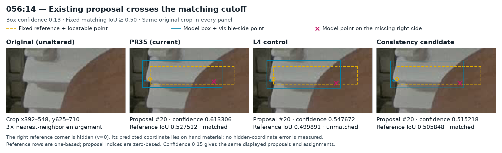
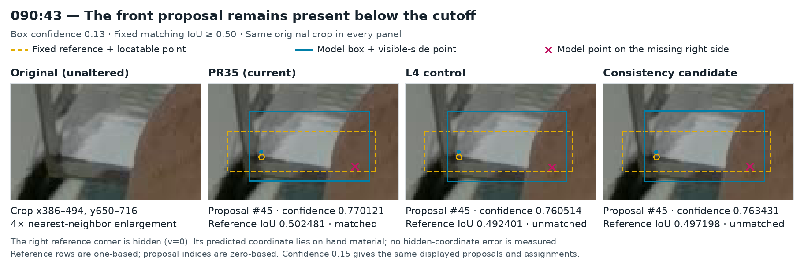

# PR47: the fourteen-box comparison is complete; retain PR35

**The returned L4 pair is valid, but the fourteen-box model does not meet the declared promotion criterion.** At the primary confidence of 0.13, it improves its matched control from **22 to 21 misses among 663 reference objects** and from **527 to 530 successes with both corners within 5 px, among 584 eligible objects**. The sole gained object match is an already-present proposal moving across the fixed IoU cutoff. Against the current PR35 model, it has **21 versus 20 misses**, **88 versus 85 scored extras**, and loses two existing 5 px pair successes despite a net gain of one.

**Keep PR35 seed 46, image size 1280, box confidence 0.13, NMS IoU 0.70 and endpoint cutoff 0.50 for assistant-reviewed proposals.** Preserve the accepted label corrections and close this fixed experiment without another GPU run, threshold sweep or automatic model change. The [existing proposal command](predict-pose-folder.md#assistant-reviewed-proposals) remains the operational entry point.

## 1. What returned and what was verified

[PR47](https://github.com/Siuuuers/dl/pull/47) is a results-only upload at commit `24e43a407da01b1e26834b6dee60a51e1ec54577`. Its archive is `results/gpu/baomai-consistency-l4-001/baomai-consistency-seed46-results.zip`: **39,776,445 bytes**, **13 members**, SHA256 `bdae4de69b3560d4fc8821dcd6f364c77eef2ed4c624c3720eae696eaa5ee5cb`.

The exact source is `14561b7f01cc89c4472e11ffb37b3943ea3e34f9`. The unchanged [protocol](../experiments/consistency-2026-11-12.json) has SHA256 `da692f2261fae441dfa7d68b3f86ed850acbb861c75e86e8c54f40b7184e540b`. The strict existing-ZIP packager passes without changing the archive. An independent audit verifies every payload's size/hash/CRC, receipt/checkpoint/staging chain, fixed recipe, original validation and exact annotation difference.

| Full-run evidence | Old-reviewed L4 control | Fourteen-box L4 candidate |
| --- | ---: | ---: |
| Completed epochs | 30 | 30 |
| Batches | 1,050 | 1,050 |
| Image presentations | 4,110 | 4,110 |
| Actual optimizer updates | 78 | 78 |
| Recorded worker time | 458.33 s | 454.83 s |
| Selected checkpoint | Finalized epoch 30 `last.pt` | Finalized epoch 30 `last.pt` |

Both full runs retain inner `arm=candidate`, independently initialize from original epoch 173, use `resume=false`, and record successful validation, finalization and observed parameter updates. Both use the same NVIDIA L4, Python 3.13.16, PyTorch 2.14.1+cu130 and Ultralytics 8.4.182 runtime. The existing seed-46 recipe, architecture, losses and augmentations remain fixed. The 78 update count reflects this recipe's accumulation behavior; it is not evidence that training was frozen.

The returned ZIP contains the completed full runs, not the resource-trial bundle. It establishes full-run eligibility but does not independently prove the trial's execution. This evaluation directly rehashed all 20 validation PNGs; all 157 image identities were checked through the frozen staging inventories. It did not newly download and rehash all 137 training originals.

### The supervised difference is exactly fourteen boxes

The candidate preserves the exact eight selected PR35 label files, eight manifest change objects and twelve accepted decisions. The only new differences are six bbox replacements in 018, three in 034 and five in 049. All 234 existing corner triples in those three images remain unchanged, including missing slots. No object is added/deleted, and held rows remain unchanged. The [six-image review](training-consistency-review-2026-11-11.md) contains the broader 135-row/270-corner-triple visual-review scope; these are different denominators.

Both effective training variants contain 137 images / 3,771 objects / 6,841 visible endpoints / 701 missing slots / 13 empty images. Original in-training validation stays 664 objects / 1,227 visible endpoints / 101 missing slots. The corrected 663-object reference is used only for post-training scoring. The non-adopted PR40 and PR43 label extensions remain separate.

## 2. Fair evaluation and the current-model control

Fresh evaluation ran all three models in one CPU environment: Python 3.12.14, PyTorch 2.10.0+cpu, torchvision 0.25.0+cpu, Ultralytics 8.4.182, NumPy 2.2.6, Pillow 11.3.0 and OpenCV 4.11.0.86. All 40 packages match the archived PR43 inference lock. Inference is FP32, four PyTorch threads, one inter-op thread, rectangular preprocessing and ordinary NMS.

The frozen driver made **120 fresh image predictions**, plus three excluded blank warmups, and scored **240 model/image/reference/threshold combinations**. No network attempt occurred during evaluation. These are offline measurements, not live-camera timing or a deployment benchmark.

| Role | Checkpoint SHA256 |
| --- | --- |
| Current PR35 | `420c00f73eeba24e587342400878b7d96371d3e745772113809aa705ec8163b1` |
| Old-reviewed L4 control | `11978a3c843ff8415aee416387d2af5acf4d913db774a26e086e88da12710780` |
| Fourteen-box L4 candidate | `61d0beea750bcbbc4bb02e17b11dec387fa288382ef2a1b5423e486a401b1cdb` |

PR35 was trained on an A100. The new control was trained on an L4 and **does not reproduce PR35 exactly**: 706/879 loaded tensor records differ. Candidate versus L4 control differs in 708/879 records; candidate versus PR35 differs in 704/879. These are state tensors after loading and before prediction/fusion, not serialized-file storage counts. The differences establish distinct learned states; they do not isolate hardware as the sole cause.

Therefore, the within-L4 comparison measures the reviewed-label intervention under matched recorded conditions. Comparison with PR35 answers whether the returned model should replace the current operational model. Cross-control differences are not credited to the fourteen edits.

Fresh PR35 retains 879/879 identical loaded tensors and all prior aggregate counts, matched identities and 2/5/10 px success identities relative to the archived PR43 PR35 replay. Its raw arrays have tiny numerical differences: maximum box-coordinate difference 0.000244141 px and endpoint difference 0.000122070 px. Only the six empty-image arrays are exactly equal; exact 40/40 historical prediction equality is not claimed. All conclusions below use the fresh three-model replay.

## 3. Primary result: corrected 663-object reference

The reference contains 663 objects, 1,228 locatable endpoints, 98 missing slots and 584 objects with both lower corners locatable. All 584 remain in the pair-success denominator, including detection misses. Matching IoU remains 0.50; endpoint availability requires confidence 0.50 and valid in-frame coordinates.

| Measure at confidence 0.13 | Current PR35 | L4 control | Fourteen-box candidate |
| --- | ---: | ---: | ---: |
| Proposals | 728 | 729 | 730 |
| Matched objects / 663 | 643 | 641 | 642 |
| Misses | 20 | 22 | 21 |
| Scored extras | 85 | 88 | 88 |
| Duplicate / other extras | 31 / 54 | 28 / 60 | 32 / 56 |
| Returned visible endpoints / 1,228 | 1,208 | 1,206 | 1,207 |
| Both corners within 2 px / 584, diagnostic | 261 | 264 | 262 |
| Both corners within 5 px / 584 | 529 | 527 | 530 |
| Both corners within 10 px / 584 | 577 | 578 | 578 |
| Miss-free nonempty images / 17 | 3 | 3 | 3 |
| Predictions across three empty images | 0 | 0 | 0 |

The same nonempty images 010/054/058 are miss-free for all models. Empty images 146/147/148 remain empty at both thresholds. At 0.13, the conditional median/p95 visible-endpoint errors are PR35 **1.5631/5.1306 px**, control **1.5665/5.1398 px**, candidate **1.5687/5.0929 px**. These conditional errors exclude missing or unreturned endpoints and cannot replace the all-object success counts.

The reference groups are 19/60/584 objects with zero/one/two locatable corners. They partition one full-image matching; they are not matched independently, and extras have no known reference-corner group. Complete group and continuous-error results remain in the evidence.

### Prespecified diagnostic at confidence 0.15

| Measure | Current PR35 | L4 control | Candidate |
| --- | ---: | ---: | ---: |
| Proposals | 718 | 718 | 718 |
| Matches / 663 | 642 | 640 | 641 |
| Misses | 21 | 23 | 22 |
| Extras | 76 | 78 | 77 |
| 5 px / 10 px pair successes | 529 / 577 | 527 / 578 | 530 / 578 |

The gained/lost object and 5/10 px pair identities are the same at 0.13 and 0.15. These are the only two tested confidence settings. The 0.15 view does not select a new threshold after seeing results.

## 4. What the changed matches mean in the images

### 056:14: the sole matched-control gain already had a proposal

Both L4 models return prediction 20 for the same partly hand-occluded front. Its fixed-reference IoU changes **0.499891458→0.505847964**, crossing 0.50. Their mutual box IoU is 0.983935293, and the largest corresponding edge shift is only **0.267456 px**. Its confidence actually decreases 0.547672→0.515218. PR35 already matches this row with IoU 0.527511665.

The original supports an exposed left front fragment, while the right physical corner is hidden by the hand. Both L4 proposals still place a right-side coordinate on hand material. The frozen reference keeps that corner missing. Preserve the official numerical gain, but do not call it discovery of a newly present front.

### 090:43: the PR35-relative loss is also a surviving proposal

All three models retain prediction 45 for the exposed front left of the thumb. Its fixed-reference IoU is **0.502481050** for PR35, **0.492400767** for the L4 control and **0.497198118** for the candidate. PR35 versus candidate boxes have mutual IoU 0.984805211 and maximum edge shift **0.391418 px**.

The candidate loses the scored match relative to PR35, while the L4 control already misses it. Within the matched L4 pair, this row is not an additional lost match. All three proposals include excess upper/lower material and return a right-side coordinate on the hand. The frozen reference's earlier lower-edge amendment selected y=700 from a documented soft transition interval 696–700; it did not certify every other retained edge. Keep that reference and cutoff fixed. The cassette has not disappeared from the proposal list.

### 007:15: the 10 px gain is assignment among existing alternatives

This top-clipped stack region has thin and taller overlapping alternatives in all models. PR35's taller proposal 52 has confidence 0.304644 and wins the assignment over its thin proposal 53 at 0.300398. The selected taller pair has errors 14.596/14.356 px, while its already-present thin alternative has errors 4.757/3.928 px.

Both L4 models rank the thin alternative above the taller one. The control selects errors 5.823/1.524 px, and the candidate selects 5.678/1.422 px, gaining the official 10 px success relative to PR35. The candidate has no 10 px status gain over its L4 control here. This is a ranking/assignment difference, not creation of an accurate alternative that PR35 lacked.

All reference row numbers are one-based. Prediction indices are zero-based within each model/image/threshold. The official confidence-ordered matcher remains unchanged throughout.

## 5. Corner tradeoffs and unlocatable sides

The candidate's net 5 px gain does not preserve every prior success:

| Comparison | Gained 5 px pair identities | Lost 5 px pair identities | Net |
| --- | --- | --- | ---: |
| Candidate versus L4 control | 008:10, 008:11, 056:3, 058:7, 089:34 | 008:20, 011:4 | +3 |
| Candidate versus PR35 | 008:22, 087:53, 089:34 | 008:20, 008:21 | +1 |

Several crossings are small: the control-to-candidate left error for 008:20 changes 4.978→5.167 px; the right error for 011:4 changes 4.913→5.049 px. An alternate candidate proposal 56 for 011:4 still has both corners within 5 px, although it does not win the reference assignment. Conversely, 058:7 has a larger selected left-error improvement 5.453→3.807 px. The evidence retains continuous errors and every 2/5/10 px change rather than presenting these discrete counts as equally clear physical events.

At 0.13, raw outputs on reference-unlocatable sides change **65/75→66/76** within the L4 pair. On commonly matched objects they are exactly **65/75→65/75**, with no binary availability changes. The extra opportunity and output come from 056:14 becoming a scored match. Thus this is not a change in the model's hidden-side suppression.

PR35 records 69/77 at 0.13. Both L4 models suppress two unavailable-side outputs on 090:48 that PR35 returns; this is already present in the L4 control and cannot be credited to the fourteen-box intervention. The changed 090:43 match also changes which sides enter that diagnostic. No true hidden-coordinate error can be computed where the reference provides no locatable physical point.

The intended partial-front cases remain unresolved: **008:33** is matched at 0.13 and missed at 0.15 in all three models, with candidate left error 6.798 px and no returned in-frame right corner. **009:57** remains unmatched in every model at both thresholds, with zero overlap from retained proposals.

## 6. New proposals and review workload

To identify changes worth inspecting, a separate review aid greedily pairs same-class boxes across models by descending box IoU, using a minimum IoU of 0.50 and prediction-index tie breaks. This is not the official reference matcher, and its unpaired boxes are not counts of new physical objects.

At confidence 0.13, candidate versus L4 control has 724 paired proposals, five control-only proposals and six candidate-only proposals. Candidate versus PR35 has 724 pairs, four PR35-only proposals and six candidate-only proposals. Combining both comparisons and both declared thresholds gives **14 unique candidate proposals in 23 association contexts across eight images**. Every one received an original-image review, with unannotated pixels inspected before overlays.

| Visual decision | Unique proposals |
| --- | ---: |
| Alternative or duplicate around an already represented front | 9 |
| Background or rack structure | 4 |
| Unresolved gripper-area interpretation | 1 |
| Established additional visible-front recovery | **0** |

The only reviewed proposal with no overlapping before-model alternative in the saved records lies outside the rack over background and blue clothing (`new_000009`, P04). The unresolved case is between the jaws in the same image (P05); it remains uncertain, rather than being counted as either a supported recovery or a certified physical false positive. Several apparent additions at 0.15 already have near-identical alternatives at 0.13. Two proposals in 090 cover the same lower-right background material; these are two predicted geometries, not two physical targets.

The review record preserves every threshold/index context, overlapping reference and before-model alternative. Classifying an occluded proposal as an existing-front alternative does not certify its hidden extent or corners. The complete decisions, four raw-pixel sheets and four overlay sheets are in `audit/proposal-review/` inside the evidence capsule.

Scored extras are unmatched predictions under the frozen reference; they are not automatically a complete physical taxonomy of mistakes. Reference uncertainty remains recorded. Review of returned boxes alone cannot find every omission; the complete original image remains necessary for the selected prototype workflow.

## 7. The original reference stays separate

The original 664-object reference has 1,227 visible endpoints and 101 missing slots. It remains the in-training validation set and a separately reported historical view.

| Original-reference result | PR35 at 0.13 | Control at 0.13 | Candidate at 0.13 | PR35 at 0.15 | Control at 0.15 | Candidate at 0.15 |
| --- | ---: | ---: | ---: | ---: | ---: | ---: |
| Matches / 664 | 632 | 631 | 632 | 631 | 630 | 631 |
| Misses | 32 | 33 | 32 | 33 | 34 | 33 |
| Extras | 96 | 98 | 98 | 87 | 88 | 87 |
| 5 px pairs / 584 | 522 | 520 | 523 | 522 | 520 | 523 |
| 10 px pairs / 584 | 570 | 571 | 571 | 570 | 571 | 571 |

The candidate gains 056:14 against the L4 control under both reference versions. It gains/loses no original-reference object identity against PR35; the 090:43 loss concerns the separately corrected visible-front box. These versions were fixed before training and are not alternatives to select after seeing scores.

## 8. Decision and next useful work

**Retain PR35 and close this fixed comparison.** The candidate improves some matched-control scores, but its only gained reference match is an existing proposal crossing the cutoff, it loses existing 5 px successes, and it establishes no additional supported recovery over the selected model. A net corner-count increase does not satisfy the predeclared preservation rule.

Keep the fourteen image-supported label corrections as a separately identified supervision candidate. This result neither invalidates those visual corrections nor proves that the same changes would improve another recipe or dataset. It also does not prove that fourteen edits were simply too few. No architecture, epoch, seed, confidence or annotation-subset search is justified automatically by this outcome.

For practical use, retain one explicit checkpoint/settings combination and review against whole originals. For further development without new captures, the more defensible next data task is a bounded completion/consistency review of still-unreviewed training material with the target policy held fixed, rather than another immediate small retraining cycle. The targeted review-history union is 61 of 137 IDs, leaving 76 outside those passes; neither number means fully certified images. See the [review coverage and remaining limits](training-consistency-review-2026-11-11.md). The separate upstream 320-frame intake remains subject to its recorded overlap, grouping and annotation limits.

Independent capture-session evidence is still needed to establish unseen-scene reliability. The reused 20 development images, one matched pair, correlated objects and nineteen unresolved reference dispositions plus the separate 011:61 caveat remain limitations. No fresh training is requested by this report.

## 9. Evidence and reproduction

The [evidence directory](../results/verification/baomai-consistency-results-20261112/README.md) contains the exact executed driver, compact derived summary, inventory and evidence capsule. It preserves predictions, both reference score sets, all comparison identities, training metadata, independent arithmetic checks, original-pixel review decisions and figures. Final weights and full original PNGs remain tied to their immutable external sources.

Driver SHA256: `aee77223ed90b36b4700dcbde1c88ade59a3a262a078c6ea6df3b80316b7177c`. The independent standard-library audit agrees on all 12 full aggregates, 240 image cases, 7,962 object assignment/endpoint states and 12 gained/lost-identity comparison cases, with absolute numeric tolerance 1e-9. It imports no repository scoring/model helper and performs no inference.

The capsule verifier distinguishes included-label/metadata verification and saved-prediction replay from stronger external-input verification. Its numerical replay needs no weights, original PNGs, PyTorch or Ultralytics; it does not claim to re-observe excluded bytes. Fresh inference uses the exact lock and all three external checkpoint bundles. None of these reproduction paths trains a model or changes the frozen references.
