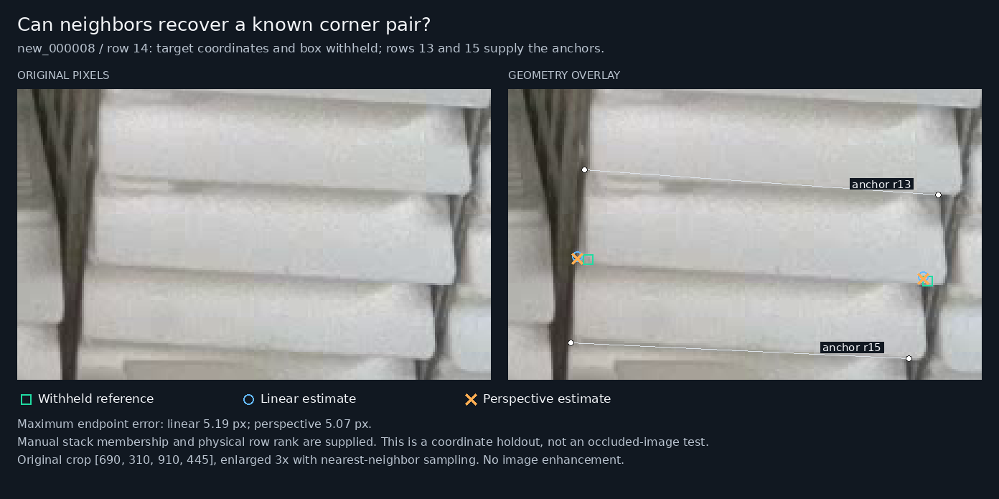
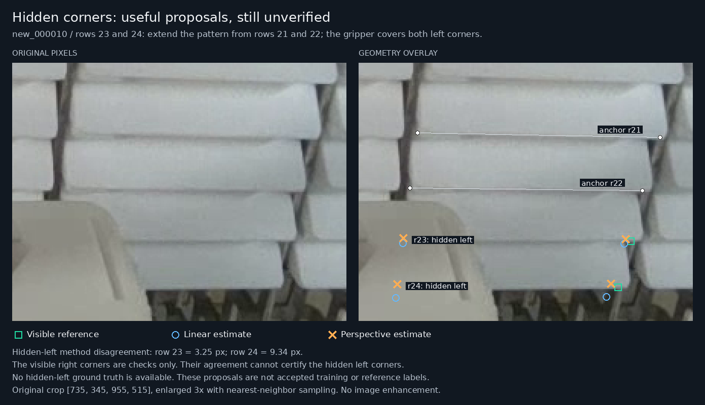

# Context-derived corner proposals

The [follow-up with PR35 anchors](context-model-anchors-2026-11-12.md) distinguishes direct model predictions from this geometry-only pilot and tests what happens when the neighboring coordinates come from PR35. The original experiment below remains separately recorded.

## Decision

The user's proposal is feasible as an **annotation aid for regular local stacks**. A small, frozen coordinate-holdout experiment recovered both known corners within 10 original-image pixels in all 26 interpolation cases. The projective method recovered both within 5 pixels in 24/26 cases. Extending a stack beyond the available anchors was less precise: 5/8 projective extrapolation cases met 5 pixels and 8/8 met 10 pixels.

These results justify showing contextual proposals for review. They do not establish accurate hidden-corner labels, automatic stack recognition, or an improvement to PR35. Two genuine hidden-left proposals are recorded separately; their errors remain unknown. Three ambiguous fragments have explicit abstentions.

**PR35 remains selected.** No model inference or training was performed. The observed reference and training labels are unchanged. The new state `estimated_from_context` records an estimate and its provenance without claiming that a hidden point was seen.

## What was tested

The [cohort](../results/review/context-corners-20261112/cohort.json) was frozen at `2026-11-12T11:34:57.725630+00:00`, before computing geometry predictions or errors. Two assistants inspected original images; stack membership and physical layer ranks were mapped manually. No PR35 predictions or method errors were used to select the cohort.

The source is PR54 commit `3939b2bd52a4d38b460d45faf4f9e2f62db6c9e2`. The experiment uses the corrected `visible-front-2026-11-11` reference. Its manifest SHA256 is `2e60b3e81195448cc565a1000b4305e3215baba2bf0ee0c976e6551c2e64937c`; the frozen cohort SHA256 is `67fe072944cc7dbe60f2be20b0ddb6c87029864cb7c0c81601a201c72c80196c`.

All row numbers below are one-based in that corrected reference. Rank zero is the first listed local front; it is not a global rack-slot number.

| Original image / stack | Members and physical ranks | Interior targets | Above-only extrapolation targets |
| --- | --- | --- | --- |
| `007`, central tall middle-shelf column | Rows 27–36, ranks 0–9 | 28–35: 8 cases | Hold out 35/36 together; donors 33/34 |
| `008`, central-left middle-shelf column | Rows 12–17, ranks 0–5 | 13–16: 4 cases | Hold out 16/17 together; donors 14/15 |
| `009`, central tall middle-shelf column | Rows 31–40, ranks 0–9 | 32–39: 8 cases | Hold out 39/40 together; donors 37/38 |
| `010`, tall column right of the jaws | Rows 15–24, ranks 0–9; only 15–22 have both corners observed | 16–21: 6 cases | Hold out 21/22 together; donors 19/20 |

There are **26 interpolation scenarios and 8 separate extrapolation scenarios, covering 30 distinct fully labelled objects**. Four objects occur in both experiments with different donor availability. These development images may show the same physical rack and cassettes; the scenarios are not independent samples.

This is a coordinate-holdout experiment. The target remains visible to the assistant assigning stack membership and rank. The geometric estimator receives only reference donor coordinates and the supplied rank ratio. It receives no target box, target endpoint, model prediction, target width, or image pixels. Automatic donor detection and actual masked-image performance are not tested.

## Geometry and physical assumptions

For an interior target at physical rank `k`, take the closest fully labelled donor above, at rank `a`, and below, at rank `b`. Define `t = (k - a) / (b - a)`.

The linear baseline predicts each endpoint independently:

```text
predicted endpoint = (1 - t) × upper donor endpoint + t × lower donor endpoint
```

This is a local affine approximation. Equal physical spacing need not appear as equal spacing in image pixels.

The projective method fits one homography from a unit rectangle to the four donor corners: upper left, upper right, lower right, lower left. It projects `(0, t)` and `(1, t)` to obtain the target pair. This allows perspective-dependent image widths and spacing. A planar homography is the appropriate mathematical relationship under a planar pinhole-camera model; see the [OpenCV explanation](https://docs.opencv.org/4.11.0/d9/dab/tutorial_homography.html) and [four-correspondence transform](https://docs.opencv.org/4.11.0/da/d54/group__imgproc__transform.html).

The interpretation assumes correct physical ranks, equal physical front width and layer pitch, and a shared local front plane. The originals show small lateral steps and tilts between individual cassettes. The experiment measures the effects of those deviations and existing label uncertainty; it does not prove exact rigidity or coplanarity. No camera calibration, depth, or lens-distortion correction is introduced.

For the extrapolation lane, both terminal targets are withheld together. The last two remaining fully labelled rows above them provide the anchors; `t` is 2 or 3. Extrapolation requires an explicit flag and is bounded to `1 < t <= 3`. It is never a silent fallback for an unsupported interpolation case.

A rack can help identify a column, its orientation and possible occupied layers. Its rear lattice is not automatically on the same plane as the cassette fronts. A transform fitted to rack holes therefore cannot simply be applied to front corners without establishing their physical relationship. A complete front can also be translated or tilted while its neighbors remain fixed.

Four donor points fit a homography exactly. Zero donor residual is expected and does not certify a withheld or hidden target. Agreement between the two methods is also not a calibrated error bound: both can share the same incorrect assumptions.

## Measured results

Errors are Euclidean distances in the original 1280×720 image. A pair succeeds only when **both** corresponding endpoints meet the radius. The 5 px and 10 px radii are existing diagnostic image-space objectives, not physical tolerances or annotation-placement allowances. All failure cases would remain in the success denominator; none of the selected cases produced a geometric failure or an out-of-image estimate.

| Experiment | Method | Both within 5 px | Both within 10 px | Median endpoint error | 90th-percentile endpoint error | Largest endpoint error |
| --- | --- | ---: | ---: | ---: | ---: | ---: |
| Interpolation: 26 pairs / 52 endpoints | Linear | 23/26 | 26/26 | 1.39 px | 3.47 px | 5.63 px |
| Interpolation: 26 pairs / 52 endpoints | Projective | 24/26 | 26/26 | 1.31 px | 3.37 px | 5.87 px |
| Extrapolation: 8 pairs / 16 endpoints | Linear | 4/8 | 6/8 | 3.50 px | 9.02 px | 13.41 px |
| Extrapolation: 8 pairs / 16 endpoints | Projective | 5/8 | 8/8 | 3.32 px | 6.92 px | 9.36 px |

The projective method has a modest aggregate advantage in this cohort. It does not improve every endpoint: its largest interpolation error is slightly worse. No per-target choice of whichever method is closer to the reference is used. This small purposive sample cannot establish statistical superiority or hidden-point reliability.

Per-stack pair counts show where the approximation was less precise:

| Stack | Interpolation linear / projective within 5 px | Extrapolation linear / projective within 5 px |
| --- | --- | --- |
| `007` | 8/8 / 8/8 | 2/2 / 2/2 |
| `008` | 2/4 / 2/4 | 0/2 / 0/2 |
| `009` | 8/8 / 8/8 | 2/2 / 2/2 |
| `010` | 5/6 / 6/6 | 0/2 / 1/2 |

The [complete evaluation](../results/review/context-corners-20261112/evaluation.json) contains each donor pair, excluded row set, ratio, predicted coordinate, withheld reference coordinate, error and summary. It also includes pair-maximum error statistics and method disagreement.



The illustration shows `008:14`. Both methods miss the 5 px pair criterion slightly because the left corner deviates from its neighbors' pattern. The raw crop is displayed beside the overlay; it has only been enlarged by nearest-neighbor sampling.

## Actual hidden-corner proposals

In `new_000010`, rows 23 and 24 continue the visible stack sequence below rows 21/22. Their right sides are exposed, while the gripper covers their left ends. That supports manual membership and consecutive ranks. It does not establish exact hidden widths, pitch or pose.

Both endpoint coordinates are estimated from donor rows 21/22. Each target's known right coordinate is read only afterward, as an external diagnostic. Only the absent left slot receives a proposal in the sidecar.

| Target | Linear hidden-left proposal `(x, y)` | Projective hidden-left proposal `(x, y)` | Disagreement on hidden left | Visible-right check: linear / projective |
| --- | --- | --- | ---: | ---: |
| `010:23`, one-rank extension | `(764.20, 463.68)` | `(764.62, 460.46)` | 3.25 px | 4.60 / 3.42 px |
| `010:24`, two-rank extension | `(759.44, 499.99)` | `(760.65, 490.73)` | 9.34 px | 10.08 / 5.29 px |

**The hidden-left errors are unknown.** The visible-right checks cannot certify the left side; a cassette could have a different orientation or width. The sidecar records `estimated_from_context`, donor IDs and ranks, method, raw coordinates, explicit assumptions, `accepted_for_training: false`, and null hidden-point error. No numerical confidence is invented.



The orange crosses and blue circles on the gripper indicate where the hidden corners are predicted to project under the stack assumptions. They are not corners observed on the gripper surface.

Both the left and right blue/orange points in this figure come from geometry. The green right points are reference annotations, and the figure contains no PR35 predictions. The right corners are visibly locatable; the follow-up includes a separate original-image view of their direct PR35 predictions.

Three additional cases deliberately have no coordinates:

| Case | Reason for abstention |
| --- | --- |
| `009:56` | Jaw fragment without established full width, front plane or physical rank relative to a supported stack. |
| `090:48` | Visible front fragment is supported, but surrounding columns and shelves do not establish same-plane donors or target rank. |
| `011:61` | Fragment identity and relationship to the neighboring front/lip remain unresolved; reliable stack membership is unavailable. |

An existing object row does not by itself establish a valid geometric rank. Another column's dimensions or a target box edge cannot supply that missing evidence silently.

## Annotation contract

The [observed annotation policy](annotation-policy.md) continues to define the current training/reference labels. A context proposal is a separate state:

| State | Meaning | Treatment in this pilot |
| --- | --- | --- |
| Observed and reliably located | Original pixels support the corner coordinate | Preserve the existing `v=2` coordinate. |
| Estimated from context | Geometry proposes a coordinate under stated assumptions | Store in the separate sidecar; show as a proposal. |
| Unresolved | Identity, rank, plane or coordinate cannot be established | Record abstention; preserve the missing slot. |

The broader [Ultralytics format](https://docs.ultralytics.com/platform/data/annotation) supports `v=1` for a labelled but occluded point. That does not make an unverified estimate reliable. This project's validators currently enforce 0/2, and its visible-front boxes can be smaller than a hypothetical hidden extent. Adopting hidden-coordinate training would require an explicit candidate policy and compatible validation; do not expand an observed box merely to enclose an estimated point.

There is also a loss-function consequence. In the pinned [Ultralytics 8.4.182 PoseLoss26 code](https://github.com/ultralytics/ultralytics/blob/v8.4.182/ultralytics/utils/loss.py), the keypoint mask is `v != 0`; both `v=1` and `v=2` participate in coordinate supervision and supply a positive keypoint-objectness target. Merely choosing `v=1` does not give a noisy inferred point a lower weight or teach a separate occlusion class. Any future weighting or visible-versus-inferred output distinction must be deliberate.

## Replay and verification

The core geometry tool needs Python and NumPy. Rendering additionally needs Pillow and the DejaVu Sans font. The recorded run used Python 3.12.14, NumPy 2.3.5 and Pillow 13.0.0. A replay with the project's NumPy 2.2.6 environment produced identical values for all 1,230 compared floating-point entries in the case results, summaries and hidden sidecars.

From a checkout of this branch with the real PNGs available (not Git LFS pointer files):

```bash
python -m unittest discover -s tests -p 'test_context_corner_pilot.py'
python scripts/context_corner_pilot.py \
  --repo-root . \
  --cohort results/review/context-corners-20261112/cohort.json \
  --output /tmp/context-corners-replay.json
python scripts/render_context_corner_pilot.py \
  --repo-root . \
  --evaluation /tmp/context-corners-replay.json \
  --output-dir /tmp/context-corners-figures
python scripts/audit_context_corner_pilot.py \
  --pilot-root . \
  --repo-root . \
  --output /tmp/context-corners-audit.json
```

Use fresh output paths. The evaluator refuses to write inside the input repository or replace an existing output. It checks the pinned manifest, all six needed original PNG hashes/dimensions and all six reference-label hashes before producing results. Original source data are never rewritten.

Nine focused tests cover known affine/projective transforms, explicit bounded extrapolation, degeneracy, source identity, exact hidden-case row/rank membership and exclusion of held-out target fields. The output retains raw coordinates and does not clip or snap to a target box.

An independent audit reconstructed all 68 scored method estimates using a separate direct 8×8 projective solve, reproduced the summaries, verified source identities and donor sets, and tested that corrupting withheld coordinates cannot change predictions. Its largest coordinate difference from the published estimator was `3.41e-13` px. Thirty-six target-corruption checks and 2,220 scalar/structure checks passed. See the [audit record](../results/review/context-corners-20261112/independent-audit.json).

The [figure index](images/context-corners-figure-index-20261112.json) records source-image hashes, exact crop rectangles, enlargement method, evaluation identity and output hashes. Both figures were visually inspected against the source crops.

## Practical next step

Use this as a **review proposal source** for an identified regular stack. Show anchors and estimated points; let the reviewer preserve, revise or reject the proposal with its provenance. The present pilot uses observed reference anchors. Connecting it to PR35 outputs would need a separate check of anchor errors, stack assignment and object correspondence before claiming an automatic improvement.

For supervised hidden-corner training, first obtain trustworthy hidden-coordinate evidence or a validated physical constraint. Existing alternate views, a stable calibrated rack/CAD relationship, or verified cassette dimensions and seating constraints may help without a new capture session. Another view must show the same unchanged object pose to establish a correspondence. A second prediction from the same model is not independent confirmation.

Both real hidden proposals in this pilot belong to the validation/development split. A later training experiment must apply the method to separate training-split images; do not train on these evaluated validation images while retaining the same validation claims.

The architectural question is whether each cassette is mechanically constrained to a known slot/plane, or can slide and tilt independently. A rigid arrangement can support a fixed geometry model; a loose stack requires local estimates and explicit residual uncertainty. The current images alone do not settle that question.
