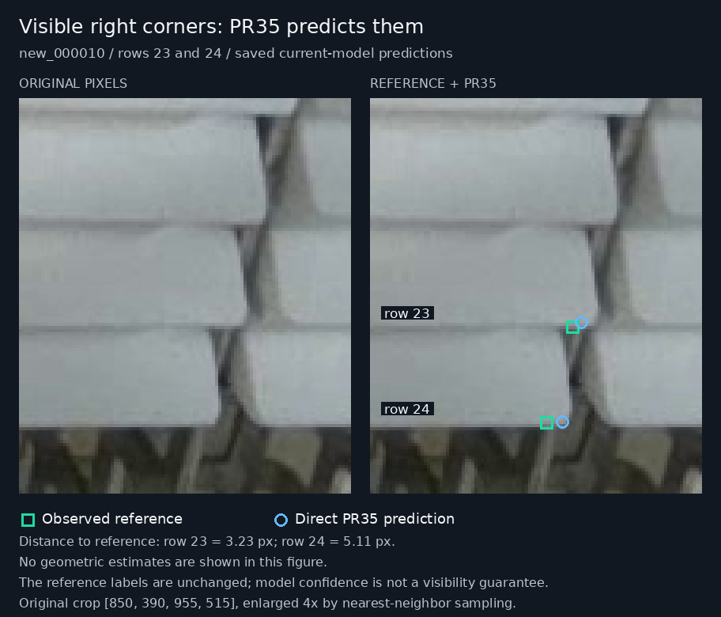

# Context estimates using PR35 anchors

## Decision

**Keep direct PR35 predictions as the working output.** This follow-up does not support automatically replacing them with contextual geometry. Retaining the predicted right point helps some estimates compared with geometry alone, but it does not improve the direct model's left-point success rate and reduces strict 5 px pair successes in both evaluated groups.

Geometry remains a review proposal source for an explicitly identified missing point. No checkpoint, inference default, training label or reference label is changed. The study is complete; it creates no new GPU training request.

## The visible right corners in `new_000010`

The right lower-front corners of rows 23 and 24 are visible and already have image-based PR35 predictions. In the [original geometry figure](context-corners-2026-11-12.md#actual-hidden-corner-proposals), green squares are observed reference annotations; both blue and orange endpoint pairs are estimates derived from neighboring reference corners. That figure contains no PR35 predictions.

The following figure explicitly shows the direct PR35 right points. The original pixels are displayed without annotations on the left. No geometric estimates are drawn.



| Corrected reference row | Reference right `(x, y)` | Direct PR35 right `(x, y)` | Endpoint confidence | Distance to reference |
| --- | --- | --- | ---: | ---: |
| `010:23` | `(914.11, 462.38)` | `(916.99, 460.91)` | 0.92953 | 3.23 px |
| `010:24` | `(905.84, 492.72)` | `(910.94, 492.39)` | 0.91308 | 5.11 px |

Original-image review supports these as lower-front junctions, distinct from the higher lip/roof boundary. The edges are soft and rounded; the review does not establish exact subpixel truth. No reference revision is supported. In particular, a model prediction that differs from the reference is not a reason to move the reference toward it.

The model also predicts the hidden left endpoints: approximately `(770.43, 464.26)` and `(768.73, 493.92)`, with confidence 0.93411 and 0.91611. Their actual errors are unknown because no reliable left reference exists. A high point score is not evidence that the corner is visible or correctly located.

“Direct PR35” identifies the source of the prediction: the pose network processes the image. It does not prove the network relies exclusively on pixels at the corner; learned image context can contribute. This distinction concerns the explicit geometric postprocessing added by this experiment.

## Fixed follow-up protocol

This follow-up asks whether the first pilot remains useful when its neighboring coordinates come from PR35, and whether retaining a directly predicted visible right point helps a proposed left point.

The [plan](../results/review/context-model-anchors-20261112/plan.json) was frozen at `2026-11-12T12:04:27.689936+00:00`, before calculating new strategy errors. Its SHA256 is `45c12b2e2e8617ad76a0b2c812122b9156eb29d908e721bc79e334bac4fb22cd`. The original cohort, donor identities, physical ranks, excluded-row sets and radii are retained.

There are 26 interpolation scenarios and 8 separately evaluated extrapolation scenarios, covering 30 distinct fully labelled objects in four development images. The groups overlap. Stack membership and ranks remain manually supplied; no automatic grouping or new object recovery is tested.

The three fixed strategies are:

| Strategy | Coordinate source |
| --- | --- |
| Direct PR35 | Both target points come from the saved model prediction. |
| Homography with model anchors | The exact two donor rows from the original pilot supply their PR35 endpoints; the target's predicted endpoints do not enter the geometric calculation. |
| Right-anchored homography | Keep the target's direct PR35 right point and add the geometric left-minus-right displacement to propose the left point. |

The third strategy is:

```text
right = direct PR35 right
left = direct PR35 right + (geometric left - geometric right)
```

It adjusts image translation while preserving the geometry's estimated relative vector. It does not independently correct a wrong width, tilt or scale. Its right coordinate and model confidence are copied exactly, so any right-side agreement is automatic and cannot validate the inferred left side.

Homography was selected from the preceding pilot before this follow-up. There is no per-case selection of the closer method and no tuning on the new errors. The direct target left coordinate and confidence cannot affect the contextual estimates. An anchored left requires the target's right point, but does not require a returned direct left point.

### Availability and failure treatment

Each designated donor must have both endpoints returned at confidence at least 0.50, finite coordinates, and positions inside the half-open image rectangle. An unavailable designated donor causes failure; it is not replaced by a more favorable donor. Structural homography failure prevents the inferred left proposal while an available direct right is retained.

Final output points are checked independently, without clipping or snapping to a reference box. A structurally valid, finite geometric pair outside the image can still supply a displacement to an anchored result; the anchored result must pass its own bounds checks. Inferred points have no invented confidence and do not inherit a donor's model score. All failures remain in the original success denominators.

Left-point coverage and success at 5/10 px are the primary measurements for the proposed one-side use. Right-point and strict pair results are also reported. Finite-error statistics are separate from coverage, and paired gains/losses preserve the identities of affected cases.

### What is supplied by the reference

The existing scorer associates predictions with reference objects using bounding-box IoU at least 0.50. Those reference boxes are used for this oracle-assisted association, but never for geometric fitting or corner placement. Endpoint proximity is not used to reassign predictions.

The cached PR35 predictions came from intact images, including the target pixels. Excluding a target coordinate field from a later calculation does not remove its visual information from the network's earlier inference. This is a model-output propagation and coordinate-holdout diagnostic, not a real or synthetic image-occlusion benchmark.

Both real hidden-left targets belong to validation/development images. Their left errors remain unknown, and none of these proposals is accepted for training or as an observed reference. The three prior abstentions (`009:56`, `090:48`, `011:61`) remain outside geometric placement.

## Measured results

All three strategies returned both endpoints for every scored scenario, so the denominators remain 26 and 8 throughout. Distances are in original-image pixels. These are diagnostic radii, not physical tolerances.

| Group | Strategy | Left within 5 px | Left within 10 px | Both within 5 px | Both within 10 px |
| --- | --- | ---: | ---: | ---: | ---: |
| Interpolation: 26 | Direct PR35 | **24/26** | 26/26 | **24/26** | 26/26 |
| Interpolation: 26 | Homography with model anchors | 23/26 | 26/26 | 23/26 | 26/26 |
| Interpolation: 26 | Right-anchored homography | **24/26** | 26/26 | 23/26 | 26/26 |
| Extrapolation: 8 | Direct PR35 | **8/8** | **8/8** | **7/8** | **8/8** |
| Extrapolation: 8 | Homography with model anchors | 6/8 | 7/8 | 6/8 | 7/8 |
| Extrapolation: 8 | Right-anchored homography | 7/8 | **8/8** | 6/8 | **8/8** |

The left-error distributions reinforce the need to inspect the tail, not only a success count:

| Group | Strategy | Median left error | 90th-percentile left error | Largest left error |
| --- | --- | ---: | ---: | ---: |
| Interpolation | Direct PR35 | 1.89 px | 4.69 px | 5.73 px |
| Interpolation | Homography with model anchors | 2.19 px | 5.11 px | 7.66 px |
| Interpolation | Right-anchored homography | 2.27 px | 3.84 px | 8.11 px |
| Extrapolation | Direct PR35 | 2.36 px | 3.21 px | 3.36 px |
| Extrapolation | Homography with model anchors | 2.32 px | 9.42 px | 10.11 px |
| Extrapolation | Right-anchored homography | 3.89 px | 5.85 px | 7.84 px |

The full [evaluation](../results/review/context-model-anchors-20261112/evaluation.json) preserves every coordinate, donor identity, availability flag, error, per-stack summary and paired gain/loss. The groups must not be pooled as independent observations, and the small purposive cohort does not establish universal superiority of any method.

### The changed cases explain the decision

At 5 px, anchoring produces one left-point gain and one loss relative to direct PR35 among the interpolation cases:

| Scenario | Direct left error | Anchored left error | Effect |
| --- | ---: | ---: | --- |
| `008:13`, interpolation | 5.73 px | 4.60 px | Left becomes a success, but its unchanged right point still fails 5 px; the pair remains a failure. |
| `010:16`, interpolation | 3.56 px | 5.68 px | Left and pair change from success to failure. |
| `010:22`, extrapolation | 1.90 px | 7.84 px | Left and pair lose 5 px success; no extrapolation case gains success over direct PR35. |

Thus a tied interpolation left success count does not imply a tied pair result. Right anchoring improves some raw geometric estimates but has no net left-success benefit over direct PR35 here, and strict pair results decline. For `010:22`, unanchored model-donor geometry has 10.11 px left error; anchoring reduces it to 7.84 px, while direct PR35 is already at 1.90 px.

Neighboring predictions contain localization errors, and the regular-stack assumptions can also be imperfect. Extending the pattern can magnify their effects. For intuition, in the linear analogue a two-rank extension is `-2 × earlier + 3 × later`; donor errors need not cancel. The homography is projective rather than linear, but the experiment shows that its additional structure does not guarantee better coordinates when its inputs come from the model.

### Genuine hidden-left outputs remain unscored

For the two actual missing-left cases, the three strategies produce:

| Target | Direct PR35 left | Model-donor geometric left | Right-anchored left |
| --- | --- | --- | --- |
| `010:23` | `(770.43, 464.26)` | `(766.32, 463.11)` | `(766.54, 464.71)` |
| `010:24` | `(768.73, 493.92)` | `(762.59, 495.13)` | `(765.06, 498.31)` |

None is established as the correct hidden coordinate. The geometric right errors are 4.06/4.39 px, while direct and anchored right errors are 3.23/5.11 px. This is mixed evidence, not a reason to choose a method separately for each target after seeing its reference. The right-anchored result uses the right model point by construction; its agreement is not an independent hidden-left check.

## Input provenance

The [compact input bundle](../results/review/context-model-anchors-20261112/model-inputs.json) contains the 36 selected stack-member records and their exact cached model predictions. All 36 have saved reference-box matches; all included endpoint confidences exceed 0.50. This limited cohort therefore does not measure low-confidence donor failure frequency.

The bundle SHA256 is `7cbed9aef5970e8d2bbb85a19770fdfebec5ea7d1801b0c422d49f9534025004`. It was extracted from the already published [PR53 evidence capsule](../results/verification/baomai-endpoint-results-20261112/README.md):

| Capsule member | SHA256 |
| --- | --- |
| `evaluation/predictions-current.jsonl` | `45587e9bd1c194fe44730a5b5404408856aa80bfb4e582632acaefb19e95c700` |
| `evaluation/scoring-current-primary.json` | `4b97981807f0d7baddc84e9cba8e8e4b79c33bc0686aa316ac45c899b2ec4344` |

The selected checkpoint is PR35 seed46 final `last.pt`, SHA256 `420c00f73eeba24e587342400878b7d96371d3e745772113809aa705ec8163b1`. The saved inference used input 1280, box confidence 0.13 and NMS IoU 0.70. No new inference or training is required for this study.

The original cohort and its measured geometry remain pinned to PR55 commit `7f4e058a25f7474ca42eeb2f74b9786e8f475c38`. The [figure index](images/context-model-direct-right-index-20261112.json) records the new figure's source-image and label hashes, crop rectangle, input bundle identity, exact point coordinates and output hash.

## Replay

The evaluator needs Python and NumPy; the figure additionally needs Pillow and DejaVu Sans. The recorded run used Python 3.12.14 and NumPy 2.3.5. From a checkout with the actual source PNGs restored:

```bash
python -m unittest discover -s tests -p 'test_context_corner_model_anchors.py'
python scripts/context_corner_model_anchors.py \
  --repo-root . \
  --plan results/review/context-model-anchors-20261112/plan.json \
  --model-inputs results/review/context-model-anchors-20261112/model-inputs.json \
  --output /tmp/context-model-anchors-replay.json
python scripts/render_context_model_anchors.py \
  --repo-root . \
  --model-inputs results/review/context-model-anchors-20261112/model-inputs.json \
  --output-dir /tmp/context-model-anchors-figures
```

Choose fresh output paths. The evaluator checks the pinned plan dependencies, original cohort and geometry implementation, model input bundle, source images and corrected labels before calculating results. It writes only its requested new result file outside the input source repository.

Nine focused tests pass. They check exact right-point copying, independence from the direct left point, low-confidence donor rejection, preservation of the right point when geometry fails, final bounds without clipping, pinned-input tampering, and failure denominators/paired changes. The original geometry helper remains unchanged.

An independent audit verified all 36 compact input records against the original saved predictions and scorer, recomputed their reference-box IoUs, and verified the four model-input image/label identities. It then independently solved the 36 homographies (34 scored scenarios plus two genuinely hidden cases), reconciled all 108 strategy outputs and all summaries, and checked the endpoint dependencies through controlled perturbations. The largest coordinate difference was `4.55e-13` px. All 10,486 structural/numeric checks passed. This verifies the arithmetic and provenance; it does not certify hidden-point accuracy. See the [audit record](../results/review/context-model-anchors-20261112/independent-audit.json).

To repeat that audit, extract the pinned PR53 evidence capsule using its linked instructions, then run:

```bash
python scripts/audit_context_model_anchors.py \
  --pilot-root . \
  --repo-root . \
  --prediction-jsonl /path/to/extracted-evidence/evaluation/predictions-current.jsonl \
  --scoring-json /path/to/extracted-evidence/evaluation/scoring-current-primary.json \
  --output /tmp/context-model-anchors-audit.json
```

## Practical use after this result

For a visible corner, retain the image-based proposal and review it against the actual lower-front junction. For a genuinely hidden corner, keep any model or context estimate identifiable as an estimate. Do not automatically replace visible points or convert high-confidence hidden model outputs into observed labels.

The current endpoint confidence does not establish which side is truly visible. This one-side experiment supplies that scenario manually; it does not implement an automatic occlusion selector. Adding such a selector or an automatic stack recognizer would require a separate target and evaluation.

The next model-quality work should address verified annotation problems and evaluate one coherent training candidate. This geometry study provides no reason for another training run on guessed hidden coordinates. Any later context-supervision candidate must use training-split images and evidence independent of its own predictions; the evaluated development images must retain their role.
