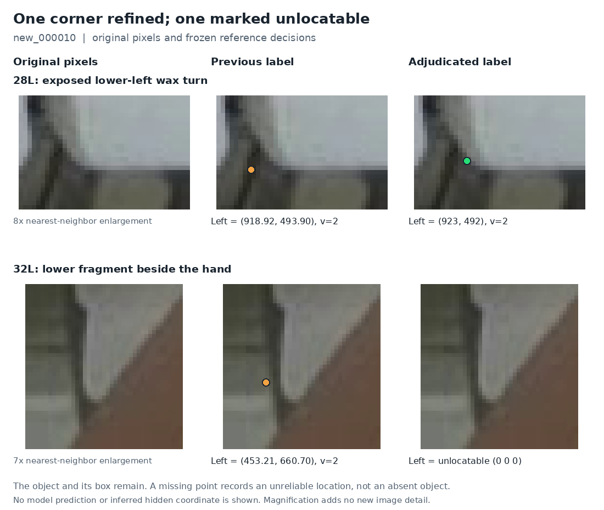

# Two further lower-front label corrections

**Two endpoint slots in `new_000010` are amended: row 28's left coordinate moves onto the exposed wax turn, and row 32's unsupported left coordinate becomes unlocatable. The saved-prediction comparison still selects PR35.** The new reference improves the measurement record; no new model was trained or run.

Review date: **2026-11-12, Asia/Hong_Kong**. Starting revision: [`6af0f9b4f04f2f282aa3c74cdc4837fa0252fa3a`](https://github.com/Siuuuers/dl/commit/6af0f9b4f04f2f282aa3c74cdc4837fa0252fa3a). This completes the bounded follow-up to the [guidance audit](lower-front-guidance-audit-2026-11-12.md), using the existing [annotation policy](annotation-policy.md). The physical target remains the actual two corners along the lower edge of one white wax front, ordered by image X.

## 1. What changed, and why

Row numbers are one-based lines in the original `new_000010` annotation file. Pixel coordinates refer to its original 1280×720 image.

| Row and slot | Previous reference | Adjudicated reference | Image-supported decision |
| --- | --- | --- | --- |
| 28, left | `(918.92,493.90,v2)` | **`(923,492,v2)`** | The parent coordinate lies below-left of the visible wax turn. Both reviewers support moving onto the exposed curved transition. |
| 32, left | `(453.21,660.70,v2)` | **`0 0 0`** | Both reviewers reject the old point on dark material left of the wax. The proposed replacement beside the hand does not establish a reliably locatable actual lower-front corner. |
| 25, 26, 27, left | Existing coordinates | Retained | The shaded outer contour belongs to the wax. No supported correction is required merely because a brighter inner edge is easier to see. |
| 31, left | `(457,641,v2)` | Retained | The upper partial front's exposed lower-left step supports the existing refinement. Its right endpoint remains missing. |



The panels use the actual original image and nearest-neighbor enlargement. Orange marks show parent-reference coordinates; green shows the one accepted replacement. The lower-right panel intentionally contains no invented point. The figure [index](images/corner-adjudication-figure-index-20261112.json) records the crop, input, renderer and font identities. Enlarging the pixels does not create new visual detail.

### Row 28: a supported coordinate refinement

The two fresh image-only nominees were `(925,492)` and `(923,492)`, on the same exposed turn. The selected `(923,492)` is reviewer B's initially recorded representative. It was not averaged with, fitted to or copied from a model prediction. The curve and shadow limit exact placement to modest pixel precision. Normalized eight-decimal label text is serialization precision, not physical measurement precision.

### Row 32: preserve the uncertainty instead of a coordinate

The reviewers agree that the old `(453.21,660.70)` location is unsupported, but disagree about the replacement. Reviewer A initially selected `(463,664)`, then traced the edge more carefully and revised the possible visible point toward `(459,663)` with reduced confidence. Reviewer B judged that the tiny curve near the hand does not establish the actual bottom edge independently of the occlusion boundary.

The final adjudication uses `0 0 0`: approximately one to three native pixels of a possible free lower arc do not provide a sufficiently reliable corner location. This is an explicit judgment under the observed-point policy, not unanimous proof that the corner is physically hidden. The [frozen review](../results/review/corner-adjudication-20261112/review.json) preserves the dissent and both original review records. The object and bounding box remain; the right endpoint was already missing.

This distinction matters: a visible object can have zero reliably locatable required corners. It should still participate in object detection evaluation. Conversely, a high-confidence model coordinate does not certify physical visibility or supply an approved annotation.

## 2. Scope, independence and provenance

Two fresh assistant reviewers first inspected unmarked source pixels without the saved label coordinates or predictions. Their initial records were frozen before label comparison. The primary assistant already knew prior discussion, labels and model-review history. The cases were selected because they were previously uncertain. This is therefore a targeted assistant review with partially reduced anchoring, not a completely model-blind study, random audit or human certification.

The new coordinates and states were frozen at **2026-11-12 14:43:18 UTC / 22:43:18 Hong Kong**, before the new case scoring began at 14:46:03 UTC. The replay verifies the frozen review and its four evidence files before loading predictions. A separate read-only [QA record](../results/review/corner-adjudication-20261112/readonly-qa.json) confirms the exact delta, counts, history, source hashes, figure and accurate preservation of reviewer A's dissent.

The [new complete reference](../data/references/visible-front-adjudication-2026-11-12/README.md) inherits the six earlier refinements and adds only the two changes above:

| Property | Immediate parent | Adjudicated reference |
| --- | ---: | ---: |
| Images / objects | 20 / 663 | 20 / 663 |
| Locatable endpoint slots | 1,228 | 1,227 |
| Missing endpoint slots | 98 | 99 |
| Objects with zero locatable corners | 19 | 20 |
| Objects with one locatable corner | 60 | 59 |
| Objects with two locatable corners | 584 | 584 |
| Empty images | 3 | 3 |

All classes, boxes, instance identities, row order and right endpoints are unchanged. The other 19 label files are byte-identical to the parent. No original baomai labels, prior reference manifest or label file, old review JSON, historical replay or source-example figure was overwritten. Other inherited box/identity questions remain outside this bounded amendment.

## 3. Replay: model selection is unchanged

The [new replay](../results/review/corner-adjudication-20261112/replay.json) rescored the same saved outputs from PR35 and the two PR52 arms. Settings remain image size 1280, box confidence 0.13, NMS IoU 0.70, matching IoU 0.50 and endpoint confidence 0.50. It did not load weights, run inference or train. Object matching is identical across all 60 model/image comparisons.

| Saved model | Matched objects | Missed objects | Scored extra detections | Both corners within 5 px | Both corners within 10 px |
| --- | ---: | ---: | ---: | ---: | ---: |
| Selected PR35 | 643 | 20 | 85 | 529 / 584 | 577 / 584 |
| PR52 matched control | 641 | 22 | 88 | 527 / 584 | 578 / 584 |
| PR52 endpoint candidate | 643 | 20 | 86 | 528 / 584 | 578 / 584 |

These detection and pair counts are unchanged from the immediate parent reference. Pair denominators include eligible missed objects, so this does not report accuracy only on convenient successful detections. The one extra 10 px pair for the PR52 endpoint candidate is also present in its matched control. There is no new evidence for replacing PR35.

For the revised row-28 left point, measured error changes as follows:

| Saved model | Parent point error | Adjudicated point error |
| --- | ---: | ---: |
| PR35 | 4.871 px | 1.966 px |
| PR52 matched control | 4.785 px | 2.135 px |
| PR52 endpoint candidate | 4.927 px | 2.065 px |

The predictions themselves did not move. These are changes in distance to the reference, not learned improvements. None crosses the 5 or 10 px scoring threshold.

Row 32's removed coordinate changes the visible-endpoint denominator from 1,228 to 1,227. For PR35, the 5 px count remains 1,139 and the 10 px count changes 1,204→1,203 because the removed target previously counted as a 10 px success. All three models still return a point in this uncertain region with confidence about 0.85–0.86. The new reference supplies no coordinate against which to measure that point, so its error is null. It is a visibility-disagreement diagnostic, not automatically a physically false prediction.

These are familiar development images used repeatedly to guide the project. Their results support continued full-image review with PR35, not a guarantee of complete automatic detection on unseen scenes. The revised reference has the same 20 missed objects and 85 scored extras; finding every existing label would still leave annotation completeness and unseen-scene performance to establish.

## 4. The next concrete training question

The [next-training handoff](../results/review/next-training-20261112/README.md) records an untested, compatible intervention: keep the **current ten-slot endpoint candidate** fixed, then add **17 previously reviewed box corrections and remove one duplicate object** from the PR49 recovery. These box changes concern different images from the fourteen-box PR47 experiment, so PR47 does not answer this question.

Use the ten-slot endpoint candidate as the experimental control and the same labels plus the 17-box/one-duplicate delta as the treatment. Keep PR35 as the operational comparator. Match initialization, training recipe, seed, runtime and hardware across the new arms. This would test the incremental box/completeness change; it would not isolate the old endpoint experiment again. The three composed label files are a compatibility prototype, not an accepted or GPU-ready training dataset, and no improvement is claimed in advance.

Two preparation requirements are explicit in the handoff. First, restore the existing original training image payloads: the available 137 training image paths are LFS pointers, not inspectable PNGs. This requires existing assets, not new captures. Second, implement an explicit composed-label contract and its verifier/stager: the existing ordinary overlay validator deliberately rejects changes to original visible endpoint tokens, and historical policy hashes must remain attached to their original versions. A real rejection receipt documents that boundary; no guard was weakened to make the prototype pass.

With the images restored, review still-unreviewed full frames for missing objects and inconsistent box boundaries. The current history inventory mentions 64 of 137 training image IDs; occurrence in that inventory is not full annotation certification. Keep this new evaluation reference frozen before any future run, retain the parent for sensitivity comparison, and predeclare the model-promotion criteria before inspecting new outputs.

## 5. Reproduce the evidence

The new replay driver verifies the two-slot delta and input hashes, then reconciles **15,591 historical scoring values** and **1,424 frozen PR56 replay values**, all with zero difference. It verifies the 20 original validation images and all three reference versions. These checks establish provenance and arithmetic consistency; they do not prove physical annotation truth.

Use a checkout containing this review, the original validation PNG payloads and the unchanged evaluator helpers. Extract the published [PR52 evaluation evidence capsule](https://github.com/Siuuuers/dl/blob/23b8aaac264179a18b0738d3e0b2e44ce0a53e56/results/verification/baomai-endpoint-results-20261112/evidence.zip), which contains the saved `evaluation/` predictions and scores. Choose a fresh output file outside the frozen reference and evidence directories:

```bash
python scripts/replay_corner_adjudication.py \
  --repo-root . \
  --review-root . \
  --prediction-dir /path/to/extracted-evidence/evaluation \
  --output /path/to/new-corner-adjudication-replay.json
```

The historical files retain their original reference identities and scores. The new reference manifest SHA-256 is `75e8689f65f7f32ca7f4657f27d214aa1ba371347812de780c6e5e6ac21af61e`; its `new_000010.txt` SHA-256 is `65a81914d32d9153963d6bbb05bd4e57012e7aee9126d1388e3f6cbb3a3eac9d`. The frozen review and replay pin all relevant source and reviewer evidence hashes.
