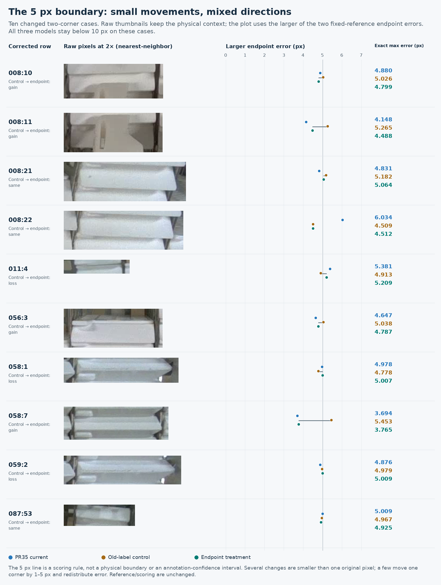
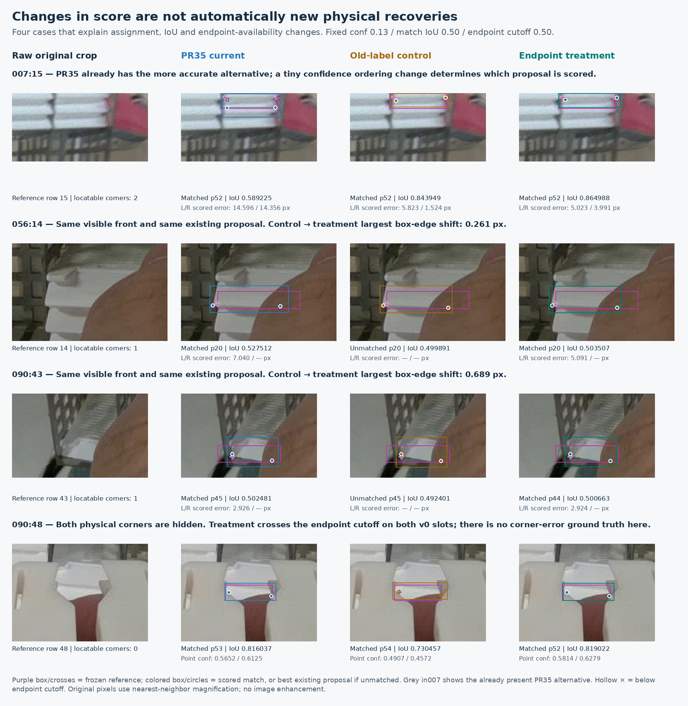

# PR52 endpoint comparison: retain PR35

Date: 2026-11-12, Asia/Hong_Kong  
Status: fixed experiment complete; the endpoint model does not replace PR35

**Keep PR35 seed 46 at input 1280, box confidence 0.13, NMS IoU 0.70 and endpoint cutoff 0.50, with whole-image review.** PR52's returned training pair is valid. The endpoint candidate improves some scores against its matched control, but loses existing 5 px pair successes and does not improve reference-unlocatable endpoint availability. Against PR35 it matches exactly the same objects, loses one net 5 px pair success and adds one scored extra. Its one additional 10 px success is already present in the unchanged-label control.

Close this fixed comparison. Preserve the accepted endpoint annotations and their uncertainty record. This result does not justify another threshold, seed, epoch or annotation-subset search.

## 1. The returned experiment is valid

[PR52](https://github.com/Siuuuers/dl/pull/52), head `8714dbb254895e3aafae92bc43d6fbad4622ddc4`, adds only the result archive and its checksum. Its base is `main`; use the pinned training source to validate the experiment, because the results branch itself does not contain the complete endpoint implementation.

The 39,776,750-byte archive has SHA256 `e3dc8755728733ad9527ef48d0d45682d80184b57871dbad515483d343c8f3d6`. All thirteen members, extracted artifact bytes, declared hashes and sizes pass verification. The unmodified `package_endpoint_results.py --verify-existing` succeeds from clean implementation commit `ce207c7a4b929fcf2ff02fb3f0db9929de08e1ea`.

Both runs independently initialize from the original epoch173 checkpoint with `resume=false`, complete 30 epochs, 1,050 batches, 4,110 image presentations and 78 optimizer updates, and record successful validation and finalization. All 109 shared numerical settings and the complete recorded NVIDIA L4 runtime agree. The distinct recipe IDs correctly identify the old annotation overlay and the endpoint overlay. The effective datasets differ only in the two declared training-label files: ten endpoint slots on six rows. Training images, 3,771 objects, boxes and validation remain fixed.

The archive supplies final-epoch `last.pt` for both roles. The logs also contain Ultralytics' automatic validation of `best.pt`; those log metrics are not the selected checkpoint's required post-training result. The resource-trial bundle is absent, as allowed by the protocol, so this return does not independently prove that trial executed.

| Role | Final checkpoint SHA256 |
| --- | --- |
| Current PR35 | `420c00f73eeba24e587342400878b7d96371d3e745772113809aa705ec8163b1` |
| Old-reviewed control | `c480ff0881e9bc8feca94b2478e6cbca76cdb8de5ed5bbf82c5de47041920b29` |
| Endpoint candidate | `890ff20f4d7c377435ee29872de18739a6571fece2f8672a19802e24dbba418c` |

## 2. Fresh, matched evaluation

All three models were freshly evaluated in the same CPU environment using the forty-package inference lock from the previous comparison: Python 3.12.14, PyTorch 2.10.0+cpu, torchvision 0.25.0+cpu and Ultralytics 8.4.182. All forty package versions match. Inference uses FP32, four PyTorch threads, one inter-op thread, rectangular preprocessing and ordinary NMS.

The driver made **60 real-image predictions**, plus three excluded blank warmups. It scored **120 model/image/reference cases** using the two separately frozen references. The only confidence was the predeclared **0.13**; matching IoU was 0.50 and the endpoint cutoff was 0.50. No network event was attempted during the guarded evaluation. These are offline measurements, not camera or deployment timing claims.

The twenty actual validation PNGs were downloaded and rehashed. Original training-image identities were checked through the complete frozen inventories; this evaluation did not newly download all 137 training originals.

An independent standard-library implementation reproduced the six aggregate results, 120 image cases, 3,981 reference-object states and six pairwise identity/common-slot comparisons without importing the repository scorers or evaluation driver. The fresh PR35 and old-reviewed control each reproduce all twenty 0.13 prediction arrays and all 879 loaded tensor records from their corresponding prior consistency replay. The old-control serialized checkpoint hash differs from the previous archive, but its loaded state and predictions are identical. The matched control remains distinct from PR35; changes already present in that control cannot be attributed to the endpoint edits.

## 3. Primary result: corrected 663-object reference

The reference contains 663 objects, 1,228 locatable endpoints, 98 unlocatable slots and 584 objects with both corners locatable. All 584 remain in the pair denominator, including eligible detection misses.

| Measure at confidence 0.13 | Current PR35 | Matched control | Endpoint candidate |
| --- | ---: | ---: | ---: |
| Proposals | 728 | 729 | 729 |
| Matched objects / 663 | 643 | 641 | 643 |
| Misses | 20 | 22 | 20 |
| Scored extras | 85 | 88 | 86 |
| Duplicate / other extras | 31 / 54 | 28 / 60 | 29 / 57 |
| Returned locatable endpoints / 1,228 | 1,208 | 1,206 | 1,208 |
| Both corners within 5 px / 584 | 529 | 527 | 528 |
| Both corners within 10 px / 584 | 577 | 578 | 578 |
| Miss-free nonempty images / 17 | 3 | 3 | 3 |
| Predictions across three empty images | 0 | 0 | 0 |

The same three nonempty images, 010/054/058, are miss-free. Empty images 146/147/148 have no outputs. Scored extras are unmatched predictions under the frozen reference; they are not automatically a complete physical false-positive taxonomy.

| Locatable corners per reference object | Objects | PR35 matches | Control matches | Endpoint matches |
| --- | ---: | ---: | ---: | ---: |
| Zero | 19 | 12 | 12 | 12 |
| One | 60 | 53 | 51 | 53 |
| Two | 584 | 578 | 578 | 578 |

These groups partition one full-image matching; they are not matched separately. PR35 and the endpoint model miss the same twenty reference objects. Fourteen of those twenty have fewer than two locatable corners and lie outside the 584-object pair measure. A high pair score therefore does not establish complete cassette detection.

Conditional median/p95 locatable-point errors are PR35 **1.5631/5.1306 px**, control **1.5665/5.1398 px**, and endpoint **1.5798/5.0394 px**. The endpoint model improves the tail statistic while slightly worsening the median. These statistics concern returned, matched points and must be read alongside coverage and object completeness.

## 4. What the changed identities mean

All row numbers below are one-based within the frozen corrected reference. They are not automatically the original-source row numbers in files with accepted reference edits. Prediction indices are zero-based within a model/image at confidence 0.13.

### Two control-relative match gains are existing proposals

For **056:14**, the control already returns prediction 20. Its reference IoU changes **0.499891458 → 0.503507469**, crossing the fixed 0.50 cutoff. The largest corresponding box-edge movement is about **0.261 px**.

For **090:43**, the control's prediction 45 corresponds to endpoint prediction 44. Reference IoU changes **0.492400767 → 0.500662504**, with a largest edge movement of about **0.689 px**.

PR35 already matches both rows. Original-image inspection supports existing partially occluded fronts in these locations, with obscured right corners. Preserve the numerical match gains, but do not call them two newly discovered physical cassettes. They are small geometry changes in proposals that already existed.

### The 10 px gain is an assignment change already in the control

At **007:15**, PR35's selected prediction 52 has corner errors **14.596/14.356 px**. Its already-present overlapping alternative, prediction 53, has both corners within 10 px. The old-reviewed control and endpoint model instead select the thinner alternative, with errors **5.823/1.524 px** and **5.023/3.991 px** respectively.

Thus the one additional 10 px success against PR35 does not establish creation of an accurate alternative that PR35 lacked, and it is not an endpoint-edit gain against the matched control.

### Net 5 px counts conceal lost successes

| Comparison | Gained 5 px pair identities | Lost 5 px pair identities | Net |
| --- | --- | --- | ---: |
| Endpoint versus control | 008:10, 008:11, 056:3, 058:7 | 011:4, 058:1, 059:2 | +1 |
| Endpoint versus PR35 | 008:22, 087:53 | 008:21, 058:1, 059:2 | −1 |

Small movements around a fixed 5 px cutoff can change the binary result. Rounded or soft physical boundaries also limit annotation precision. Those qualifications do not permit moving the threshold or editing the reference after seeing results. The declared rule required preserving existing successes; three losses occur in each comparison.

For the three control-relative losses, the maximum corner error changes **4.913 → 5.209 px** at 011:4, **4.778 → 5.007 px** at 058:1, and **4.979 → 5.009 px** at 059:2. Two are particularly close to the cutoff. These small changes warrant a cautious interpretation of practical severity, while the frozen preservation decision remains unchanged.

The gains are also mixed at the individual-point level. At 008:11 the left error worsens **1.892 → 4.488 px** while the right improves **5.265 → 2.603 px**. At 058:7 the selected maximum error improves **5.453 → 3.765 px**, while PR35 already has **3.694 px**. The evidence records every changed case rather than treating all threshold crossings as equally clear physical improvements.

## 5. Endpoint availability does not support the hypothesis

The control's per-model matched-object diagnostic is **65/75** returned coordinates on reference-unlocatable slots; the endpoint model records **69/77**. Two additional denominator slots come from the two newly scored matches above.

Restricting both models to the **same 641 matched objects and the same 75 unlocatable slots**, the result is **65/75 → 67/75**. Both added returns occur on **090:48**, whose physical lower corners remain hidden between the foreground jaws/finger in the original image. The control's point confidences are approximately **0.4907/0.4572**, below the fixed endpoint cutoff; the candidate's are **0.5814/0.6279**, above it. PR35 already returns both sides.

On those same matched objects, locatable-corner coverage is unchanged at **1,206/1,207** slots. Full-reference locatable coverage rises **1,206/1,228 → 1,208/1,228** because the two additional scored matches contribute their left corners. There is no common-object locatable-availability gain.

Against PR35, the endpoint model has the same 643 matched identities, the same **69/77** unlocatable-slot returns and the same **1,208/1,228** full-reference locatable returns. No binary availability identity changes occur. Missing reference slots have no reliable hidden coordinate, so these counts are availability diagnostics, not measurements of hidden-corner geometric error.

## 6. Proposal workload and original-reference view

For review only, same-class boxes were associated across models by descending mutual IoU, with a minimum of 0.50 and deterministic index tie breaks. This is separate from the official reference matcher.

Endpoint versus PR35 has **725 associated proposals, three PR35-only proposals and four endpoint-only proposals**. Endpoint versus control has **725 associated proposals, four control-only proposals and four endpoint-only proposals**. Their endpoint-only sets are disjoint, giving eight unique proposals for original-image inspection.

All eight were inspected on unmarked crops and six complete originals before reviewing overlays. Four are alternative extents of already represented cassette fronts, three cover foreground/background structures, and one occluded-stack extent remains ambiguous. **No additional physical cassette-front recovery is established.**

The alternatives include top- and bottom-clipped fronts already covered by other proposals. The three structure/background cases cover the gripper head/gap in 009, a rack/base strip in 054, and tabletop/blue packaging outside the rack in 090. The ambiguous 009 case spans neighboring already matched fronts and the gripper; it remains unresolved. All eight are also unmatched by the official primary matcher, but that numerical status alone was not used to classify the pixels.

A proposal can remain unpaired even when an overlapping comparator box exists: the greedy review association may have used that box for a more similar alternative. Therefore an endpoint-only box in this review is not automatically a newly seen physical object. Per-proposal identities, crops, neighboring matches and uncertainty are preserved in the capsule.

The original 664-object reference remains the training validation set and a separately reported historical view. It is not substituted for the primary reference after observing results.

| Original-reference result at 0.13 | PR35 | Control | Endpoint |
| --- | ---: | ---: | ---: |
| Matches / 664 | 632 | 631 | 632 |
| Misses | 32 | 33 | 32 |
| Extras | 96 | 98 | 97 |
| Returned locatable points / 1,227 | 1,190 | 1,189 | 1,190 |
| 5 px pairs / 584 | 522 | 520 | 521 |
| 10 px pairs / 584 | 570 | 571 | 571 |

Only 056:14 is a gained control-relative original-reference match. There are no gained or lost original-reference match identities relative to PR35. The same 5/10 px pair changes remain.

## 7. Decision and next useful work

**Retain PR35 and finish this experiment.** The endpoint model does not satisfy the predeclared preservation rule against the matched control or the selected model. Its improvements are mixed, reference-unlocatable outputs do not decrease, and it does not establish a supported detection advantage over PR35.

Keep the ten endpoint corrections as an explicitly identified supervision candidate. In particular, preserve the moderate-confidence **new_000023 original row 33 right point `(612,549)`** and its recorded reviewer disagreement; rows 34/35 remain missing. A training result does not adjudicate what the original pixels show. This joint ten-slot experiment also cannot attribute a score change to that one newly accepted point.

For use, keep one checkpoint/settings combination and inspect the whole original, including areas with no returned boxes. The [reviewed-proposal command](predict-pose-folder.md#assistant-reviewed-proposals) remains the entry point. Three miss-free nonempty images out of seventeen support continued review, not autonomous completeness.

For further work without new captures, prioritize a bounded completion and consistency review of previously unreviewed training material, with the target policy fixed before inspection. Record uncertain cases explicitly and accumulate a coherent data revision before considering another training hypothesis. Do not optimize another tiny variant against these same twenty development views simply because a new run is possible.

Independent capture-session evidence remains necessary to establish unseen-scene reliability. This experiment uses one matched seed and correlated reused development images, with the frozen unresolved reference dispositions retained. No new GPU run is requested by this report.

## 8. Evidence and reproduction

The [evidence directory](../results/verification/baomai-endpoint-results-20261112/README.md) contains the exact executed driver, compact summary, indexed evidence capsule and reproduction instructions. The capsule preserves raw predictions, both score sets, all gained/lost identities and common-slot comparisons, source and training metadata, the independent arithmetic audit, and original-image review records.

Driver SHA256: `54a66f22775fc8dbc1469a651991977d1f145efee99427bca6835e693abde64c`.

The full audit rechecks twenty actual original PNGs. A separate numerical-replay mode uses the included label bytes and saved predictions and explicitly reports that it has not re-observed the excluded original-image bytes. Neither mode trains a model or changes any reference. External weights and complete original PNGs remain bound to their immutable sources.
