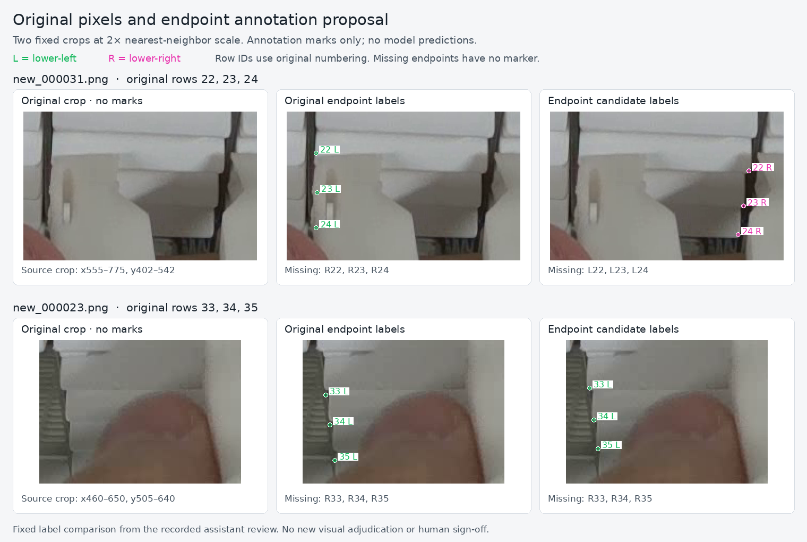

# Endpoint corrections prepared for a controlled comparison

**Historical PR50 snapshot.** The nine-slot counts, staging-only status and figure below describe commit `5f547d6166099faf39bc5b3bf9c044333d1682f0`. A user-requested original-image recheck subsequently accepted 023 row33's right corner, producing a ten-slot candidate and a dedicated GPU protocol. See the [current review and training handoff](training-endpoint-visibility-2026-11-12.md). Run historical commands from their pinned snapshot.

Date: 2026-11-12  
Status: verified annotation candidate and staging support; no new trained model

**Keep PR35 selected at input 1280, box confidence 0.13, NMS IoU 0.70 and endpoint cutoff 0.50.** The interrupted recovery is published in [draft PR49](https://github.com/Siuuuers/dl/pull/49). This continuation makes its six recorded corner decisions consumable by the existing dataset stager, as a separate endpoint-only extension of PR35's exact annotation parent.

The [candidate README](https://github.com/Siuuuers/dl/blob/5f547d6166099faf39bc5b3bf9c044333d1682f0/data/candidates/endpoint-visibility-2026-11-12/README.md), [manifest](https://github.com/Siuuuers/dl/blob/5f547d6166099faf39bc5b3bf9c044333d1682f0/data/candidates/endpoint-visibility-2026-11-12/manifest.json), [review](https://github.com/Siuuuers/dl/blob/5f547d6166099faf39bc5b3bf9c044333d1682f0/data/candidates/endpoint-visibility-2026-11-12/review.json) and [verification receipt](../results/verification/baomai-endpoint-candidate-20261112/verification.json) contain the inputs, decisions and mechanical checks. No inference, training, threshold search or model replacement occurred.

## What changed

The cumulative candidate copies all eight PR35-parent label files, their eight change records and twelve review decisions exactly. It adds two label files derived from the frozen originals. Only the following nine endpoint slots differ from PR35 supervision:

| Image | Original row | Left corner | Right corner |
| --- | ---: | --- | --- |
| `new_000023` | 33 | Move to `(482, 550)` | Keep missing |
| `new_000023` | 34 | Move to `(486, 580)` | Keep missing |
| `new_000023` | 35 | Move to `(490, 607)` | Keep missing |
| `new_000031` | 22 | Mark missing | Record `(742, 458)` |
| `new_000031` | 23 | Mark missing | Record `(737, 491)` |
| `new_000031` | 24 | Mark missing | Record `(732, 518)` |

Coordinates are in the original 1280 × 720 images. There are three visible-coordinate corrections, three visible-to-missing changes and three missing-to-visible changes. The three existing missing right slots in 023 retain their exact bytes. Missing means the actual target corner is not reliably locatable; it does not supply a hidden coordinate.

All six corrected positions fit the original boxes. The candidate therefore preserves every class and box token, object identity, row count, row order and unrelated endpoint relative to PR35. The seventeen box corrections and duplicate removal in PR49 remain a separate recorded proposal. In particular, 023 retains 36 rows here, so its endpoint rows are **33–35**, not the shifted 32–34 in the recovery's combined overlay.

| Training labels | Images | Objects | Visible endpoints | Missing slots |
| --- | ---: | ---: | ---: | ---: |
| Frozen originals | 137 | 3,772 | 6,839 | 705 |
| PR35 annotation parent | 137 | 3,771 | 6,841 | 701 |
| Endpoint candidate | 137 | 3,771 | 6,841 | 701 |

The unchanged endpoint totals conceal a real change in supervision: a visible point assigned to the wrong side can be replaced by the correct visible side without changing the count. Original validation remains 20 images, 664 objects, 1,227 visible endpoints and 101 missing slots. The separately corrected 663-object development scoring reference is also unchanged.

## Original-pixel comparison



These are two fixed crops at 2× nearest-neighbor scale. Green marks the image-left slot; magenta marks the image-right slot. Missing slots have no marker. The unannotated crop panels preserve the source pixels exactly. These marks are annotations, not model predictions.

The figure visualizes the already recorded assistant review. Rendering it does not constitute another independent visual adjudication or human sign-off. The review records descriptive ranges around the manual placements; they are not statistical confidence intervals or physical tolerances. The [figure provenance](../results/verification/baomai-endpoint-candidate-20261112/figures/figure-provenance.json) binds the images, labels, crops and renderer by hash. Reproduce it with `python -B scripts/render_endpoint_review.py` after materializing the original PNGs and installing Pillow.

## Small integration with the existing workflow

The old annotation verifier deliberately forbids moving an inherited visible endpoint. It remains byte unchanged. The new `training_endpoint_overlay` kind uses a dedicated [endpoint verifier](../scripts/verify_pose_endpoint_candidate.py), while the existing stager gains one dispatch branch and records the new verifier's code hash.

The endpoint verifier calls the unchanged parent verifier, pins the exact PR35 parent manifest, checks the copied parent bytes and decisions, and binds every added operation to its declared review and recovery evidence. It rejects extra rows, box/class changes, validation edits, unlisted byte changes, malformed missing points and invalid geometry. It requires full identity row maps and all twelve before/after endpoint triples for the six reviewed rows.

This candidate uses the unchanged PR49 recovery record. The verifier binds its operations to that declared record by SHA256. A separate remote comparison established that the current record equals Git blob `93b4971123be2d569acdcc4346a43aa2ed6878fe` at PR49 commit `ab998df15cf7b8e6d92a3ba95bea6a70230f4145`. The verifier itself does not contact GitHub or authenticate a declared revision; its receipt reports that limitation explicitly. Hash consistency is not visual correctness.

Every existing training recipe rejects this kind before loading the training runtime or creating a run directory. This is an implementation boundary: no endpoint-specific training protocol is supplied in this change. The receipt therefore says `training_recipe_supported: false`.

### Commands

From the repository root, verify the candidate:

```bash
python -B scripts/verify_pose_endpoint_candidate.py \
  --candidate data/candidates/endpoint-visibility-2026-11-12/manifest.json
```

With the actual original PNGs materialized, stage into a fresh directory outside the repository:

```bash
python -B scripts/stage_pose_training.py \
  --candidate data/candidates/endpoint-visibility-2026-11-12/manifest.json \
  --output /tmp/baomai-endpoint-stage

python -B scripts/stage_pose_training.py \
  --candidate data/candidates/endpoint-visibility-2026-11-12/manifest.json \
  --verify /tmp/baomai-endpoint-stage
```

The stager's `reference` directory contains **frozen original labels**, not PR35's annotation overlay. Its `candidate` directory contains the cumulative endpoint candidate. A future PR35-supervision control must use the parent overlay explicitly; accidentally training the original-label arm would answer a different question.

## Verification performed

The [receipt](../results/verification/baomai-endpoint-candidate-20261112/verification.json) separates actual-data integration from synthetic rejection checks:

- All 157 original PNGs were restored and matched their frozen hashes and dimensions. All 157 original label hashes matched.
- The real candidate passed its verifier. The stager copied 314 images and 314 labels across its two arms, and a separate `--verify` invocation checked the completed dataset again.
- An independent label comparison found exactly six changed rows and nine changed slots relative to PR35, with eight inherited files identical and all new-row class/box tokens unchanged.
- All **43 focused checks** passed: 13 endpoint checks, 19 existing annotation checks and 11 existing training-runner checks. These include refreshed-hash tampering, inherited-data preservation, canonical missing points, geometry, validation protection, recipe compatibility and rejection of the new kind by existing recipes.
- An actual runner CLI invocation rejected the endpoint kind with the expected staging-only error before creating its output directory. No trainer, model weights or GPU was used.
- Frozen data, the scoring references, existing candidates, old verifiers and model configuration were not edited.

The staging manifest captures the local paths, code hashes and file inventory of this execution. Rebuilding elsewhere changes path/time-dependent manifest bytes; source and candidate content identities remain the relevant reproducible inputs. Mechanical checks do not establish better model performance or certify every annotation in the dataset.

## Scientific next step

The new hypothesis is specific: **correcting false visible-corner targets and misplaced visible points may improve endpoint availability and localization on partially obscured cassette fronts.** It may have no effect on object recall. That outcome remains unknown.

The pinned [Ultralytics 8.4.182 pose loss](https://github.com/ultralytics/ultralytics/blob/v8.4.182/ultralytics/utils/loss.py) uses the nonzero visibility mask for coordinate supervision and for the keypoint-objectness target. These amendments therefore alter real training targets even though the visible/missing totals stay equal. This mechanism motivates a comparison; it does not predict its result.

Before another GPU run, encode one fixed matched protocol with these properties:

1. **Control:** the exact PR35 annotation overlay. **Intervention:** that overlay plus only these nine endpoint changes. Both use the same initial checkpoint, seed, device, runtime, 30-epoch schedule, preprocessing and augmentation settings. Keep the PR49 box/deletion proposal out of this comparison.
2. Preserve the current development reference and explicit inference settings. Report misses and scored extras for all 663 objects, recall separately for zero/one/two locatable-corner groups, and 5/10 px pair success over all 584 eligible objects, including eligible detection misses.
3. Compare returned coordinates on reference-unlocatable slots within **the same commonly matched objects**. Otherwise a model can appear to reduce these outputs merely by missing more objects. Also report missing predictions for genuinely locatable slots, so suppressing endpoints cannot masquerade as an improvement.
4. Review changed match identities on original images. Distinguish a newly found front from a near-identical proposal crossing IoU 0.50. Compare the intervention with its matched control for the label effect and separately with retained PR35 for model replacement.
5. Require a useful improvement without worse object completeness before considering replacement. A single seed on reused development scenes remains a development result; it cannot establish unseen-scene reliability. Close the comparison after its declared analyses instead of scanning thresholds or seeds until a favorable score appears.

PR35's current 577/584 result at 10 px remains a strong result for the two-locatable-corner population. It does not cover all cassette fronts: fourteen of its twenty misses belong to the 79 objects with fewer than two locatable corners. Whole-image review therefore remains part of the selected workflow. The [recovered readiness analysis](../results/review/baomai-review-recovery-20261112/report.md) explains these denominators and the completed PR47 decision in detail.

The recovery report is preserved as the approved historical package, including its pre-publication wording. PR49 is now published; this document records the subsequent staging implementation. There is still no new trained endpoint model or measured accuracy gain.
