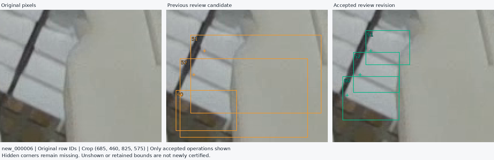
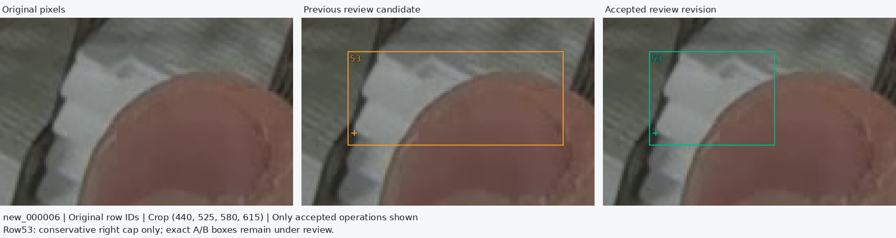
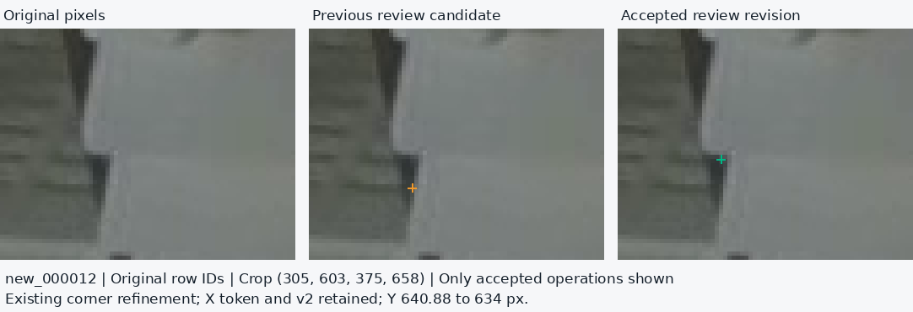
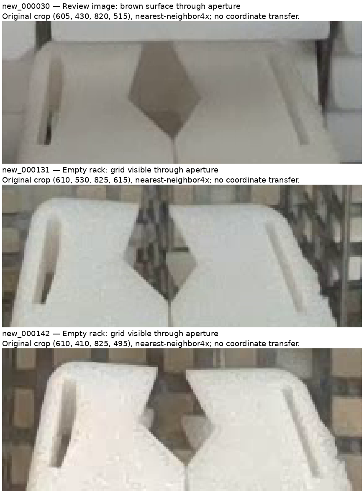

# Refine observed labels with the confirmed fixed cassette geometry

Date: 2026-11-14, Asia/Hong_Kong.

**The user confirms that the cassettes have identical dimensions, do not slide or tilt in their seated positions, and the racks have equal widths.** This supplies a previously missing physical constraint. The new review uses it to establish correspondence between fronts, then accepts coordinates from the original pixels.

The resulting [review candidate](../data/candidates/fixed-geometry-labels-2026-11-14/README.md) adds **69 box revisions, one existing visible-corner refinement and one duplicate removal** to the frozen reconciled parent. Four training images receive new changes. The complete overlay contains 41 label files; the other 37 inherited files are byte-identical to the parent. This remains a partially adjudicated review revision, with no new training or model-accuracy claim.

[Exact accepted operations](../results/review/fixed-geometry-20261114/accepted-review.json) · [Current field status](../results/review/fixed-geometry-20261114/review-status.json) · [Physical constraints](../results/review/fixed-geometry-20261114/physical-constraints.json) · [Evidence and verification](../results/review/fixed-geometry-20261114/README.md)

## 1. What the new physical information changes

Equal fixed cassettes make repeated profiles and neighboring positions useful evidence about physical ownership. The earlier possibility that a particular seated cassette might slide or tilt independently is no longer an unresolved design assumption for this dataset. The constraint is recorded as user-supplied physical knowledge; no numerical dimensions or camera calibration were supplied.

Equal physical dimensions still do not imply equal pixel widths. Perspective changes projected scale and makes some seams slanted. Copying one rectangle's width/height to every visible fragment would change the target. The current box is the observed front extent, while a full hidden-object box would be an explicitly different, amodal target.

The [upstream source comparison](visible-and-hidden-2026-11-14.md) remains applicable. The [current baomai README](https://github.com/an94-doll/embedding_vision/blob/351eb3cf960ccc34829e2bc72e1fa4645acc6295/data/README.md#L31-L39) defines two actual lower-front corners and independently unlocatable slots. The [historical editor](https://github.com/an94-doll/embedding_vision/blob/6f7112a553e1759fc755bda1f18ee56cb34dd315/detect/data/data_last/picture/work/ANNOTATION_EDITOR.md#L19-L20) informs our adopted observed-front box convention. It is not a fully-unobstructed-only inclusion rule.

The new information does not turn a naturally hidden coordinate into a visible `v=2` label. Direct predictions of hidden corners remain possible under the existing confidence/finite/in-image display rules. The [existing context pilot](context-corners-2026-11-12.md) already evaluates this geometry idea with manually supplied correspondences; the [model-anchor follow-up](context-model-anchors-2026-11-12.md) still does not justify replacing direct PR35 output with an automatic geometry fallback. This pass changes supervision, not the predictor architecture.

## 2. Concrete accepted changes

| Training image | New box revisions | Other accepted change | Main observed problem |
| --- | ---: | --- | --- |
| `new_000006` | 4 | None | Three right-jaw boxes substantially include the gripper; one thumb-adjacent box has an excessive right extent. |
| `new_000012` | 32 | Source30 left Y: 640.88 → 634 px; preserve exact X and `v=2` | Legacy upper bounds cut visible face material; some lower/right bounds include the next front, hand or jaw. |
| `new_000030` | 21 | Proposed source12 deletion **not accepted** | Rack/neighbor margins and clipped visible tops; bottom partial fronts include the hand. |
| `new_000128` | 12 | Delete source12's redundant right-border subregion | Rack/jaw inclusion and neighboring-front overlap; no separate physical owner for the redundant border strip. |

The 69 replacements are row-level box operations. They do not certify every bound of every affected box. Existing historical repairs remain part of the parent, and unreviewed fields remain exact. Each operation records the original image/label hashes, original and parent row, before/after text, changed bounds, physical reason and reviewer provenance.

### Three distinct right-jaw fronts in new006

Original rows51/52/60 identify three successive front surfaces. The slanted seams and visible rounded lower-left turns distinguish them. Root and an independent reviewer inspected the original pixels before comparing replacement coordinates; their estimates agreed within the recorded ordinary manual boundary ranges.

| Original row | Accepted observed box `[xmin,ymin,xmax,ymax]`, original pixels |
| --- | --- |
| 51 | `[714,478,752,508]` |
| 52 | `[703,497,743,532]` |
| 60 | `[694,518,743,556]` |

Their existing left corner tokens and canonical missing right slots remain exact. No hidden width or right corner was filled in.



The user's A/source59 and B/source53 identities remain settled as **two separate cassettes**. Source53's right bound is conservatively reduced from565 to522px, removing unequivocal excess over the hand. This is deliberately a partial improvement: a tighter B-only maximum near499–506 depends on the weak oblique seam, and the source top still includes the A/roof region. Source59's exact front/lip extent remains held. Neither identity is reopened and neither row is deleted.



### A visible corner correction in new012

Source30's old lower-left point lies about6.88px below the owning front's rounded lower-left turn, along the transition into the next front. A first reviewer flagged the issue, a second independently inspected the original crop, and root checked the original-pixel detail. The accepted minimal correction preserves the exact X token (`329.4899968px`) and changes Y from`640.8799992` to`634px`. Visibility stays2; the right point and box tokens remain unchanged.

The plausible manual turn range is approximately x327–332/y631–636. This is a placement range, not a statistical confidence interval or subpixel ground-truth claim. The box's separate roof/front upper-bound question remains held.



### Remove a positively identified duplicate subregion in new128

Source12 is the x1269.95–1280 right-border strip. Its main material is continuous with source10's front, followed below by rack/gap. The few top pixels may belong to the separately retained source9 strip; they do not establish a separate source12 owner. The removal is based on physical surface correspondence, not thinness or box overlap alone. Both source12 slots were already missing, so no observed point is discarded or transferred.

Original rows13 onward consequently move one output row earlier. The candidate manifest preserves both original→parent and original→new row maps. Source10 remains output10; original13 becomes output12. The separate top-strip identity questions remain held.

## 3. How much uncertainty this pass resolves

The three largest legacy review groups cover **81 rows and163 explicit fields** in new012/new030/new128. Every listed field was re-examined:

| Final field disposition | Count |
| --- | ---: |
| Accepted observed-bound change | 109 |
| Accepted retention within the observed boundary range | 10 |
| Resolved duplicate identity | 1 |
| Bounds no longer applicable after that deletion | 4 |
| Still held | **39** |

Thus124 of those documented fields now have a disposition beyond the prior hold. This does not mean124 coordinate edits or a measured dataset accuracy percentage. The extra new012 point correction and the new006 work are separate from that163-field accounting.

The remaining39 fields are concentrated in topmost roof/lip/front transitions, three thin top-border identities, source19's pale band in new128, source23's gripper-opening identity in new012, source12's gripper-opening identity in new030, and the bottom-left extent of new030 source27. Some unchanged bounds outside the explicit legacy list also remain uncertified; absence from this list is not full-row approval.

The new006 right-jaw case097 closes. The thumb case096 remains open for exact geometry. Applying this addendum to the frozen ledger yields **87 documented open case groups across64 training images**, compared with88 previously. These are documentary review groups, not87 proven defects. The old ledger and earlier candidate remain immutable.

## 4. A deletion withheld after disagreement

One reviewer proposed removing new030 source12 because most of its box is gripper. Root questioned whether the brown surface in the diamond-shaped aperture might be a shaded front. An independent second review compared the same physical opening in existing empty-scene images new131 and new142: rack texture is visible through it. The aperture is therefore see-through, not inherently opaque gripper material.

This comparison identifies the fixture's opening; it does not transfer coordinates or cassette identities between frames. It also does not prove that new030's brown patch is a cassette. **The row remains unchanged and its identity/bounds remain held.** The proposed deletion is preserved as reviewer dissent and is absent from the emitted candidate.



The useful user question is whether the brown/gray surface in the **top panel's new030 aperture** is an exposed cassette front, or hand/background/another component. Fixed dimensions alone cannot identify the material. A direct answer can settle this specific inclusion decision and help interpret related opening cases.

## 5. Dataset and current-model implications

| Supervision | Training images | Objects | Locatable slots | Missing slots | Empty images |
| --- | ---: | ---: | ---: | ---: | ---: |
| Actual selected PR35 training inputs | 137 | 3,771 | 6,841 | 701 | 13 |
| Frozen reconciled parent | 137 | 3,774 | 6,849 | 699 | 13 |
| This observed review revision | 137 | **3,773** | **6,849** | **697** | 13 |

The object/missing-slot decreases from the parent come solely from deleting the both-missing duplicate. The observed-point count stays constant because the new012 correction changes position, not visibility. Fewer missing slots here are not evidence that the model recovered hidden corners.

Original validation remains20 images /664 objects /1,227 locatable /101 missing /3 empty. The separately adjudicated663-object development reference also remains unchanged. No validation frame is moved to training.

The [actual PR35 input audit](label-refinement-2026-11-14.md#1-what-the-selected-model-actually-learned-from) already establishes its older supervision. Editing labels cannot retroactively change those weights. This revision provides corrected examples for a future controlled comparison; it does not prove a new accuracy, justify promotion, or by itself make the dataset release-ready.

## 6. Simple review and verification workflow

Use one current candidate and the [existing HTML labeler](../tools/cassette_labeler/README.md). The new overlay is a versioned annotation revision, not a standalone folder of images for the editor. An editor working copy must combine original images with matching effective labels; retain original row maps when reporting corrections.

Verify the accepted revision from the repository root:

```bash
python -B scripts/refine_reconciled_pose_labels.py --root . verify \
  --candidate data/candidates/fixed-geometry-labels-2026-11-14
```

Rebuild into a fresh directory:

```bash
python -B scripts/refine_reconciled_pose_labels.py --root . build \
  --review results/review/fixed-geometry-20261114/accepted-review.json \
  --output /tmp/fixed-geometry-labels-review
```

The checker first reconstructs and verifies the frozen parent with its unchanged strict verifier. It then applies only accepted operations by original row identity, preserves unlisted bytes and point tokens, checks exact row maps and geometry, and requires unchanged validation. The candidate remains `release_ready:false`, with no training recipe. No GPU or model inference is performed by either command.

Mechanical checking caught two initial box proposals that excluded an existing visible turn by0.32px and1.50px. Root re-inspected the source rulers and adopted slightly more inclusive left bounds within the reviewers' stated observed ranges: new030 source23 x990 and source24 x974. The point tokens were preserved. The explicit adjustments remain in the operation record.

The renderer reproduces the diagnostic figures from the original PNGs and accepted before/after rows. Independent payload reconstruction and targeted corruption checks are recorded in the [evidence index](../results/review/fixed-geometry-20261114/README.md). Mechanical validity verifies composition and numerical consistency; the source-image review supplies the physical interpretation.
