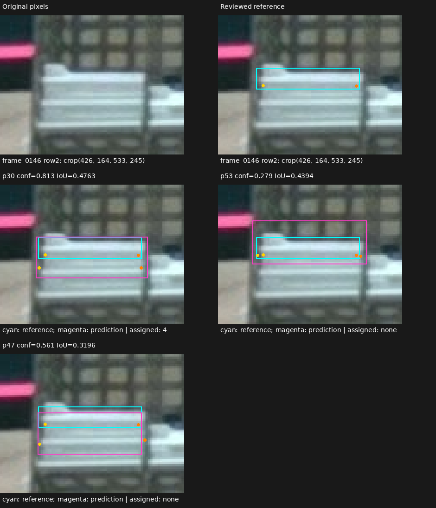
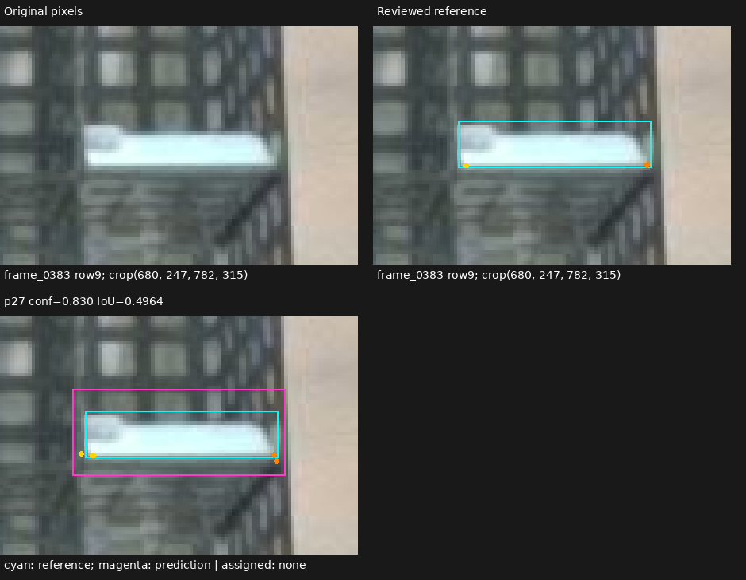

# R42 — what PR127 tells us about unmatched cassette fronts

**The return is internally reproducible. The next useful improvement is more
consistent front-box supervision and a clearly separated error diagnosis.**
Unmatched rows do not all mean that the model failed to produce a front proposal.
All five unmatched references in the three newly completed review images have a
visually plausible saved proposal, with a box that is too tall to pass the fixed
matching rule. This is evidence about these five selected cases, not every miss
in the dataset.

## Deliverables

- [Offline review capsule](../results/review/front-mining-r42/review.zip): original
  photographs, every source-row decision, exact label files, interactive viewer,
  verifier, five unmatched-case figures and audit records.
- [R42 CPU notebook](../notebooks/baomai_front_review_r42.ipynb): retrieve the
  immutable capsule, verify it, view the original-pixel review, and download it.
  It performs no inference or training and requires no GPU.
- [Annotation manifest](../data/reviews/additional-fronts-2026-11-26-r42/manifest.json)
  and [independent review](../data/reviews/additional-fronts-2026-11-26-r42/independent-review.json).
- [Full R41 replay audit](front-mining-r41-audit.json) and
  [fixed-prediction diagnostic](front-mining-r42-diagnostic.json).
- The original [R41 notebook](../notebooks/baomai_front_mining_r41.ipynb) is preserved
  byte-for-byte so the return's actual mining logic is now inspectable in Git.

## What was verified

[PR127](https://github.com/Siuuuers/dl/pull/127), head
`1aa89408089ea848ed7557cc33e195d42612f1f5`, contains the Tesla T4 mining return.
Its archive is 41,161,728 bytes, SHA256
`c73f3cafd916532e727cd6467f580253fa2dd3778f3f19169eb9abc45972f218`.
All 97 ZIP members, 96 inventoried payloads and source pins pass. The original
320-frame pool's 640 image/label payload hashes pass independently.

Reconstructing the primary prediction IDs and replaying the original notebook's
pure postprocessing and selection functions reproduces all 320 saved records,
both CSV files and all 12 selected image identities exactly. The selected PNGs
are pixel-identical to the original JPEGs decoded to RGB. This validates saved
outputs and their processing; the GPU forward pass was not rerun. The recorded
runtime is a T4, FP32, with Ultralytics 8.4.182. A T4 was an allowed fallback.

The whole pool contains 16,733 primary outputs and 16,716 postclip-filtered outputs.
Seventeen outputs were suppressed. The original unqualified labels yield 457
unmatched rows and 4,186 unmatched predictions, with 2,021 in the scorer's
duplicate subset. These are **mining disagreements against unqualified labels**,
not verified misses, physical duplicates, or an accuracy estimate.

On 2026-11-26 the remote `baomai`, `grasp-vision`, and `yolo-pose` heads still
matched the earlier intake pins. This return uses existing frames; it does not
establish newly captured photographs.

## What changed in the annotations

All 12 complete original images and all 507 starting rows were inspected.
The review preserves source IDs and separates the upstream label from the
working baseline, which includes older pilot corrections on three images.

| Result relative to the R41 working labels | Count |
| --- | ---: |
| Retained source rows | 340 |
| Revised source rows | 166 |
| Deleted source rows | 1 |
| Added fronts with new stable identities | 1 |
| Final proposed rows | 507 |
| Source rows with unresolved fields | 55 |
| Complete annotation candidates | 3 images / 129 fronts |
| Held whole images | 9 |

Sixty-three observed corner coordinate slots change. Five previously marked
corners are made unavailable where the image does not support their location;
one actually visible corner is restored. Those field counts overlap the revised
rows and exclude the separate added/deleted instance pair.

### A count can be right while identities are wrong

In `frame_0128`, source row 43 points below the final lower-left cassette front,
onto rack/gripper material. At the same time, the topmost lower-left front was
unlabeled. The review removes source row 43 and adds
`frame_0128:add:lower_left_top:001`. The image still has 43 proposed rows, but they
represent the supported instances more faithfully. Other source IDs are kept.

This image remains held because row 35's upper frontal boundary blends into its
upper surface. A valid identity correction does not settle every boundary.

### A visible object can have a hidden corner

In `frame_0225` and `frame_0301`, several inherited corner coordinates are on the
gripper. The front remains identifiable, so its row remains, while that corner
becomes `0 0 0`. Conversely, the left corner of `0301` row 40 is visible inside
the frame and is restored to an observed coordinate. No hidden coordinate is
borrowed from a prediction or neighboring cassette.

### Whole-image disposition

**Complete assistant-reviewed candidates:** `frame_0146`, `frame_0371`,
`frame_0383`. All three received an independent second assistant review of their
original pixels and final interpretation.

**Held:** `frame_0001`, `frame_0160`, `frame_0038`, `frame_0074`, `frame_0128`,
`frame_0178`, `frame_0225`, `frame_0280`, `frame_0301`. Their exact held fields and
reasons are in the manifest and viewer. Useful corrections remain saved, but no
held image enters the complete-candidate export or the reviewed-label diagnostic.

The holds concern physical ownership or instance identity, not decimal precision.
For example, a few clipped gray rows in `0301` row 43 could belong to another
front or to the preceding front's underside. Both `instance_identity` and `ymin`
remain unresolved. Retaining that provisional strip does not assert an extra
physical cassette and does not make the image an empty negative.

## The same predictions against three label versions

Only the three complete images are used here: 129 reference fronts, 218 fixed
postclip predictions. Box confidence remains 0.13, matching IoU 0.5, and endpoint
confidence 0.5. The original source counts and exact match pairs reproduce.

| Reference version | Matches | Unmatched references | Unmatched predictions | Duplicate subset |
| --- | ---: | ---: | ---: | ---: |
| Original upstream source | 123 | 6 | 95 | 51 |
| R41 working baseline | 121 | 8 | 97 | 44 |
| R42 reviewed labels | 124 | 5 | 94 | 45 |

The duplicate subset is already included in unmatched predictions. It means an
unmatched prediction overlaps an already matched reference at IoU at least 0.5;
it is not a completed physical duplicate review of all 45 cases. The other 49
unmatched predictions have not been individually classified in this pass.

The table records a **reference and matching change**, not a model gain. The
checkpoint and every prediction stay fixed. Tightening a reference can improve
its physical fidelity while increasing an unmatched count elsewhere: source
0383 has one unmatched row, whereas the reviewed version has two. Therefore the
unmatched count is not the rule used to choose annotation boundaries.

### The five remaining unmatched references

| Reference | Plausible saved output | IoU | Diagnostic left/right corner distance |
| --- | ---: | ---: | ---: |
| 0146 source 1 | p49 | 0.4668 | 1.29 / 5.19 px |
| 0146 source 2 | p53 | 0.4394 | 3.24 / 2.71 px |
| 0371 source 9 | p26 | 0.4670 | 3.41 / 4.17 px |
| 0383 source 2 | p33 | 0.4858 | 4.59 / 7.29 px |
| 0383 source 9 | p27 | 0.4964 | 3.27 / 1.89 px |

Original-pixel inspection supports a plausible correspondence in all five cases.
The boxes are approximately 1.8–2.1 times the reviewed thin-front height and
include excess rack/background or adjacent frontal bands. None has a prediction
that meets IoU 0.5 but is lost solely to one-to-one matching competition. These
observations diagnose the outputs; they do not establish the model's internal
recognition state.

The candidate distances above are **diagnostic only**. They are not inserted into
the official matched-endpoint metrics. All five remain officially unmatched.



For 0146 row 2, the mathematically highest-IoU output p30 belongs to the adjacent
row 4. Separate p53 follows row 2's lower corners but extends about 9.9 pixels
too far upward. Merely changing the assignment algorithm would not supply an
IoU-qualified box for row 2.



The other figures are [0146 row 1](images/front-mining-r42/frame_0146_row_001.png),
[0371 row 9](images/front-mining-r42/frame_0371_row_009.png), and
[0383 row 2](images/front-mining-r42/frame_0383_row_002.png).

## The next improvement decision

1. **Keep the current physical target and model architecture.** Tight visible
   front boxes and actual lower-front corners remain the task. The full camera
   image already provides rack context. Enlarging a target to include the rack
   would teach a different boundary and does not follow from these cases.
2. **Prioritize consistent box supervision for thin fronts and reliable labels
   for partly occluded fronts.** The five inspected unmatched cases support a
   localization problem. Other reviewed frames also contain real partly covered
   fronts and incorrectly available corners, so those require correct data,
   not deletion to make a metric look cleaner.
3. **Use the saved 320-frame cache for further review before another GPU run.**
   The three completed images have all 258 reference corners visible. They add
   thin-front examples, but do not yet add the occluded-corner examples needed
   to test improvement on that difficult subset. The nine held images retain
   useful partial work; alternative existing frames can supply clearer cases
   without new photographs or inference.
4. **Then make one controlled training-data comparison.** Hold architecture,
   starting checkpoint, seed, inference and comparison references fixed; change
   only the reviewed training data. Define the training assignment explicitly,
   keep related pool frames out of any purported independent test, and report
   thin-front localization, genuinely absent proposals, duplicate outputs and
   partial-front coverage separately. Existing reused validation remains a
   development comparison.

Increasing confidence or strengthening NMS is not supported as the first fix by
these five cases. For example, the plausible 0146 row-2 proposal has confidence
0.279 and already falls below the IoU gate; raising confidence can discard it
without repairing its box. No additional filtering experiment or model promotion
is part of R42.

## Replay the quantitative comparison

```bash
python scripts/compare_front_mining_r42.py \
  --return-root /path/to/extracted-pr127 \
  --output /path/to/replayed-comparison.json
```

This reproduces the three-image quantitative comparison from the saved cache.
The original-pixel visual interpretations are recorded separately in the published
diagnostic; they are not inferred from a numerical pass.

## Limits and verification

Independent assistant cross-review is recorded without a human-approval claim.
The row verifier checks hashes, exact operation replay, source/output mapping,
canonical missing states, point order, and box/point geometry at the policy's
0.0001-pixel serialization tolerance. Mechanical checks do not establish which
physical surface owns a boundary. The complete-candidate export is checked
against the whole-image gates and label bytes.

All 320 source JPEGs have distinct decoded RGB hashes, and all selected 12
JPEG/PNG pairs are pixel-equal. All 157 frozen rasters were also downloaded and verified against their pinned
hashes: 141,130,768 bytes. There are zero exact byte-hash or decoded-RGB overlaps
with the 320-frame pool, including the selected 12. The complete comparison is
recorded in the independent-review report. Exact nonidentity still does not exclude
lossy re-encoding, crops or near-adjacent frames. Capture independence is not
established, and these mined scenes cannot certify deployment accuracy.

No new GPU inference, training, active-label replacement, merge or model
promotion occurred in this review.
