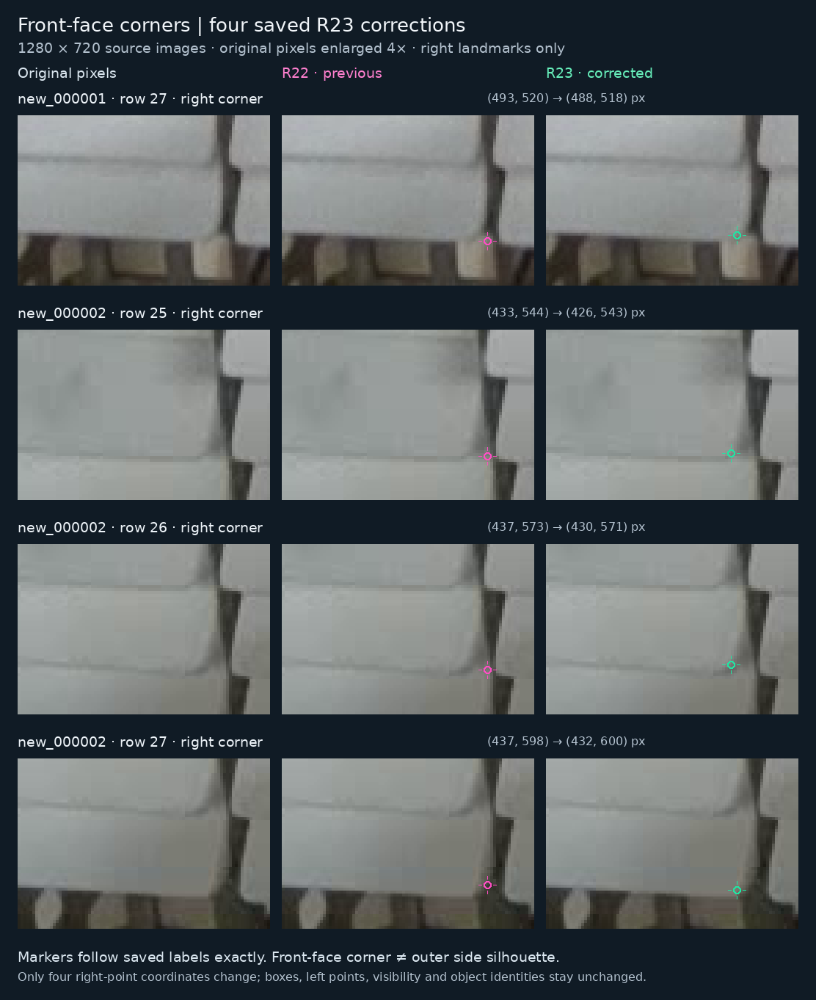

# R23: front-face corners and the next notebook

22 November 2026, Asia/Hong_Kong.

**Run the r23 notebook next. PR35 remains the selected model.** R23 includes
the completed [r22 review and PDF](front-review-r22.md), plus the four named
right-point corrections below. The two-point architecture and training recipe
are unchanged.

## Run

[Open r23 in Colab](https://colab.research.google.com/github/Siuuuers/dl/blob/codex/front-review-r23-20261122/notebooks/baomai_front_review_r23.ipynb)
or download [baomai_front_review_r23.ipynb](../notebooks/baomai_front_review_r23.ipynb).

1. Select a GPU runtime.
2. Choose **Run all**. Connect Drive when offered to retain completed bundles.
3. Return **`baomai-front-review-r23-results.zip`** after both arms finish.

The notebook pins a full source commit and protocol hash, verifies the inputs,
runs a four-batch resource trial and then trains the two independent arms.
Both start from original epoch 173: seed 46, 30 epochs, batch 4, input 1280,
FP32, AdamW and initial learning rate 0.0001. Final-epoch checkpoints are used.
The resource trial does not initialize either full run. Its existing completed-run
checks and Drive/result packaging are preserved.

## The four point corrections

Coordinates below are original 1280×720 pixels, with Y increasing downward.
Rows retain their r22 identities.

| Image | Row | R22 right point | R23 right point |
| --- | ---: | --- | --- |
| new_000001 | 27 | (493, 520) | (488, 518) |
| new_000002 | 25 | (433, 544) | (426, 543) |
| new_000002 | 26 | (437, 573) | (430, 571) |
| new_000002 | 27 | (437, 598) | (432, 600) |

The points follow the actual lower front-face corner instead of the projecting
side silhouette. All four remain visible. Boxes, left points, visibility flags,
classes and instance identities retain their exact r22 tokens. The four
accepted standards (`001:1,19,25` and `002:28`) remain unchanged. The other 155
label files and all development labels are byte-identical to r22.

White-versus-grey appearance is supporting evidence. The [landmark policy](annotation-boundaries-r23.md)
uses front-face geometry and context; it does not use a global colour threshold,
fixed inward offset or automatic snapping to a box. Rounded and blurred corners
leave roughly one or two pixels of visual ambiguity.

## What is actually trained

Both arms keep 137 training images, including 13 empty scenes. The reference
uses PR35 supervision; the candidate uses eligible r23 supervision. Photo 015
and the 31 old-series treatment exclusions retain exact PR35 labels in both
arms. The complete review and the training candidate are therefore different
artifacts.

| Training input | Reference | Candidate |
| --- | ---: | ---: |
| Fronts | 3,771 | 3,784 |
| Locatable points | 6,841 | 6,836 |
| Training images | 137 | 137 |

The original 20-image / 664-front trainer validation stays fixed. Evaluation
uses the frozen 666-front primary reference and 663-front historical reference;
the 662-front current review is reported separately as exploratory evidence.
R23 changes no development labels. The experiment compares the accumulated
eligible review with PR35 supervision; it does not isolate the effect of these
four points alone.

[Exact changes](../results/review/front-review-20261122-r23/operations.json),
[verified candidate](../results/review/front-review-20261122-r23/verification.json),
[staged input readback](../results/review/front-review-20261122-r23/staging-verification.json)
and [notebook verification](../results/review/front-review-20261122-r23/notebook-verification.json)
record the delivered inputs. Preparation verifies the notebook and data; it
does not execute GPU training or demonstrate a new model improvement.

## Model status

[PR96](../results/evaluation/pr96-r21-20261122/README.md) returned the r21
experiment. Its fixed-reference result does not support replacing PR35.
On the same frozen 666-front reference, PR35 / r21 candidate have 648 / 631
matches and 533 / 518 both-corner successes within five pixels, out of 584
eligible fronts. Keep PR35 for current inference.

There is a separate, modest measured gain over original baomai in the earlier
[PR35 comparison](annotation-confirmation-2026-11-11.md#original-reference-retained-separately).
At confidence 0.25 on the same original 664-front reference, unmatched targets
fell from 39 to 36 and unmatched predictions from 63 to 61; both-corner
successes within ten pixels rose from 568/584 to 570/584. Those historical
figures must not be mixed with the current confidence-0.13 scores, and they
are not results of the new r23 labels.
