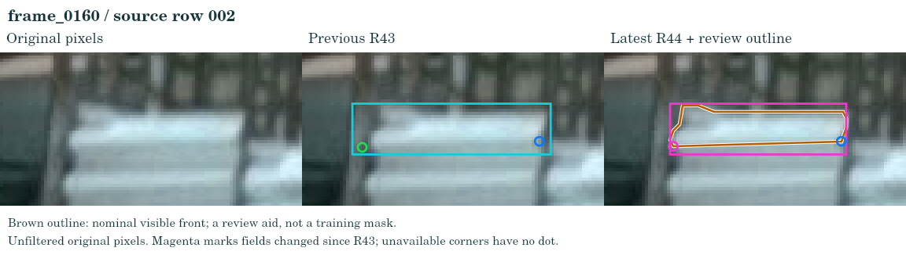

# R44 — complete current-front audit and visible cassette outline

R44 reviews every current front in the **12 selected additional upstream photographs**. It corrects clear corner/rack mistakes, preserves all earlier identities and evidence, and records unresolved surface ownership explicitly. This is an annotation review, not a trained model result.

## Open the result

- Download [review.html](../results/review/front-mining-r44/review.html) and open it in a browser. It contains its images and works offline.
- [review.zip](../results/review/front-mining-r44/review.zip) contains the viewer, all-row ledger, exact proposals, conservative complete-image export, reproducible scripts, and the entire original PR131 return.
- The optional [CPU notebook](../notebooks/baomai_front_review_r44.ipynb) verifies and opens this same package. A new CPU return pull request is unnecessary unless there is new feedback or evidence. It does not train.
- [Training lineage and next experiment](front-review-r44-training-plan.md) explains how additional photographs can enter a controlled training comparison after their labels are qualified.

Select a frame and scroll through **all its rows on the same page**. Previous/Next changes frames. The history selector switches the third panel between R43 and R42; the other panels retain original pixels, the R41 working labels, and the latest R44 proposal. Unchanged rows remain present. The whole-image overlay also provides upstream labels. Five saved prediction comparisons remain explicitly labeled as historical R42 evidence.

For `frame_0160` source row 2, enable the outline toggle. The traced polygon represents a nominal interpretation of the visible front. It is a review aid, **not a segmentation training mask**. No other row receives a fabricated rectangular outline.

## What was reviewed and changed

All 12 full original photographs and all **507 current fronts** were visually inspected. Each current row has an exact before/after decision in [audit-ledger.json](../data/reviews/additional-fronts-2026-11-26-r44/audit-ledger.json). Clear geometry proposals were cross-checked independently; several proposed contractions were withdrawn because they could cut away owned shaded material.

| Relative to R43 | R44 result |
|---|---:|
| Current fronts inspected | 507 |
| Rows with numerical geometry amendments | 100 |
| Rows whose numerical labels are retained | 407 |
| Individual physical corner locations changed | 35 |
| Individual box boundaries changed | 122 |
| New objects / deleted objects / visibility changes | 0 / 0 / 0 |
| Stable identities retained, including the earlier deletion | 508 |
| Current source rows with unresolved fields | 328 |
| Whole images with no unresolved fields | 1 |

The 35 corner changes and 122 boundary changes overlap within rows. These are review counts, not improved detections or model accuracy. The cumulative manifest also contains counts relative to the older R41 working baseline; those must not be mistaken for this round's changes.

| Original photo | Current fronts | Numerically amended rows | Held rows |
|---|---:|---:|---:|
| frame_0001 | 43 | 8 | 34 |
| frame_0160 | 43 | 7 | 1 |
| frame_0383 | 43 | 4 | 0 |
| frame_0038 | 35 | 6 | 26 |
| frame_0074 | 43 | 3 | 34 |
| frame_0128 | 43 | 4 | 32 |
| frame_0146 | 43 | 2 | 31 |
| frame_0178 | 43 | 3 | 36 |
| frame_0225 | 42 | 20 | 37 |
| frame_0280 | 43 | 41 | 32 |
| frame_0301 | 43 | 2 | 34 |
| frame_0371 | 43 | 0 | 31 |

This is exhaustive within the current 12-photo viewer. It is not a claim that all 320 additional photographs have now been physically reviewed.

## The user's marked example: frame_0160 source row 2

The marked image identifies a real miss in the previous review. The continuing gray structure to the left is outside the cassette's sloping frontal contour. The old green point lies on that structure. A general warning that shaded plastic can be gray does not justify retaining this particular rack strip.



Coordinates below refer to the **original 1280 × 720 image**, with x increasing rightward and y increasing downward. They are nominal visual locations, not subpixel measurements.

| Field | R43 | R44 |
|---|---|---|
| Left physical corner | (370.14, 309.35) | **(373, 309)** |
| xmin | 367.02 | **372** |
| xmax | 430.04 | **428** |
| Right corner | (426.45, 307.41) | Retained |
| ymin / ymax | 295.38 / 311.61 | Retained |

The left side has a short raised frontal tab and slopes toward the lower-left turn. The right corner is independently placed at the lower frontal turn; it need not equal the rectangle's xmax/ymax intersection. The bright vertical feature around x=399 continues upward behind the cassette, so it does not create an upward notch in the traced front outline.

The lower transition is soft. A ymax near 310 is plausible, but its roughly 1.6 px difference from the current extent is comparable to boundary uncertainty; that small contraction was not applied. The illustrative contour therefore states approximately 1.5 px uncertainty and does not certify every polygon vertex as exact ground truth. Its purpose is to expose the material interpretation for review. The lateral rack correction is substantially clearer.

Other requested examples:

| Source identity | R44 decision |
|---|---|
| frame_0001:source:025 | Left point → (563,425); xmin → 562. Old left point was on the rack. Upper ownership remains held separately. |
| frame_0160:source:005 | xmin → 369. Retain left point (369.95,322.38), which already touches the soft lower turn; a further one-pixel shift is not established beyond blur. |
| frame_0160:source:009 | Left point → (370,335); xmin → 369. Remove the continuing left rack strip. |
| frame_0160:source:024 | Retain R43 left point (418,465); tighten xmin/xmax to 416/477. |

All requested rows were inspected even when a point was retained. The audit also checked `frame_0001` rows 10–30 and every other current row; it did not uniformly trim them to the brightest band.

## Why color and geometry must be read together

The [current front policy](annotation-policy.md) and [front-labeling guide](front-labeling-guide.md) target one identifiable **visible frontal surface**. Its own molded frontal rim or short protrusion belongs to it. Continuing rack, gripper, a neighboring front, and a broad receding/perforated upper plane must not determine its outer extents.

The historical [PR30 amendment](https://github.com/Siuuuers/dl/blob/fda37dc364f8c6ea54ad23819482dbf21be0534a/docs/reference-amendment-2026-11-10.md) contains both kinds of correction: `new_000054:17` and `new_000056:1` remove definite upper rack; `new_000086`–`new_000090` row 4 restore owned front material that thin lower-band boxes had omitted. For example, `new_000086:4` moved ymin from approximately 132.12 to 122. Thus gray does not universally mean rack or roof.

In each row, follow the visible side contour, lower edge, short owned rim and any geometric change of plane. Continuing uprights across multiple cassettes are strong rack evidence. Color contrast supports that interpretation; it does not replace ownership and orientation. A slanted front's tight axis-aligned rectangle can contain some background internally. The rule concerns what sets its extrema, not whether every pixel inside the rectangle is white.

Likewise, a box overlapping part of the cassette above does not alone prove its ymin is wrong: the target's highest owned corner can occur at the other side of a sloped face. Do not set every top below the preceding row's ymax. Do not infer hidden corners from spacing or the box. Unlocatable corner slots remain exactly `0 0 0`.

## What remains uncertain

The stricter review records 328 held source rows, including all 55 prior held rows. Most new holds concern the highest owned frontal material at a gray interface between stacked fronts. The old coordinate is retained provisionally when the original pixels do not securely distinguish owned shaded front from receding material or a neighboring face. This is uncertainty about the label, not proof that all gray strips are wrong.

`frame_0038:source:035` also has a new front-surface identity hold: a roughly five-pixel-high gray patch at the bottom of the image does not securely establish a visible front versus an upper plane. Its existing candidate row and unavailable points remain preserved.

Only **frame_0383**, containing 43 fronts in **one photograph**, remains in the complete-candidate label export. The other eleven whole images stay out. The previous complete status of `frame_0146` and `frame_0371` is revoked by the new upper-boundary uncertainty. Removing uncertain rows from an otherwise occupied training photograph would incorrectly present those visible fronts as unlabeled background; therefore the gate applies to whole images.

The highest-value next physical clarification is **frame_0160 source row 37's upper frontal edge**: that is the only held row in this otherwise reviewed photograph. A trace of the actual front/upper-plane junction there could qualify the whole 43-front photo. `frame_0001` row 11 is a useful second example for the recurring interlayer ambiguity; any clarified rule still needs case-by-case application to visible contours.

## What PR131 and the new notebook actually do

[PR131](https://github.com/Siuuuers/dl/pull/131) at `7b6c312c492a65a216a678b855f62cb63ee2bdd4` returns exactly the published R43 archive: **4,293,004 bytes, 73 members**, SHA-256 `ae3d7310fd6b2d3a623bd7b8760dc9d6ffc75e6df1be28bbf0a2555fdb380d6e`. The returned archive passed byte identity and the full R43/R42 replay checks. It contains annotation review, not new trained weights.

The documented epoch173 → PR35 / PR123 training lineage used 137 training photos and 20 validation/development photos from the 157-photo `new_*`/`old_*` collection. The additional 320 `frame_*` photos have not entered those documented training inputs. R41 mined them with a frozen checkpoint and selected these 12 for review. That is a plausible coverage limitation; a controlled experiment is still required to establish whether adding qualified examples improves the remaining errors. See the [pinned evidence and comparison design](front-review-r44-training-plan.md).

The `baomai` branch was checked again for this review and still points to `351eb3cf960ccc34829e2bc72e1fa4645acc6295`, the already recorded metadata/data revision. No new baomai revision was found. The `grasp-vision` branch remains at `9a6bf2432582af517d789c94eab2ac27e03a304b`, and `yolo-pose` remains at `72a99dafa1b14bfabd101e639b9ddb5f5aa38d52`.

The R44 notebook is an optional CPU viewer and verification convenience. It does not solve label ambiguity or launch a GPU run. Open the delivered HTML directly if that is simpler. Before a genuine supplementary-data training notebook is launched, freeze the qualified image/label manifest and its split policy, then hold the evaluation references and inference settings fixed.

## Reproduce and verify

From this checkout, using the exact PR131 return ZIP:

```bash
python scripts/build_front_review_r44.py \
  --return-archive /path/to/baomai-front-review-r43-results.zip \
  --audit-ledger data/reviews/additional-fronts-2026-11-26-r44/audit-ledger.json \
  --outlines data/reviews/additional-fronts-2026-11-26-r44/outlines.json \
  --output /tmp/front-review-r44.zip
```

After extracting the portable R44 ZIP, its verifier runs offline with the Python standard library:

```bash
python review.py --check-capsule /path/to/front-review-r44.zip
```

The checker pins the entire returned R43 package, reconstructs its R42 history, replays every R44 decision, checks original image hashes, stable identities, exact unchanged tokens, geometry, canonical missing slots, current export membership and the canonical HTML. Mechanical tolerance is 0.0001 original pixel; visual uncertainty is much larger and remains explicit. A successful checksum or replay does not establish physical correctness or human approval.

The [verification report](front-review-r44-verification.json) records artifact and UI checks. UI verification uses a DOM adapter and real canvas rendering, not a full browser/CSS engine; the browser executable is unavailable in this environment. The active 137/20 dataset and selected model are not modified by this review package.
