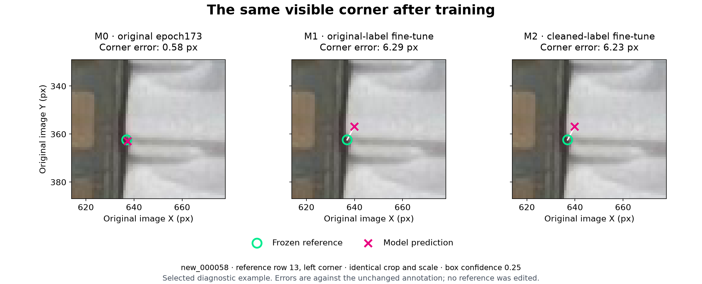

# Baomai A100 comparison: retain epoch173

**Decision on 2026-11-07 (Asia/Hong_Kong): retain the supplied epoch173 model. Neither returned fine-tune passes the predeclared replacement rule.** Both GPU runs completed correctly, but their extra detections and tight corner errors increased. The eleven-row cleanup did not demonstrate a useful model advantage in this experiment.

The returned models are in [PR #13](https://github.com/Siuuuers/dl/pull/13), commit `f860c8cfa071da252edbf5fd1320bf83cdf8d51d`. This report records new inference on all three models, using one common environment and the unchanged development validation set. The current task is image-space cassette localization with the existing two lower-front corners. Camera or robot calibration is outside this comparison.

## What was compared

| Model | Training input | Checkpoint evaluated |
| --- | --- | --- |
| M0 | No additional training | Supplied epoch173 |
| M1 | Original 137 training images and 3,772 object labels | Finalized epoch-30 `reference/fit/weights/last.pt` |
| M2 | Same images; eleven duplicate rows removed from five label files, leaving 3,761 objects | Finalized epoch-30 `candidate/fit/weights/last.pt` |

M1 and M2 started from identical epoch173 bytes, with the same seed, initialization, architecture, resolution, augmentation, optimizer, loss settings and training duration. All 6,839 visible training endpoints were retained by the deletion-only candidate. Validation was identical in both runs.

The training recipe and the original conservative decision rule were declared before these results in [PR #1's experiment plan](https://github.com/Siuuuers/dl/blob/b42e84953d11db6b71f5d032bf1bc911ef6bc00d/docs/refine-cassette-pose.md). At box confidence 0.25, a replacement must have no increase in **FN, total FP, missing visible endpoints, conditional median error or conditional p95 error**, and a strict improvement in at least one. Comparisons use unrounded values. M2 must also pass against M1 before a gain is attributed to the label change.

## Primary measured result

All values below use box confidence 0.25, matching IoU 0.50 and endpoint confidence 0.50. Lower values are better in the first seven rows. Pixel errors are conditional on matched, returned reference-visible endpoints.

| Measure | M0 original | M1 original-label fine-tune | M2 cleaned-label fine-tune |
| --- | ---: | ---: | ---: |
| Missed objects, FN | 39 | 36 | 37 |
| Extra detections, total FP | 63 | 80 | 80 |
| Duplicate FP, included in total FP | 17 | 28 | 27 |
| Missing visible endpoints | 43 | 43 | 44 |
| Median corner error, px | 1.611790 | 2.468005 | 2.473908 |
| 95th-percentile corner error, px | 5.161683 | 6.326759 | 6.282496 |
| False detections across the three empty scenes | 0 | 0 | 0 |
| Matched objects / 664 | 625 | 628 | 627 |
| Object precision | 90.84% | 88.70% | 88.68% |
| Object recall | 94.13% | 94.58% | 94.43% |
| Returned visible endpoints / 1,227 | 1,184 | 1,184 | 1,183 |

M1 finds three additional objects but adds seventeen extra detections. M2 finds two additional objects but also adds seventeen extras and misses one additional visible endpoint. Both have higher median and p95 corner error. **Neither qualifies to replace M0.**

M2 also fails the rule against M1: it has one more missed object, one more missing endpoint and a slightly higher median error, with equal total FP and a slightly lower p95. The differences are small tradeoffs, not evidence that the cleanup improved this model.

The full unrounded statistics and comparisons are in [the machine-readable comparison](gpu-comparison-2026-11-07.json). They are derived from the raw prediction records in [the evidence archive](../results/evaluation/baomai-a100-001/evaluation.zip), not from the training console's best-checkpoint score.

The [execution verification record](gpu-comparison-verification-2026-11-07.json) identifies the clean comparison-code revision, archive hash, successful fresh-restoration replay and two rejected altered-evidence probes. The compact archive contains 58 files and is about 1.12 MiB.

## Tight corner accuracy became worse

This diagnostic counts success only when the same object has **both** corresponding corners returned within the specified radius. Its denominator includes all 584 reference objects with both corners visible, including missed objects.

| Both corners within radius | M0 | M1 | M2 |
| --- | ---: | ---: | ---: |
| 2 px | 263 / 584 = 45.03% | 94 / 584 = 16.10% | 94 / 584 = 16.10% |
| 5 px | 521 / 584 = 89.21% | 479 / 584 = 82.02% | 479 / 584 = 82.02% |
| 10 px | 568 / 584 = 97.26% | 569 / 584 = 97.43% | 569 / 584 = 97.43% |

At 5 px, either fine-tune changes 51 previously successful objects into failures and nine previous failures into successes: a net loss of 42 objects, or 7.19 percentage points. At 10 px each fine-tune gains one object. The result depends on the demanded precision, which is why a loose-radius score alone would conceal this regression. These radii remain illustrative diagnostics; none has been adopted as an application acceptance requirement.

Each model returns both points for 570 of the 584 fully visible objects; these objects need not have identical IDs. Worse 5 px results therefore cannot be explained simply as an aggregate loss of returned pairs.

### Comparing the same reference endpoints

Different models can match different objects or suppress different endpoints. To check that this selection effect was not the sole explanation, the independent audit restricted the calculation to the **1,176 reference endpoint IDs returned by all three models** at the primary setting.

| Metric on this identical subset | M0 | M1 | M2 |
| --- | ---: | ---: | ---: |
| Median error, px | 1.609879 | 2.461262 | 2.466826 |
| p95 error, px | 5.054094 | 6.336479 | 6.299535 |
| Mean signed Y error, prediction minus reference, px | -0.334207 | -1.872966 | -1.879366 |

M2 worsens 919 of these 1,176 endpoint errors and improves 257. Every one of the 17 nonempty validation images has a higher median error on its common reference endpoints after either fine-tune.

Image Y increases downward, so the signed residual shows a broader upward displacement after fine-tuning. This describes the observed error; it does not identify its training cause or justify applying an empirical pixel offset. The matching contract remains the same confidence-greedy one-to-one box matcher throughout.

### A concrete visible-corner example



The figure uses `new_000058`, reference row 13, left endpoint, with an identical crop, original-pixel scale and unchanged reference coordinate `(636.96, 362.43)`. Its error is 0.582 px for M0, 6.289 px for M1 and 6.230 px for M2. All three object matches have IoU near 0.80. The raw original was inspected before constructing this figure; no label was edited. The green ring is the fixed reference and the magenta cross is the prediction.

Another selected case, `new_000059` row 13 right, changes from 1.507 px error to 7.512 / 7.478 px in M1/M2. M2's endpoint confidence is approximately 0.957. High endpoint confidence still does not establish pixel accuracy.

These examples are selected diagnostic cases, not a random sample. The aggregate and common-endpoint calculations above provide the population accounting for this validation set.

## Other checks and tradeoffs

### The threshold sweep does not reverse the decision

| Box confidence | Model | FN | FP | Missing endpoints | Median error, px | p95 error, px |
| --- | --- | ---: | ---: | ---: | ---: | ---: |
| 0.15 | M0 | 33 | 90 | 38 | 1.616650 | 5.238279 |
| 0.15 | M1 | 31 | 111 | 39 | 2.471899 | 6.347772 |
| 0.15 | M2 | 31 | 114 | 39 | 2.476365 | 6.322108 |
| 0.40 | M0 | 42 | 44 | 46 | 1.610708 | 5.173750 |
| 0.40 | M1 | 46 | 52 | 51 | 2.461262 | 6.316113 |
| 0.40 | M2 | 46 | 53 | 51 | 2.466826 | 6.263447 |

Both fine-tunes also fail the same five-metric dominance check against M0 at 0.15 and 0.40. At 0.40 each is worse on all five measures. These are secondary diagnostics; the predeclared primary comparison stays at 0.25. No setting was changed to make one model win.

### Reference-unlocatable endpoints

At confidence 0.25, eligible coordinates are returned on 61 / 66 reference-unlocatable endpoints on matched objects for M0, 65 / 72 for M1, and 64 / 71 for M2. The denominators change because object matches change. These fractions are availability disagreements, not geometric errors for hidden points; no hidden reference coordinate exists. Their decrease in percentage does not by itself establish better occlusion handling. All three genuinely empty scenes remain free of false detections at all three thresholds.

### Training mAP is a different measurement

The returned epoch-30 CSV gives box mAP50-95 of 0.58472 / 0.58433 and pose mAP50-95 of 0.96015 / 0.96013 for M1/M2. These are the training validator's scores, not the fixed-threshold direct-pixel report. They neither reverse the measured corner regression nor establish a physical accuracy tolerance. The training console's final evaluation uses `best.pt`; the predeclared models evaluated here are the finalized epoch-30 `last.pt` files.

## Verified execution and provenance

The return archive has **39,776,601 bytes** and SHA-256 `9ec72f6124027889f8d6b8cf41b939aa4c164cc0ab23063af9064ca64098ad19`. Its 13-member inventory and payload hashes were checked. Both complete bundles passed the repository's checkpoint validator and paired-run consistency check. Independently comparing the receipts and staged manifests found only the expected run paths and five changed training label files; every retained label row is unchanged.

| Execution evidence | Reference M1 | Candidate M2 |
| --- | ---: | ---: |
| Completed epochs | 1-30 | 1-30 |
| Completed training batches | 1,050 | 1,050 |
| Image presentations | 4,110 | 4,110 |
| Actual optimizer updates | 78 | 78 |
| Wall time | 403.29 s | 405.05 s |
| Sampled process-tree host RAM peak | 3,026.19 MiB | 2,993.36 MiB |
| Worker exit code | 0 | 0 |

The 78 updates are consistent with the configured gradient accumulation and warmup schedule; 1,050 batches do not mean 1,050 parameter updates. The shared 83,941 MiB RSS limit is a cap, not observed usage or GPU VRAM.

Training used clean source `707ca254ac624ae956400216deffbefb52a4bc89`, Python 3.13.16, PyTorch 2.14.1+cu130, torchvision 0.29.1+cu130, CUDA 13.0 and Ultralytics 8.4.182 on the recorded NVIDIA A100-SXM4-40GB. Both runs used 30 epochs, batch 4, image size 1280, FP32, AdamW and seed 42. All six source-file hashes recorded in each receipt match the retrieved source.

New inference for **all three models** ran from clean revision `707ca254ac624ae956400216deffbefb52a4bc89` on Linux with Python 3.12.14, PyTorch 2.10.0+cpu, torchvision 0.25.0+cpu, Ultralytics 8.4.182, NumPy 2.5.4, Pillow 13.0.0 and OpenCV 5.0.0.93. Actual backend checks established CPU, FP32, ordinary NMS and four Torch threads. Model heads have the expected two-keypoint shape. Each run completed 60 image/threshold pairs with exit 0; no runtime or NMS time-limit warning was found.

Inference fixed image size 1280, rectangular preprocessing, batch 1, NMS IoU 0.70 and `max_det=300`. Matching IoU was 0.50. Each model used the same ordered images, thresholds and excluded blank-image warmup. The full runtime freeze, commands, source identities and timestamps are preserved in the archive. Offline CPU timings are recorded separately in each summary and are not A100 or live-camera latency claims.

All 20 validation PNGs and labels, their dimensions and counts, and the original checkpoint bytes were independently verified in this evaluation environment. Training-data inventories were compared with frozen metadata and the isolated candidate; this evaluation did not redownload all 137 training images. The original checkpoint, reference data, candidate overlay, inference defaults and returned artifacts were not changed.

| Model | SHA-256 |
| --- | --- |
| M0 | `e0aab1b377491700318e0b14cd4c558ec3c1684087a13b7dde2298ebdbf2847e` |
| M1 | `7dabd1253f8d54f63049c62365647a65d9d390e517898b677412084f25f92bea` |
| M2 | `72793c6874a7e6d5851dd9697c52f2216c92174b65262b605939dbdcea610a9c` |

## Next experiment: test the shared bias warmup

The common training procedure is the next useful target. The original plan explicitly set nominal `lr0=0.0001`, but also **`warmup_bias_lr=0.1`**. Inspection of the [pinned trainer](https://github.com/ultralytics/ultralytics/blob/v8.4.182/ultralytics/engine/trainer.py), `build_optimizer` and `_do_train`, confirms that explicit AdamW preserves this setting. Bias parameters begin at 0.1 while other groups begin at zero. That bias start is **1,000 times the nominal learning rate**. The returned CSV records precisely the expected trajectory:

| End of epoch | Bias group `lr/pg2` | Other groups |
| --- | ---: | ---: |
| 1 | 0.0676514 | 0.000032381 |
| 2 | 0.0343493 | 0.0000635457 |
| 3 | 0.00104489 | 0.0000925105 |
| 4 | 0.0000901 | 0.0000901 |

With 35 batches per epoch and three warmup epochs, warmup lasts 105 batches and includes 19 of the 78 optimizer updates. This was part of our declared recipe, faithfully executed by both GPU runs. It is not evidence of a transfer problem or an unauthorized user change.

**Hypothesis, not established cause:** the high bias warmup may disturb a pretrained model's precise localization. Shared regression and the early learning-rate values justify testing it, but no counterfactual run has yet isolated its effect. The early loss observations involve different batches, so they cannot alone prove a causal explanation.

The proposed bounded next experiment is to restart from M0 using the original reference labels and change **only `warmup_bias_lr: 0.1 -> 0.0001`**. Keep the other optimizer, augmentation, data, seed, image size, batch, 30-epoch duration and final-epoch selection unchanged. Compare against M0 and the current M1 using the same primary metrics and supplementary diagnostics. Reuse M1 as a matched control only if the new run retains the same training software and device environment; otherwise run both old and revised reference recipes in the new environment.

This is a recorded design for the next run, **not a completed experiment or a claimed fix**. Implement an explicitly versioned recipe and its checkpoint verification before execution. The current runner deliberately pins the original recipe. Do not edit old receipts, replace the old recipe silently or change loss weights, augmentation and labels at the same time. A positive bias start of 0.0001 also remains compatible with the runner's positive-learning-rate update witness; a zero start would require separate handling of the initial zero-rate optimizer call.

The reviewed duplicate correction can remain a separate data-quality proposal. Its failure to improve this run does not prove those redundant labels should be retained, nor does it establish that every future fine-tune will fail. First test the shared training setting, then assess the candidate labels under a suitable training recipe if warranted.

## Reproduce without running the models again

From this report's branch, obtain the validation originals through Git LFS and extract the compact evidence archive into a new directory:

```bash
git lfs pull --include='data/images/val/*.png' --exclude=''
python -m zipfile -e results/evaluation/baomai-a100-001/evaluation.zip ../baomai-comparison-evidence
python scripts/summarize_pose_comparison.py \
  --root . --evidence ../baomai-comparison-evidence \
  --output ../baomai-comparison-recomputed.json
```

The summarizer validates completion, matching identities/settings, checkpoint evidence and raw-prediction replay before calculating the decision and shared-endpoint diagnostics. This path uses the Python standard library and does not load model weights. The archive contains complete predictions and per-image results for every model and threshold, quality reports, runtime/command records and the small checkpoint-provenance bundles. Weights remain in the original returned archive in PR #13. Automatically selected overlays are reproducible and are omitted to keep the evidence small.

For an individual candidate replay:

```bash
python scripts/evaluate_pose.py \
  --checkpoint-manifest ../baomai-comparison-evidence/checkpoints/candidate/checkpoint-manifest.json \
  --replay ../baomai-comparison-evidence/m2/predictions.jsonl \
  --overlays 0 --output ../baomai-candidate-replay
```

For fresh inference, extract PR #13's original results ZIP, obtain M0 through Git LFS, and follow [the evaluation guide](evaluate-pose.md) with one common pinned runtime and each explicit checkpoint manifest. The archive preserves the exact commands executed here. Recreate the selected figure with the archived `render_example.py` using the original validation images, Pillow and Matplotlib.

## Limits and continuation

This is one seed on 20 development validation images already used for checkpoint selection and subsequent analysis. The 1,227 endpoints and related images are not independent deployment trials. No independent-test, physical-grasp or repeatable-improvement claim follows from this experiment.

The default stays **M0 epoch173**. Preserve both returned models and their evidence for comparison. The next scoped task is explicit support for the single-variable warmup experiment above, followed by a GPU run and the same evaluation. Broad relabeling, a new architecture, a different threshold per model and an empirical coordinate offset are not supported by this result.
