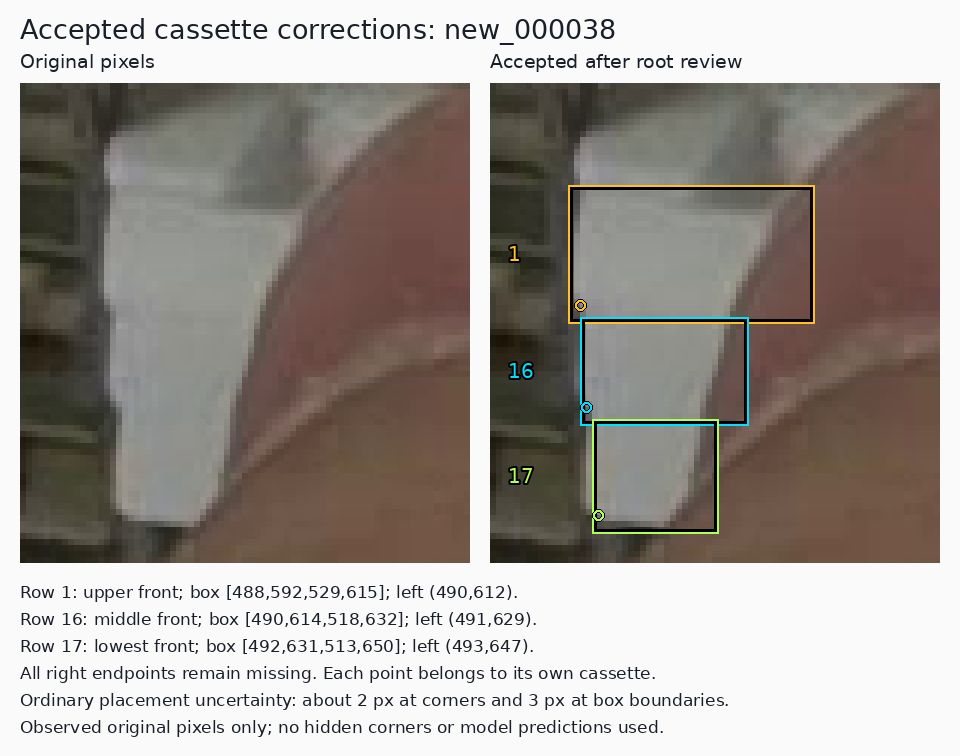
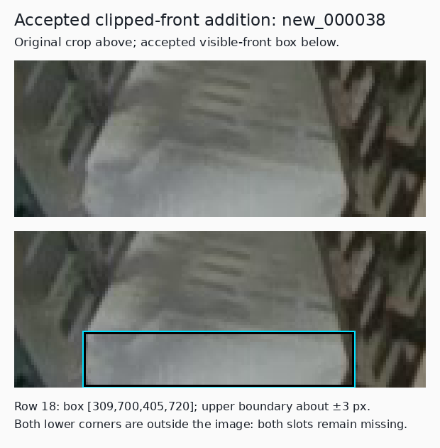
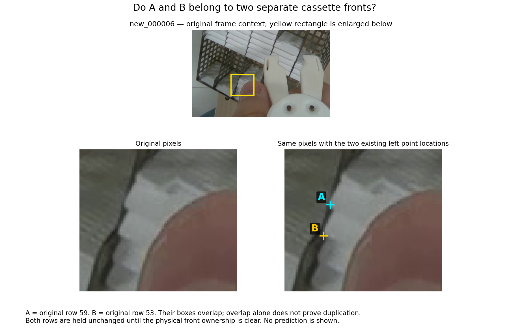

# Reconcile reviewed labels before the next GPU run

Date: 2026-11-14, Asia/Hong_Kong.

**The selected PR35 model was trained with annotation defects identified by later reviews.** Its actual returned training archive records the eight-file `annotations-2026-11-10` overlay. That overlay leaves `new_000038` unchanged, including its single, overly broad row for the three fronts beside the thumb. Later accepted repairs in other images are also absent from those training inputs. Label corrections made after training do not change the existing weights.

This continuation assembles the compatible, previously accepted training corrections and the new three-front repair into one explicitly versioned **review candidate**. Original labels and original validation remain frozen. This is preparation for further review, not a new training result or a claim that every annotation is correct. No GPU job, inference, model promotion or change of runtime defaults is part of this work.

[Reconciled label candidate](../data/candidates/reconciled-labels-2026-11-14/README.md) · [Evidence index](../results/review/label-refinement-20261114/README.md) · [Existing label editor](../tools/cassette_labeler/README.md)

## 1. What the selected model actually learned from

The audit opens the returned PR35 ZIP, verifies its Git blob against immutable revision `8e8bb99cabcb44ed0ec0acd14db911aa44013fd8`, and checks its payload, checkpoint, training receipt and staging inventory. Every effective label hash in both recorded training arms matches the current original or versioned overlay bytes. All 157 original PNG hashes and dimensions and the eight historical training-source hashes also match.

| Identity | Value |
| --- | --- |
| Selected checkpoint | PR35 seed46 candidate `last.pt`, after 30 completed fine-tuning epochs |
| Selected checkpoint SHA-256 | `420c00f73eeba24e587342400878b7d96371d3e745772113809aa705ec8163b1` |
| Original initialization / generic runtime default | Separate epoch173 checkpoint, SHA-256 `e0aab1b377491700318e0b14cd4c558ec3c1684087a13b7dde2298ebdbf2847e` |
| Selected training labels | `annotations-2026-11-10`, exactly eight changed files |
| Recorded training | 137 images; 3,771 objects; 6,841 locatable endpoint slots; 701 missing slots; 13 empty images |
| Recorded validation | Original 20 images; 664 objects; 1,227 locatable slots; 101 missing slots; three empty images |
| Returned archive | 39,776,456 bytes; SHA-256 `df53683ccf6f266a605b2844f42a98e808f75686cfab09f14d680c9d061e8a91` |

The 701 missing slots are not 701 mistakes. Correct labels use `0 0 0` for an actual corner that the original pixels cannot locate. The concrete defects are missing identifiable fronts, incorrect visible-face extents, duplicated instances, and specific corner assignments established by review.

The actual `new_000038` training label has 15 rows and SHA-256 `779961aa5d4fd688831c881c166467802fcaa508954f5184c17ae75f3dd2137b`. Its row 1 has box approximately `[489.43,608.26,617.90,638.00]`, left point `(489.43,608.26,v2)` and missing right point. The reviewed three-front region has only this one source row; no two additional local rows were supplied to PR35.

Other clear later repairs absent from those inputs include four added fronts in `new_000029`, restored observed left points in `new_000033:41/42`, the lower bound of `new_000037:11`, the right bound of `new_000040:14`, and the rack-inclusive box of `old_000042:10`. Their exact source/after bytes and relationship to the returned staging inventory are in the [provenance audit](../results/review/label-refinement-20261114/provenance/audit.json).

These checks establish the inputs named by the returned training evidence. They do not independently attest execution inside a remote GPU process or measure the effect of an individual annotation defect. The earlier epoch173 training itself was not reconstructed. If a generic launcher is used, its epoch173/default-confidence behavior must not be confused with the explicitly selected PR35 review workflow.

## 2. Recover supported corrections across experiment branches

Earlier experiments deliberately compared bounded annotation changes. Consequently, the latest 17-file `remaining-fronts-2026-11-14` candidate is not a union of all earlier reviewed corrections. It omits accepted work from the duplicate, box-refinement, partial-front, visible-extent, consistency, endpoint and composed-front reviews.

The reconciliation identifies each operation by original image, original row and field. Exact retained normalized tokens are preserved. Repeated inherited operations are included once. A historical training candidate's failure to replace PR35 does not itself invalidate the source-image evidence for its labels.

The historical inventory contains 119 distinct accepted field/object operations. Of these, 90 are absent from the 17-file candidate: 59 box changes, 14 instance deletions, six added fronts and 11 endpoint-slot changes. There are no divergent accepted after-tokens or delete-versus-edit conflicts. Held proposals, withdrawn rack additions, scoring-reference changes and the quarantined supplementary pilot are excluded. The later ten-slot endpoint record supersedes its earlier nine-slot version; the recorded dissent about `new_000023:33` right remains visible.

The new revision includes those compatible historical operations and the separately reviewed `new_000038` repair below. It has its own kind, `training_reconciled_overlay`, and its own deterministic verification command. It is not silently substituted into any old experiment or training recipe.

The final overlay changes **40 training label files** and contains **124 field/object operations**: 66 box changes, 20 deletions, 22 additions and 16 endpoint-slot changes. These are totals relative to the frozen originals, not 124 newly discovered errors in this continuation. The new revision differs from PR35's effective training supervision in 33 files.

| Training supervision | Images | Objects | Locatable slots | Missing slots | Empty images |
| --- | ---: | ---: | ---: | ---: | ---: |
| Frozen originals | 137 | 3,772 | 6,839 | 705 | 13 |
| Selected PR35 training inputs | 137 | 3,771 | 6,841 | 701 | 13 |
| Earlier 17-file PR63 candidate | 137 | 3,779 | 6,846 | 712 | 13 |
| Reconciled 40-file review candidate | 137 | **3,774** | **6,849** | **699** | 13 |

The decrease from 3,779 to 3,774 combines newly added fronts with older accepted duplicate/spurious-instance removals. Object count alone is not a quality measure. Every retained operation keeps its original-row identity. For example, deleting original row15 in `new_000102` moves original row53 to output52; its earlier box correction still belongs to original53. All operations from the prior seventeen-file candidate survive, although that file's new row numbering means only sixteen of its label files are byte-identical.

## 3. Correct the three-cassette region by physical ownership

The user's three-instance identification is supported by the original frame. The two intermediate seams and the terminal lower contour distinguish three individual cassette fronts. Each row belongs to one physical front. The original row 1 point belongs to the upper cassette; the withdrawn proposal to move it to the lowest cassette would have mixed object identities.

Root reviewed the original and enlarged original-pixel crops after the reviewer supplied nominations. This is an assistant-reviewed decision, not a blind root review or independent human certification. The accepted geometry uses the observed front and visible rounded lower-left turns:

| Owning front | Original / candidate row | Observed box `[xmin,ymin,xmax,ymax]` | Left corner | Right corner |
| --- | --- | --- | --- | --- |
| Upper beside thumb | Replace original row 1 | `[488,592,529,615]` | `(490,612,v2)` | `0 0 0` |
| Middle beside thumb | Append row 16 | `[490,614,518,632]` | `(491,629,v2)` | `0 0 0` |
| Lowest beside thumb | Append row 17 | `[492,631,513,650]` | `(493,647,v2)` | `0 0 0` |
| Separate bottom-left clipped front | Append row 18 | `[309,700,405,720]` | `0 0 0` | `0 0 0` |

The upper point is a small local placement refinement within its owning front, not the earlier cross-object A-to-B move. The three right corners remain hidden. Both lower corners of the separate clipped front lie outside the image. No point is supplied from model output, another frame, stack spacing or a box corner.

The left-turn locations have about 2 original-image pixels of manual placement uncertainty. The upper front/ledge transition is soft around y591–596; y592 is the adopted observed-face boundary, including plausible shaded front material. The clipped front's upper boundary has roughly 3 px uncertainty. These are recorded placement ranges, not calibrated confidence intervals or guarantees of subpixel accuracy. Soft boundaries do not justify dropping clearly identified fronts or labeling hidden corners as visible.





## 4. Uncertainty stays explicit

The review records distinguish an unlocatable corner from an unresolved object identity. For `new_000033:46`, the actual left turn remains behind the gripper boundary; keep its left slot missing and its existing right slot unchanged. In `new_000014:21/22`, neither actual lateral corner is exposed; both slots stay missing. Those missing states are supported, while their box extents are not newly certified.

`new_000006:53/59` is different: the two rows overlap and their left points are approximately `(465,580)` and `(469.10,560.16)`. The blurred, partly covered surface does not securely settle whether they represent distinct fronts or a redundant instance. Both rows remain unchanged. No deletion follows from overlap alone.



**Question for the owner:** do A and B belong to two separate cassette fronts, or to two features of the same front? If the image is insufficient, record that outcome rather than choosing a convenient count. The answer changes instance count and potentially the visible-face boxes; it does not change the settled corner definition.

Other held physical-identity and extent questions are retained in the [training uncertainty ledger](../results/review/label-refinement-20261114/unresolved/ledger.json), including `new_000041:9`, selected jaw-obscured fronts and thin frame-edge fragments. Withdrawn suggestions and resolved missing-corner cases are recorded separately from open issues. Validation-reference questions are not mixed into this training ledger's release decision.

Recovering the full history uncovered **88 documented open case groups across 64 training images**. This is not a count of 88 proven label errors: one case can contain several rows or a possible omitted object. Three early pilot records alone retain 81 rows with 163 explicitly unresolved fields, including seven identity questions. The compact ledger summary distinguishes 44 instance/possible-omission groups, three physical-corner groups, surface-boundary and legacy-box questions, and seven older extent flags that first need row localization. Seven generic scope or precision caveats are separately non-blocking. Ordinary 2–3 px placement uncertainty on an accepted visible junction is not automatically a new human-decision blocker.

All 137 training IDs have membership in a documented targeted review, but that is not per-row certification. The candidate therefore has `release_ready: false`. Before calling it a complete corrected training release, resolve each relevant open case or explicitly version a quarantine with its changed split/counts. This work does neither silently.

## 5. Reproducibility and the next decision

The canonical annotation-policy file is restored byte-for-byte to the existing `74dd9439…` version pinned by the current candidates. Earlier explanatory paragraphs added to that file had changed its hash and broken verification. Their guidance remains in the separate [target clarification](target-clarification-2026-11-14.md); no settled target or inference behavior is lost. Historical `3cda361a…` policy bytes remain in their existing snapshot. No old manifest or verifier is repinned to disguise a mismatch.

The new reconciliation verifier reconstructs the candidate from frozen originals and hash-bound accepted operations, checks original row maps, exact retained bytes, all effective label geometry and unchanged validation, and preserves the unresolved release state. It is a review build, not a supported input to an old GPU recipe. Existing historical verifiers remain unchanged.

Final verification passes for all 40 payload files and all 157 original image/label identities. A separate reviewer followed 240 historical origin records, checked 75 modified source rows and 1,358 unchanged rows inside the changed files, and independently confirmed the 20 deletions and 22 additions. Disposable corrupted copies with a changed retained token or an extra validation label were rejected. The final portable candidate keeps exactly the same 40 label hashes as that independent review. The [evidence index](../results/review/label-refinement-20261114/README.md) links the actual receipts.

To reproduce the provenance audit with the actual returned PR35 archive and hydrated originals:

```bash
python -B scripts/audit_pr35_label_provenance.py \
  --archive /path/to/baomai-reviewed-annotations-seed46-results.zip \
  --output /tmp/pr35-label-audit
```

The output directory must be new or empty. The archive is the one stored in [immutable PR35](https://github.com/Siuuuers/dl/blob/8e8bb99cabcb44ed0ec0acd14db911aa44013fd8/results/gpu/baomai-reviewed-annotations-seed46-l4-001/baomai-reviewed-annotations-seed46-results.zip). A Git LFS pointer is not the archive.

No improvement in trained-model performance follows from this label-only revision. PR35 remains the review model at input1280, box cutoff0.13, NMS0.70 and endpoint cutoff0.50. Its existing development misses and extras still apply. After the labels are resolved and frozen, the next experiment can compare this exact revision with a fixed control while keeping the development scoring reference separate. More training or a lower confidence threshold cannot establish the correct physical target in an ambiguous original.
