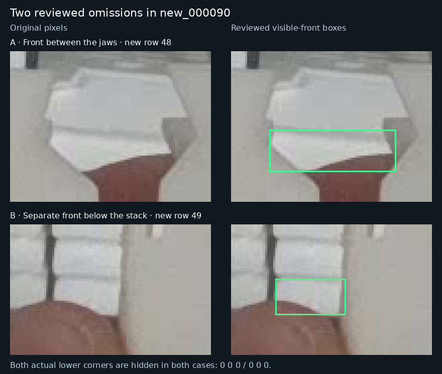

# Review lower-confidence proposals and correct two omissions

**Use the seed46 candidate at box confidence 0.15 for our assistant-reviewed annotation workflow. Keep NMS 0.70, endpoint cutoff 0.50 and 1280 inference.** This is a deliberate proposal-collection setting under the user's delegated review authority. The runtime default and fixed historical comparison remain epoch173/0.25. Predictions still require image-based adjudication before becoming labels.

The original-image review found **two omitted partial fronts**. They are now added to the separately versioned [2026-11-11 reference](../data/references/visible-front-2026-11-11/README.md), with both actual lower corners marked unavailable. The complete 20-image label set contains **663 objects and 1,228 locatable corners**. These are validation-reference corrections; no training labels or model weights changed.

## What was reviewed

The saved candidate predictions at 0.15 contain all **689 predictions from 0.25 exactly unchanged**, plus **29 additional proposals across nine images**. Under the earlier PR30 reference those additions were three new matches and 26 extras. Reviewers inspected all nine originals and all 29 additions, then compared them with the reference and adopted visible-front policy. Scorer categories were not treated as physical truth: many extras describe already annotated fronts with different or excessively broad boxes.

Two original-pixel reviews and a root review agreed that `new_000090` contains these omitted instances:

| Added row | Visible-front rectangle, original pixels | Supported interpretation |
| --- | --- | --- |
| 48 | `[674, 474, 737, 495]` | Lower front facet between the jaws, below the broad upper surface |
| 49 | `[572, 527, 607, 545]` | Separate front below existing row 42, partly covered by the thumb and jaw |



Both slots in both rows are exactly `0 0 0`. The visible occlusion intersections do not establish the actual outer lower corners. Final integer rectangles were fixed before amended-reference scoring; independent boundary choices differed by 1–2 pixels along soft edges. All existing rows and all nineteen earlier unresolved dispositions remain intact. The separate `011:61` boundary/identity caveat remains open.

## Fair comparison on the corrected reference

The [complete saved-prediction replay](../results/verification/baomai-low-confidence-20261111/reference-replay.json.gz) scores the same epoch173, control and candidate predictions against both references at all three stored thresholds. Nothing is retrained or reinferred.

| Model | Box confidence | Misses / 663 | Extras | Both corners within 10 px / 584 | Miss-free nonempty images / 17 |
| --- | ---: | ---: | ---: | ---: | ---: |
| Epoch173 | 0.25 | 28 | 53 | 575 | 4 |
| Seed46 control | 0.25 | 25 | 57 | 578 | 3 |
| Seed46 candidate | 0.25 | 26 | 52 | 577 | 3 |
| Epoch173 | 0.15 | 23 | 81 | 575 | 5 |
| Seed46 control | 0.15 | 22 | 75 | 578 | 3 |
| **Seed46 candidate — review setting** | **0.15** | **21** | **76** | **577** | **3** |

At the fixed primary 0.25 comparison, the candidate now misses one more object than its control. At 0.15 it misses one fewer, at one extra proposal and one fewer 10 px pair success. The chosen review setting follows the user's object-miss priority; it is not a claim that the candidate dominates every measure. Epoch173 at 0.15 has more miss-free scenes despite more total misses.

For the candidate alone, lowering 0.25 to 0.15 adds **29 proposals: five reference matches and 24 extras**. The five additional matches are `008:1`, `009:52`, `011:61`, `090:48` and `090:49`. The `011:61` reference caveat is not resolved by the match. Both new `090` fronts match only at 0.15 for this candidate; the baseline already matches row 48 at 0.25, which is why every model was rescored fairly.

The candidate's recall/precision at the review setting are **642/663 = 96.83%** and **642/718 = 89.42%**. Neither the 5 px nor 10 px pair-success count changes when lowering its confidence. Only one additional locatable endpoint is returned, on `009:52`; that proposal's hidden right point remains unsupported. The new zero-corner fronts also receive confident predicted points, but the reviewed labels correctly leave those points unavailable. The review setting improves proposal coverage; it does not establish reliable hidden-corner estimation or unattended scene completeness.

## Practical workflow and stopping point

Use the [verified candidate command](predict-pose-folder.md#assistant-reviewed-proposals) with `--conf 0.15`. Review extra proposals against the original pixels, preserve one row per identifiable front, and keep unsupported points missing. No additional editor or inference mode is needed. The new reference label files already use the existing HTML editor's format.

This pass is complete. It accepts two reference additions, records all 29 proposal decisions, and does not justify another training run from these validation images. Twenty repeatedly used development images remain development evidence. Better annotation, changed threshold behavior and improved trained weights are separate outcomes; this pass changes the first two.

## Evidence and reproduction

- [Numerical proposal inventory](../results/verification/baomai-low-confidence-20261111/numerical-audit.json): exact retained prediction equality, all additions, row associations and endpoint consequences under PR30.
- [Original-pixel review A](../results/verification/baomai-low-confidence-20261111/visual-a.json) and [review B](../results/verification/baomai-low-confidence-20261111/visual-b.json): all 29 cases, original hashes and uncertainty.
- [Independent review of the two omissions](../results/verification/baomai-low-confidence-20261111/independent-090-review.json): separately selected original-pixel extents before amended scoring.
- [New reference manifest](../data/references/visible-front-2026-11-11/manifest.json): exact rows, parent identity, complete file hashes and preserved dispositions.

```bash
python3 results/verification/baomai-low-confidence-20261111/rescore_reference.py --check
```

The replay first reproduces all 180 old per-image scores and quality records and all nine old aggregates exactly, then scores the frozen new reference. Between reference versions at each fixed model/threshold, no previously existing-row match is lost, gained or reassigned, and no retained endpoint state/error changes. The full result is deterministically compressed; use `--output /tmp/reference-replay.json` for an uncompressed copy. The earlier [readiness snapshot](readiness-2026-11-11.md) remains explicitly tied to PR30's 661-object reference.
