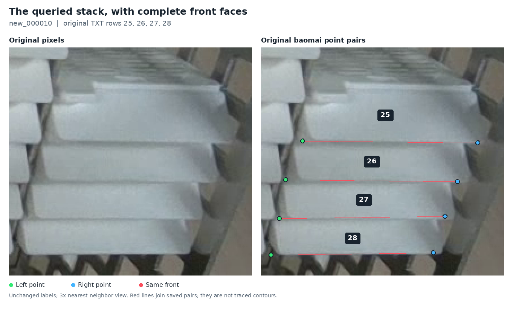

# Apply the existing lower-front annotation guidance

**Editor follow-up, 2026-11-13:** the [browser editor](../tools/cassette_labeler/README.md) now rejects the malformed import/save states described in section 5, preserves invalid imported text for explicit correction, and validates the serialized label before writing. All 157 frozen source label files remain accepted. The historical audit below and its evidence retain their original scope; this preventive fix changes no saved labels or model weights.

**Later follow-up:** the [original-image adjudication](corner-adjudication-2026-11-12.md) resolves the bounded left-point review with two amendments: row 28 moves onto the exposed wax turn and row 32 becomes unlocatable. The other reviewed left points are retained, and the physical-visibility disagreement beside the hand is preserved. The [new reference](../data/references/visible-front-adjudication-2026-11-12/README.md) has 1,227 locatable and 99 missing endpoints. The audit and counts below describe the earlier reference at the revision named here; its evidence JSON is unchanged.

**The target definition is already settled.** The current policy and the inspected examples use the actual two bottom-edge corners of the white wax block's front face. The current reference passes all checked representation and geometry rules. Some inherited point locations remain unresolved, so this is not a certification that every saved coordinate is physically correct.

The user reaffirmed the existing upstream guidance on 2026-11-12. This audit checks the current proposed PR56 reference and the selected PR35 training-label composition at revision `40fa0f1ee863b3458feec0db1cf40086dab4538f`. It corrects the earlier source guide's suggestion that the user needed to choose between different landmarks. The guidance already excludes an upper shoulder or lip when it belongs to a different edge.

## 1. What the rule requires

The upstream [runtime README](https://github.com/an94-doll/embedding_vision/blob/351eb3cf960ccc34829e2bc72e1fa4645acc6295/README.md) and [data README](https://github.com/an94-doll/embedding_vision/blob/351eb3cf960ccc34829e2bc72e1fa4645acc6295/data/README.md) remain the source for the physical target. The current [annotation policy](annotation-policy.md), especially sections 3–5 and 8, applies that target to accepted references and distinguishes context-derived proposals.

| Guidance | Operational meaning | Result of this pass |
| --- | --- | --- |
| Actual corners on the lower edge of the white front | Identify one physical front and its side-to-lower-edge turns | Reviewed visible examples generally follow this; unresolved cases below remain open |
| Exclude upper rim, support and rack | A nearby corner on another surface cannot substitute for the required feature | No new clear wrong-feature assignment found in the inspected examples |
| Order along image X | Left point precedes right point when both are locatable | All checked saved labels pass; equal Y is not required |
| Visible and reliably locatable reference point | Store `x y 2` from original-image evidence | Current `v=2` values are not all newly visually certified |
| Unreliable, hidden or out-of-frame reference point | Store `0 0 0`; preserve the other endpoint independently | Every checked missing slot is canonical |
| Display prediction above its endpoint threshold | Apply confidence and in-image conditions to the model output | Normal live and folder overlays use these gates |
| Join both displayed points | Draw a line only when both gates pass | Normal live and folder overlays comply |

White identifies the physical object, not a pixel-intensity threshold. Its surface can appear gray in shadow. Similarly, a rounded visible turn may be locatable without being an infinitely sharp vertex. A point should not be moved to the first bright pixel, the most extreme dark pixel or a mathematical intersection of extrapolated edges solely to make its coordinates look regular.

In the current reference, **582 of 584 pairs with two visible points have unequal Y coordinates**. This is compatible with the rule: perspective can tilt the lower edge. The physical target is selected first and the endpoints are then ordered by image X.

## 2. What was checked mechanically

The [structural audit](../results/review/lower-front-guidance-20261112/structural-audit.json) records counts, source hashes and the exact selected training composition. An independent pass used the existing `parse_pose_labels()` and `check_geometry()` helpers, with their current Git blob identities verified against the audited tree. That pass checks positive box dimensions, class, field count, finite values, normalized coordinates, canonical missing points, image-X order, strict visible-point bounds and point containment with the existing serialization tolerance.

| Label view | Images | Objects | Visible endpoints | Missing slots | Checked violations |
| --- | ---: | ---: | ---: | ---: | ---: |
| Original baomai train | 137 | 3,772 | 6,839 | 705 | 0 |
| Original baomai validation | 20 | 664 | 1,227 | 101 | 0 |
| Effective training labels used by selected PR35 | 137 | 3,771 | 6,841 | 701 | 0 |
| Proposed PR56 development reference | 20 | 663 | 1,228 | 98 | 0 |

The PR35 training view uses the original 137 training labels with only the eight declared overrides from `annotations-2026-11-10`: `new_000065`, `067`, `068`, `072`, `097`, `101`, `102`, and `103`. Historical candidates are not combined implicitly. All original source hashes, declared overlay hashes and current reference label hashes verify.

The PR56 reference contains 584 objects with two locatable corners, 60 with one and 19 with neither; three images are empty. A few computed box edges differ from the frame boundary by at most 0.0000064 source pixels due to decimal normalization. They pass the existing 0.0001-pixel numerical tolerance and are not annotation accuracy claims.

These are separate label views. PR56's latest six-point change is an evaluation-reference refinement. It does not update the training data used to produce PR35 or teach an unchanged checkpoint anything new. This audit is not a rerun of the full historical training-candidate verifier, inference, scoring or training.

## 3. Original-image findings

The visual pass covered all 32 current rows in `new_000010` and nine selected full-front precedents in `new_000008` and `new_000009`. Reviewers could see the current labels and earlier review context; this was not a blind audit. No new model output was loaded or copied. The [visual audit record](../results/review/lower-front-guidance-20261112/corner-audit.json) preserves each disposition.

| Case | Finding | Disposition |
| --- | --- | --- |
| `010`: 15R, 16R, 22R, 23R, 24R, 31L | The six accepted refinements lie on visible lower-front turns | Retain the six refinements |
| `010`: 25L | Saved point remains defensible at its lower-front turn | Retain |
| `010`: **26L, 27L, 28L** | Lower-seam ownership is clear, but the shaded outer material versus brighter interior turn remains indistinct | Retain as unresolved inherited positions; no precise replacement established |
| `010`: **32L** | A small white tip meets the hand; it may be the actual corner or an occlusion intersection | Its inherited `v=2` is not certified by this pass |
| `010`: rows 13/14, 23L, 24L, 29R, row 30, 31R and 32R | Holder, hand or frame boundary prevents locating the actual endpoint | Keep the existing missing slots |
| `008`: row 20, rows 28–32; `009`: rows 46–48 | Saved points refer to lower-front endpoint regions, with some rounded-turn placement uncertainty | No new precise change justified |

The four unresolved visible points in `010` are **26L, 27L, 28L and 32L**. That is a statement about this inspected image, not a count of all uncertain points in the complete dataset. Row 14's object identity and box extent also remain a separate inherited issue. A visual pass with no clear new wrong-feature assignment does not certify complete object coverage or every box boundary.

### Retained history is not confirmed ground truth

The proposed PR56 reference remains a bounded amendment of an inherited reference. Its unresolved legacy values remain visible in the record; they are not silently promoted to reliable truth. This is permitted for a disclosed incremental comparison under policy section 5, but it is insufficient for a claim of a fully adjudicated dataset.

For a new, fully adjudicated label release, resolve affected cases from evidence or explicitly quarantine affected images with recorded counts and split decisions. If adjudication establishes that a particular actual corner cannot be located, use `0 0 0` in a separately versioned reference. Preserve historical reference bytes and rerun any affected comparison against the new version. Do not change or suppress a troublesome point merely because doing so improves a model score.

No new coordinate or visibility edit is justified by this audit alone. In particular, the guidance does not justify either moving all shaded points inward or filling hidden corners from rack geometry.

## 4. Reference visibility and prediction confidence

A reference label's `v=2` is an annotation state. A model endpoint's confidence is a prediction score. They answer different questions:

- The reference asks whether the actual required corner can be located from the image.
- The normal display asks whether a model output passes the chosen confidence and image-bounds gate.

A high-confidence prediction can still land on an occluder, support or wrong turn. A low-confidence prediction does not make a visibly locatable reference point disappear. Object identity is also independent: an identifiable front can retain its box even when neither corner is locatable.

The live [`render()`](../scripts/view_d405_yolo.py) and folder prediction renderer already require both display gates before drawing a connecting line. Their normal behavior needs no geometry change. Diagnostic mode deliberately exposes rejected coordinates as orange crosses for review.

This change makes two display-text corrections in the live diagnostics:

- `VISIBLE` / `HIDDEN` becomes **`SHOWN` / `NOT SHOWN`**.
- The header's `hidden-kp` counter becomes **`low-conf-kp`**, accurately naming its existing below-threshold count.

Coordinates, confidence conditions, connecting-line conditions and serialized output fields remain the same. Syntax validation passes, and an AST comparison is identical after restoring only these text literals. No camera run was performed for this text-only change.

## 5. Remaining tooling boundary

The browser editor's missing-point controls produce canonical `0 0 0` and its point-placement controls produce `v=2`. It is a correction surface, not a semantic validator. Its current import/save path can accept some malformed states that the subsequent project validator rejects: a nonzero missing sentinel, reversed visible X order or a visible point on the excluded right boundary. This audit found no such state in the checked saved labels. Earlier rejection in the editor is a separate small improvement; the existing staging/geometry validation remains required.

Similarly, model-generated annotation exports are drafts. Their proposed `v=2` flags are not established physical visibility until original-image review accepts them. Context estimates from the earlier pilot remain separately identified and are not replacements for observed reference points.

## Verification and next action

The [verification record](../results/review/lower-front-guidance-20261112/verification.json) pins the checked source revision, helper identities, label-view counts and the diagnostic text change. All original, training-overlay and proposed-reference label bytes retain their prior identities. Frozen review and replay evidence remain intact.

The next annotation work is to resolve the four identified ambiguous points under the existing rule, then continue a bounded consistency review of already available training material. This pass establishes no need for a new landmark, a new architecture, a threshold search or an immediate training run. PR35 remains the selected checkpoint under the existing reviewed workflow.
