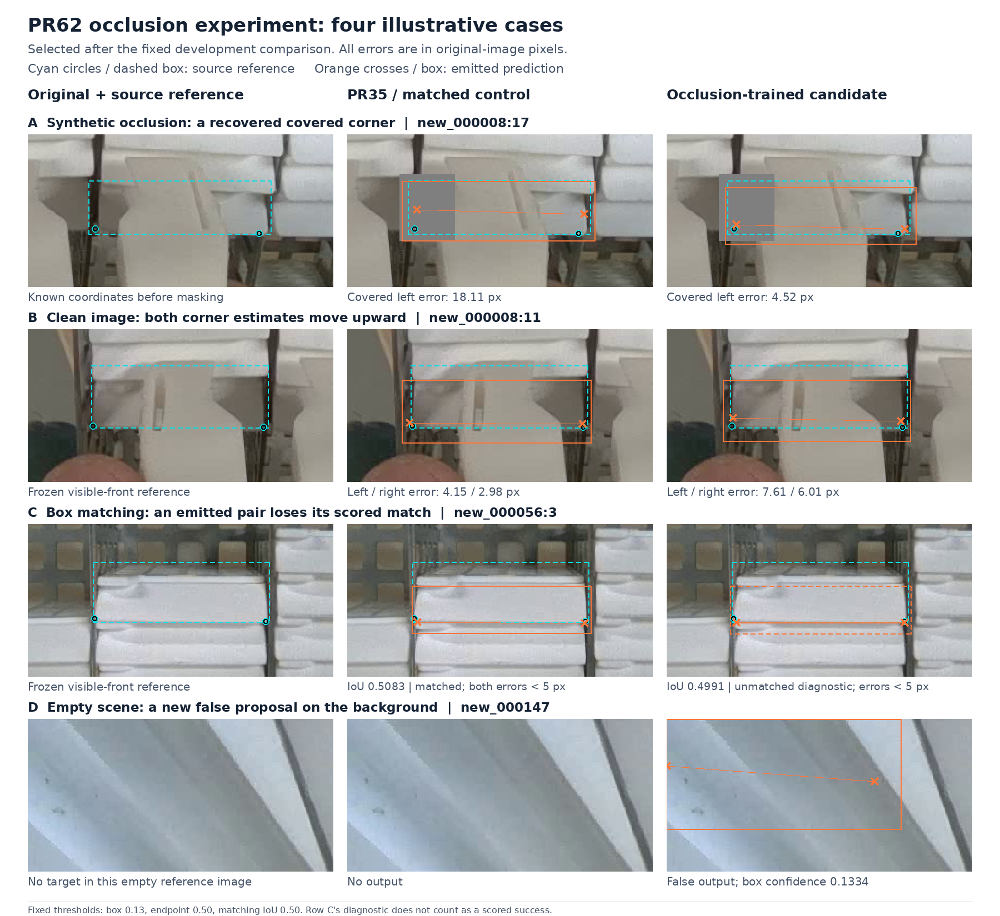

# PR62 occlusion-training results: retain PR35

## Decision

**Keep PR35 for reviewed image proposals at input 1280, box confidence 0.13, NMS 0.70 and endpoint confidence 0.50.** The returned candidate improves the fixed synthetic-occlusion probe, but fails the prospectively declared clean-image preservation rule. This experiment is complete; no repeat GPU run is needed.

The interrupted result publication has been reconstructed from the actual [PR62 return](https://github.com/Siuuuers/dl/pull/62), with new CPU inference, exact historical reproduction, offline replay and independent arithmetic verification. The evidence and replay code belong on the [PR61 source stack](https://github.com/Siuuuers/dl/pull/61); PR62 remains the returned-artifact branch.

The model is useful for assistant-reviewed proposals. These results do not establish automatic whole-image completeness, accurate naturally hidden coordinates, or that further improvement is impossible. Continue inspecting the full original image, including areas without proposals.

## What was actually compared

The [frozen protocol](../experiments/occlusion-training-2026-11-13.json) was declared before training. Both roles use the same 137 training originals, exact PR35 label composition, independent original epoch173 initialization, seed 46, batch 4, input 1280 and final epoch-30 checkpoint. The candidate alone applies the known-corner pixel corruption. Both use unmodified validation images during training.

The 39,788,156-byte returned archive has SHA-256:

```text
4c94b9ae2496b0ab8846941e7da61eba4931630b805ca7f35a0a9272fc486cad
```

Its 14 files pass the existing paired-run verifier, including actual checkpoint bytes, receipts, source identities, training inventory, all 30 epochs, 4,110 image presentations and 1,050 batches per role. Both ran on the recorded A100 runtime. The candidate applied 1,839 masks, covering 4,521 known endpoint observations; 2,682 were collateral endpoints on other objects. The control planned the same masks with the same planning digest and applied none. These are repeated training exposures, not counts of independent objects.

Evaluation uses the unchanged 20-image, 663-object development reference, containing 1,227 locatable endpoints and 584 objects with two locatable corners. All three checkpoints use the same CPU inference settings and pinned Ultralytics 8.4.182 / Torch 2.10.0+cpu / NumPy 2.2.6 / Pillow 11.3.0 / OpenCV 4.11.0.86 environment. Training and evaluation runtime versions are separately recorded.

Fresh inference covers all 20 clean images for all three checkpoints plus the 90 masked inputs for each new role: **240 new image predictions**, excluding three blank warmups. The 94 published PR35 probe predictions are hash-bound and replayed. PR35's 20 fresh clean prediction arrays reproduce the published arrays exactly. The matched control's raw arrays equal PR35 on **all 20 clean and all 94 probe cases**. Its column can therefore be combined with PR35 below; equality was checked, not assumed from summary scores.

## Clean-image result

| Measure | PR35 / matched control | Candidate |
| --- | ---: | ---: |
| Matched reference objects / 663 | 643 | 643 |
| Scored misses | 20 | 20 |
| Unmatched proposals | 85 | 86 |
| Scored duplicate proposals | 31 | 28 |
| Returned locatable endpoints / 1,227 | 1,207 | 1,205 |
| Both endpoints available / 584 eligible pairs | 578 | 577 |
| Both errors at most 5 px / 584 | 529 | 530 |
| Both errors at most 10 px / 584 | 577 | 577 |
| Outputs on the three empty images | 0 | 1 |
| Nonempty images with no scored misses / 17 | 3 | 3 |
| Nonempty images with neither scored misses nor extras / 17 | 0 | 0 |

"Unmatched" and "duplicate" are outcomes of the fixed box-association rule; not every scored extra is automatically a nonexistent physical object. The new empty-scene proposal was separately inspected and is a genuine background error.

The aggregate increase from 529 to 530 five-pixel successes consists of **10 gained and nine lost identities**. The unchanged 577 ten-pixel total hides one gain and one loss. All identities remain in the evidence; aggregate improvements do not erase existing failures.

## What explains the changes

### One pair loses its match while its coordinates remain accurate

For `new_000056:3`, PR35's box has IoU **0.508325** with the reference; the corresponding candidate proposal has IoU **0.499087**. The matching threshold is 0.50. Its actual emitted endpoint errors are **4.635 / 1.132 px**, compared with PR35's **4.647 / 1.417 px**. Both candidate coordinates still pass the display threshold and lie within 5 px of the frozen reference.

This single lost box association explains the two-count reduction in returned locatable endpoints and the lost available/5/10-pixel pair. It does not show that the network stopped returning those coordinates. The candidate proposal remains an explicitly labelled diagnostic; it is not promoted into a canonical scored success, and the fixed matching rule is unchanged.

The sole gained match, `new_000009:56`, also corresponds to a proposal already present in PR35: IoU changes from **0.423989 to 0.539514**. Original-image inspection supports the same partially occluded patch, not a newly discovered physical front. Both reference corners are unlocatable, so this case supplies no measurable hidden-coordinate success.

### Some clean coordinate changes are real; small threshold crossings need restraint

For `new_000008:11`, both candidate points visibly move upward from the exposed lower-front edge. Left/right errors change from **4.148 / 2.984 px to 7.612 / 6.013 px**. Both proposals still match the same reference object, so the regression is not caused by losing the box association.

Seven other lost five-pixel pairs have smaller coordinate changes near soft or chamfered boundaries. Their scored losses remain, but movements of roughly 0.5–1.8 px should not be described as seven independently decisive physical failures. Annotation uncertainty and a hard five-pixel cutoff matter. The gained five-pixel cases also include small threshold crossings. This review does not change the evaluation labels after seeing the model output.

### A clean scored gain also involves duplicate ranking

For `new_000007:15`, the canonically matched errors improve from **14.60 / 14.36 to 5.70 / 1.67 px**, but PR35 already emits another proposal with errors **4.76 / 3.93 px** and reference IoU **0.850809**. PR35's less accurate proposal has slightly higher box confidence, **0.304644 versus 0.300398**, so the confidence-ordered association assigns it to the reference first and leaves the accurate alternative unmatched. The candidate ranks its more accurate proposal higher, **0.479245 versus 0.307360**; its poorer duplicate remains in the output.

The fixed ten-pixel score therefore gains a success through a changed proposal ranking as well as changed coordinates. It does not demonstrate that an accurate pair was previously unavailable, or that duplicate outputs were removed. The candidate's selected left point also exceeds five pixels, whereas PR35's unassigned alternative has both errors below five pixels. This diagnostic preserves all emitted proposals and leaves the canonical scores unchanged.

Two of the ten gained five-pixel identities, `new_000009:13` and `new_000011:4`, likewise already have unmatched PR35 alternatives with both errors below five pixels. Their canonically selected pairs improve, but these are not newly available accurate pairs. The [additional case review](../results/verification/baomai-occlusion-results-20261114/additional-case-review.json) records the exact alternative indices, confidences, overlaps and errors. The four supporting synthetic-occlusion gains below do not have this already-successful-baseline-alternative explanation under the fixed matching threshold.

### The new empty-scene output is genuine

On `new_000147`, the candidate emits a box over the upper-left wall/pipe background, at box confidence **0.133380**. PR35/control emit nothing. Its two endpoint scores are approximately **0.948 and 0.830**, so both points and the connecting line satisfy the current display conditions despite the absence of a target.

This is a real error at the preselected 0.13 operating threshold. Raising the threshold after seeing this example would change the experiment and could discard useful low-confidence proposals elsewhere; no threshold search or production setting change was made.



The figure was selected after the fixed evaluation to explain mechanisms. It is not a representative sample or an independent test. Its [index](images/occlusion-results-20261114-index.json) records exact source hashes, crop coordinates, masks, predictions and model identities.

## Synthetic-occlusion result

| Fixed probe measure | PR35 / control | Candidate |
| --- | ---: | ---: |
| Covered left corner within 10 px | 28/30 | 29/30 |
| Covered right corner within 10 px | 26/30 | 29/30 |
| Covered-side total within 10 px | 54/60 | 58/60 |
| Covered left corner within 5 px | 22/30 | 24/30 |
| Covered right corner within 5 px | 22/30 | 25/30 |
| Intact target pairs within 5 px | 27/30 | 26/30 |
| Center-mask target pairs within 5 px | 22/30 | 24/30 |
| Center-mask target pairs within 10 px | 30/30 | 30/30 |

All 30 targets remain matched with both points available in every condition for all three models. The candidate passes the protocol's numeric synthetic-probe criteria, including preservation of opposite-side ten-pixel counts and the center controls. The four new covered-side ten-pixel successes are:

| Object and masked side | PR35 / control error | Candidate error |
| --- | ---: | ---: |
| `new_000008:13`, right | 10.065 px | 7.365 px |
| `new_000008:15`, right | 10.027 px | 7.689 px |
| `new_000008:17`, left | 18.109 px | 4.516 px |
| `new_000010:20`, right | 10.480 px | 7.633 px |

Each improves by at least two pixels on a distinct object. The largest gain is substantial relative to the fixed reference. They occur in two of the four reused scenes, and the sixty observations are left/right conditions on thirty objects, not sixty independent scenes. Two covered-side predictions still exceed ten pixels; all remain display-eligible.

Full-image effects on surrounding objects are retained as required. Across the 30 left-masked images, scored misses change **62→50** and extras **324→320**; right-masked images change **60→50 / 324→314**; center-masked images change **59→50 / 334→325**. Each group repeats the same source objects across perturbations and has 1,403 reference-object exposures. These sums are not counts of newly found unique physical objects. The complete associations, scores, target identities and collateral-mask inventories remain replayable.

## Why PR35 remains selected

The prospective rule requires improvement on the masking probe **and** clean preservation against both comparators. The candidate fails clean unmatched-proposal, endpoint-coverage and empty-scene checks. Visual adjudication explains the matching artifact while confirming the background false output and a clear clean-corner displacement. The fixed rule is not relaxed after seeing these results.

This is evidence of a useful augmentation effect with tradeoffs. It does not support promoting the returned candidate, adding an ensemble, replacing the model architecture, or declaring the existing model optimal.

## Work available without new captures

The recovered [ten-empty-training-image review](../results/review/baomai-empty-training-20261114/README.md) inspected all ten remaining empty-labelled originals at full resolution after verifying their hashes. All ten labels remain empty; the large white foreground fixture, empty rack and reflections are not wax-front targets. No new model gain is claimed from this review.

The union of documented targeted review passes is now **80/137** training images. **57 nonempty images** remain outside those passes, containing **1,590 original object rows and 203 missing endpoint slots**. Membership in a review pass is not certification that every annotation in that image is correct.

The next useful work is a coherent review of those remaining originals and unresolved boundaries, preserving every supported visible corner and marking genuinely unlocatable points as missing. Accumulate evidence-backed training corrections before another fixed matched experiment; the already reviewed [border-front candidate](../data/candidates/border-fronts-2026-11-13/README.md) stays separate from this completed PR35-label experiment. Repeatedly changing a few boxes or choosing another seed until the familiar validation score rises does not establish a better model.

If another occlusion experiment becomes justified, the observed clean/background tradeoff and collateral masking provide a specific question to test. They do not yet identify which mask component caused the regression. Any follow-up should isolate one declared change, retain clean and empty-scene checks, and compare with both a matched control and PR35. No new training is launched by this report.

The task remains the two actual lower corners of the white wax front face, ordered by image X. The upstream [`baomai` contract](https://github.com/an94-doll/embedding_vision/blob/351eb3cf960ccc34829e2bc72e1fa4645acc6295/data/README.md) is the foundation; the original [`yolo-pose` link](https://github.com/an94-doll/embedding_vision/blob/72a99dafa1b14bfabd101e639b9ddb5f5aa38d52/README.md) describes a different five-point front/back task. Do not mix those label systems.

Naturally hidden corners may be estimated, but coordinates that cannot be established from the source image are not invented as training truth. Synthetic masking can retain a coordinate observed before masking; natural hidden-point accuracy remains unknown without an independent reference. Endpoint scores are not calibrated probabilities of being within a chosen pixel radius.

Two acceptance details remain open: whether the final consumer can receive an uncertain/review-needed result, and what localization/miss/false-output tolerance the assignment requires. The existing 5/10 px radii are development diagnostics, not an approved physical tolerance. These questions do not block the current review workflow.

## Evidence and reproduction

Start at the [result evidence directory](../results/verification/baomai-occlusion-results-20261114/README.md). It contains the compressed raw predictions, fixed references/cases, all per-image/object/condition scores, source and training verification, independent arithmetic review and visual adjudication. The [runner](../scripts/evaluate_occlusion_results.py) replays the saved evidence without a GPU, model weights or new inference.

Source labels, the 137/20 split, frozen training/masking protocols, historical scoring helpers and operational thresholds remain unchanged. No model promotion or merge is performed by this analysis.
