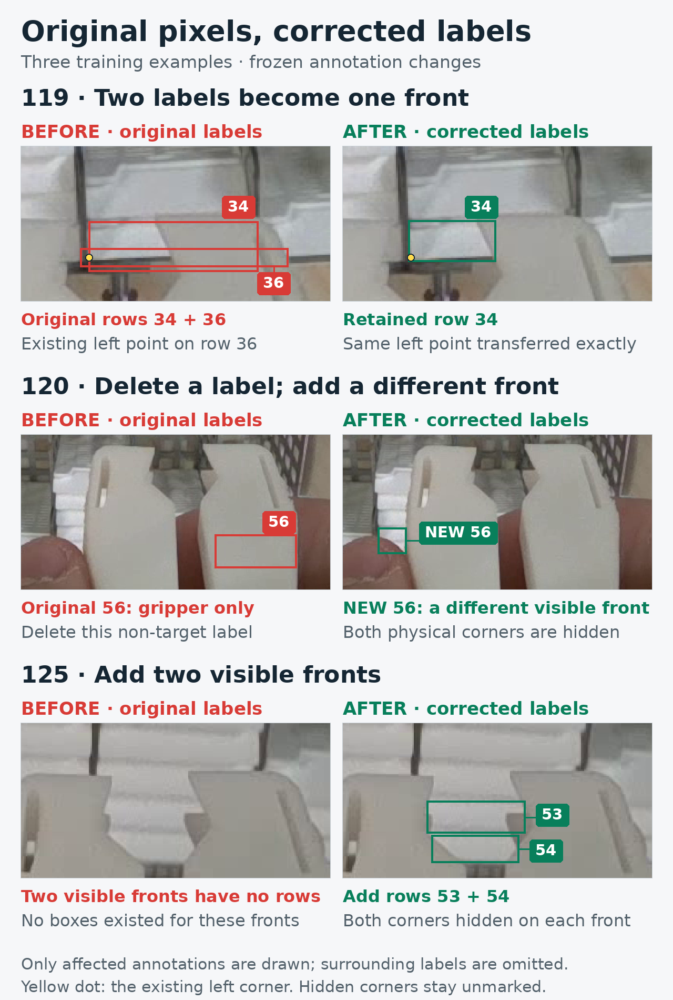

# Improve partial-front supervision; retain 1280 inference

**Completion update:** the prepared GPU comparison has now returned in PR40. The [completed result](partial-front-results-2026-11-11.md) retains the current checkpoint: no additional object is recovered. The preparation record below preserves what was known and fixed before those runs.

**Keep the current seed46 candidate at 1280 / confidence 0.15 for reviewed proposals. The fixed 1920 comparison worsened misses and corner results. A new, separately identified training-label candidate is ready for one matched GPU comparison.** No new trained checkpoint is claimed by this preparation pass.

The user delegated original-image review and supported label amendments, with missed objects first. This continuation addresses a concrete remaining problem: identifiable partial fronts can be omitted from the training labels, while a gripper-only rectangle or duplicate can supply conflicting targets. It preserves the existing two-corner task, trainer, model architecture and browser editor.

## 1. Diagnose the remaining misses before choosing an intervention

The current 663-object reference gives the candidate **21 misses and 76 extras** at confidence 0.15. The exact saved-prediction inventory separates those 21 misses into **18 previously unresolved reference rows**, two amended partial-front targets, and one newer extent disagreement. The two clearer residual targets are `008:33`, a right-clipped front, and `009:57`, a small fragment beside the jaw.

All six misses with two locatable reference corners already have nearby proposals at confidence 0.874–0.932 whose corresponding corner distances are each within 10 px. Their box IoUs are only 0.409–0.493, below the unchanged 0.50 matching rule. These diagnostic distances do not replace official matches or certify the disputed box extents. Saved post-NMS predictions also cannot tell whether an absent returned proposal was below threshold, suppressed, or absent from the raw network output.

The active pinned training path was inspected against its actual seed46 receipt. Zero-corner objects remain detection targets: the pose assigner falls back to box IoU when both corners are unavailable. Missing coordinates are excluded from coordinate/RLE loss, while availability is trained against zero. Horizontal flipping uses the required `[1,0]` mapping. No missing-corner or flip implementation defect was established. The recorded classification defaults for erasing and RandAugment are not active pose erasing. No loss-weight change is selected from label-frequency arithmetic alone.

## 2. One fixed resolution test: 1920 did not help

The [prospective protocol](../results/verification/baomai-partial-fronts-20261111/resolution/protocol.json) fixed the same checkpoint, all 20 original images, the same 663-object reference, confidence 0.15, NMS 0.70, endpoint cutoff 0.50 and original-pixel scoring. It compared freshly loaded 1280 and 1920 inference arms, with no resolution or threshold sweep. Upsampling changes the model input; it supplies no new optical information.

| Measure | Fresh 1280 | Fresh 1920 |
| --- | ---: | ---: |
| Missed reference objects / 663 | **21** | 31 |
| Extra detections | 76 | **66** |
| Both corners within 5 px / 584 | **529** | 510 |
| Both corners within 10 px / 584 | **577** | 572 |
| Missing visible endpoints / 1,228 | **21** | 28 |
| Miss-free nonempty images / 17 | **3** | 2 |
| Detections on the three empty images | **0** | 1 |
| Mean CPU prediction call, ms | 436 | 956 |

All 20 fresh 1280 raw prediction arrays exactly reproduce the archived candidate predictions. At 1920, three official matches are gained and thirteen are lost. All three gains have previously recorded reference uncertainty. Five losses have affirmative support from prior pixel reviews, including both newly annotated `090` fronts. The new prediction in empty image `146` falls on top-edge background/cable material, with no visible cassette front in that region.

Neither prespecified target is recovered. `008:33` remains unmatched, with maximum overlap changing from 0.07347 to 0.06927; `009:57` still has no overlapping returned proposal. **Retain 1280.** The lower extra count at 1920 does not compensate for its worse miss count under the user's stated priority, and its corner outcomes also worsen.

Timing is descriptive CPU evidence: one observation per image, fixed arm order and four Torch threads. It is not a GPU or deployment benchmark. The previous interrupted resolution trial remains unrecovered; these are new, verified measurements.

## 3. A new training correction supported by original pixels

Earlier recorded passes covered parts of 43 of the 137 training originals. This pass selected 12 previously unreviewed images with relevant partial-object labels: `111`, `114`, `115`, `116`, `117`, `119`, `120`, `122`, `124`, `125`, `127`, `130`. They contain 472 existing rows. Full originals supplied scene context before targeted crops and label correspondence; this was not a complete certification of every row.

The [cumulative candidate](../data/candidates/partial-fronts-2026-11-11/README.md) preserves all eight earlier corrected label files byte-for-byte and adds these supported changes:

| Training image | New correction | Corner handling |
| --- | --- | --- |
| `119` | Consolidate original row 36 into row 34 and fit row 34 to its observed front | Transfer row 36's exact existing left-point tokens; right remains missing |
| `120` | Remove original row 56 on solid gripper material; separately add the visible lowest left fragment | Both points of the new front remain missing |
| `122` | Add the omitted front between the jaws, below its slotted upper surface | Both points remain missing |
| `125` | Add two distinct front bands below existing row 46 | Both points remain missing in each instance |
| `130` | Add the lower front beneath the face represented by row 57 | Both points remain missing |

The incremental change is **five additions, two deletions and one retained-row amendment**, including one exact corner transfer. No new visible corner is invented. All five added fronts have `0 0 0` in both corner slots; their visible intersections with the hand or jaws do not establish the actual outer corners. Bounds were fixed from original pixels before training, with approximately 1–2 px visual softness.

The full proposed training set contains **3,774 objects, 6,841 visible endpoints and 707 missing endpoints** across the same 137 images. The existing trained annotation candidate used 3,771 / 6,841 / 701. Every parent visible-point token is preserved per image. The historical deduplication and box-only candidates are not silently combined into this extension.

No new correction is accepted in `111` or `114`. Identity/extent questions in `115`, `116`, `117`, `124` and `127` remain recorded and unchanged. Dark or shaded material is not automatically treated as tool, and repeated stack spacing is not evidence for a hidden instance.

## 4. The next GPU run isolates these new edits

Open [baomai_partial_fronts.ipynb](../notebooks/baomai_partial_fronts.ipynb) in the established GPU workflow. The notebook pins its implementation revision, [experiment protocol](../experiments/partial-fronts-2026-11-11.json), both annotation manifests and the existing seed46 recipe. It produces **`baomai-partial-fronts-seed46-results.zip`** for return.

| Experimental role | Training annotations | Initialization and recipe |
| --- | --- | --- |
| `old_reviewed` | The existing eight-file annotation correction | Original epoch173; existing seed46 recipe; 30 completed epochs |
| `extended_reviewed` | The same eight files plus this five-image extension | Identical initialization, recipe, seed and duration |

Both roles are truthfully recorded as `candidate` arms by the unchanged training runner. The new [small return packager](../scripts/package_partial_front_results.py) gives them distinct outer role names and verifies their matched conditions. It does not relabel either bundle as the old original-label `reference` arm or change historical packaging contracts.

Each full run starts independently from epoch173. The resource trial never initializes a full run, and the comparison does not resume the currently used fine-tuned weights. Both roles train in the same recorded GPU environment and select finalized epoch-30 `last.pt`, not whichever checkpoint looks best on validation. Completed roles can be saved to and restored from Drive; restored evidence is validated before skipping work or starting a missing role.

The original train/validation split and original validation labels inside training remain identical. After return, evaluate both completed models against the same current 663-object reference, retaining the original-reference results separately. Confidence **0.15 is primary for this new study**, because it is already the selected reviewed-proposal setting; 0.25 and 0.40 remain declared diagnostics. This does not rewrite the older studies' primary 0.25 comparisons.

Report every gained/lost object, extra detection, zero/one/two-corner group, both-corner result, empty image and miss-free scene. Carry reference uncertainty forward. A score gain confined to uncertain rows does not establish recovery of the two physically supported target fragments. One pair is declared; no favorable-seed search or automatic checkpoint promotion is scheduled.

## 5. Evidence and present limits

The [evidence capsule](../results/verification/baomai-partial-fronts-20261111/evidence.zip) preserves the miss inventory, training-mechanism audit, original-pixel review records, prospective resolution protocol, raw predictions, full scoring, logs and independent numerical audit. Its [inventory and verification](../results/verification/baomai-partial-fronts-20261111/evidence-inventory.json) bind the contents. A small source Git bundle preserves the exact local experiment commits above the published parent, so their recorded SHAs remain reconstructible.

The completed resolution comparison produced 40 real image predictions. An independent replay exactly reproduced all 40 per-image scores and quality records and both aggregates. Original images, reference labels, checkpoint bytes and executed source hashes were checked. An initial reporting-only attempt stopped after warmup because a predictor metadata field was absent; no original-image predictions were made in that attempt. The failure and the narrow metadata/reporting fixes are preserved, and the numerical experiment settings did not change.

The new labels pass the existing annotation verifier and an independent reconstruction against the parent candidate: all eight inherited files and all original labels are preserved, only the declared five-image delta changes, and the transferred visible point keeps its exact tokens. The source-pinned notebook passes **12 focused packaging/recovery checks**, and its actual input preflight verifies all **157 original PNGs**, the epoch173 checkpoint bytes and both effective label variants. The [handoff verification record and logs](../results/verification/baomai-partial-fronts-20261111/gpu-handoff/verification.json) preserve those results and exact file hashes. Packaging tests use explicitly synthetic CUDA metadata; **GPU training of this new candidate has not run here**. Its effect on the model remains to be measured.

The current usable checkpoint and reviewed-proposal command remain unchanged. This pass supplies a tested decision to retain 1280 and a concrete new supervision intervention. Reused development images remain development evidence; no unseen-scene accuracy claim is added.
