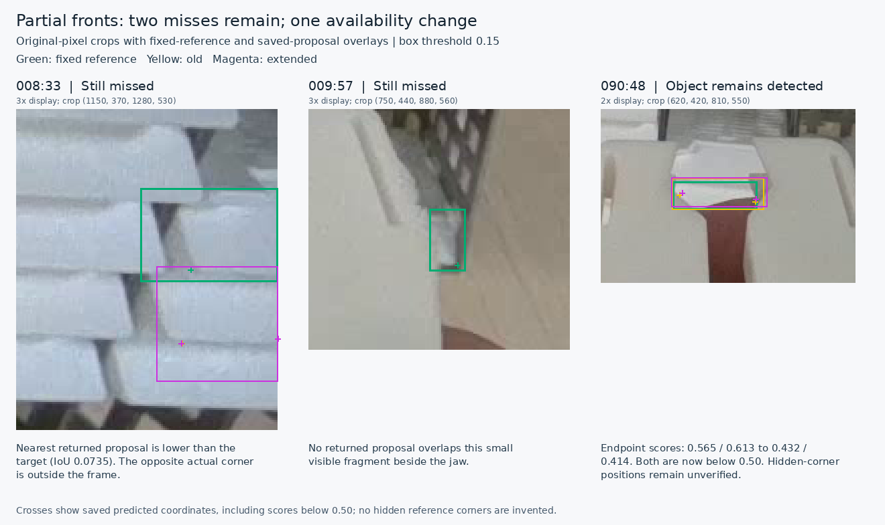

# Partial-front training result: retain the current checkpoint

**The completed PR40 experiment does not justify replacing the currently used seed46 checkpoint.** At the primary confidence 0.15, the extended labels recover no additional reference object: misses remain **21/663**, extras increase **76→77**, both-corner success within 10 px remains **577/584**, and the same three nonempty images remain miss-free. Both prespecified partial fronts remain missed.

This report closes the fixed [partial-front training protocol](../experiments/partial-fronts-2026-11-11.json) using the [PR40 returned archive](https://github.com/Siuuuers/dl/pull/40). Report date: **2026-11-11, Asia/Hong_Kong**. The [preparation report](partial-front-improvement-2026-11-11.md) records the preceding original-image review and the negative 1920 inference test.

## Decision and practical use

Retain the PR35 seed46 candidate, image size 1280, NMS IoU 0.70 and endpoint cutoff 0.50. This training comparison's fixed primary confidence remains 0.15. A subsequent [completed proposal-filter investigation](proposal-filter-review-2026-11-11.md) separately selects confidence **0.13** for the [assistant-reviewed proposal command](predict-pose-folder.md#assistant-reviewed-proposals): one additional supported reference match for nine additional scored extras, with all existing matches and corner-pair results preserved. The generic runner still defaults to epoch173/0.25.

Keep the [reviewed training corrections](../data/candidates/partial-fronts-2026-11-11/README.md) as a separately versioned annotation candidate. Their original-pixel justification and their effect on model performance are different questions. The labels were corrected before training; this comparison does not show that their five-image extension improves missed-object recovery under the declared recipe.

No further seed, resolution or epoch search is requested by this result. The subsequently completed [bounded trace before confidence filtering and NMS](proposal-filter-review-2026-11-11.md) explains the two supported residual targets separately: `008:33` has qualifying geometry below the confidence cutoff, while `009:57` has no decoded box reaching the fixed IoU criterion and its nearby proposals have very low scores. That follow-up and its fixed 0.15/0.13 comparison are separate from this training experiment; all tables below retain the original declared settings.

## 1. The returned comparison is eligible

The PR40 head is `fd1cb723a0be8859a50382b8903f0b2556103df3`. Its archive is **39,776,611 bytes**, with SHA-256:

```text
717781a642c1ac5597eb76d17e5b9c07e9306f64baed6ba82759007ebcd8379c
```

The existing packager's read-only `--verify-existing` operation passes from a clean checkout of the pinned implementation, `2d8b6f61865100e50742e384fb06dd87c37fb603`. All thirteen unique safe ZIP members, twelve payload hashes/sizes, CRC, checkpoint identities, receipts, logs and CSVs agree. Both roles truthfully remain internal `candidate` arms; their outer names identify this experiment's old-reviewed and extended-reviewed label variants.

| Training evidence | Old reviewed | Extended reviewed |
| --- | ---: | ---: |
| Completed epochs | 30 | 30 |
| Completed batches | 1,050 | 1,050 |
| Image presentations | 4,110 | 4,110 |
| Optimizer steps | 78 | 78 |
| Training objects | 3,771 | 3,774 |
| Visible training endpoints | 6,841 | 6,841 |
| Missing training endpoints | 701 | 707 |

Both runs record the same NVIDIA A100-SXM4-40GB hardware/runtime profile, software/backend settings, original epoch173 initialization, seed46 recipe and final-epoch `last.pt` selection. The only effective data difference is the declared training-label extension in images 119/120/122/125/130; all eight previously corrected files are preserved. All 157 original PNGs and the initialization checkpoint bytes were independently reverified. Original in-training validation remains 20 images, 664 objects and 1,227 visible endpoints.

The recovery notebook actually used after disconnection was `d2bd0866`. Compared with the published notebook, only its recovery code cell differs; source/protocol pins, full training and packaging cells are identical. The resource-trial path is skipped when both completed roles restore. PR39's later exception-handling fix is separate from the notebook used for this return. The verified completed artifacts, rather than the browser interruption narrative, establish eligibility.

The trainer performs an additional final console validation of `best.pt`. Those last console metrics are not the selected checkpoint's metrics. This report evaluates the archived finalized `last.pt` files, as declared before training.

## 2. The fresh control reproduces the current model

The current operational checkpoint was also evaluated under the same fresh CPU inference environment. It is an operational comparator, not a third training arm.

| Role | Checkpoint SHA-256 |
| --- | --- |
| Current PR35 candidate | `420c00f73eeba24e587342400878b7d96371d3e745772113809aa705ec8163b1` |
| Fresh old-reviewed control | `024022f1ffb20370413c2d99660f44d729fc312b8921dd89e8c68554a348a15b` |
| Extended-reviewed candidate | `debf6b07a6188f9061df4b308e7ebcdf7a21ba85de0fb6602d8f3a1ac952734d` |

The current and fresh old-reviewed checkpoint files have different archive identities, but **all 879 recorded model-state tensors after loading and before prediction/fusion are identical**. All **60 ordered saved post-filter prediction arrays** are also exactly identical across the twenty images and three fixed thresholds. No numerical tolerance is used for this comparison. Thus the fresh control provides the same observed behavior as the currently selected model in this evaluation.

The extended checkpoint changes **686 of those 879 recorded tensors**. Its unchanged missed-object set is therefore an observed training result, not an accidental evaluation of the same weights. This one repeated control does not establish universal determinism across hardware, runtimes or future runs.

## 3. Primary result on the corrected reference

All models use the frozen **663-object / 1,228-visible-endpoint reference**. Matching stays at box IoU 0.50, endpoint cutoff at 0.50, and corner distances use the original 1280×720 pixels. Missed eligible objects remain in corner-success denominators.

| Measure at box confidence 0.15 | Current / old reviewed | Extended reviewed |
| --- | ---: | ---: |
| Matched objects / 663 | 642 | 642 |
| Missed objects | 21 | 21 |
| Extra detections | 76 | 77 |
| Duplicate / other extras | 28 / 48 | 29 / 48 |
| Returned visible endpoints / 1,228 | 1,207 | 1,207 |
| Both corners within 2 px / 584 | 261 | 264 |
| Both corners within 5 px / 584 | 529 | 528 |
| Both corners within 10 px / 584 | 577 | 577 |
| Conditional median corner error, px | 1.563011 | 1.561615 |
| Conditional p95 corner error, px | 5.120129 | 5.139903 |
| Miss-free nonempty images / 17 | 3 | 3 |
| Predictions on three empty images | 0 | 0 |
| Returned points on unlocatable sides of matched objects / 76 | 69 | 67 |

**No object is gained or lost.** The missed-object identities and miss-free images (`010`, `054`, `058`) are unchanged. All three empty images remain empty in every model/threshold combination.

### Partial-object groups

The corner groups partition the same full-image object matching; they are not rematched separately. Unmatched predictions have no known reference-corner group and remain in the overall extra count.

| Locatable reference corners | Reference objects | Current / old matched | Extended matched |
| --- | ---: | ---: | ---: |
| Zero | 19 | 12 | 12 |
| One | 60 | 52 | 52 |
| Two | 584 | 578 | 578 |

The desired gain on partial objects does not appear in either the zero- or one-corner group. Eighteen of the twenty-one missed rows retain prior reference uncertainty; `011:61` retains its separate boundary/identity caveat. These qualifications remain attached to the rows, without removing them from the official denominator or altering the reference after observing results.

### The two prespecified targets

- **`008:33`, the right-clipped front:** remains unmatched. Maximum overlap with any returned proposal changes from **0.073466 to 0.073505**, far below the fixed IoU 0.50 matching threshold.
- **`009:57`, the small fragment beside the jaw:** remains unmatched, with **no overlapping returned proposal** in either model.

Those are post-filter observations. Neither supports a claim that the new supervision recovered its intended missed fragments.



Green shows the fixed reference, yellow the old-reviewed output and magenta the extended-reviewed output. Crosses include saved raw coordinates below the endpoint cutoff; they do not certify hidden corners. The figure uses original-pixel crops with nearest-neighbor display enlargement. Full-scene context and seven bounded cases were reviewed before this illustration was assembled.

### The changed extra detections

The primary net extra increase comprises one removed duplicate and two added duplicates. Original-image review supports the associations below; the referenced front already has a matched detection in each role.

| Image | Old / extended extras | Changed proposal at confidence 0.15 | Association |
| --- | ---: | --- | --- |
| `011` | 5 / 4 | Old prediction 64 disappears; old confidence 0.156611 | Duplicates `011:56` |
| `055` | 3 / 4 | Extended prediction 28 appears; confidence 0.158478 | Duplicates `055:23` |
| `057` | 0 / 1 | Extended prediction 21 appears; confidence 0.335452 | Duplicates `057:2` |

Prediction indices are zero-based within a particular model, image and threshold. Counterparts absent from saved outputs have no observed raw confidence here, so these changes cannot be attributed specifically to a confidence crossing rather than another filtering effect. None recovers an omitted reference object.

### Small corner and availability changes

The single 5 px pair loss is `058:1`. Its left-corner error changes **4.977795→5.033394 px**, while its right error improves **1.462197→1.371903 px**. The aggregate pair count correctly falls by one, but the approximately 0.056 px crossing should not be described as a large localization regression. At 2 px, six pair successes are gained and three lost; at 10 px no pair is gained or lost.

The two fewer returned points on unlocatable sides both belong to `090:48`, an already matched partial front. Its left/right endpoint confidences change **0.565/0.613→0.432/0.414**, crossing below the fixed cutoff. This is closer agreement with the reference's missing-point state. Because both actual corners are unlocatable in the reference, no physical hidden-corner coordinate error can be calculated. This small secondary change does not recover a missed cassette.

## 4. Fixed diagnostics and original-reference results

The confidence diagnostics were declared before the runs. They are not alternative primary settings selected after viewing the results.

| Confidence | Current / old misses | Extended misses | Current / old extras | Extended extras |
| --- | ---: | ---: | ---: | ---: |
| **0.15 — primary** | **21** | **21** | **76** | **77** |
| 0.25 | 26 | 26 | 52 | 54 |
| 0.40 | 31 | 31 | 38 | 38 |

There are **no gained or lost object identities at any of the three thresholds**. The extra increases at 0.15 and 0.25 are entirely in the scorer's duplicate category. The same 5 px pair crossing and unchanged 10 px pair count remain at the diagnostic thresholds.

The original 664-object reference is preserved and scored separately:

| Confidence | Current / old misses / extras | Extended misses / extras |
| --- | ---: | ---: |
| 0.15 | 33 / 87 | 33 / 88 |
| 0.25 | 36 / 61 | 36 / 63 |
| 0.40 | 42 / 48 | 42 / 48 |

The original reference contains 21 zero-corner, 59 one-corner and 584 two-corner objects. Its results must not be mixed with the corrected reference or earlier PR30's 661-object scores.

For limited training-curve context, original-reference epoch-30 CSV box mAP50 changes 0.93920→0.93951 and box mAP50–95 changes 0.57519→0.57617. These small in-training metric changes do not establish recovery at the operational confidence threshold. The fixed post-training comparison above answers that question directly.

## 5. Reproduction and evidence

The [evaluation driver](../results/verification/baomai-partial-fronts-results-20261111/evaluate_comparison.py) ran from clean published revision **`19459913c8be2f08978d8eee93387a6087407444`**. It produced **180 real image predictions**, with three explicitly excluded warmups, in one shared CPU FP32 environment. It uses the unchanged repository matching and corner-quality functions, records model-state and source hashes, and preserves ordered predictions after confidence filtering and NMS. Network access was disabled during evaluation.

The [evidence capsule](../results/verification/baomai-partial-fronts-results-20261111/evidence.zip) and [inventory](../results/verification/baomai-partial-fronts-results-20261111/evidence-inventory.json) preserve the returned-bundle audit, exact source/input identities, raw outputs, scoring, case evidence and reproduction records. The [compact JSON](../results/verification/baomai-partial-fronts-results-20261111/summary.json) separates current, old-reviewed and extended-reviewed roles and both references.

Independent replay imports the unchanged scoring functions directly, without importing the new driver or loading a model. It exactly verifies all **360 per-image score records**, **360 quality records**, **18 full aggregates**, **108 scene/range aggregates**, group summaries and object/corner changes. The driver's separate replay mode also reproduces all six scoring files byte for byte and the comparison content after omitting the declared execution-mode/timing fields, with zero model loads or new inference.

One initial package-verification attempt stopped because the local sparse checkout omitted `metadata/model_card.json`; the complete unchanged metadata was materialized and strict verification passed. That failed local setup attempt is preserved. It involved no model loading or predictions. The real inference run completed successfully on its first attempt.

These are repeated development images. The experiment supplies a precise decision about this label extension on this reference, without establishing unseen-scene reliability or a physical positioning tolerance. The current reviewed-proposal workflow remains useful, with its known misses and manual review requirement.
