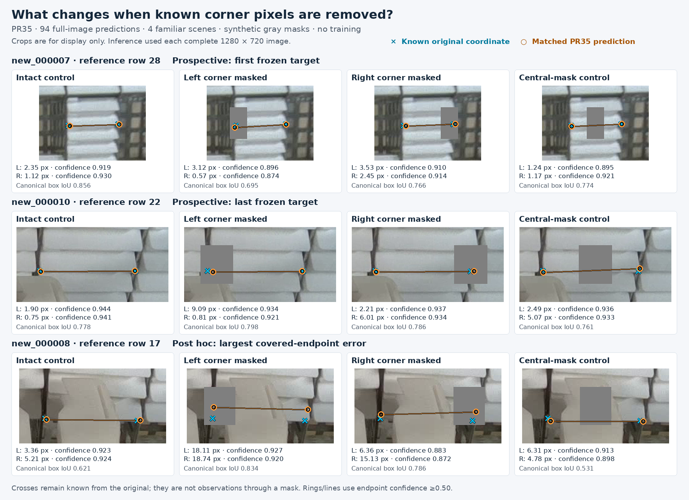

# Hidden-corner prediction after covering image pixels

## Decision

**PR35 can often preserve a known corner location after its local pixels are covered, but its endpoint confidence does not reliably signal the resulting localization error. Keep PR35 and the current reviewed workflow.** This is a completed diagnostic, not a newly trained model or a deployment acceptance result.

The user authorized investigation of hidden-corner estimates. The [upstream label definition](https://github.com/an94-doll/embedding_vision/blob/351eb3cf960ccc34829e2bc72e1fa4645acc6295/data/README.md) still requires the actual lower-front corners and uses `0 0 0` for unreliable locations. An estimated hidden point can be a useful output without becoming an accepted visible training label. In this experiment, the original image supplies the known coordinate before a synthetic mask removes its pixels. The model receives only the altered image.

This directly tests a limitation of the earlier [context study](context-corners-2026-11-12.md) and [model-anchor study](context-model-anchors-2026-11-12.md): withholding a reference coordinate while leaving the image intact did not test visual occlusion.

## What happened

The cohort contains 30 previously fixed, fully locatable corner pairs in four familiar development images. Each target was tested with a left-side mask, a right-side mask, and a center-face mask. Four shared intact predictions provide the paired baseline. All 30 designated objects matched in every condition, and both predicted endpoints always passed the unchanged 0.50 display threshold and image-bounds checks.

Every number below uses **all 30 targets**, including any potential detection or endpoint failures. Distances are measured against the same original, current reference coordinates.

| Input condition | Objects matched | Left point within 5 / 10 px | Right point within 5 / 10 px | Both points within 5 px | Both points within 10 px |
| --- | ---: | ---: | ---: | ---: | ---: |
| Intact image | 30/30 | 28/30 · 30/30 | 28/30 · 30/30 | 27/30 | 30/30 |
| Left corner covered | 30/30 | 22/30 · 28/30 | 27/30 · 29/30 | 21/30 | 28/30 |
| Right corner covered | 30/30 | 28/30 · 30/30 | 22/30 · 26/30 | 22/30 | 26/30 |
| Center face covered; both corner neighborhoods preserved | 30/30 | 25/30 · 30/30 | 26/30 · 30/30 | 22/30 | 30/30 |

The center strip is a **location control**, not a harmless sham. Removing central face content also changed predictions, including five lost 5 px pair successes. Consequently, the side-mask effects cannot all be attributed exclusively to the disappearance of the endpoint's own pixels.

At 5 px, left masking loses six original pair successes and gains none; right masking loses six and gains one; center masking loses five and gains none. At 10 px, left/right masking loses two/four pair successes and gains none. The complete named gains and losses are in [summary.json](../results/verification/baomai-pixel-occlusion-20261113/summary.json).

### High confidence can accompany a displaced hidden point

All 60 covered endpoint predictions exceeded 0.85 confidence. Six covered endpoint observations exceeded 10 px error, across five distinct objects:

| Target | Covered side | Intact error | Masked error | Masked endpoint score |
| --- | --- | ---: | ---: | ---: |
| `new_000008:13` | Right | 6.79 px | 10.07 px | 0.9447 |
| `new_000008:15` | Right | 3.99 px | 10.03 px | 0.9217 |
| `new_000008:17` | Left | 3.36 px | 18.11 px | 0.9270 |
| `new_000008:17` | Right | 5.21 px | 15.13 px | 0.8723 |
| `new_000010:19` | Left | 5.58 px | 14.93 px | 0.9544 |
| `new_000010:20` | Right | 3.69 px | 10.48 px | 0.9571 |

Rows are one-based in the frozen current reference. The two results just above 10 px are threshold crossings, not evidence of a meaningful distinction between 9.99 and 10.03 px. Reference placement also has human uncertainty. The larger displacements remain useful failure examples.

For `008:17`, covering the left side also moves the *uncovered right* prediction to 18.74 px error. A matched box therefore does not establish correct endpoint identity or accurate placement. For `010:19`, the covered left score rises slightly, from 0.9528 to 0.9544, while error increases from 5.58 to 14.93 px.

Mean confidence changes are small. With all 30 targets matched in both conditions, left masking changes left/right scores by approximately −0.0086/−0.0163; right masking by −0.0037/−0.0078; center masking by −0.0104/−0.0193. These are score differences, not calibrated probability changes. A higher display threshold is not established as the solution by this experiment.

### Illustrations

The first two illustrated objects are the first and last target in the frozen cohort, chosen before inspecting masked results. The third is selected afterward to illustrate the largest covered-endpoint error, `008:17`; it is not a representative frequency estimate. All 30 targets remain in the tables. Cropping is for display only: inference processed every complete 1280×720 input. The crosses show coordinates measured in the intact source, even where the altered input hides them. They were never passed to the model. The [figure index](images/pixel-occlusion-20261113-index.json) records selection, crops, and hashes.

## Fixed protocol and execution

The [protocol](../experiments/pixel-occlusion-2026-11-13.json) was frozen at `2026-11-13T11:46:59.373878+00:00`. The final protocol and [runner](../scripts/probe_pixel_occlusion.py) were published in [commit 3647d09](https://github.com/Siuuuers/dl/commit/3647d0937ab036974cda4867815a8fe20aef07d7), and both files were fetched back exactly before inference began. The experiment is stacked on the completed PR58 recovery at `d28cb65dbb45afa215839ba9b383ea8202318fbe`.

| Item | Fixed value |
| --- | --- |
| Model | PR35 seed46 final `last.pt` |
| Weight SHA-256 | `420c00f73eeba24e587342400878b7d96371d3e745772113809aa705ec8163b1` |
| Input / inference | 1280, CPU FP32, ordinary NMS, four Torch threads |
| Box / endpoint threshold | 0.13 / 0.50 |
| NMS / matching IoU | 0.70 / 0.50 |
| Reference | `visible-front-adjudication-2026-11-12` |
| Model evaluations | Four intact inputs plus 90 masked inputs; one excluded blank warmup |
| Training or threshold search | None |

The 30 target identities are the unique union of the earlier interpolation/extrapolation cohort: `007:28–36`, `008:13–17`, `009:32–40`, and `010:16–22`. They were selected before the masked predictions, not from favorable results. The current reference includes revised right coordinates for `010:16` and `010:22`; all new results use the same current reference and fresh intact controls. Old study scores are not silently substituted as an identical baseline.

### Pixel intervention

For original target box `(x0, y0, x1, y1)`, width `w`, and horizontal midpoint `cx`, masks use these bounds:

| Condition | Horizontal interval | Vertical interval |
| --- | --- | --- |
| Left | `x0 − 0.05w` to `x0 + 0.25w` | `y0 − 6` to `y1 + 6` |
| Right | `x1 − 0.25w` to `x1 + 0.05w` | `y0 − 6` to `y1 + 6` |
| Center | `cx − 0.15w` to `cx + 0.15w` | `y0 − 6` to `y1 + 6` |

Lower bounds are floored, upper bounds ceiled, and the rectangle is clipped to the image. Mask pixels are replaced with RGB `(127,127,127)`. Every variant starts from its intact source. Bounds derive from the original box, rather than being centered on the exact unknown endpoint coordinate.

Preparation froze all 94 decoded input hashes and verified that no pixels outside a mask change. Each side mask fully covers a radius-3-pixel neighborhood of its designated point and preserves the opposite neighborhood. The minimum covered-point interior margin is 5.84 px. Center masks preserve both target neighborhoods. The predictor receives only full-image RGB pixels, not boxes, target IDs, reference coordinates, or mask metadata.

### Reference, matching, and visibility

Original reference boxes remain **fixed association geometry** after masking. They are not newly adjudicated visible-face extents for the altered pictures. The existing scorer assigns class-compatible predictions in descending box-confidence order to the best still-unmatched box at IoU ≥0.50. Endpoint proximity does not choose a match.

Original corner coordinates remain immutable. Each experiment record separately marks a covered endpoint as `observed_in_masked_input: false`. Its source `v=2` describes the intact image. The evaluator's legacy `visible_endpoints` field counts known original coordinates, including those subsequently covered; it must not be read as a count of physically visible points in a masked input.

An unmatched target's best-overlap proposal is recorded only as a diagnostic and cannot become an official endpoint success. Raw coordinates and scores are retained below the display threshold. Missing matches, unavailable points, or out-of-bounds outputs stay in the fixed denominator. No designated target happened to trigger those failures here; other objects in the scene did.

### Crowded-scene effects

Of the 90 masks, 51 cover another reference endpoint center; 56 intersect another endpoint's radius-3 neighborhood. All remain in the experiment. Compared with intact predictions repeated with the same per-image case weighting, the full-image counts change as follows:

| Condition | Matched-object count change | Unmatched-proposal (FP) count change |
| --- | ---: | ---: |
| Left masks | −3 | +9 |
| Right masks | −1 | +9 |
| Center masks | 0 | +19 |

These are totals across 30 modified images per condition, with repeated source scenes. They are neither counts of distinct newly failed physical objects nor independent trials. The target-only table would conceal these neighboring effects; complete image scores remain in the archive.

## What this establishes, and what it leaves open

The four intact prediction arrays exactly reproduce the published PR35 records. The new test therefore measures the effect of the fixed pixel changes under the same model/runtime settings. It demonstrates that this model can sometimes localize a known corner after losing its immediate local image evidence. Preserved surrounding shape, opposite corners, stack context, and learned appearance may contribute; this experiment does not identify the causal contribution of each.

The result does not measure the true errors of naturally hidden `010:23/24` left corners, whose reliable coordinates remain unavailable. Artificial gray rectangles, box-derived placement, familiar regular stacks, repeated source scenes, and collateral masking limit transfer to real occluders. Thirty targets from four development images are not 30 independent deployment scenes, and 90 altered copies add no new captured scenes.

The 5/10 px radii are existing diagnostic tolerances, not newly approved application requirements. Successful mechanical label validation also does not certify every physical landmark. The [current label review](readiness-and-border-review-2026-11-13.md) remains the source for accepted fixes and unresolved review scope.

Normal output still means **a predicted point passed its display gate**. It does not independently classify physical visibility. We have not added an occlusion detector or a new production visibility flag. In this diagnostic, the synthetic mask itself supplies the observed/covered distinction.

## Next model-improvement decision

Keep the existing two-keypoint architecture for now. This test exposes a concrete robustness problem without establishing a need for a larger model or a geometric replacement. The earlier model-anchor experiment also did not support replacing direct predictions with contextual geometry.

The next justified training hypothesis is a **separately fixed, training-only pixel-occlusion augmentation comparison**, using known original training coordinates and a matched no-augmentation control. Before running it, specify the meaning of the post-augmentation boxes, coordinate supervision, and endpoint score. Retaining a known original coordinate under artificial corruption differs from inventing the location of a naturally hidden point. Clean-image performance, partial objects, extras, and the opposite endpoint must remain explicit acceptance checks; a hidden-point gain that harms the visible task is not an automatic promotion.

Simply writing `v=1` does not supply uncertainty weighting or a separate physical-visibility classifier. In the pinned [Ultralytics 8.4.182 pose loss](https://github.com/ultralytics/ultralytics/blob/v8.4.182/ultralytics/utils/loss.py), the keypoint mask is `gt_kpt[..., 2] != 0`: both `v=1` and `v=2` supervise coordinates and provide a positive keypoint-objectness target. Any new supervision convention therefore needs an explicit version and evaluation meaning.

Continue image-supported label corrections independently of this hypothesis. Never fill canonical missing slots with the current model's own high-confidence guesses. Reusing those guesses as truth could teach and then reward the same error. Current weights, source labels, canonical reference, train/validation split, and production defaults remain unchanged by this completed diagnostic.

## Evidence and replay

The [evidence entry point](../results/verification/baomai-pixel-occlusion-20261113/README.md) provides the 738 kB archive, hashes, runtime, preparation, raw predictions, complete scores, and independent review. Replay uses saved predictions and references and requires no model loading or source-image download. Fresh inference additionally requires the exact four originals and verified PR35 training bundle.

The runtime was Python 3.12.14, Torch 2.10.0+cpu, torchvision 0.25.0+cpu, Ultralytics 8.4.182, NumPy 2.3.5, and Pillow 13.0.0. The runner verified source hashes, image/label hashes, selected checkpoint identity, all prepared pixels, and the published intact baseline before interpreting masked results.
