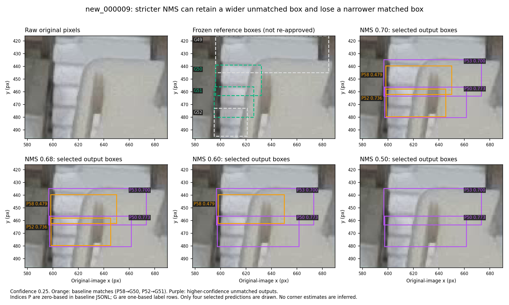
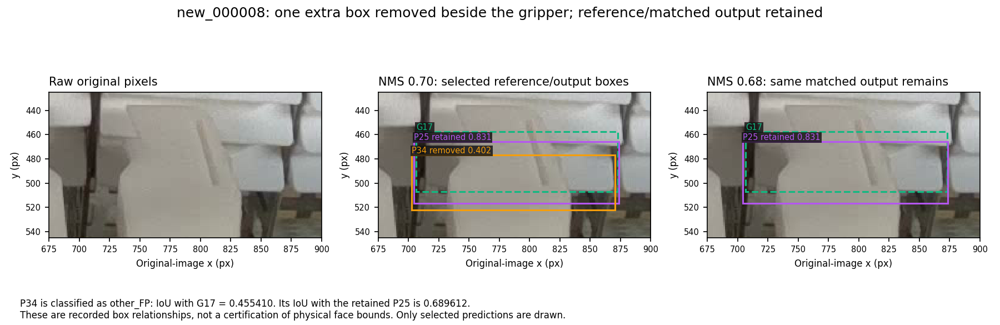

# Cassette postprocessing experiment without new training data

**Decision:** epoch173 is a usable baseline for a human-reviewed still-image workflow; it is not yet qualified for unattended use on future scenes. The experiment below found a small optional improvement on the existing development reference: **NMS IoU 0.68 at confidence 0.25 reduces FP from 63 to 61, preserving all 625 matched objects and their exact predictions.** Model weights, reference labels and the default NMS 0.70 remain unchanged.

The primary NMS-0.60 hypothesis failed the declared guard because it introduced one additional missed object and missing visible endpoint. The 0.68 result is a separately declared secondary finding, not a successful primary result. The [original plan and executable source](https://github.com/Siuuuers/dl/tree/89895a172d94421f90c13a7858d9e8e8db4c11fd) were published before fresh candidate inference.

## Plan recorded before fresh candidate inference

**Goal:** test whether stronger non-maximum suppression (NMS) can reduce duplicate cassette detections while preserving object recall and the established two-corner quality measures. This is an inference-settings experiment on the frozen development reference, not a new trained model or an independent test.

The current M0/epoch173 result at box confidence 0.25 and NMS IoU 0.70 has 39 missed reference objects, 63 extra detections and 17 duplicate false positives across 664 objects in 20 images. The known duplicate category provides a concrete reason to test NMS before allocating another training run. Source: [the recorded warmup comparison](warmup-comparison-2026-11-07.json), M0 metrics.

## Fixed experiment

- Checkpoint: the original epoch173 bytes, SHA-256 `e0aab1b377491700318e0b14cd4c558ec3c1684087a13b7dde2298ebdbf2847e`.
- Reference: all 20 original validation images and frozen labels, including the three empty scenes. Existing manifest/hash and checkpoint checks apply.
- Box confidence: 0.15, 0.25 and 0.40.
- NMS IoU: 0.70, 0.60, 0.68 and 0.50; four values by three confidences, totaling 240 fresh image/setting predictions.
- Other inference settings: image size 1280, rectangular preprocessing, FP32, ordinary NMS, batch 1, `max_det=300`, one common CPU runtime and four threads.
- Scoring: unchanged confidence-ordered matcher, matching IoU 0.50, endpoint confidence 0.50. NMS IoU and matching IoU serve different purposes; the matching rule stays fixed.
- Retain full predictions and every image's scores, including all missed objects and empty scenes. Preserve the runtime, exact source files, source revision, input hashes and successful completion status.

The primary comparison is **NMS 0.60 / confidence 0.25 versus NMS 0.70 / confidence 0.25**. The NMS 0.68 and 0.50 settings at confidence 0.25 are separately reported secondary candidates. Confidence 0.15 and 0.40 are sensitivity checks, not replacements for the primary comparison.

The conservative 0.68 secondary was added during pre-inference review because an existing true-positive box in `new_000009` overlaps an earlier false-positive box by approximately 0.658 after clipping. Stronger NMS might suppress that correct match. This review uses existing outputs to formulate the hypothesis; it does not claim unseen-data selection. There will be no adaptive grid expansion after reading the fresh results.

## Acceptance and interpretation

For a setting to pass the existing five-measure no-regression guard, all of the following unrounded values must be finite and no larger than the current 0.70/0.25 control, with at least one strictly smaller:

1. Missed objects (FN).
2. Extra detections (FP).
3. Missing reference-visible endpoints.
4. Conditional median endpoint error in pixels.
5. Conditional p95 endpoint error in pixels.

Report precision, recall, F1 and FN+FP as descriptive object-detection summaries. The user has not prioritized missed over extra detections, but an equal-cost FN+FP summary does not retrospectively replace the existing five-measure guard. The 2/5/10-pixel corner radii remain illustrative diagnostics rather than user-approved tolerances. Per-image regressions and every lost/gained reference match must remain visible even if an aggregate guard passes.

Verify that fresh NMS-0.70 controls reproduce the previously saved raw predictions at all three confidences. This checks common-runtime consistency before interpreting a candidate difference. Replay saved experimental predictions through the same unchanged scorer and compare the complete numerical reports. Inspect relevant original-image regions for candidates that pass the numerical guard.

No default model or inference setting changes automatically. A same-data result can support a bounded candidate setting, but cannot establish its performance on future camera scenes. Unresolved supplementary annotations remain quarantined.

## Implementation rationale

Ultralytics documents that a lower NMS IoU suppresses more overlapping boxes and can reduce duplicates. Suppression can also remove distinct overlapping objects. The pinned framework performs NMS before the pose predictor scales/clips coordinates into the original image. Consequently, applying another NMS pass to already saved, clipped boxes is not an equivalent implementation of this experiment. Each cell must run through fresh framework inference.

Primary references:

- [Ultralytics prediction arguments](https://docs.ultralytics.com/modes/predict/#inference-arguments).
- [Pinned v8.4.182 NMS implementation](https://github.com/ultralytics/ultralytics/blob/v8.4.182/ultralytics/utils/nms.py).
- [Pinned v8.4.182 pose prediction conversion](https://github.com/ultralytics/ultralytics/blob/v8.4.182/ultralytics/models/yolo/pose/predict.py).
- [Existing model-quality definitions and limitations](model-quality.md).

## Execution and result

All **240 image/settings predictions** completed successfully on clean revision `89895a172d94421f90c13a7858d9e8e8db4c11fd`. The runtime was Python 3.12.14, PyTorch 2.10.0+cpu, torchvision 0.25.0+cpu, Ultralytics 8.4.182, NumPy 2.5.4, Pillow 13.0.0 and OpenCV 5.0.0.93. Backend checks confirmed CPU, FP32, ordinary NMS and four Torch threads. No new training or image acquisition was performed.

### Declared comparisons at confidence 0.25

| NMS IoU | Role | Missed objects (FN) | Extra detections (FP) | Duplicate FP | Missing visible endpoints | Conditional median, px | Conditional p95, px | Five-measure guard |
| --- | --- | ---: | ---: | ---: | ---: | ---: | ---: | --- |
| 0.70 | Baseline | 39 | 63 | 17 | 43 | 1.611790 | 5.161683 | Reference |
| 0.60 | Primary | 40 | 46 | 7 | 44 | 1.611271 | 5.088072 | Fails: more FN and missing endpoints |
| **0.68** | **Secondary** | **39** | **61** | **17** | **43** | **1.611790** | **5.161683** | **Passes on this reference** |
| 0.50 | Secondary | 41 | 34 | 0 | 45 | 1.610989 | 5.039748 | Fails: more FN and missing endpoints |

Displayed errors are rounded for readability; decisions use full precision. NMS 0.68 retains the exact baseline median `1.6117904791992994` and p95 `5.161682583866238`. Its precision changes from **90.843% to 91.108%**, recall stays **94.127%**, and F1 changes from **92.456% to 92.593%**. Equal-cost FN+FP changes from 102 to 100. These are small development-reference differences, not evidence of a statistically established improvement on future images.

The primary 0.60 setting loses the baseline match for `new_000009`, reference row **51**; 0.50 loses rows **50 and 51**. Rows are one-based label-file positions. Stronger suppression therefore has a concrete coverage cost. Both-corners-within-5-px remains 521/584 for all four settings: that diagnostic alone does not expose losses among partially locatable objects.



Orange boxes are the baseline predictions that match reference rows 50/51. Wider, higher-confidence purple boxes remain after stronger suppression removes those narrower matches. These selected crops explain a measured matching failure; they do not newly certify the reference boundaries. Prediction indices in this diagnostic figure are zero-based, as stated in its caption.

### What actually changes at 0.68

All **625 matched reference objects retain identical full prediction payloads**, including boxes, confidences and both keypoint slots. There are no lost or gained matches and no per-image FN increase. Seven unmatched baseline outputs disappear and five unmatched outputs appear across four images:

| Image | FP at 0.70 → 0.68 | Removed / added outputs | Interpretation under the fixed scorer |
| --- | ---: | --- | --- |
| `new_000007` | 2 → 2 | 1 / 1 | One duplicate FP is replaced by another near the top border |
| `new_000008` | 4 → 3 | 1 / 0 | One other FP is removed in the central occluder region |
| `new_000009` | 14 → 13 | 4 / 3 | Other-FP survivors change around clutter and a clipped top region |
| `new_000090` | 13 → 13 | 1 / 1 | One other FP is replaced by another near the lower-right border |

The duplicate-FP total remains **17**; other FP falls **46 → 44**. It would be incorrect to describe this as removing two duplicate detections. NMS changes which overlapping predictions survive, and new survivors can replace old ones.



In `new_000008`, the removed output overlaps the retained prediction by 0.689612 but the nearby reference by only 0.455410, below the fixed matching threshold. Its `other_FP` category therefore does not imply an entirely imaginary cassette. In `new_000009`, the gripper-region changes replace three other FPs with three other FPs; the net reduction comes from a separate top-border sliver. The archive also preserves the border replacement examples from images 7/90.

The original-image regions and the lost rows under stronger suppression were inspected. The report's FP categories remain measurements against the frozen annotations, not physical certification of every unmatched rectangle. Border truncation, gripper occlusion and unsettled front-face extents require particular care. No reference box, corner, visibility value or object inclusion was changed to improve these results.

### Complete sensitivity grid

The two other confidence thresholds were declared diagnostics. The lower FN+FP values below do not retrospectively change the primary comparison or the five-measure guard. A future equal-cost selection procedure could be defined prospectively, but this experiment does not silently substitute it for the existing rule.

| NMS IoU | Confidence | FN | FP | Missing endpoints | Precision | Recall | FN+FP |
| --- | --- | ---: | ---: | ---: | ---: | ---: | ---: |
| 0.70 | 0.15 | 33 | 90 | 38 | 87.52% | 95.03% | 123 |
| 0.70 | 0.25 | 39 | 63 | 43 | 90.84% | 94.13% | 102 |
| 0.70 | 0.40 | 42 | 44 | 46 | 93.39% | 93.67% | 86 |
| 0.60 | 0.15 | 36 | 63 | 40 | 90.88% | 94.58% | 99 |
| 0.60 | 0.25 | 40 | 46 | 44 | 93.13% | 93.98% | 86 |
| 0.60 | 0.40 | 43 | 36 | 47 | 94.52% | 93.52% | 79 |
| 0.68 | 0.15 | 33 | 88 | 38 | 87.76% | 95.03% | 121 |
| 0.68 | 0.25 | 39 | 61 | 43 | 91.11% | 94.13% | 100 |
| 0.68 | 0.40 | 42 | 41 | 46 | 93.82% | 93.67% | 83 |
| 0.50 | 0.15 | 37 | 49 | 41 | 92.75% | 94.43% | 86 |
| 0.50 | 0.25 | 41 | 34 | 45 | 94.82% | 93.83% | 75 |
| 0.50 | 0.40 | 44 | 30 | 48 | 95.38% | 93.37% | 74 |

All three reference-empty images have zero detections throughout this grid. Three familiar empty scenes do not establish a general background false-alarm rate. No further thresholds were added after inspecting the fresh results.

## Is the model good enough?

The folder delivery demonstrates that the exact checkpoint can turn original images into inspectable boxes, corners and structured records. The evaluation measures something different: how those outputs match the existing annotations. Neither establishes autonomous readiness on a new capture population.

At the default 0.70/0.25 setting, 625 of 664 reference objects are matched, with 39 misses and 63 extras. **Every one of the 17 nonempty validation images has at least one FN or FP.** Consequently, treating the whole image as reliably complete would be premature even though object recall is about 94.1%. The familiar 20 images have also been used repeatedly for checkpoint selection and analysis.

The missing-object burden is uneven:

| Reference-locatable lower corners | Objects | Missed objects | Miss rate |
| --- | ---: | ---: | ---: |
| Both | 584 | 14 | 2.40% |
| One | 59 | 15 | 25.42% |
| Neither | 21 | 10 | 47.62% |

The 80 objects with one or neither corner locatable account for **25/39 misses (64.1%)**. This is an association with reference corner availability, not a causal estimate for occlusion. It gives a practical review priority: border fragments, partially exposed fronts and occluder interactions.

The median corner error of 1.61 px applies only to returned reference-visible endpoints. It excludes missed endpoints and gives no hidden-corner accuracy guarantee. At the illustrative 5 px radius, only **521/584 objects with both reference corners locatable (89.21%)** have both corresponding corners within tolerance, counting eligible misses as failures. That 5 px radius is not an approved application requirement. The prior [quality review](model-quality.md#3-check-whether-an-endpoint-should-be-returned-at-all) also found that 61/66 reference-unlocatable endpoints on matched objects still receive in-frame coordinates above the 0.50 cutoff. Model confidence therefore cannot certify physical visibility.

Continue using the pipeline as a human-reviewed image-localization prototype. A stronger readiness claim needs a declared acceptable error/tolerance level and suitable evidence for the intended image population. Robot calibration is outside the present scope and is not required to continue this image work.

## Improvements possible without new photographs

1. **Preserve this bounded settings result.** Keep epoch173 and the default settings reproducible. Offer NMS 0.68 at confidence 0.25 explicitly; it is a small candidate improvement on the present reference. Avoid a long adaptive threshold search over the same 20 images.
2. **Improve supervision from the material already available.** The [additional-frame intake](warmup-detection-review-2026-11-07.md) recovered 320 images; 317 have not completed row review. The three-image [pilot](additional-annotation-pilot-2026-11-07.md) remains quarantined with 36 unresolved rows and zero eligible scoring/training images. Review complete images under the existing front-face policy, including omitted objects and correct empty regions. Agent proposals can shorten drawing work, but a prediction is not reference truth. Preserve unresolved coordinates rather than guessing them.
3. **Prioritize clear, informative existing cases.** The baseline's `new_000009` and `new_000090` contain 104/664 reference objects but account for 35/102 FN+FP. Their difficulty motivates inspecting comparable existing training images; it does not justify changing the frozen validation labels to match predictions. Keep capture families and prior upstream usage recorded. The recovered pool cannot simply be called a new independent test set.
4. **If allocating the next GPU experiment, test whether the warmup finding survives different seeds.** The [previous comparison](warmup-comparison-2026-11-07.md) found a promising lower-bias-warmup candidate, but it failed the declared primary comparison against the fresh control. Two additional matched control/candidate seed pairs would probe training variability while changing one factor. This needs a separately versioned recipe because the current runner pins seed 42. Repeating the already-reproduced same-seed run is not the next useful experiment. Seed replication estimates training variability; it does not provide unseen-scene evidence.
5. **Make any augmentation or training change answer a specific error.** Existing training already uses modest rotation, translation, scaling, horizontal flips with slot swapping, and HSV variation. Adding more augmentation is not automatically new supervision. Start with a targeted, physically plausible condition visible in the failures and compare it against a matched control. Geometric transforms must preserve box/keypoint coordinates and left/right semantics; synthetic occlusion needs consistent visibility labels. Larger models, more epochs, arbitrary freezing or several simultaneous changes have no demonstrated advantage here.

There is useful work without new camera input: better reviewed labels, fewer inference artifacts, clearer failure categories and more reproducible comparisons. These steps can improve the model or workflow on existing material. They cannot manufacture independent evidence of performance on future scenes. Moving old images into a new split also does not erase their earlier exposure to epoch173; any genuine group-held-out retraining study must account for the starting checkpoint's history.

## Use the optional setting

Use branch `codex/baomai-postprocess-review-20261107` and the [folder guide](predict-pose-folder.md). In its configured environment:

```bash
.venv/bin/python scripts/predict_pose_folder.py \
  --input /path/to/original-images \
  --output /path/to/new-results-nms068 \
  --device cpu --conf 0.25 --nms-iou 0.68
```

Omitting `--nms-iou` retains 0.70. The selected IoU is validated, used during warmup and every real prediction, and recorded in `run_status.json`. It does not alter the frozen evaluator or its matching IoU of 0.50.

The optional runner was tested at clean revision `2c409f4fa7c16367b7895a8b021611a277c68a3c`. All **14 folder checks** and **seven experiment checks** passed. Real CPU inference at 0.68 on the four changed original images produced **53, 36, 65 and 57** predictions respectively; all four complete raw lists exactly match the fixed experiment. A separate default run on `new_000007` and `new_000146` produced **53 and 0** predictions, also exactly matching the fixed experiment. Both commands exited 0 with complete status and no labels in their input directories. Counts are predictions, not measurements of errors on unlabeled input.

## Evidence and reproduction

The [evidence ZIP](../results/evaluation/baomai-postprocess-20261107/evidence.zip) preserves all 240 image/settings prediction records, per-image scores, aggregate metrics, execution/replay logs, completion and runtime records, numeric change audit, independent verifier, readiness calculations, selected figures and folder parity evidence. The [verification record](../results/evaluation/baomai-postprocess-20261107/verification.json) identifies the tested source revisions, code/data/model hashes, archive hash and payload inventory. Original model/image payloads stay in the existing Git LFS dataset; the archive does not duplicate them.

Verification established:

- All **60 NMS-0.70 image/confidence outputs exactly reproduce the historical M0 raw predictions**, excluding timing.
- Saved predictions replay to **byte-identical** `summary.json`, `per_image.json`, `metrics.csv` and `predictions.jsonl`.
- An independent audit rescored all 240 image/settings prediction records and reproduced all 12 aggregate/quality records, the declared guard decisions and changed-match identities.
- The folder option reproduces the same raw predictions through the separate label-free user command.

Replay requires the repository's original validation PNGs for identity checks but does not load weights or import the ML runtime:

```bash
git lfs pull --include='data/images/val/*.png' --exclude=''
python3 -m zipfile -e results/evaluation/baomai-postprocess-20261107/evidence.zip ../postprocess-evidence
python3 scripts/experiment_pose_postprocess.py \
  --replay ../postprocess-evidence/fresh/predictions.jsonl \
  --output ../postprocess-replay
python3 ../postprocess-evidence/verify_predictions.py \
  --repo . --results ../postprocess-evidence --replay ../postprocess-replay
python3 ../postprocess-evidence/verify_folder.py --evidence ../postprocess-evidence
python3 ../postprocess-evidence/summarize_readiness.py --repo . --evidence ../postprocess-evidence
```

For a fresh fixed-grid run, use the pinned compatible runtime, obtain `weights/cassette_lower_epoch173.pt`, and run `scripts/experiment_pose_postprocess.py --output /path/to/new-experiment --device cpu --threads 4`. The grid is deliberately fixed. The experiment's executable helpers retain their inference-time hashes in subsequent documentation/evidence commits.
