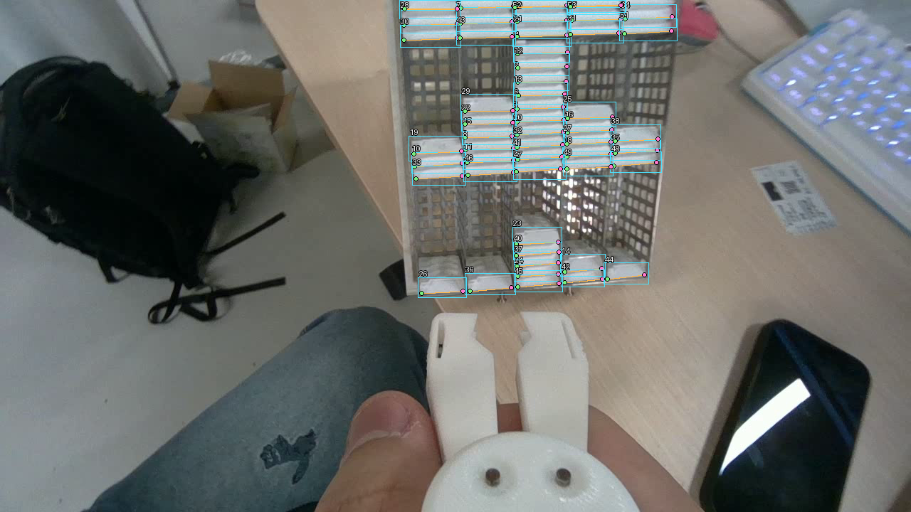

# Predict cassette objects in a folder of images

Use `scripts/predict_pose_folder.py` to run the default epoch173 model or an explicitly selected, verified completed checkpoint on a folder of original still images. It writes annotated PNGs, structured predictions and an image summary. No annotation TXT files, camera, desktop display or training run are needed.

The agreed scope is one `cassette_front` class and its two lower-front corner slots. The user has delegated assistant review and supported label amendments, with missed objects first. For that review workflow, use the **PR35 seed46 candidate at box confidence 0.13**, NMS IoU **0.70** and endpoint display confidence **0.50**. The generic runtime default remains epoch173 at 0.25. The [completed proposal-filter review](proposal-filter-review-2026-11-11.md) explains this bounded choice, its added review cost and the corrected reference; no universal optimum is claimed.

## Run

The current instructions, completed PR43 evaluation and implementation including verified candidate selection are on `Siuuuers/dl` branch `codex/visible-extent-results-20261111`. Use this branch while its PR is open. PR40 and PR43 are results-only branches based on main; the complete developed workflow is on the branch named here. The selected model still comes from PR35, as described below. For a fresh Linux checkout with Git and Git LFS installed:

```bash
GIT_LFS_SKIP_SMUDGE=1 git clone --depth 1 --single-branch \
  --branch codex/visible-extent-results-20261111 \
  https://github.com/Siuuuers/dl.git dl-folder
cd dl-folder
git lfs install --local
```

The checkout leaves LFS image and weight payloads unfetched. Create `.venv` using only [the isolated-runtime setup](evaluate-pose.md#2-use-an-isolated-runtime), keeping the folder-inference checkout above. The runner requires Ultralytics `8.4.182`; the verified CPU environment uses PyTorch `2.10.0+cpu`, torchvision `0.25.0+cpu`, NumPy `2.5.4`, Pillow `13.0.0` and OpenCV `5.0.0.93`. The live-camera environment's RealSense and display setup is unnecessary for this command.

For the default epoch173 model, download its weights once and run:

```bash
git lfs pull --include='weights/cassette_lower_epoch173.pt' --exclude=''
.venv/bin/python scripts/predict_pose_folder.py \
  --input /path/to/original-images \
  --output /path/to/new-results \
  --device cpu
```

In an existing compatible CUDA environment, use that environment's Python in place of `.venv/bin/python` and choose `--device 0`. Choose a new output directory for each run. The input and output directories must not contain each other. Existing outputs are refused.

The command recursively selects `.png`, `.jpg` and `.jpeg` files, including uppercase extensions, in a stable relative-path order. Use original camera images; `data/annotated/` contains reference previews with a footer and is not the image input. Labels and other file types are ignored. Unreadable images are reported explicitly. Animated/multiple-frame files and non-8-bit image modes are rejected rather than silently converted into an unintended still image.

### Use the seed46 candidate explicitly

The [completed seed46 comparison](annotation-confirmation-2026-11-11.md) retains a useful experimental candidate. Selecting it here does not change the default model or approve unattended use. Candidate-only inference needs the returned candidate bundle and tracked repository metadata; it does not require downloading the original dataset or epoch173 weight payload.

From the checkout above, download the immutable [PR35 return archive](https://github.com/Siuuuers/dl/blob/8e8bb99cabcb44ed0ec0acd14db911aa44013fd8/results/gpu/baomai-reviewed-annotations-seed46-l4-001/baomai-reviewed-annotations-seed46-results.zip) and verify it before extracting into a new folder:

```bash
curl --fail --location \
  'https://raw.githubusercontent.com/Siuuuers/dl/8e8bb99cabcb44ed0ec0acd14db911aa44013fd8/results/gpu/baomai-reviewed-annotations-seed46-l4-001/baomai-reviewed-annotations-seed46-results.zip' \
  --output ../seed46-results.zip
printf '%s  %s\n' \
  df53683ccf6f266a605b2844f42a98e808f75686cfab09f14d680c9d061e8a91 \
  ../seed46-results.zip | sha256sum --check -
python3 -m zipfile -e ../seed46-results.zip ../seed46-results
.venv/bin/python scripts/predict_pose_folder.py \
  --checkpoint-manifest ../seed46-results/candidate/checkpoint-manifest.json \
  --input /path/to/original-images \
  --output /path/to/new-candidate-results \
  --device cpu --conf 0.25 --nms-iou 0.70 --endpoint-conf 0.50
```

The archive is **39,776,456 bytes** and contains both completed arms. Select `candidate/checkpoint-manifest.json`, which identifies the **30-epoch final `last.pt`**, SHA-256 `420c00f73eeba24e587342400878b7d96371d3e745772113809aa705ec8163b1`. Keep the candidate directory intact: its manifest refers to the weights, training receipt, staging manifest, training log and results CSV. Passing the manifest alone or an unrelated `.pt` file is insufficient.

The existing validator checks the selected checkpoint bytes, recorded completion, recipe, pose contract and matching repository metadata before inference. It does not reverify the original training image/label payloads or initial checkpoint bytes for this inference-only command. These limits are recorded in `run_status.json`. An invalid explicit selection fails; it never silently falls back to epoch173. Prediction success is not an accuracy measurement without a reference annotation.

### Assistant-reviewed proposals

After obtaining the candidate bundle above, use the existing threshold argument:

```bash
.venv/bin/python scripts/predict_pose_folder.py \
  --checkpoint-manifest ../seed46-results/candidate/checkpoint-manifest.json \
  --input /path/to/original-images \
  --output /path/to/new-review-results \
  --device cpu --conf 0.13 --nms-iou 0.70 --endpoint-conf 0.50
```

On the corrected 663-object reference, confidence **0.13 yields 20 misses and 85 scored extras**, compared with **21/76 at 0.15**. It preserves all 718 previous outputs exactly and adds ten proposals across six images: one supported additional reference match and nine scored extras. Both-corner success remains 529/584 within 5 px and 577/584 within 10 px; miss-free images remain 3/17 and the three empty images remain clear. All ten additions were reviewed. The [full comparison and decision](proposal-filter-review-2026-11-11.md) record the recovered clipped-front proposal's imperfect box and missing right corner. This selects an explicit reviewed workflow; it does not change the older experiments' fixed settings or generic defaults.

The earlier [0.25-to-0.15 review](low-confidence-review-2026-11-11.md) inspected its 29 additions and produced two separately versioned reference labels. The later 0.13 comparison preserves that reference unchanged. Keep unavailable corners missing even when a model reports a confident coordinate. Low-confidence predictions are proposals to inspect, not automatically approved annotations. Use the [corrected reference label set](../data/references/visible-front-2026-11-11/README.md) with the existing HTML editor; training labels and weights are separate. Review the complete original image as well as the proposal list, because missing proposals will not appear in the list.

Retain the existing 1280 inference size. The [fixed 1920 comparison](partial-front-improvement-2026-11-11.md#2-one-fixed-resolution-test-1920-did-not-help) increased misses from 21 to 31 and reduced 10 px two-corner successes from 577 to 572 on the same reference. The subsequent [completed PR40 training-label comparison](partial-front-results-2026-11-11.md) also retains this PR35 checkpoint: the new model leaves misses at 21, changes extras 76→77 and keeps 577/584 two-corner successes. The current model and fresh old-reviewed control produce exactly the same 60 ordered prediction arrays.

The later [PR43 visible-extent comparison](visible-extent-results-2026-11-11.md) is also complete and retains PR35. At the fixed primary confidence 0.13, its new model changes misses 20→21, extras 85→87, 5 px pairs 529→526 and 10 px pairs 577→578. Original-image review establishes no additional recovered front; the lost scored match survives as a nearly identical proposal, and the 10 px gain reflects assignment between existing alternatives. Its old-reviewed control exactly equals PR35 for all forty prediction arrays at 0.13/0.15. Keep the PR35 bundle above; no new training or model replacement is required.

### Optional overlap suppression

The default NMS IoU remains **0.70**. A bounded [existing-data comparison](postprocess-experiment-2026-11-07.md) found that **0.68 at box confidence 0.25** reduces extra detections from 63 to 61 on the 20 development images, preserving all 625 matched objects and their exact predictions. This is a small settings result on familiar images, not a new trained model or an independent accuracy guarantee.

This historical result used epoch173 and the original reference; it is not a tested combination with the seed46 checkpoint. To try that epoch173 setting, add `--conf 0.25 --nms-iou 0.68` to the default-model command. The actual IoU is recorded in `run_status.json` under `inference.iou`. A lower value suppresses overlapping predictions more strongly; the tested 0.60 and 0.50 values also remove valid reference matches, so lower is not automatically better. NMS IoU is separate from the evaluator's fixed matching IoU of 0.50.

## Results

| Output | Contents |
| --- | --- |
| `overlays/` | One annotated PNG for each successfully processed image, retaining its subdirectory and complete original filename before `.prediction.png`. |
| `predictions.jsonl` | One record for every selected image, including zero-detection images and image errors. Successful records retain raw postprocessed boxes, corner coordinates, confidences and display flags. |
| `summary.csv` | Per-image status and predicted-object counts for quick inspection. |
| `run_status.json` | Completion state, selected/successful/failed counts, selected model hash and checkpoint identity, input/settings information and the actual runtime. |

For example, `tray/frame.jpg` and `tray/frame.png` produce `overlays/tray/frame.jpg.prediction.png` and `overlays/tray/frame.png.prediction.png`.

The overlay uses cyan boxes, green left-slot points, pink right-slot points, and an orange line when both points pass the display checks. Small numbers identify each prediction's one-based position in that image's JSON list; they are not tracking IDs across images. Confidence values remain in JSON so dense scenes stay readable.

Require both process exit **0** and `run_status.json` with `status: complete` before treating a run as finished. A failed or interrupted run is not a complete result; create a new output directory after correcting its cause. A zero-object prediction is a successful processed image, not a read error or proof that the scene contains no cassette.

Coordinates are in the displayed image's pixels. EXIF orientation is applied once before inference and rendering; the record preserves the source dimensions/orientation and the decoded dimensions. There is no resize of the saved overlay. Framework preprocessing is reversed by the existing prediction implementation, so output coordinates are not scaled again.

The two keypoint slots remain in model order. Their confidence and coordinates are preserved even when a point is not drawn. Display requires confidence at least `--endpoint-conf` and finite coordinates inside `0 <= x < width`, `0 <= y < height`. The point flags describe these checks. They do not certify physical visibility, occlusion, annotation correctness or a pixel-error tolerance. No hidden point is extrapolated and no prediction is exported as an approved `v=2` label.

## What this result establishes

This is an inference deliverable. Unlabeled images cannot supply false-negative, false-positive, precision, recall or accuracy measurements. `ground_truth_available: false` distinguishes predictions from reference annotations. Keep the existing [evaluation command](evaluate-pose.md) for the frozen labeled development set.

The [additional-frame candidate](additional-annotation-pilot-2026-11-07.md) still has three quarantined images and zero eligible scoring/training images. Drawing predictions on an image does not resolve its reference boundaries. See the [completed proposal-filter review](proposal-filter-review-2026-11-11.md) for the current assistant-review setting, corrected reference and limits of the existing development results.

## Verified example, 2026-11-07

Clean source revision [`df9254ac16f61eb6f5f858dfd4737459d4133a7e`](https://github.com/Siuuuers/dl/commit/df9254ac16f61eb6f5f858dfd4737459d4133a7e) passed all **11 focused checks** and a real CPU run on two hash-verified repository originals:

| Original image | Folder-runner predictions | Comparison with the existing evaluator |
| --- | ---: | --- |
| `new_000007.png`, dense scene | 53 | Raw boxes, keypoints and confidences exactly equal |
| `new_000146.png`, reference-empty scene | 0 | Raw predictions exactly equal |

Both runs completed with exit 0 at the same clean revision, using four CPU threads, ordinary NMS and FP32. Both 1280×720 overlays were inspected. The dense overlay uses compact numbers; the empty-image output preserves the image without invented annotations. Prediction counts alone are not missed-object or false-positive counts.



The [19-file demo ZIP](../results/prediction/baomai-folder-20261107/demo.zip) contains both original inputs, both rendered outputs, predictions, CSV, runtime/status records, comparison output and command logs. Fresh extraction passed every payload hash and the archive CRC check. The [verification record](../results/prediction/baomai-folder-20261107/verification.json) preserves that original runner revision, source hashes, commands, runtime and exact archive identity.

The optional-NMS extension was subsequently tested at clean revision `2c409f4fa7c16367b7895a8b021611a277c68a3c`: **14 focused folder checks** pass. A real 0.68 run on `new_000007`, `new_000008`, `new_000009` and `new_000090` exactly reproduces all four corresponding raw prediction lists from the fixed experiment. A separate default run on the original dense/empty pair still produces exactly 53/0 predictions. Both commands complete with exit 0. The [new evidence record](../results/evaluation/baomai-postprocess-20261107/verification.json) identifies these distinct tests; the older demo remains evidence for its original revision.

## Candidate verification, 2026-11-11

The recovered implementation at `fff2c5c6490fc35f70ce105c13566b4fb28aabf8` passes **16 focused checks**. The real PR35 candidate bundle also passes completion, identity and byte verification. A fresh CPU run on the hash-verified dense `new_000007` and reference-empty `new_000146` images completes with exit 0 and **54/0 predictions**. Every ordered raw box, class, confidence and keypoint value equals the saved PR36 M2 primary predictions exactly; no numerical tolerance is used.

Both overlays were inspected at their original 1280×720 size; the empty overlay is pixel-identical to its input. The [execution and comparison evidence](../results/verification/baomai-readiness-20261111/folder-inference.json) and [fresh predictions](../results/verification/baomai-readiness-20261111/folder-predictions.jsonl) preserve the actual runtime, command, source hashes and verification limits. Concurrent untracked documentation appears honestly in the source record; executed script bytes match the recovered commit. This checks the candidate workflow on two examples and does not add unseen-scene accuracy evidence.

## Implementation and focused verification

The runner reuses `evaluate_pose.INFERENCE`, `_runtime_and_model` and `_prediction_records`, including the existing actual model-head check. Default preflight verifies the original checkpoint's SHA-256, byte size and two-corner identity; explicit candidate selection reuses `pose_checkpoint.select_checkpoint` with weight verification required. The frozen evaluator's 20-image guard and scorer are unchanged.

It decodes each selected file explicitly to avoid a framework folder loader silently skipping an unreadable image. The same oriented RGB pixels are rendered and converted to BGR for inference. One blank warmup precedes predictions; the actual backend is checked for ordinary NMS and FP32, then the requested CPU thread count is restored.

Run the focused checks in an environment with Pillow and NumPy:

```bash
.venv/bin/python scripts/check_predict_pose_folder.py
```

The tests use temporary images and a substituted prediction adapter. A separately recorded real-model check uses a dense original and a reference-empty original, inspects both overlays, and compares their raw predictions with the existing evaluator in the same runtime. Neither check establishes independent-test accuracy.

Implementation research used the pinned official [pose-coordinate conversion](https://github.com/ultralytics/ultralytics/blob/v8.4.182/ultralytics/models/yolo/pose/predict.py), [image loaders](https://github.com/ultralytics/ultralytics/blob/v8.4.182/ultralytics/data/loaders.py) and [coordinate clipping](https://github.com/ultralytics/ultralytics/blob/v8.4.182/ultralytics/utils/ops.py), alongside the repository's existing evaluator.
