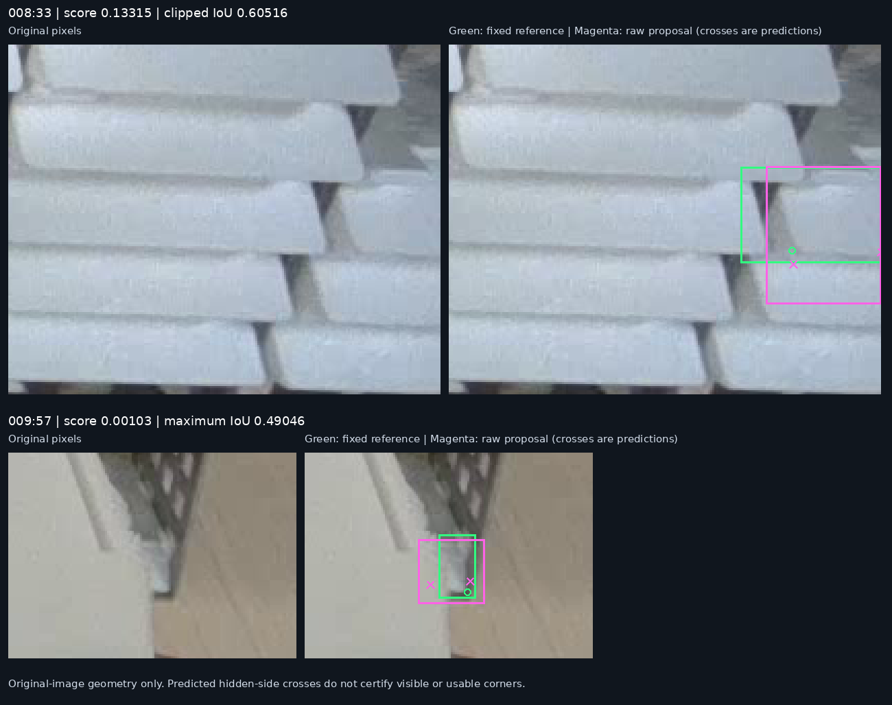

# Recover one reviewed proposal with the existing model

**Use the current PR35 seed46 checkpoint at confidence 0.13 for assistant-reviewed proposals, keeping image size 1280, NMS 0.70 and endpoint cutoff 0.50.** The fixed twenty-image comparison recovers one supported missed front, adds nine scored extras, preserves all existing matches and corner-pair results, and leaves the three empty images clear. All ten added proposals have now been reviewed from original pixels. The [existing folder command](predict-pose-folder.md#assistant-reviewed-proposals) needs only its confidence argument changed; generic runtime defaults remain epoch173/0.25.

**The current PR35 seed46 checkpoint already produces a weak, plausibly associated box for the clipped front `008:33`. Its confidence is below 0.15. The tiny fragment `009:57` has no decoded box meeting the fixed IoU 0.50 criterion, and even its strongest overlapping proposal has very low confidence.** At the starting 0.15 cutoff, neither target has a qualifying confident box available for NMS to retain.

This follow-up begins after the [completed PR40 training comparison](partial-front-results-2026-11-11.md). That comparison remains a negative result for the training-label extension: it recovers no additional object at its three declared thresholds, so the PR35 checkpoint is retained. This investigation changes neither the weights nor the reference and tests a different question: where do the two supported missed targets disappear in the prediction path?

Date: **2026-11-11, Asia/Hong_Kong**. The [evidence and reproduction guide](../results/verification/baomai-proposal-filter-20261111/README.md) preserves the trace, the later single-image counterfactual and their separate scopes.

## 1. The trace reproduces the existing outputs

The current checkpoint has SHA-256 `420c00f73eeba24e587342400878b7d96371d3e745772113809aa705ec8163b1`. For the initial trace it uses image size 1280, rectangular preprocessing, FP32, box confidence 0.15, NMS IoU 0.70 and endpoint cutoff 0.50. The reference is the same 663-object / 1,228-locatable-endpoint version used for the PR40 comparison.

The diagnostic copies the decoded pose tensor immediately before the unchanged predictor performs confidence filtering and ordinary NMS. It records all **19,320 proposals per image**, their box and endpoint values, and the retained proposal indices. It performs **two original-image predictions and one excluded blank warmup**.

All final values exactly reproduce the archived current-model outputs: **40 predictions for `008` and 74 for `009`**, with no numerical tolerance. The saved predictions cited in the PR40 report are outputs after filtering; this new trace is the evidence for the earlier dense-proposal stage.

The input tensor is 736 by 1280 pixels, with eight pixels of vertical letterbox padding at each side. Reference matching uses the normal scaled and clipped original-image boxes. Suppression uses model-input boxes before clipping, because clipping can change overlap. Independent reconstruction verifies every transformed box and endpoint, every IoU 0.50 membership, and all retained indices using a separate NumPy greedy-NMS implementation.

The trace uses the same pinned packages and four intra-op threads. It records nine inter-op threads, compared with one in the archived evaluation. Exact output equality supports comparison for these two images; this is not a claim that all runtime settings or all future predictions are identical.

## 2. The two targets have different immediate failure mechanisms

| Fixed target | Decoded boxes with reference IoU at least 0.50 | Highest confidence among qualifying boxes | Highest decoded reference IoU | Diagnosis at confidence 0.15 |
| --- | ---: | ---: | ---: | --- |
| `008:33`, right-clipped front | 21 | 0.133154839 | 0.656487394 | All geometrically qualifying boxes fail the confidence gate. |
| `009:57`, fragment beside the jaw | 0 | None | 0.490461924 | No decoded box meets the fixed matching criterion; nearby proposals also have low scores. |

For `008:33`, the strongest qualifying proposal is index 17038, with **IoU 0.605158784 and confidence 0.133154839**. It is not the maximum-IoU proposal. The maximum-IoU proposal has confidence only 0.003460282.

For `009:57`, the maximum-IoU proposal has confidence **0.001025405**. The strongest proposal with any overlap has confidence **0.025030576** and IoU **0.183195645**. It would be inaccurate to say that there is no nearby raw geometry: there is, but its scores and alignment do not establish a usable detection. Changing NMS alone at confidence 0.15 cannot recover either of these fixed targets.

Green is the unchanged reference. Magenta is one inspected decoded proposal. Crosses show predicted coordinates, including unavailable or out-of-frame sides; they do not certify physical visibility.

## 3. One explicitly exploratory counterfactual

After seeing the 0.133154839 score, a **single-image** replay tried confidence **0.13**, keeping NMS 0.70 and every other setting fixed. This was selected after diagnosis and is explicitly exploratory. It loads no model and performs no new image prediction.

On image `008`, the inspected proposal survives NMS and uniquely matches reference row 33 under the unchanged full-image one-to-one scorer:

| Image `008` only | Confidence 0.15 | Confidence 0.13 |
| --- | ---: | ---: |
| Returned proposals | 40 | 42 |
| Matched reference objects | 34 | 35 |
| Misses | 2 | 1 |
| Extras | 6 | 7 |

No prior proposal or matched reference row is lost. The other added proposal is index 19064, confidence 0.141025856. These are image-specific counts, not a full-dataset threshold result.

Original-image inspection supports associating index 17038 with the intended clipped front, while also showing a poor lower box boundary: the box extends about 20 pixels below the fixed reference into the next-front region. Its left endpoint error is about 6.93 pixels. The predicted right endpoint has confidence about 0.835 but X coordinate 1280, which fails the existing strict in-frame check for a 1280-pixel-wide image. This is a potentially useful proposal for review, not a newly recovered pair of usable corners or a precise final annotation.

This result motivated the fixed full-set comparison below. It did not by itself establish a global setting or authorize a stronger reliability claim.

## 4. The fixed whole-set comparison

Before the next inference run, the protocol fixed exactly two settings, **0.15 and 0.13**, on all twenty original validation images. It required recovery of the supported `008:33` proposal, no loss of existing matches, no reduction in 5 px or 10 px two-corner success, no new detections in the three empty images, and explicit review of every added proposal. The hypothesis came from the preceding diagnosis; fixing this protocol before the next run does not turn reused development data into independent validation.

The unchanged evaluator performed **40 original-image predictions and one excluded warmup**, with four intra-op and one inter-op CPU threads. All twenty fresh 0.15 arrays exactly reproduce the archive. Every previously retained prediction is exactly identical at 0.13; the new setting only adds ten outputs.

| Same current checkpoint and corrected reference | Confidence 0.15 | Confidence 0.13 |
| --- | ---: | ---: |
| Returned proposals | 718 | 728 |
| Matched objects / 663 | 642 | 643 |
| Misses | 21 | 20 |
| Extra detections | 76 | 85 |
| Duplicate / other extras | 28 / 48 | 31 / 54 |
| Object recall | 96.83% | 96.98% |
| Object precision | 89.42% | 88.32% |
| Returned visible endpoints / 1,228 | 1,207 | 1,208 |
| Both corners within 5 px / 584 | 529 | 529 |
| Both corners within 10 px / 584 | 577 | 577 |
| Miss-free nonempty images / 17 | 3 | 3 |
| Predictions on the three empty images | 0 | 0 |
| Returned points on reference-unlocatable sides | 69 / 76 | 69 / 77 |

**Only `008:33` is gained; no existing matched reference object is lost.** The zero/one/two-locatable-corner groups have 7/7/6 misses at 0.13, compared with 7/8/6 at 0.15. The new returned visible endpoint is within 10 pixels but outside 5 pixels. The two-corner subgroup and every old matched object's endpoint states/errors remain unchanged. The unlocatable-side denominator increases because the recovered object has one unavailable side; its clipped right endpoint is still rejected by the existing in-frame rule.

The ten added proposals occur in six images: two in `007`, two in `008`, one in `009`, three in `011`, one in `055` and one in `090`. Under the frozen scorer they comprise **one recovered reference object, three duplicate extras and six other extras**. That is ten additional review proposals, including nine extras, for one recovered reference match. It is approximately 1.39% more proposals than the previous 718; it is not a measured review-time saving or a general cost estimate.

The original 664-object reference remains separate: matches change **631→632**, misses **33→32**, extras **87→96**, and its 5/10 px pair results remain **522/570 out of 584**. No reference labels were edited after seeing either comparison.

All fixed numerical checks pass. Independent saved-prediction replay reproduces all eighty per-image score records, eighty quality records, four reference/threshold aggregates, subgroup summaries and object changes. No further inference was needed for that audit.

### Completed original-image review and use decision

An independent assistant reviewed all ten additions using full-scene context, original crops and exact overlays. The review supports `008:33` as an additional proposal for the intended clipped front, with the boundary and point limitations above. The other nine additions establish no separately accepted new instance in this pass: they include narrow alternative boxes, duplicate or occlusion-region proposals, and a clear background proposal near a blue device edge.

The added `009:74` prediction overlaps the unresolved reference `009:56`. The added `011:66` prediction repeats the region with the separate `011:61` caveat. These uncertainties remain attached to their cases. "Nine scored extras" does not mean that all nine have independently certified false physical identities. No new label is accepted and no reference row is removed.

Under the user's established priority to recover missed objects and delegated review-workload decisions, **select 0.13 explicitly for proposal collection with this checkpoint**. The measured cost is ten extra proposals to inspect across six images for one supported additional reference match. Existing matches, 5/10 px corner-pair outcomes and empty-image outputs are preserved, and every addition has a recorded disposition. Review time was not measured. The change is useful for this reviewed workflow; it is not a globally optimal threshold or an unattended-use approval.

The per-proposal review and operational decision are recorded separately from the frozen numerical summary, which truthfully retains its initial pending-review status. This is an inference-setting change with the same learned weights; it adds no evidence of improved training or reliability on new scenes.

## 5. Limits and next decisions

The two targets were chosen from previously reviewed failures. This is a mechanism diagnosis on known development images, not an independent accuracy measurement or an estimate of how common either failure mechanism is.

For the current 663-object reference, the PR35 model at confidence 0.13 has **643 matches, 20 misses and 85 extras**. Its **577/584** both-corner successes within 10 pixels concern only the objects with two locatable reference corners. Objects with one or no locatable corner account for **14 of the 20 misses**. Eighteen missed rows retain prior reference uncertainty, with the separate `011:61` boundary/identity caveat also preserved. The report does not turn all scored misses into physically certified failures or remove difficult rows to improve the denominator.

Review therefore still needs a completeness scan of the original image, in addition to accepting or rejecting model proposals. An object without a returned proposal cannot be discovered by inspecting only the proposal list. Hidden endpoints remain missing unless the original image supports their location.

The trace and fixed comparison recover a review proposal for the first target. The second needs a different hypothesis concerning localization, representation or supported supervision. This result does not justify another seed search, a larger architecture, stronger NMS or a new resolution sweep. The completed 1920 comparison already worsened misses; its decision remains to use 1280. The present pass stops after reviewing the ten additions and preserving a usable command; no further experiment is scheduled by this result.

Existing unreviewed material remains a later avenue for improving supervision without new capture. The [additional-frame pilot](additional-annotation-pilot-2026-11-07.md) records 320 recovered upstream frames, 317 without complete row review and three quarantined pilot images with 36 unresolved boundaries. These are not automatically eligible training images or an independent test set. Their physical ambiguities, source use and capture relationships must be resolved before an appropriate role is assigned.
