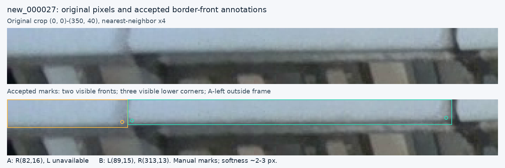

# 組織包埋盒影像辨識：PR58 後的可用程度與下一步

日期：2026-11-13（香港時間）

**目前建議：繼續使用 PR35，作為需要逐張覆核的離線定位工具；先完成既有影像的標註修訂，再決定下一個訓練實驗。** PR58 的評估已完成，但未達預先訂明的模型替換條件。本輪新增的是有原圖支持的訓練標註候選，尚未訓練，也沒有證明模型準確度已提升。

設定維持 `imgsz=1280`、box confidence `0.13`、NMS IoU `0.70`、endpoint confidence `0.50`。模型與操作方式見[資料夾推論指南](predict-pose-folder.md)；完整比較及證據見[PR58 結果報告](composed-results-2026-11-13.md)。

## 1. 現在的模型算「夠好」嗎？

對「先提出候選位置，再由助理查看完整原圖並修正」的工作，已有可用基礎。對「自動找齊每張圖的所有目標，直接接受輸出」的工作，現有證據仍不足。這兩種用途需要不同的 acceptance criteria。

以下數字來自相同的 20 張既有 development images，其中 17 張非空、3 張空白。主要參考標註包含 663 個物件、1,227 個可定位角點；matching IoU 固定為 `0.50`。[評估證據](../results/verification/baomai-composed-results-20261113/README.md)

| PR35 指標 | 結果 | 可支持的解讀 |
| --- | ---: | --- |
| 成功配對物件 | 643 / 663＝96.98% | 在固定參考標註及配對規則下的 object recall |
| 額外提案（scored extras） | 85 | 需要判斷身分、框範圍或重複性，不能直接全稱為不存在的盒子 |
| 非空圖片完全沒有 scored misses | 3 / 17 | 大多數圖片仍有未成功配對的參考物件 |
| 非空圖片同時沒有 misses 或 extras | 0 / 17 | 尚未得到無須修訂的完整偵測清單 |
| 兩角均在 5 px 內 | 529 / 584＝90.58% | 只涵蓋兩角均可定位的物件 |
| 兩角均在 10 px 內 | 577 / 584＝98.80% | 同一子群；分母亦包含該子群中漏配對的物件 |
| 三張空白圖的提案數 | 0 | 支持這三張既有圖片上的表現 |

**98.80% 不能稱為「整個系統準確率」。** 584 的分母排除了 79 個只有一角或沒有角點可定位的物件。條件式角點誤差中位數約 1.558 px，也只統計已配對且回傳的可定位角點，不能反映全部漏檢。

缺口集中在只有一個或沒有可定位角點的物件：零角可定位組漏 7/20；一角組漏 7/59；兩角組漏 6/584。前兩組合共承擔 **20 個 scored misses 中的 14 個**，PR58 沒有改善這 14 個。

同時，scored miss 不一定表示畫面上完全沒有相關 proposal；框的 IoU 稍低或配對到另一個框，也會產生 miss。真正沒有重疊輸出的 `new_000009:57` 仍存在，所以需要分清「沒有候選」與「候選框未通過配對」。原圖覆核是作出物理判斷的依據。

Endpoint confidence 也不能證明角點可見或達到某個誤差容限：三模型在共同配對物件的 78 個參考不可定位欄位中，仍回傳 70 個角點。這些位置沒有可靠座標可供量測誤差，不能自動變成已接受的 visible labels。上述 5/10 px 是原圖上的距離，亦不是毫米精度。

## 2. PR58 數字略好，為何仍保留 PR35？

PR58 的 matched control 已包含十個 endpoint-slot 修訂；candidate 在此基礎上加入 17 個框修正和一次 duplicate removal。PR35 則是另一個、目前實際採用的比較對象。

| 主要參考下的結果 | PR35 | PR58 matched control | PR58 candidate |
| --- | ---: | ---: | ---: |
| Matches / misses / extras | 643 / 20 / 85 | 643 / 20 / 86 | 644 / 19 / 84 |
| 兩角均在 5 px 內 | 529 / 584 | 528 / 584 | 531 / 584 |
| 兩角均在 10 px 內 | 577 / 584 | 578 / 584 | 578 / 584 |

唯一新增的 match 是 `new_000087:15`。三個模型本來都有對應 proposal；它與參考框的 IoU 依次為 `0.493069`、`0.498035`、`0.500135`。Control 到 candidate 的最大框座標變化只有約 **0.0981 px**，剛好跨過 `0.50`。因此，少一個 miss、增加角點覆蓋、增加一張 miss-free 圖，有部分是同一次重新分類帶來的連動，不能當成幾項互相獨立的新物件恢復證據。

另一個必須講清的比較是：candidate 相對 matched control，失去 `008:22` 的 5 px 成功及 `007:15` 的 10 px 成功；相對 PR35，則**沒有失去主要參考下既有的角點配對成功**。兩者並不矛盾。

候選的 scored duplicate extras 也增加至 32，而 PR35 為 31、control 為 29；新增輸出的原圖覆核未證實找回另一個獨立盒正面。綜合結果未達[預定 promotion rule](../experiments/composed-fronts-2026-11-12.json)，故保留 PR35。這是特定用途下的保守採用決定，不表示 PR58 每項表現都較差。

## 3. 本輪已把兩個漏標物件變成具體候選

兩次各自先看未標記原圖的助理覆核，均支持 `new_000027` 左上邊界存在兩個漏標的 cassette fronts。採納的幾何如下，座標均以原始 1280×720 圖片的 pixels 表示；bbox 順序為 `[xmin, ymin, xmax, ymax]`。

| 修訂 | Bbox | 左下角 | 右下角 |
| --- | --- | --- | --- |
| `new_000027` 新增 A | `[0, 0, 86, 20]` | `0 0 0`；實際左角在畫面外 | `(82, 16, v=2)` |
| `new_000027` 新增 B | `[86, 0, 317, 18]` | `(89, 15, v=2)` | `(313, 13, v=2)` |
| `old_000010` 原 row 1 | 僅把 `ymin` 改為 `0` | 原 tokens 保留 | 原 tokens 保留 |

可見交界存在約 **2–3 px 的人工定位不確定度**；這是圖像柔化與人工判讀的限制，並非經測量得到的統計 confidence interval。頂部截斷亦不代表底部兩角必然不可見。A 的左角缺失與其右角可定位必須分別記錄，符合[annotation policy](annotation-policy.md)。

本次 [border-fronts-2026-11-13 候選](../data/candidates/border-fronts-2026-11-13/README.md)完整繼承 PR35 的八個 overlay 檔，再加入這兩張圖的標籤修訂。有效訓練集為 **137 張、3,773 個物件、6,844 個可定位角點及 702 個 missing slots**。它沒有默默合併歷來所有候選的改動，也不是 PR58 模型的新結果。

[完整裁定、各自提名及驗證紀錄](../results/review/border-fronts-20261113/README.md)保留不同判讀與限制。現有標註驗證器已通過；沒有改寫原始標籤或固定評估參考。

既有覆核範圍仍為 **70/137 張**；本輪完成的是已記錄問題的裁定，沒有把新的圖片計入覆核。仍有 67 張不在那些已記錄的 passes 中：57 張非空、10 張空標籤，包含 1,590 個原始物件列及 203 個 missing endpoint slots。覆核紀錄不等於每張圖的所有細節已獲認證。

## 4. 沒有新圖片，下一步仍可以很具體

1. **完成既有原圖覆核。** 從剩餘圖片累積漏標、重複、框範圍與角點狀態修訂。每張都要看完整原圖，包括沒有 proposal 的區域；十張空標籤也要確認真的是空場景。
2. **形成一個一致的 training revision。** 每次修改保留原始 row identity、原圖證據與未決事項。先處理標註內容，避免每修幾個框便立即重訓。
3. **有足夠實質改動後，才固定下一次 matched experiment。** 事先訂明控制組、PR35 比較、training recipe、評估集及成功條件；同時追蹤部分目標、整圖完整性、重複輸出與角點退步。
4. **沿用現有工具。** 使用 PR35 的明確 checkpoint manifest、現有 folder runner 和 HTML editor。Generic CLI default 仍是 epoch173/0.25，不能省略選模參數便假定執行了 PR35。

較高解析度、幾何推估與多輪局部標註訓練已有紀錄，不應當成尚未試過的捷徑。圖片 augmentation 可以改變訓練樣本，但不會增加新的獨立觀測。這 20 張 development images 已參與模型選擇及反覆比較；重新分割既有資料也不能讓目前模型取得未接觸過的測試證據。現階段可以改善既有資料上的工作品質，不能因此宣稱已驗證新場景可靠性。

## 5. 已確認的角點需求與目前符合程度

使用者再次明確確認：目標是同一白色蠟塊正面下沿的兩個實際角點，不是上唇、底托或籃架；兩點依 image X 排列，達到 endpoint confidence 門檻才顯示，兩點均通過顯示條件時才連線。這與既有 upstream 定義及 annotation policy 相符，不需要重新選擇 landmark 或更換模型架構。

**角點的物理身分與定位才是主目標。** 框是物件配對和診斷的支援；框 IoU 或整圖偵測數不是完整的角點達標判準。Image-X 排列要求左點在右點左側，不要求兩個 Y 相同；不能把傾斜的實際下沿強行拉成水平線。

現有 live 與 folder renderers 分別檢查每一點的 confidence ≥0.50 及圖內有限座標，僅在兩點皆通過時連線，不會推估缺失點或強制相同 Y。Live diagnostics 可另以橙色叉號顯示未通過的提案；那不是正常模式接受的角點。程式保留 model slots，沒有在 runtime 硬排序或拒絕 X 反轉。

針對同一批 PR35 儲存輸出新增[需求對照診斷](../results/review/corner-requirement-20261113.json)，沒有新推論、重訓、改門檻或改配對：

| 通過兩點顯示條件的提案分類 | 數量 |
| --- | ---: |
| 配對到兩角均可定位的參考物件 | 578 |
| 配對到只有一角可定位的參考物件 | 48 |
| 配對到沒有角點可可靠定位的參考物件 | 11 |
| 在既定 scorer 下未配對的提案 | 78 |
| 合計 | 715 |

715 對的 X 次序全部正確，沒有反轉或相同 X。這是已觀察輸出的結果，不是對未來任何圖片的硬保證。578 個兩角可定位的配對中，529 個兩角都在5 px內，577個都在10 px內；與既有584個合格目標分母一致。

**577/584 不是所有畫出線段的正確率。** 59 對連線配對到只具有一個或零個可靠參考角點的物件，無法完整證實為已觀察到的真實角點對；另外78對是在IoU規則下未配對，也不能直接稱為不存在的物理邊線。

具體例子：`new_000010` row28 的PR35兩點誤差約1.97/0.64 px，支持模型能找出指定角點；row31可見左角誤差約10.58 px，證明仍有定位失敗。Row32兩個提案信心值約0.862/0.875，均會通過顯示門檻，但最新參考的兩角皆不可可靠定位。這保留可見性判讀的限制，並不宣稱兩個座標必然物理錯誤。

目前可確認的是：目標定義正確、正常繪圖邏輯符合要求，且清楚可定位物件的角點結果強；尚不能認證每一個標籤、每條顯示線段或未見場景。下一輪標註覆核應優先檢查角點所屬物件、實際下沿轉角及獨立missing狀態。原始標籤、PR35使用過的訓練標籤、新候選與評估參考各自保留；修改後兩者不會自動更新既有模型權重。

需求沒有提供允許的像素誤差或誤顯示率，因此5 px維持診斷門檻、10 px維持暫定評估上限，不能把它們冒充為教師已訂明的驗收條件。PR35繼續作為目前有覆核流程的模型。

## 6. 續接時完成的工具修正

[HTML 編輯器](../tools/cassette_labeler/README.md)的匯入、Apply 及 Save 現在遵守既有機械標註規則：missing slot 必須為 `0 0 0`，兩角可見時維持 image-X 次序，可見點必須在影像與自身框內。也會檢查實際八位小數的輸出，避免 rounding 把可見點寫到被排除的右邊界或下邊界。檢查不會自行推估座標、交換左右或修改可見性。

無效匯入仍顯示原圖，並逐字保留原標註文字供修正；Save 與 Save & Next 在資料無效時不寫檔、不跳圖。24項 focused checks 通過，包括所有157份凍結標籤、無效輸入的恢復、Undo、部分可見點及寫檔失敗處理。另通過 draft exporter 檢查。這些檢查使用 DOM 與 file-handle stubs，未宣稱本輪完成真實桌面瀏覽器操作或新的模型推論。

原有2.1 MB評估封裝與所有60筆影像預測保留；[續接驗證紀錄](../results/verification/baomai-composed-results-20261113/recovery-verification.json)記錄獨立下載的PR58回傳驗證、原始紀錄與公開精簡版的逐項一致性，以及不需GPU的數值重播。
