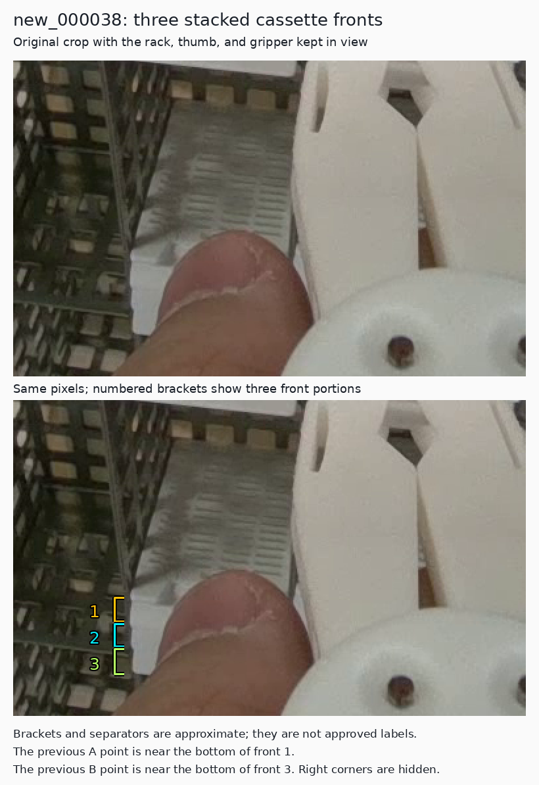
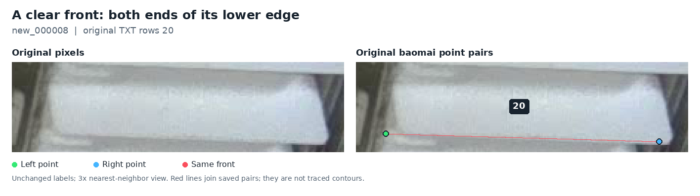
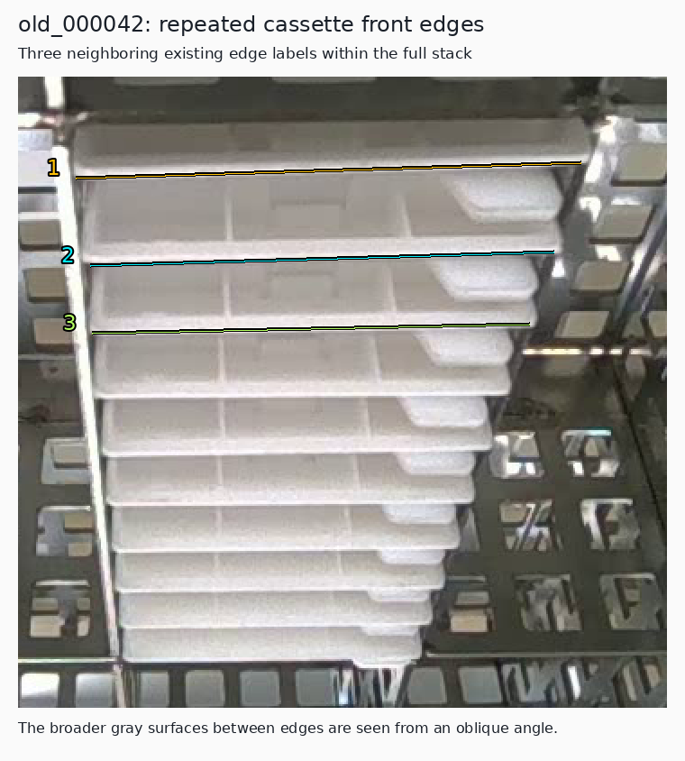

# Corrected cassette ownership and the established prediction contract

Date: 2026-11-14, Asia/Hong_Kong. This corrects the interpretation published
in PR63 at `2c6d5e7f80acca63a6cd478234af594bd7a5c759`.

**Subsequent label repair:** the [reconciled-label review](label-refinement-2026-11-14.md)
now gives the three thumb-adjacent fronts individual rows and adds the separate
bottom-clipped front. Its original-pixel rulers refine the coarse boundary ranges
below, and its explicit accepted record contains the replacement geometry. The
earlier observations remain a historical ownership correction; they are not the
final coordinate specification. No model has been retrained on the new labels.

**The target and permission to predict obscured corners were already settled.**
The previous follow-up overlooked the PR55/56 decisions and incorrectly framed
`new_000038` as one cassette with two alternative corner locations. The user
pointed out three cassettes. Full-image review supports that correction. The
proposed A-to-B move is withdrawn; no label had been changed by that proposal.

The established task remains one physical cassette front, its actual two lower
corners ordered by image X, direct confidence-gated model predictions, and a
line when both predictions qualify. Inferred coordinates remain predictions;
they do not automatically become observed training/reference truth. No new
landmark choice, visibility-only output restriction or architecture decision is
required to continue the existing work.

## 1. Q1: three cassettes, not one tall front

The original has two subtle transverse boundaries accompanied by steps in the
left silhouette. They separate three exposed front portions under the thumb:

| Feature | Approximate original-image Y |
| --- | --- |
| Upper/middle boundary, near previous A | 608–610 |
| Middle/lower boundary | 625–629 |
| Lowest cassette's lower turn, near previous B | 646–649 |

The frozen A coordinate `(489.43,608.26)` plausibly belongs to the upper
cassette's lower-left corner. The suggested B coordinate near `(492,646)` lies
at the lowest cassette's turn. **They must not be treated as replacement
coordinates for the same object.** The brackets show approximate ownership,
not approved endpoint or box geometry.

The [nearby new_000039 view](../results/review/target-clarification-20261114/figures/new_000039-neighbor-three-fronts.png)
corroborates a three-unit stacking pattern. Identical physical instances or
unchanged poses across these frames have not been established; no hidden
coordinates are transferred. The seams in `new_000038` itself are the direct
image evidence.

### Concrete annotation repair item

Only frozen row 1 represents this region. Its box is approximately
`[489.43,608.26,617.9,638]`: the visible point is near the upper front's bottom,
while the box extends across portions of the lower fronts and thumb. The issue
is **three-instance coverage and box/point ownership**, not a 38 px point shift.
Two local instances are absent or merged under the one-instance-per-cassette
rule.

Review the assignment of row 1 to the upper front, then define distinct middle
and lower rows from their visible extents. Exact new boxes and left-corner
locations are not approved yet: the boundaries are soft and partly hidden.
All three right corners are obscured. Their natural-image reference slots must
not be filled from a neighboring image or a model guess. This training-label
rule does not prohibit model estimates at inference.

The separate bottom-left, image-clipped front identified in the earlier review
is a different region and retains its own unresolved extent question.

## 2. Q2: recover the existing physical target example

PR56 already provided an explicit full-front example and recorded that the
user reaffirmed the existing guidance. The
[source example](baomai-corner-examples-2026-11-12.md#2-a-clear-complete-front-new_000008-row-20)
and [guidance audit](lower-front-guidance-audit-2026-11-12.md) explain that no
new landmark choice is needed.

This is `new_000008`, original row 20: left `(930.29,240.39)`, right
`(1114.63,245.90)`. The two points belong to the same individual front's lower
edge; its upper lip is separately visible. The original coordinates illustrate
the intended feature, not subpixel ground truth. "Whole cassette" means the
individual physical unit, not the connected white silhouette of a stack or the
largest bright area in a crop.

At a shared stack seam, the lower corner of the front above and the upper
shoulder of the next front are close but have different owners. This distinction
was already documented in the PR56 source guide and directly explains the Q1
mistake.

### old_000042: successive edges in an oblique stack

The earlier A/B edges are best interpreted as successive cassette-edge levels:
source row 10, then row 1; row 2 continues the same pattern below. The complete
stack, related old-image viewpoints, and isolated upstream cassette views favor
separate units. The former broad question about redefining the target is
withdrawn. Do not merge/delete row 10 or move its pair onto row 1 merely because
the larger pale region between them looks continuous in a crop.

The isolated upstream [recessed-side example](https://github.com/an94-doll/embedding_vision/blob/72a99dafa1b14bfabd101e639b9ddb5f5aa38d52/images/01/frame_0001.jpg)
and [opposite-side example](https://github.com/an94-doll/embedding_vision/blob/72a99dafa1b14bfabd101e639b9ddb5f5aa38d52/images/04/frame_0001.jpg)
show both the three-recess short-end construction and the smooth sloped end.
The broad recessed band in `old_000042` is not safely interpreted as one smooth
front plane. Oblique surfaces and projected neighboring edges need per-object
ownership. This visual correspondence does not certify every existing pixel
coordinate or box extent, and it does not establish that isolated examples are
the same physical specimens.

The current [baomai instructions](https://github.com/an94-doll/embedding_vision/blob/351eb3cf960ccc34829e2bc72e1fa4645acc6295/data/README.md)
remain authoritative for the two-point task. The isolated yolo-pose images help
identify construction; their five-point schema, object-relative identities and
whole-object boxes are not imported. The local visible-front box rule remains
separate from the physical endpoint definition.

## 3. Q3: the established inference behavior already permits estimates

PR1–63 were listed and their titles screened, then the relevant descriptions,
source documents, implementations and selected comment timelines were read.
This is a focused history recovery, not a claim to have audited every PR diff.
The decisive existing decisions are:

| History | Decision carried forward |
| --- | --- |
| [PR1](https://github.com/Siuuuers/dl/pull/1), [PR2](https://github.com/Siuuuers/dl/pull/2), [PR10](https://github.com/Siuuuers/dl/pull/10) | Preserve baomai's two-lower-corner task; distinguish observed label truth and missing slots. |
| [PR20](https://github.com/Siuuuers/dl/pull/20) | Keep raw prediction coordinates/scores separate from display flags in folder inference. |
| [PR55](https://github.com/Siuuuers/dl/pull/55) | Investigate hidden-corner estimates with `estimated_from_context` provenance; the follow-up retains direct PR35 output because automatic geometry substitution is unsupported. |
| [PR56](https://github.com/Siuuuers/dl/pull/56) | Reaffirm the existing physical target; change diagnostic wording from VISIBLE/HIDDEN to SHOWN/NOT SHOWN without changing the gates. |
| [PR60](https://github.com/Siuuuers/dl/pull/60) | Test covered pixels while retaining known original coordinates for scoring; confidence does not guarantee hidden-corner accuracy. |
| [PR61/62](https://github.com/Siuuuers/dl/pull/61) | Complete the synthetic-corruption comparison, retain PR35, and explicitly allow naturally hidden estimates without inventing training truth. |

The [PR55 follow-up](https://github.com/Siuuuers/dl/blob/c55a7160df0b9ce0fa32a2bfb6df61dbf4cfd128/docs/context-model-anchors-2026-11-12.md)
retains direct PR35 predictions. Context geometry remains a separate review
proposal tool with manually supplied stack membership/ranks, unknown natural
hidden-point errors and `accepted_for_training: false`. It is not an automatic
fallback or geometry-fusion layer in the folder/live path.

The [PR56 guidance](https://github.com/Siuuuers/dl/blob/543a6afb4bc22c8b340deeb0402396c942a693c6/docs/lower-front-guidance-audit-2026-11-12.md#4-reference-visibility-and-prediction-confidence)
already distinguishes reference visibility from prediction confidence. The
[completed PR61 result](https://github.com/Siuuuers/dl/blob/1b71e8158e0594ee4c72ba845fa7b514a78b9e0d/docs/occlusion-results-2026-11-14.md)
expressly permits naturally hidden-corner estimates while keeping their unknown
accuracy separate from observed supervision. The previous suggestion to impose
an observed-corners-only output restriction is therefore withdrawn.

### Minimal current contract

For an object returned by detector postprocessing, the
[folder runner](../scripts/predict_pose_folder.py) and
[live viewer](../scripts/view_d405_yolo.py) use:

`display(point) = score >= endpoint_threshold AND finite in-frame coordinates`

`draw_line = display(left) AND display(right)`

Each endpoint is independent; the current endpoint cutoff is `0.50`. A
confident hidden-corner estimate may be drawn and connected if both predictions
qualify. These are predictions, not declarations of physical visibility. The
runtime has no physical-visibility classifier. Diagnostic crosses for withheld
coordinates remain separate from ordinary endpoint marks.

For natural-image training/reference labels, a reliable observed corner can
receive `v=2`; an unlocatable slot remains `0 0 0`. The model's score cannot
convert its estimate into observed truth. In the separate synthetic-corruption
experiment, a coordinate known before masking can remain a reconstruction
target; this does not establish a naturally hidden coordinate.

No new output restriction, classifier, mode or permission question is added.

## 4. The point cutoff explains only one withheld locatable endpoint

An arithmetic [display audit](../results/review/target-clarification-20261114/pr35-display-audit.json)
reused the saved PR35 `0.13` predictions and the current 663-object development
reference. It performed no new inference, image adjudication or threshold sweep.
All twenty reference-label hashes and the prediction payload identity were
checked. The existing scoring and matching results reproduced the frozen
adjudication replay; a separate standard-library recount also reproduced the
counts below without importing the production scoring helpers.

| Outcome for the 1,227 reference-locatable endpoint slots | Count |
| --- | ---: |
| Display eligible on scorer-matched objects | 1,207 |
| Belong to reference objects unmatched by the fixed association rule | 19 |
| On a matched object but withheld by the `0.50` endpoint cutoff | 1 |
| On a matched object but withheld for invalid/out-of-frame coordinates | 0 |

The single withheld point is `new_000008`, reference row 1, right side. Its
stored score is `0.22002056`; its stored coordinate is 8.624 px from the current
reference. That is within the provisional 10 px radius, but not within 5 px.
It lies near the top image boundary and is not newly visually certified here.
This identifies a withheld coordinate; it does not establish that lowering the
operational cutoff to approximately `0.22` improves the overall result.

All **578 matched objects with two locatable reference corners already have
both endpoints display eligible**. The remaining six of the 584 such reference
objects are unmatched. The one withheld point belongs to an object with only
one locatable reference corner. Lowering the endpoint cutoff on these saved
predictions therefore cannot increase two-locatable-corner display coverage.
Display coverage also does not establish coordinate accuracy: 577 of those 584
reference objects meet the existing both-corners-within-10-px criterion.

There are separately **20 unmatched reference objects**, containing those
19 locatable endpoint slots plus 21 unavailable slots. The two counts of 20
(unmatched objects and unavailable locatable endpoints) are coincidental.
An unmatched object can reflect the fixed IoU association or unresolved label
geometry, not necessarily the absence of a plausible emitted proposal.

The audit also reproduces **70 displayed coordinates for 78 reference-v0 slots
on matched objects**; 59 rendered lines on matched objects involve at least
one such slot. A v0 reference has no reliable coordinate and can reflect
clipping, uncertainty or occlusion. These counts are availability disagreements,
not a count of proven false endpoints or physically occluded corners. Their
coordinate error cannot be scored without independent reference evidence.

These are diagnostics on the same twenty reused development images and their
current annotation semantics. Their reference semantics remain version-specific; the corrected object-ownership findings do not recompute these scores.

## 5. Continue the existing task with corrected object ownership

The image-level repair is now specific: review the three fronts in
`new_000038`, correct their instance ownership and visible extents, and retain
unavailable corners independently. No broad physical-target or hidden-output
permission question remains. A soft or occluded pixel location can still be
held without reopening the established task definition.

The [remaining-front candidate](../data/candidates/remaining-fronts-2026-11-14/README.md)
remains untrained. It does not contain a `new_000038` override, so the withdrawn
A-to-B proposal never entered its labels. Its six additions, two restored left
slots and three box corrections retain their existing review scope; the
`old_000042` box correction is not a new physical identity or coordinate
certification.

PR35 remains the reviewed-image comparator at input `1280`, box confidence
`0.13`, NMS IoU `0.70`, endpoint confidence `0.50`. Direct predictions are the
working output; a future model improvement needs a supported coherent annotation
revision and the established controlled comparison. The generic epoch173 camera
launcher remains a separate configuration; explicit PR35 weights also need the
explicit reviewed confidence setting.

[Corrected observations and image provenance](../results/review/target-clarification-20261114/resolution.json)
record the user correction, approximate seam ranges, source and figure hashes,
source-label identity, remaining repair item and recovered runtime contract.
The old A/B figures and their observations are marked superseded historical
review material. Earlier review/adjudication JSON remains intact; its held
single-point suggestion is withdrawn by this resolution.

This correction involved source/history review and original-image inspection.
The previously checked saved-prediction arithmetic is unchanged. No new
inference, training, source/candidate label edit, reference change or renderer
change is claimed.
