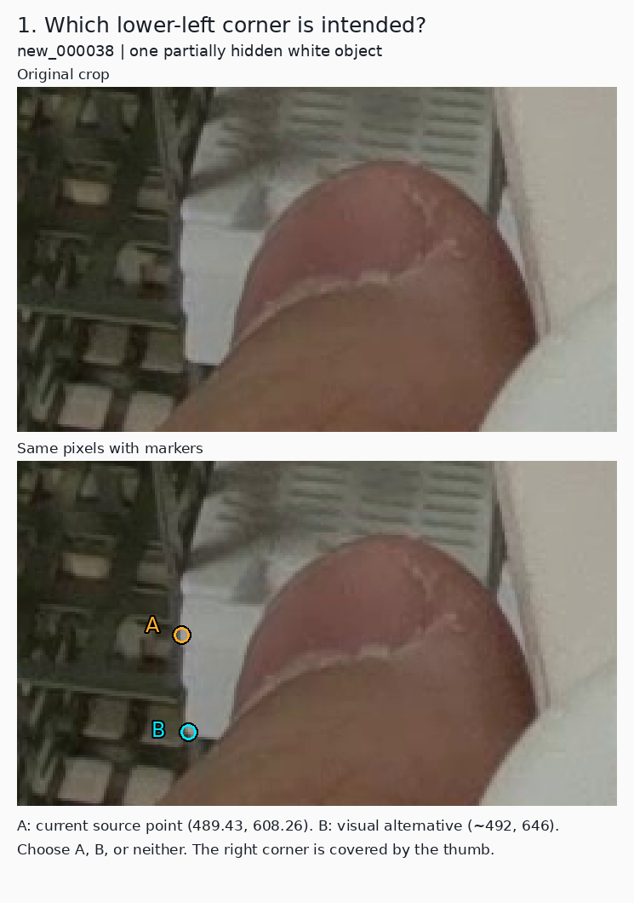
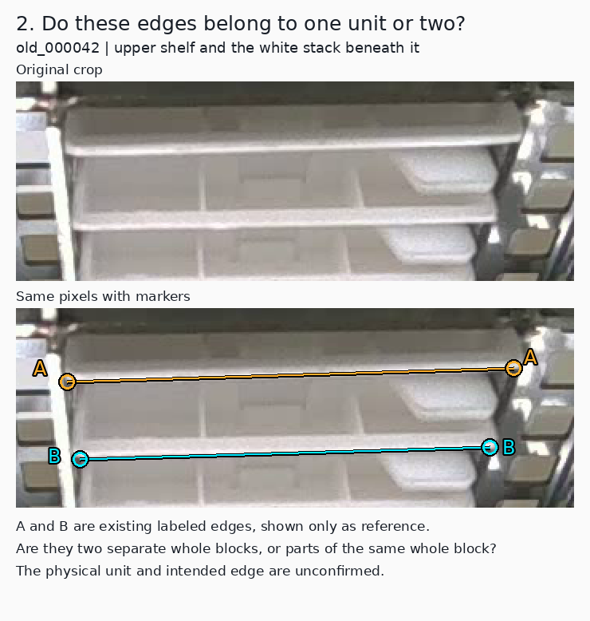

# Confirm the whole-block corner target before further training

Date: 2026-11-14, Asia/Hong_Kong. Source review: PR63 at
`e2dce11e1f2d224495a33971f349eed56a7b253a`.

The user clarified that the required endpoints are the two actual corners
along the bottom edge of the **front face of the whole white wax block**.
A corner of a visible fragment is not a replacement for the physical corner.
The user also requested confidence-gated points, a connecting line when both
points are visible, and fewer missing outputs.

**The current written target agrees with this clarification, but the physical
interpretation of particular source labels still needs an original-image
anchor.** The existing code already gates each endpoint and the connecting
line. This follow-up records two image questions and the remaining meaning of
runtime visibility. It changes no labels, predictions, model or renderer.

The untrained [remaining-front candidate](../data/candidates/remaining-fronts-2026-11-14/README.md)
remains a draft. Recheck its relevant decisions against the confirmed physical
unit before preparing a training comparison. The earlier accepted/rejected
review records remain historical evidence, not automatic certification under
this unresolved image interpretation.

## 1. What the source branches establish

The live upstream heads were read on this date:

| Source | Verified meaning | Consequence |
| --- | --- | --- |
| [Current baomai README](https://github.com/an94-doll/embedding_vision/blob/351eb3cf960ccc34829e2bc72e1fa4645acc6295/README.md), [data instructions](https://github.com/an94-doll/embedding_vision/blob/351eb3cf960ccc34829e2bc72e1fa4645acc6295/data/README.md), and [model card](https://github.com/an94-doll/embedding_vision/blob/351eb3cf960ccc34829e2bc72e1fa4645acc6295/metadata/model_card.json) | Actual lower-front left/right corners of the white wax block, ordered by image X. Upper lip, tray and rack corners are excluded. Independently unlocatable points use `0 0 0`. | This is the current two-point target. Agreement with this text does not prove a particular dot is on the right feature. |
| [Historical two-point standard](https://github.com/an94-doll/embedding_vision/blob/6f7112a553e1759fc755bda1f18ee56cb34dd315/detect/data/data_last/picture/work/annotation_standard.json) | The identifier is `reference83_front_lip_junction_corners`; its description anchors the actual turns of a front long edge to a saved frame83 example. | The older wording is a possible source of different feature interpretations. It does not establish that every old label is incorrect. |
| [Current yolo-pose instructions](https://github.com/an94-doll/embedding_vision/blob/72a99dafa1b14bfabd101e639b9ddb5f5aa38d52/annotations/README.md) | Front/back classes, five object-relative points, an edge midpoint and a whole-object box. | This is a different task. Do not import its point order, extrapolation rule or box definition into the two-point dataset. |

The upstream `data/annotated/` PNGs are **reference annotation previews**, not
model predictions. They were exported from the human-edited state; that
provenance does not guarantee correct feature identity. Training uses original
images and TXT labels, so correcting a preview alone would not change training.

The word "whole" resolves which physical corners are wanted; it does not by
itself request hidden full-object bounding boxes. The existing
[visible-front box policy](annotation-policy.md#2-box-the-observed-front-face-extent)
is a separate local convention. A partly visible block may remain one object
with one or both target corners unlocatable. A fragment endpoint must not be
substituted for a whole-block corner.

## 2. Two concrete image questions

The visual reviewer first viewed the three complete originals before their
label coordinates; the root
then viewed the originals, crops and source labels. The root knew the nominated
issues. This is not an independent human adjudication. The figures preserve an
unmarked original crop and add markers only to a duplicate. Coordinates below
are original-image pixels, not enlarged-display pixels.

### Q1 — A point above the apparent lower turn: new_000038

- **A:** frozen row 1 left point, approximately `(489.43, 608.26)`.
- **B:** apparent lower-left turn, approximately `(492, 646)`.
- B lies about 38 original pixels below A. Its soft/rounded transition leaves
  roughly 2–4 px of manual placement uncertainty; this is not a calibrated
  interval. The right corner is covered by the thumb.

**Question:** Does A, B, or another location identify the actual bottom-left
corner of the intended whole block? B is the visual reviewer's interpretation
of the lower turn; it is not an approved label.

This point correction was already held in the previous review. It would need
a coordinated box/point decision, rather than moving a point to fit the old box.

### Q2 — One physical unit or two: old_000042

| Marked edge | Existing source row | Existing endpoints |
| --- | ---: | --- |
| A, thin upper strip below the metal shelf | 10 | `(582,326)` to `(862.25,317.97)` |
| B, lower edge of the broader white region below | 1 | `(590,374.50)` to `(847.46,367.47)` |

**Question:** Are A and B the bottom edges of two separate whole blocks, or
parts of the same physical block? If they are one block, which edge belongs to
its required front face? "Neither" or a user-marked alternative is also valid.

This is an instance-identity question as well as a point-placement question.
The PR63 proposal narrowed row 10's box while preserving its point tokens;
that operation cannot resolve whether row 10 identifies the intended whole
block. Do not automatically merge/delete rows or move A to B from this crop.

### Supporting example — new_000033

The [supporting figure](../results/review/target-clarification-20261114/figures/reference-new_000033-rows39-41-42.png)
shows a fully exposed existing pair on row 39 and the proposed left restorations
on rows 41/42 at `(613,453)` and `(617,477)`. The latter are on exposed lower
turns beside the column gap; their right sides are obscured by the gripper.
Their consistency with the desired physical unit remains conditional on the
user's image anchor. Existing boxes cannot independently settle that identity.

[Image provenance and unconfirmed coordinates](../results/review/target-clarification-20261114/observations.json)
record source revision, hashes, crop rectangles, enlargement scales and figure
hashes. These are diagnostic figures, not new annotation previews or training
labels.

## 3. Confidence gating is already implemented

The [folder runner](../scripts/predict_pose_folder.py) and
[live viewer](../scripts/view_d405_yolo.py) each apply this normal display rule
after an object prediction survives detector postprocessing:

`display(point) = score >= endpoint_threshold AND finite in-frame coordinates`

`draw_line = display(left) AND display(right)`

| Qualifying endpoints | Normal output |
| --- | --- |
| Neither | No endpoint or connecting line |
| Left only | Left point only |
| Right only | Right point only |
| Both | Both points and one connecting line |

The endpoint cutoff is inclusive (`>=`), with default `0.50`. Image bounds are
half-open: `0 <= x < width`, `0 <= y < height`. The live path rejects nonfinite
prediction output before rendering. The folder extractor converts nonfinite XY
to missing coordinate values, which do not display. Both paths delegate the
box cutoff to the prediction backend; it is separate from endpoint gating.

The live viewer's optional D diagnostics can show orange crosses at withheld
coordinates. Those are explicitly diagnostic marks, not ordinary qualifying
endpoints; they never make a connecting line eligible.

**Neither renderer independently establishes physical visibility.** It does
not read reference `v=2` labels at runtime. A high-scoring in-frame estimate of
a hidden corner can pass the display gate. The score also does not certify
correct feature identity or a pixel-error limit. Existing synthetic-occlusion
[evidence](pixel-occlusion-2026-11-13.md) already shows covered corners passing
the display cutoff, including some incorrect estimates.

**Q3 — product decision:** When a physical corner is hidden but the model
returns a confident estimate, should the ordinary result omit it, or may a
separately identified estimate be shown? The observed training label and an
inferred coordinate must remain distinguishable either way. If ordinary lines
require two physically observable corners, score gating alone does not prove
that requirement is met; visibility mistakes must be evaluated explicitly.
No extra model or runtime mode is adopted by this note.

## 4. The point cutoff explains only one withheld locatable endpoint

An arithmetic [display audit](../results/review/target-clarification-20261114/pr35-display-audit.json)
reused the saved PR35 `0.13` predictions and the current 663-object development
reference. It performed no new inference, image adjudication or threshold sweep.
All twenty reference-label hashes and the prediction payload identity were
checked. The existing scoring and matching results reproduced the frozen
adjudication replay; a separate standard-library recount also reproduced the
counts below without importing the production scoring helpers.

| Outcome for the 1,227 reference-locatable endpoint slots | Count |
| --- | ---: |
| Display eligible on scorer-matched objects | 1,207 |
| Belong to reference objects unmatched by the fixed association rule | 19 |
| On a matched object but withheld by the `0.50` endpoint cutoff | 1 |
| On a matched object but withheld for invalid/out-of-frame coordinates | 0 |

The single withheld point is `new_000008`, reference row 1, right side. Its
stored score is `0.22002056`; its stored coordinate is 8.624 px from the current
reference. That is within the provisional 10 px radius, but not within 5 px.
It lies near the top image boundary and is not newly visually certified here.
This identifies a withheld coordinate; it does not establish that lowering the
operational cutoff to approximately `0.22` improves the overall result.

All **578 matched objects with two locatable reference corners already have
both endpoints display eligible**. The remaining six of the 584 such reference
objects are unmatched. The one withheld point belongs to an object with only
one locatable reference corner. Lowering the endpoint cutoff on these saved
predictions therefore cannot increase two-locatable-corner display coverage.
Display coverage also does not establish coordinate accuracy: 577 of those 584
reference objects meet the existing both-corners-within-10-px criterion.

There are separately **20 unmatched reference objects**, containing those
19 locatable endpoint slots plus 21 unavailable slots. The two counts of 20
(unmatched objects and unavailable locatable endpoints) are coincidental.
An unmatched object can reflect the fixed IoU association or unresolved label
geometry, not necessarily the absence of a plausible emitted proposal.

The audit also reproduces **70 displayed coordinates for 78 reference-v0 slots
on matched objects**; 59 rendered lines on matched objects involve at least
one such slot. A v0 reference has no reliable coordinate and can reflect
clipping, uncertainty or occlusion. These counts are availability disagreements,
not a count of proven false endpoints or physically occluded corners. Their
coordinate error cannot be scored without independent reference evidence.

These are diagnostics on the same twenty reused development images and their
current annotation semantics. The physical-target questions above still apply.

## 5. What to improve with the existing images

1. Resolve the physical unit and endpoint feature using Q1/Q2, then record the
   confirmed originals as examples. The current single class and two-point
   shape can remain; no architecture change follows from wording alone.
2. Recheck related training and development labels against those examples,
   keeping candidate annotations and scoring references separately versioned.
   Prior development scores measure agreement with their specific reference;
   they cannot certify a different physical interpretation.
3. Separate missed objects, withheld endpoint proposals, wrong physical
   features and inaccurate coordinates. Lowering an endpoint cutoff only
   affects withheld endpoint proposals on objects already returned.
4. Prepare one coherent correction candidate and a defined comparison after
   the image questions are resolved. Another training run before that would
   leave the target disagreement unresolved.

PR35 remains the historical reviewed-image comparator at `imgsz=1280`, box
confidence `0.13`, NMS IoU `0.70`, and endpoint confidence `0.50`. Those settings
and the generic epoch173 camera defaults are different workflows. In
particular, supplying PR35 to the live viewer with `--weights` changes the
weights but still inherits the baseline box cutoff unless `--conf 0.13` is also
supplied. This note is not a live-camera validation or a model promotion.

The work here consists of source/code review, original-image inspection, and
arithmetic reuse of saved predictions.
No new inference, training, threshold change or reference relabeling is implied.
