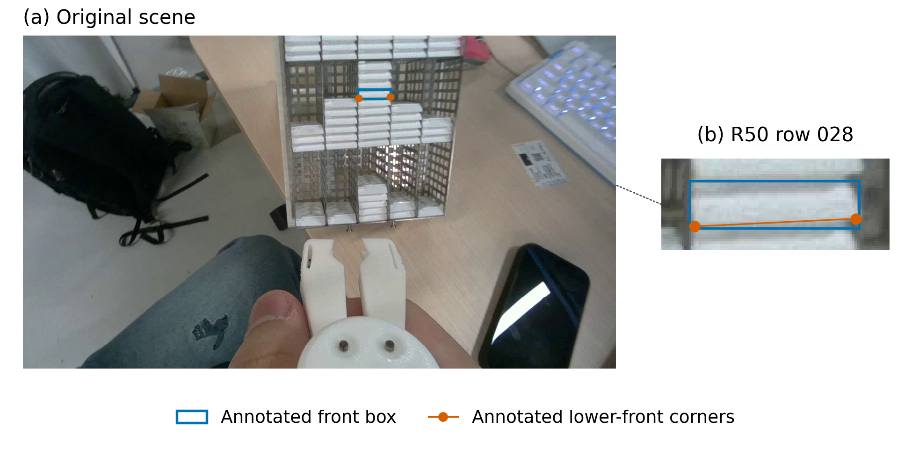
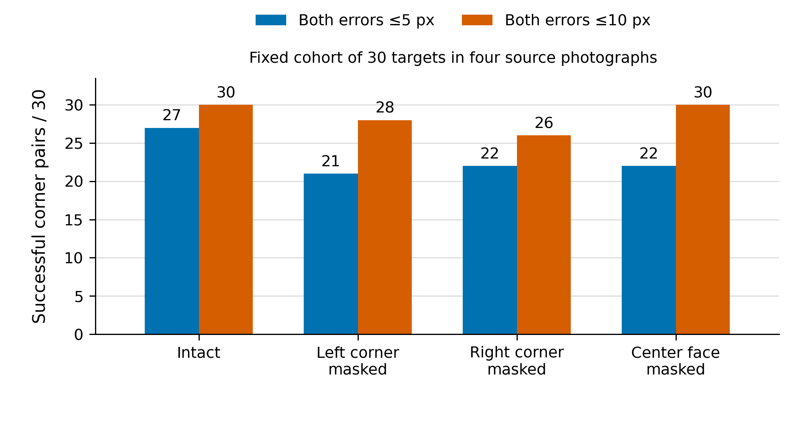
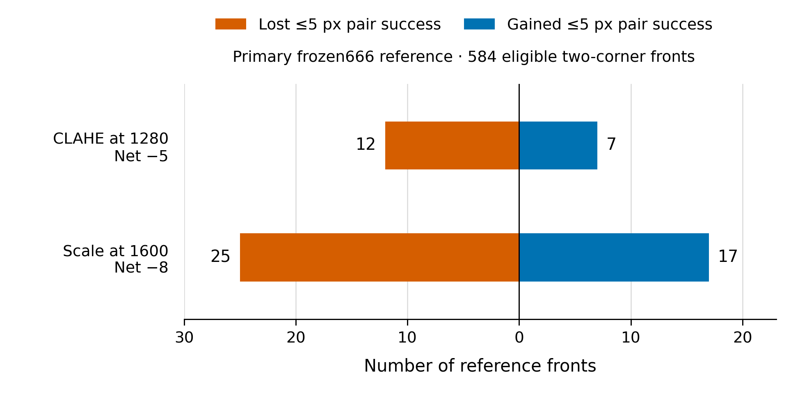
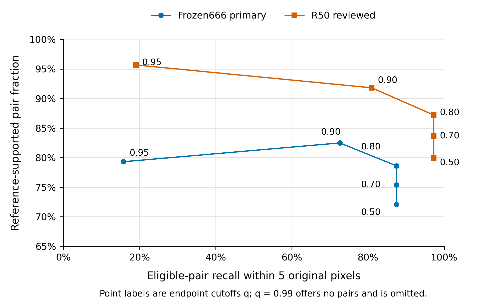

# Cassette Front Detection and Corner Localization for Automatic Image Analysis

## 1 Abstract

Automatic analysis of cassette images requires detection of identifiable fronts and accurate localization of their actual lower corners. Partial visibility, closely packed objects, and uncertain annotation boundaries make a successful box detection insufficient to establish a useful coordinate output. This project investigates annotation quality, controlled inference changes, and the evaluation of outputs offered to an automatic consumer. A single-class, two-keypoint model is studied using versioned annotations, paired comparisons, and reproducible prediction records.

An earlier annotation experiment reduced unmatched outputs from 58 to 52 while maintaining 24 missed fronts relative to its matched training control under that experiment's fixed reference. Later classification weighting recovered partial fronts but increased unmatched predictions. Two newly completed inference experiments tested fixed contrast enhancement and a larger input size. On the primary 666-front reference, each reduced misses from 34 to 33, while the number of fronts with both corners within five pixels fell from 511 to 506 and 503, respectively. An output-screen analysis also showed that high target recall can coexist with many coordinate pairs lacking full reference support.

The contribution is a documented annotation policy, a reproducible evaluation procedure, and a case-level account of the benefits and limitations of proposed changes. The results support targeted investigation rather than a uniform enhancement or scale change. All evaluations reuse development photographs; independent scene validation and an application-specific acceptance tolerance remain necessary for stronger claims about automatic use.

## 2 Table of Contents

<!-- DOCX_TOC_START -->
- [1 Abstract](#1-abstract)
- [2 Table of Contents](#2-table-of-contents)
- [3 Introduction](#3-introduction)
  - [3.1 Problem and significance](#31-problem-and-significance)
  - [3.2 Related work](#32-related-work)
  - [3.3 Objectives and targeted specification](#33-objectives-and-targeted-specification)
- [4 Background](#4-background)
  - [4.1 Front geometry and annotation meaning](#41-front-geometry-and-annotation-meaning)
  - [4.2 Detection matching and error categories](#42-detection-matching-and-error-categories)
  - [4.3 Corner error and conditional reporting](#43-corner-error-and-conditional-reporting)
  - [4.4 Confidence and output coverage](#44-confidence-and-output-coverage)
- [5 Methodology and Implementation](#5-methodology-and-implementation)
  - [5.1 Data and reference management](#51-data-and-reference-management)
  - [5.2 Model and image-processing arrangement](#52-model-and-image-processing-arrangement)
  - [5.3 Controlled comparisons](#53-controlled-comparisons)
  - [5.4 Reproduction checks and measurement procedure](#54-reproduction-checks-and-measurement-procedure)
  - [5.5 Output contract and pair evaluation](#55-output-contract-and-pair-evaluation)
- [6 Simulation Results](#6-simulation-results)
  - [6.1 Digital occlusion method](#61-digital-occlusion-method)
  - [6.2 Measured response to masking](#62-measured-response-to-masking)
- [7 Experimental Results](#7-experimental-results)
  - [7.1 Earlier annotation comparison](#71-earlier-annotation-comparison)
  - [7.2 Partial-target training tradeoff](#72-partial-target-training-tradeoff)
  - [7.3 Contrast and scale comparisons](#73-contrast-and-scale-comparisons)
  - [7.4 Paired cases and geometric sensitivity](#74-paired-cases-and-geometric-sensitivity)
  - [7.5 Combining cached views](#75-combining-cached-views)
  - [7.6 Automatic pair screening](#76-automatic-pair-screening)
- [8 Discussions](#8-discussions)
  - [8.1 What the experiments establish](#81-what-the-experiments-establish)
  - [8.2 Limits of the evidence](#82-limits-of-the-evidence)
  - [8.3 Next controlled inference experiment](#83-next-controlled-inference-experiment)
  - [8.4 Further investigations](#84-further-investigations)
- [9 Conclusions](#9-conclusions)
- [10 References](#10-references)
- [11 Appendices](#11-appendices)
  - [11.1 Additional R53 reference results](#111-additional-r53-reference-results)
  - [11.2 Reproduction and evidence identifiers](#112-reproduction-and-evidence-identifiers)
  - [11.3 Terms used in the report](#113-terms-used-in-the-report)
<!-- DOCX_TOC_END -->

## 3 Introduction

### 3.1 Problem and significance

A cassette image may contain many similar white fronts arranged in a rack, with some regions clipped by the image boundary or obscured by other material. An automatic system must identify the intended fronts without counting the rack or gripper as additional objects. If it also returns corners, the points must refer to the actual lower edge of the same front. Figure 1 illustrates the target definition using a project photograph and a reference annotation. The upstream baomai project provides images, annotations, a trained model, and an explicit definition of the two lower-front corner slots [1].

The project studies image-based recognition and localization. Its outputs are intended for automatic consumption, but the present work does not measure a robot's positioning accuracy or grasp success. Image coordinates are expressed in pixels, which are sampling coordinates rather than physical lengths. Physical quantities, where reported, use metric units. A conversion from pixel error to millimetres would require calibrated scene geometry that is outside this study.

Figure 1. Original development photograph new_000007 and an enlarged view of reference R50 row 028. The rectangle encloses the annotated front; the two marked points identify its actual lower corners, ordered by image X. The scene includes rack and foreground material that are not additional cassette fronts. This illustration explains the target and is not a selected model-success example. Source photograph and reference coordinates are unchanged.

### 3.2 Related work

Unified object detectors predict object locations and categories from an image in one inference pipeline; the original YOLO work is an established example of this approach [2]. Our implementation extends the object record with two landmark coordinates. Evaluating such outputs requires more than a single detection score. TIDE separates effects such as localization, duplicate predictions, background responses, and missed objects [3]. These distinctions motivate the project's error ledger, although the fixed-threshold evaluation here does not implement TIDE's complete average-precision decomposition.

Annotation errors also affect learning and measurement. ObjectLab uses detector predictions to prioritize possible label problems for review [4]. Noise-aware evaluation shows that uncertain box boundaries can change detector scores, especially for small objects and strict overlap thresholds [5]. These findings motivate explicit annotation policies, versioned reference sets, and checks against original pixels. They do not make a model prediction authoritative evidence that a label should move.

Image enhancement and scale changes are plausible interventions. Contrast-limited adaptive histogram equalization changes local contrast while limiting histogram amplification [6]. Image-Adaptive YOLO combines learned image processing with detection in adverse conditions [7]. Slicing Aided Hyper Inference studies overlapping image regions for small-object detection [8]. Those methods differ from the two simple interventions tested here: fixed enhancement at inference and a larger whole-image input. Their published results motivate hypotheses; they do not establish cassette-specific gains.

### 3.3 Objectives and targeted specification

The objective is to improve useful front detection and corner localization while keeping the implementation understandable. Recognition quality takes priority over latency and hardware cost. The working specification is stated in Table 1. No universal numerical accuracy target is invented where the downstream operation has not supplied one.

Table 1. Task and evaluation specification. The pixel tolerances are diagnostic thresholds used consistently in the experiments, rather than physical acceptance limits.

| Item | Specification |
| --- | --- |
| Input | Original colour images of 1280 by 720 pixels |
| Object | One identifiable cassette front, including an identifiable partial front |
| Landmark output | Two actual lower-front corner slots in image-X order |
| Unavailable annotation | Preserve the canonical zero-coordinate, zero-visibility triplet |
| Detection matching | Same class, one-to-one assignment, intersection over union at least 0.50 |
| Corner diagnostics | Original-pixel distances; both-corner success within 5 and 10 pixels |
| Automatic output | Front proposal, raw landmark estimates, and explicit complete-pair status |
| Development improvement | Fewer misses without increased unmatched or duplicate outputs, new fully locatable misses, corner-success loss, or new empty-scene outputs |

## 4 Background

### 4.1 Front geometry and annotation meaning

A bounding box is an axis-aligned rectangle around the observed front. Its extrema follow material belonging to that front, including its own continuous frontal rim, tab, or cap. Rack, gripper, and neighbouring cassettes do not establish the target boundary. Because the box is rectangular, some foreign pixels can lie inside it without becoming part of the annotated object. A shadow on the cassette's own surface does not remove that surface from the target [9].

The keypoints are the actual lower corners, not intersections of an arbitrary box with an occluder. Baomai retains a reliably locatable endpoint when the other is unavailable. In the annotation, visibility value 2 identifies a visible point, while an unavailable point is stored as 0 0 0 [1]. A hidden-point estimate returned by the model remains a prediction. It cannot be converted into a verified label solely because its score is high.

Normalized point coordinates are converted into original-image coordinates by Equation (1), where W and H are image width and height and $x_n$ and $y_n$ are normalized values. All geometric comparisons in this report use that original coordinate system.

$$
x = W x_n, \qquad y = H y_n. \tag{1}
$$

### 4.2 Detection matching and error categories

Intersection over union measures the common area of a predicted box B and a reference box G relative to their combined area [3]. It is dimensionless:

$$
\operatorname{IoU}(B,G)=\frac{|B\cap G|}{|B\cup G|}. \tag{2}
$$

The project scorer processes predictions in descending box-score order and assigns each eligible prediction to the highest-overlap, still-unmatched reference of the same class. Each prediction and reference can participate in at most one match. A reference left unassigned is a missed target. A retained prediction left unassigned is an unmatched output. A formal duplicate is an unmatched output that sufficiently overlaps a reference already assigned another prediction [10]. Duplicates are therefore included in unmatched outputs, not added to them.

Using TP for matched references, FN for missed references, and FP for unmatched predictions, the conventional detection fractions are:

$$
P=\frac{TP}{TP+FP}, \qquad R=\frac{TP}{TP+FN}. \tag{3}
$$

An unmatched prediction is an outcome of this protocol. It is not automatically proof that the image region is background. An extent disagreement can produce both a miss and an unmatched output for the same physical front. For equal-width boxes of height h displaced vertically by d, with $0 \leq d < h$, the overlap is:

$$
\operatorname{IoU}=\frac{h-d}{h+d}. \tag{4}
$$

For h = 8 pixels and d = 3 pixels, the ratio is 5/11, approximately 0.455. A small boundary shift can thus cross the 0.50 matching threshold. This geometric sensitivity is one reason to retain case-level evidence and annotation uncertainty [5].

### 4.3 Corner error and conditional reporting

For an assigned prediction p and a locatable reference g, the Euclidean coordinate error is:

$$
e_k=\sqrt{(p_{x,k}-g_{x,k})^2+(p_{y,k}-g_{y,k})^2}. \tag{5}
$$

A complete pair first requires an assigned box and two endpoint slots that pass the finite-coordinate, original-image-bounds, and declared endpoint-score checks. Among those eligible outputs, success at tolerance epsilon requires both corners to meet the tolerance:

$$
\max(e_L,e_R)\leq\epsilon. \tag{6}
$$

The eligible-pair denominator includes every reference front with two locatable corners, including missed objects. A median measured only among returned, matched points is conditional: it can improve when difficult objects disappear from the measured set. Counts of missing objects and points must therefore accompany conditional error statistics [10].

### 4.4 Confidence and output coverage

A model score is useful for ranking, but its numerical value is not automatically a probability of physical correctness. Guo et al. examine calibration of classification scores; their results motivate checking score interpretation, but do not supply a cassette landmark error model [11]. Selective classification studies the relationship between accepting fewer predictions and reducing error [12]. We use the same general principle of reporting quality together with coverage, without importing a classification guarantee into pose estimation.

Let $A$ be the number of coordinate pairs offered by a declared screen, $G_2$ the number of reference fronts with two locatable corners, and $S_\epsilon$ the number of offered pairs that match such a front and satisfy Equation (6). The report uses:

$$
F_\epsilon=\frac{S_\epsilon}{A}, \qquad C_\epsilon=\frac{S_\epsilon}{G_2}. \tag{7}
$$

$F_\epsilon$ is the reference-supported pair fraction; $C_\epsilon$ is eligible-pair recall. $F_\epsilon$ is undefined when A is zero. Its complement includes both measured coordinate errors and outputs without complete reference support. Consequently, it is not a proven physical-error rate.

## 5 Methodology and Implementation

### 5.1 Data and reference management

The original baomai snapshot contains 137 training photographs and 20 validation photographs. Its model-selection use of the validation photographs means they are not an independent final test set [1]. The latest paired R51 training experiment uses the same 142 full photographs and 3,999 fronts in both arms, including five additional eligible photographs. Both arms independently initialize from the learned epoch-173 cassette checkpoint [13]. This is fine-tuning, not random initialization.

R51 uses seed 46, 30 epochs, training input size 1280, batches of four photographs, 32-bit floating-point arithmetic, and the AdamW optimizer. Each arm completes 1,080 batches, 4,260 image presentations, and 80 optimizer updates under the recorded accumulation schedule. A separate four-batch resource trial is discarded before either full arm begins. Classification weighting changes only the contribution of assigned partial targets; the same native box and landmark loss formulas and declared training recipe are retained [13].

The recent analyses score the same 20 development photographs against four named references. Frozen666 is the primary historical comparison. Historical663, R38, and R50 provide explicitly identified sensitivity views. R50 contains 654 fronts: 583 with two locatable corners, 54 with one, and 17 with none. Frozen666 contains 584 two-corner fronts. Four annotations of the same photographs do not provide four independent experiments [13].

Reference revisions and model changes are recorded separately. A reference-only rescore uses identical prediction arrays, so any resulting score change is an evaluation effect rather than new learning. Rows are identified by reference name, image identifier, and row number. Prediction positions are local to an image and model arm and are not persistent object identities.

### 5.2 Model and image-processing arrangement

The recorded model is a YOLO26s-Pose configuration with one class and two three-value landmark slots. The R53 experiments use the immutable PR137 candidate checkpoint, whose saved predictions equal the PR146 reference arm. It is a research control and is distinct from the historically retained PR35 model [14].

The runtime uses ordinary non-maximum suppression, abbreviated NMS, to suppress sufficiently overlapping predictions. R53 fixes box confidence at 0.13, native NMS overlap at 0.70, maximum detections at 300, endpoint confidence for drawing and score eligibility at 0.50, batch size at one image, and 32-bit floating-point inference. The existing additional suppression after clipping boxes to image bounds is retained. Results labelled postclip refer to that declared output stage [14].

The audited live viewer passes the colour image to prediction without a separate CLAHE operation. Camera image formation, an explicit image enhancement, prediction suppression, and point display are different stages. The viewer's endpoint threshold affects drawing, while snapshot JSON retains the complete raw detection records. Display omission therefore does not establish that a coordinate has been removed from the exported data [15].

### 5.3 Controlled comparisons

The contrast experiment changes only image appearance. It converts the original image to Lab colour space, applies contrast-limited adaptive histogram equalization to the L channel with clip limit 2.0 and an 8 by 8 tile grid, and converts back. L denotes perceptual lightness, not a new physical luminance measurement. Image geometry and the 1280 input-size setting stay fixed. This is an inference-only distribution change; the model is not retrained on enhanced images [14].

The scale experiment changes only the whole-image inference-size setting from 1280 to 1600. Aspect-preserving interpolation produces a gain of 1.25, with the transformed content padded to the network's required shape. Interpolation changes sampling but adds no new captured scene detail. The recorded tensors are 1 by 3 by 736 by 1280 for the control and 1 by 3 by 928 by 1600 for the scale treatment. Returned boxes and points are mapped back before scoring [16]. This procedure is not tiled inference.

Table 2. Main experimental comparisons and the change isolated within each comparison. Historical experiments retain their original reference and threshold; they are not pooled with R53.

| Study | Control | Treatment | Status |
| --- | --- | --- | --- |
| Seed-46 annotation study | Original training labels | Reviewed training labels, same paired recipe | Completed |
| R51 classification study | Partial-target classification weight 1 | Weight 2 on assigned partial targets | Completed |
| R53 contrast | Original image, size 1280 | Fixed Lab-L enhancement, size 1280 | Completed |
| R53 scale | Original image, size 1280 | Original image, size 1600 | Completed |
| R54 confidence replay | Saved predictions at original cutoff | Alternative retained-score operating points | Exploratory analysis |
| R55 output screen | Saved complete-pair proposals | Declared endpoint-score cutoffs | Exploratory analysis |
| R56 horizontal reflection | Original image, size 1280 | Explicit reflected image and inverse mapping | Prepared for a future run |

### 5.4 Reproduction checks and measurement procedure

Each R53 notebook runs the unchanged control before interpreting its treatment. The control must reproduce the archived baseline within declared numerical tolerances while preserving every discrete match, miss, duplicate assignment, and per-row corner-threshold state. The returned archives preserve the input audit, driver, predictions, three repeated prediction sets, runtime versions, case records, and member hashes [14].

Both new returns pass independent CPU reconstruction of suppression, all four references, raw and postclip reports, paired cases, repeatability, and the control checks. All 20 source-image hashes and 80 labels for the four scored references are verified; the source audit also checks 20 R48 lineage labels. Maximum control drift from the older cache is approximately 0.000122 pixel in a coordinate component and 0.00000116 in a score, below the declared bounds; all required discrete outcomes agree. Repeated outputs within each returned experiment are identical [17] [16]. This verifies reproducibility on these inputs, not accuracy on new scenes.

Timing records exclude camera capture and file reading. They are software-path measurements on the recorded devices, not camera frame rates. The contrast run used an NVIDIA L4 and the scale run used an NVIDIA A100. Each treatment is compared with its own unchanged control. Hardware cost is recorded for reproducibility and is not the model-selection objective.

### 5.5 Output contract and pair evaluation

The proposed application record retains a front proposal, two raw landmark proposals, and an explicit status indicating whether a complete pair passes a named screen. A status such as pair_candidate describes the screening result. It does not assert physical visibility or guaranteed localization accuracy. A withheld pair does not delete the front or erase an individually useful point.

R55 offers a pair when its retained box passes the declared box threshold and both endpoint coordinates are finite, inside the original image, and at or above the endpoint-score threshold. The original matcher is recomputed on offered pairs against all reference fronts. Success requires a matched reference with two locatable corners and both errors within tolerance [18].

For each tolerance, offered outputs are partitioned into supported successes, measured localization failures on complete references, matches to incomplete reference pairs, and unmatched outputs. The last two categories stay in the denominator. A one-corner reference can still provide information about that corner, but it cannot fully verify the pair. Runtime screening cannot consult ground-truth visibility flags that are unavailable on a new image.

## 6 Simulation Results

### 6.1 Digital occlusion method

A completed digital intervention study used the PR35 model and 30 fronts in four familiar development photographs. Every selected front had two known corner coordinates in the unmodified photograph. Separate opaque masks covered the left endpoint, right endpoint, or an interior control region. The original coordinates were retained to measure the resulting prediction displacement. This is an image perturbation experiment, not a physical simulation of a camera or occluding material [19].

Masks use constant red, green, and blue channel values of 127. A side mask extends from five percent of the reference box width outside its side to one quarter of the width inside it. The centre mask covers the middle 30 percent of the width. All masks extend six pixels above and below the box, with integer bounds clipped to the image. Each side mask covers its designated corner neighbourhood and preserves the opposite neighbourhood. Predictions use the complete altered photograph, at size 1280, with box and endpoint thresholds of 0.13 and 0.50; no reference coordinates are supplied to the model.

The design distinguishes a known point hidden by an artificial mask from a naturally unavailable point whose location cannot be established. However, the masks also alter context and can affect neighbours: 51 of 90 masked images cover another annotated endpoint centre. Observations share photographs and objects and cannot be treated as independent samples of new scenes.

### 6.2 Measured response to masking

All 30 selected fronts remained detected in each condition. Their localization performance changed as shown in Table 3 and Figure 2 [19].

Table 3. Both-corner success after digital masking. Each denominator is the same 30 originally locatable fronts; success requires both errors to satisfy the stated original-pixel tolerance.

| Image condition | Both corners within 5 pixels | Both corners within 10 pixels |
| --- | ---: | ---: |
| Intact photograph | 27/30 | 30/30 |
| Left endpoint masked | 21/30 | 28/30 |
| Right endpoint masked | 22/30 | 26/30 |
| Interior control masked | 22/30 | 30/30 |

Figure 2. Localization response of the same 30 fronts to digital masks. Bars count fronts for which both predicted corners fall within the given tolerance of the original, known coordinates. The model detected all 30 fronts in every condition. The interior control also reduces five-pixel success, showing that endpoint coverage alone does not explain every effect. These paired, familiar-image observations do not estimate natural-occlusion generalization.

The 60 covered-endpoint predictions all retained scores above 0.85, yet six exceeded 10 pixels of error across five objects. This directly demonstrates that a high returned endpoint score is insufficient to certify coordinate accuracy in this intervention. It does not measure the model's accuracy on naturally hidden corners, where the needed reference coordinates may be unknown.

## 7 Experimental Results

### 7.1 Earlier annotation comparison

The seed-46 study compared a fresh epoch-173 baseline, a control trained with original labels, and a candidate trained with reviewed labels. Both training arms ran 30 epochs from the same starting checkpoint. Table 4 preserves the study's original confidence threshold of 0.25 and its revised 661-front reference; these settings differ from the later R53 comparisons [20].

Table 4. Historical seed-46 annotation experiment. The same reference contains 584 fronts with two locatable corners. Unmatched outputs include any formal duplicates.

| Model | Missed fronts | Unmatched outputs | Pair within 5 pixels | Pair within 10 pixels |
| --- | ---: | ---: | ---: | ---: |
| Fresh epoch-173 baseline | 27 | 54 | 528/584 | 575/584 |
| Original-label training control | 24 | 58 | 527/584 | 578/584 |
| Reviewed-label candidate | 24 | 52 | 529/584 | 577/584 |

Relative to its matched training control, the candidate removed six unmatched outputs, tied missed fronts, gained two five-pixel successes, and lost one ten-pixel success. Relative to the untrained-for-this-comparison baseline, its results were more broadly favorable. That latter comparison includes additional training and cannot attribute the whole improvement to annotation review. An earlier seed-45 comparison also reduced unmatched outputs, but the two studies used different graphics processors and the same development photographs. They are supportive history, not independent evidence of a universal label-improvement effect.

### 7.2 Partial-target training tradeoff

R51 doubled classification weight for predictions assigned to partially locatable targets. On R50, misses fell from 15 to 11 while unmatched outputs rose from 84 to 112 and formal duplicates from 13 to 23. Both-corner five-pixel success changed from 566 to 567 out of 583; ten-pixel success remained 582. The net five-pixel increase is one near-threshold case, from about 5.094 to 4.984 pixels [13].

All 583 two-corner fronts matched in both arms. The remaining misses concern fronts with one or both corners unavailable. Thus, the current missed-target problem is not simply failure to detect every fully locatable cassette. An intervention aimed at partial-front recall must also be judged against the added automatic outputs it creates.

### 7.3 Contrast and scale comparisons

Table 5 summarizes the independently verified R53 returns. Both treatments recover one net primary-reference match, but neither satisfies the declared joint improvement rule [17] [16].

Table 5. R53 postclip results at box confidence 0.13. The unchanged controls in the two runs have identical discrete outcomes. Pair denominators include missed eligible fronts. Frozen666 is primary; R50 is a separately named sensitivity analysis of the same photographs.

| Reference and arm | Missed | Unmatched | Duplicates | Pair within 5 pixels | Pair within 10 pixels |
| --- | ---: | ---: | ---: | ---: | ---: |
| Frozen666, unchanged | 34 | 91 | 17 | 511/584 | 575/584 |
| Frozen666, CLAHE | 33 | 92 | 19 | 506/584 | 573/584 |
| Frozen666, size 1600 | 33 | 82 | 20 | 503/584 | 566/584 |
| R50, unchanged | 15 | 84 | 13 | 566/583 | 582/583 |
| R50, CLAHE | 14 | 85 | 22 | 564/583 | 582/583 |
| R50, size 1600 | 16 | 77 | 17 | 557/583 | 581/583 |

Contrast enhancement introduces two new primary misses while recovering three; size 1600 introduces three while recovering four. Each newly misses one primary-reference front with two locatable corners. The larger input reduces total unmatched outputs but increases the duplicate subset. The three reference-empty photographs remain empty in both experiments, a useful check with too few scenes to estimate a general false-alarm rate.

### 7.4 Paired cases and geometric sensitivity

Figure 3 shows why the net corner counts require a paired account. CLAHE creates seven five-pixel successes and loses twelve on the primary reference. Size 1600 creates seventeen and loses twenty-five. Treatment benefit and harm therefore coexist in different objects [17] [16].

Figure 3. Changes in both-corner five-pixel success on the 584 eligible Frozen666 fronts. Each gain is a reference row that fails under its unchanged control and succeeds under treatment; each loss is the reverse. CLAHE has net change minus five and size 1600 minus eight. These paired transitions explain the totals without implying that the treatments fail on every object.

One scale-treatment miss, new_000057 row 012 on Frozen666, crosses the matching boundary from IoU approximately 0.50516 to 0.48961 despite retaining a high-score prediction. It is a protocol miss caused by insufficient overlap, not evidence that the network ceased to propose that physical front. Such cases require examination of original pixels, box extent, and localization, rather than indiscriminate lowering of confidence.

### 7.5 Combining cached views

A subsequent fixed, exploratory replay combined the native-NMS outputs of the unchanged view with either treatment. Predictions were scored in descending confidence, suppressed at overlap 0.70 in the original frame, capped at 300, and retained as complete pose records. No corner coordinates were averaged. These cached records already followed native suppression; this replay cannot recover proposals removed earlier in the network pipeline [21].

Table 6. Cached two-view fusion at the fixed R53 operating point. This is a post-hoc replay of existing arrays, not a new model run or a threshold search.

| Reference and views | Missed | Unmatched | Duplicates | Pair within 5 pixels |
| --- | ---: | ---: | ---: | ---: |
| Frozen666, unchanged | 34 | 91 | 17 | 511/584 |
| Frozen666, unchanged + CLAHE | 33 | 111 | 25 | 510/584 |
| Frozen666, unchanged + scale | 33 | 135 | 34 | 506/584 |
| R50, unchanged | 15 | 84 | 13 | 566/583 |
| R50, unchanged + CLAHE | 12 | 102 | 23 | 565/583 |
| R50, unchanged + scale | 10 | 124 | 28 | 557/583 |

The combined views recover some references but increase unmatched and duplicate outputs. They do not improve the complete-pair totals over the unchanged view. A reference-aware retrospective choice among all three views could count 534 primary five-pixel successes, but that selector uses unavailable ground truth. It is a diagnostic measure of complementary successes, not an executable detector result. The implemented fixed combinations provide no basis for adopting view fusion as the default.

### 7.6 Automatic pair screening

R55 analyzes the R51 candidate at a box threshold strictly above 0.20, not the R53 control. Of 722 retained front proposals, an endpoint threshold of 0.50 offers 709 complete pairs. Against R50, 567 meet five-pixel accuracy, 16 fail that tolerance on a complete reference, 53 match incomplete references, and 73 remain unmatched [18].

Raising the endpoint threshold to 0.80 offers 650 pairs: the same 567 supported successes and 16 measured localization failures remain, while incomplete-reference matches fall to 35 and unmatched pairs to 32. No previously successful reference identity is lost at five or ten pixels. This is an observed development-set operating point, not an independently validated threshold recommendation.

Table 7. Pair screening on the same R51 candidate predictions and R50 reference. Supported fraction uses offered pairs as denominator; eligible recall uses all 583 two-corner reference fronts.

| Endpoint threshold | Offered pairs | Supported within 5 pixels | Supported fraction | Eligible-pair recall |
| --- | ---: | ---: | ---: | ---: |
| 0.50 | 709 | 567 | 79.97% | 97.26% |
| 0.80 | 650 | 567 | 87.23% | 97.26% |
| 0.95 | 116 | 111 | 95.69% | 19.04% |

Figure 4. Five-pixel pair support and coverage at declared endpoint thresholds for the R51 candidate with box score above 0.20. Frozen666 and R50 are alternative references for the same photographs. The plot connects evaluated operating points without implying that interpolation or an unseen threshold is validated. At threshold 0.99 no pairs are offered, so the supported fraction is undefined and that point is omitted.

The 0.80 screen removes 59 outputs lacking complete five-pixel support but corrects none of the 16 measured R50 coordinate failures. It also retains the original front proposals. It is therefore a coordinate-output screen, not a solution to box duplicates or all localization errors.

## 8 Discussions

### 8.1 What the experiments establish

The project finds useful improvements and persistent tradeoffs. Reviewed labels reduce unmatched outputs in the historical matched training comparison. Partial-target weighting improves recall but produces more unsupported detections. Fixed contrast enhancement and whole-image enlargement do not improve the joint detection-and-corner objective in the recent trials. Their simple cached fusion also increases the automatic-output burden.

The evidence supports prioritizing useful missed-front recovery subject to explicit unmatched-output, duplicate, and corner constraints. Optimizing misses alone would favor some R51 and fusion results while ignoring their added outputs. Optimizing duplicates alone could discard close, distinct fronts. The simpler design is one defined target, one matching protocol, one proposed change per comparison, and a short set of jointly reported quality measures.

The contribution is empirical and methodological: an explicit annotation policy, original-pixel amendment records, controlled comparisons, reproducible case tracking, and an output-level evaluation that exposes incomplete-reference uncertainty. The report does not claim a new detector architecture, a new general learning law, or independent-session accuracy.

### 8.2 Limits of the evidence

The principal limitation is repeated reuse of 20 development photographs. Model and threshold decisions informed by these images can overfit their particular scenes. Thousands of annotated fronts do not replace independent capture sessions because objects share illumination, rack configuration, background, and camera processing. The four reference versions measure label sensitivity rather than additional data.

Reference changes sometimes reverse checkpoint rankings. Historical retention of PR35 follows the frozen-reference decision rule; it does not prove that PR35 is physically best under every subsequent annotation policy. Boundary ambiguity should be adjudicated using the source images before a final comparison, with unresolved cases recorded explicitly. Moving evaluation labels to agree with a favored model would confound the measurement.

The present five- and ten-pixel thresholds are diagnostic. No downstream localization tolerance, new-session acceptance study, or demonstrated automatic coordinate-error guarantee is available. Photographs also provide no direct evidence that camera enhancement is enabled unless acquisition settings are recorded. The audited software viewer contains no separate CLAHE stage, but that observation cannot determine hidden camera processing.

### 8.3 Next controlled inference experiment

The next prepared notebook tests an explicit horizontal reflection at input size 1280. Pose-estimation baselines use flipped-view testing, while work on unbiased data processing shows why transformation conventions can affect landmark alignment [22] [23]. These papers motivate the test; their human-pose results do not predict its cassette outcome.

The native pose implementation does not reliably activate the intended comparison through a generic augmented-prediction flag. The new driver therefore reverses the image array explicitly, keeps augmented prediction disabled, and transforms predictions back. For continuous image width W, the point and box transformations are:

$$
x_o=W-x_f, \qquad [x_{\min},x_{\max}]_o=[W-x_{\max,f},W-x_{\min,f}]. \tag{8}
$$

The two landmark slots and their scores are swapped according to the declared image-X ordering. Native scaling and clipping precede this inverse mapping; the existing suppression follows it. The unchanged control, source hashes, all references, case identities, and repeated outputs are checked using the existing R53 procedure [24].

The prepared implementation has CPU tests and a notebook preflight. It has no recognition result until the neural-network experiment returns. Both views will first be evaluated separately. Research on test-time augmentation shows that aggregation choice matters [25]; the negative cached fusion here is a concrete reason not to assume that averaging or merging will improve the result.

### 8.4 Further investigations

A training-side review experiment is the next data-focused option. Consistency-based active learning uses changes under transformations to rank informative detection examples [26]. An adaptation could rank training photographs by unstable boxes or corner geometry, compare a fixed review budget against seeded random and geometric review, and then train matched control and corrected-label arms. Review yield, time, and downstream model change must be reported separately. Predictions used to rank training cases should be out-of-sample, for example from group-based held-out folds, to reduce self-confirmation.

Tiled inference remains a separate hypothesis from whole-image enlargement. A pose-compatible implementation would need overlapping crops, preserved global coordinates, handling of boundary-cut fronts, and consolidation of complete object records. SAHI motivates the small-object question but does not establish those two-corner semantics [8]. Given the present scale and fusion tradeoffs, it is a lower-priority experiment than the explicit reflection and a controlled review study.

Changing model capacity or training from random initialization is not yet the most informative first step. An architecture comparison would need the same data, target definition, initialization policy, training budget, and evaluation contract. Without those controls, an improved score would not identify the cause. Future independent capture-session evaluation remains the strongest test of generalization when new photographs become available.

## 9 Conclusions

This project developed a reproducible study of cassette-front detection and lower-corner localization using an explicit annotation contract and controlled model comparisons. A historical reviewed-label candidate reduced unmatched outputs relative to matched training, demonstrating a useful result under a fixed reference. Later experiments showed that recovering more fronts can increase unmatched and duplicate predictions and that apparently small inference changes can reduce corner accuracy.

Neither tested R53 treatment supports replacing the unchanged input path: CLAHE and size 1600 each recover one net primary match but lose five and eight both-corner five-pixel successes, respectively. Combining their cached outputs with the unchanged view introduces additional unmatched outputs. Pair screening exposes a further distinction between finding eligible reference fronts and offering reliable automatic coordinate pairs.

The immediate application is a clearer development and review procedure: retain explicit output status, trace gained and lost cases, preserve annotation provenance, and test one intervention at a time. The prepared reflection experiment and a budget-controlled annotation review study provide concrete next steps. Stronger conclusions about unseen scenes and automatic-use accuracy require independent captures and a downstream acceptance tolerance.

## 10 References

[1] an94-doll, “Data README,” embedding_vision, commit 351eb3cf960ccc34829e2bc72e1fa4645acc6295. Accessed: Nov. 27, 2026. [Online]. Available: https://github.com/an94-doll/embedding_vision/blob/351eb3cf960ccc34829e2bc72e1fa4645acc6295/data/README.md

[2] J. Redmon, S. Divvala, R. Girshick, and A. Farhadi, “You only look once: Unified, real-time object detection,” in Proc. IEEE Conf. Computer Vision and Pattern Recognition (CVPR), 2016, pp. 779–788, doi: 10.1109/CVPR.2016.91.

[3] D. Bolya, S. Foley, J. Hays, and J. Hoffman, “TIDE: A general toolbox for identifying object detection errors,” in Computer Vision – ECCV 2020, Lecture Notes in Computer Science, vol. 12348. Springer, 2020, pp. 558–573, doi: 10.1007/978-3-030-58580-8_33.

[4] U. Tkachenko, A. Thyagarajan, and J. Mueller, “ObjectLab: Automated diagnosis of mislabeled images in object detection data,” in ICML Workshop on Data-centric Machine Learning Research, 2023. [Online]. Available: https://arxiv.org/abs/2309.00832

[5] J. Murrugarra-Llerena and C. R. Jung, “Noise-aware evaluation of object detectors,” in Proc. IEEE/CVF Winter Conf. Applications of Computer Vision (WACV), 2025, doi: 10.1109/WACV61041.2025.00903.

[6] K. Zuiderveld, “Contrast limited adaptive histogram equalization,” in Graphics Gems IV, P. S. Heckbert, Ed. Academic Press, 1994, pp. 474–485.

[7] W. Liu, G. Ren, R. Yu, S. Guo, J. Zhu, and L. Zhang, “Image-adaptive YOLO for object detection in adverse weather conditions,” in Proc. AAAI Conf. Artificial Intelligence, vol. 36, 2022, pp. 1792–1800, doi: 10.1609/aaai.v36i2.20072.

[8] F. C. Akyon, S. O. Altinuc, and A. Temizel, “Slicing aided hyper inference and fine-tuning for small object detection,” in Proc. IEEE Int. Conf. Image Processing (ICIP), 2022, pp. 966–970, doi: 10.1109/ICIP46576.2022.9897990.

[9] Siuuuers/dl project, “Cassette-front annotation policy,” project documentation, 2026. Accessed: Nov. 27, 2026. [Online]. Available: https://github.com/Siuuuers/dl/blob/5001d83439eaf31c7ecae378c27a0de847e65686/docs/annotation-policy.md

[10] Siuuuers/dl project, “Cassette pose scoring implementation,” project documentation, 2026. Accessed: Nov. 27, 2026. [Online]. Available: https://github.com/Siuuuers/dl/blob/5001d83439eaf31c7ecae378c27a0de847e65686/scripts/pose_scoring.py

[11] C. Guo, G. Pleiss, Y. Sun, and K. Q. Weinberger, “On calibration of modern neural networks,” in Proc. 34th Int. Conf. Machine Learning (ICML), Proceedings of Machine Learning Research, vol. 70, 2017, pp. 1321–1330. [Online]. Available: https://proceedings.mlr.press/v70/guo17a.html

[12] Y. Geifman and R. El-Yaniv, “Selective classification for deep neural networks,” in Advances in Neural Information Processing Systems, vol. 30, 2017, pp. 4878–4887. [Online]. Available: https://proceedings.neurips.cc/paper/2017/hash/4a8423d5e91fda00bb7e46540e2b0cf1-Abstract.html

[13] Siuuuers/dl project, “R51 partial-target classification: completed paired training results,” project documentation, 2026. Accessed: Nov. 27, 2026. [Online]. Available: https://github.com/Siuuuers/dl/blob/5001d83439eaf31c7ecae378c27a0de847e65686/docs/partial-classification-r51-results.md

[14] Siuuuers/dl project, “R53 fixed contrast and scale inference comparisons,” project documentation, 2026. Accessed: Nov. 27, 2026. [Online]. Available: https://github.com/Siuuuers/dl/blob/5001d83439eaf31c7ecae378c27a0de847e65686/docs/inference-ablation-r53.md

[15] Siuuuers/dl project, “Camera and inference pipeline audit,” project documentation, 2026. Accessed: Nov. 27, 2026. [Online]. Available: https://github.com/Siuuuers/dl/blob/5001d83439eaf31c7ecae378c27a0de847e65686/docs/camera-pipeline-r53.md

[16] Siuuuers/dl project, “R53 scale inference return,” pull request 150, head e8a70f67cba1bf99e2d8a7bce9c93b5d4d7996b2, 2026. Accessed: Nov. 27, 2026. [Online]. Available: https://github.com/Siuuuers/dl/pull/150

[17] Siuuuers/dl project, “R53 contrast inference return,” pull request 149, head 343f8d759ccaba671fa38ad4e9674d75a1bb5ba7, 2026. Accessed: Nov. 27, 2026. [Online]. Available: https://github.com/Siuuuers/dl/pull/149

[18] Siuuuers/dl project, “R55 automatic pair-output diagnostic,” project documentation, 2026. Accessed: Nov. 27, 2026. [Online]. Available: https://github.com/Siuuuers/dl/blob/codex/thesis-r56-report-and-flip-probe-20261127/docs/thesis/evidence/automatic-pair-results.md

[19] Siuuuers/dl project, “Hidden-corner prediction after covering image pixels,” project documentation, 2026. Accessed: Nov. 27, 2026. [Online]. Available: https://github.com/Siuuuers/dl/blob/5001d83439eaf31c7ecae378c27a0de847e65686/docs/pixel-occlusion-2026-11-13.md

[20] Siuuuers/dl project, “Reviewed annotations: completed seed46 confirmation,” project documentation, 2026. Accessed: Nov. 27, 2026. [Online]. Available: https://github.com/Siuuuers/dl/blob/5001d83439eaf31c7ecae378c27a0de847e65686/docs/annotation-confirmation-2026-11-11.md

[21] Siuuuers/dl project, “R53 cached two-view fusion and complementarity analysis,” project documentation, 2026. Accessed: Nov. 27, 2026. [Online]. Available: https://github.com/Siuuuers/dl/blob/codex/thesis-r56-report-and-flip-probe-20261127/docs/thesis/evidence/cached-fusion-results.md

[22] B. Xiao, H. Wu, and Y. Wei, “Simple baselines for human pose estimation and tracking,” in Proc. European Conf. Computer Vision (ECCV), 2018, pp. 466–481. [Online]. Available: https://openaccess.thecvf.com/content_ECCV_2018/html/Bin_Xiao_Simple_Baselines_for_ECCV_2018_paper.html

[23] J. Huang, Z. Zhu, F. Guo, and G. Huang, “The devil is in the details: Delving into unbiased data processing for human pose estimation,” in Proc. IEEE/CVF Conf. Computer Vision and Pattern Recognition (CVPR), 2020, pp. 5700–5709. [Online]. Available: https://openaccess.thecvf.com/content_CVPR_2020/html/Huang_The_Devil_Is_in_the_Details_Delving_Into_Unbiased_Data_CVPR_2020_paper.html

[24] Siuuuers/dl project, “R56 explicit horizontal flip experiment,” project documentation, 2026. Accessed: Nov. 27, 2026. [Online]. Available: https://github.com/Siuuuers/dl/blob/dc7eec630bb0b613fc1fe784e4d9818a0893658e/docs/thesis/flip-experiment-r56.md

[25] D. Shanmugam, D. Blalock, G. Balakrishnan, and J. Guttag, “Better aggregation in test-time augmentation,” in Proc. IEEE/CVF Int. Conf. Computer Vision (ICCV), 2021, pp. 1214–1223. [Online]. Available: https://openaccess.thecvf.com/content/ICCV2021/html/Shanmugam_Better_Aggregation_in_Test-Time_Augmentation_ICCV_2021_paper.html

[26] W. Yu, S. Zhu, T. Yang, and C. Chen, “Consistency-based active learning for object detection,” in Proc. IEEE/CVF Conf. Computer Vision and Pattern Recognition Workshops (CVPRW), 2022, pp. 3951–3960. [Online]. Available: https://openaccess.thecvf.com/content/CVPR2022W/L3D-IVU/html/Yu_Consistency-Based_Active_Learning_for_Object_Detection_CVPRW_2022_paper.html

## 11 Appendices

### 11.1 Additional R53 reference results

Table 8. R53 diagnostic reference results omitted from Table 5 for readability. They reuse the same 20 images and are not independent test sets. Historical663 has 584 eligible pairs and R38 has 583 [17] [16].

| Reference and arm | Missed | Unmatched | Duplicates | Pair within 5 pixels | Pair within 10 pixels |
| --- | ---: | ---: | ---: | ---: | ---: |
| Historical663, unchanged | 30 | 90 | 17 | 511/584 | 575/584 |
| Historical663, CLAHE | 31 | 93 | 18 | 506/584 | 573/584 |
| Historical663, size 1600 | 29 | 81 | 20 | 503/584 | 566/584 |
| R38, unchanged | 15 | 84 | 14 | 566/583 | 582/583 |
| R38, CLAHE | 14 | 85 | 23 | 564/583 | 582/583 |
| R38, size 1600 | 15 | 76 | 18 | 557/583 | 581/583 |

### 11.2 Reproduction and evidence identifiers

PR149 contains the contrast archive at commit 343f8d759ccaba671fa38ad4e9674d75a1bb5ba7. PR150 contains the scale archive at commit e8a70f67cba1bf99e2d8a7bce9c93b5d4d7996b2. The R53 runner is pinned to source commit 7b36e23dbbc24769f92a88cb93ae44acfc0406c5; the new reflection runner is pinned to dc7eec630bb0b613fc1fe784e4d9818a0893658e. Repository documentation records full archive, checkpoint, source, image, and reference-label hashes [14] [24].

To reproduce an archived comparison, obtain its declared source and original inputs, run the preparation audit, and replay the returned archive with the matching driver. To produce new model predictions, run the pinned notebook, retain its baseline and repeatability records, and compare its full case ledger. CPU replay reconstructs the scores from saved predictions; it does not substitute for fresh neural-network inference.

### 11.3 Terms used in the report

CLAHE means contrast-limited adaptive histogram equalization. IoU means intersection over union. NMS means non-maximum suppression. A keypoint is a landmark coordinate; here the landmarks are the actual lower-front corners. A checkpoint stores learned model parameters. A reference is a named annotation version. A development photograph has already informed research decisions and is not an untouched final test example. An unmatched output is a prediction without an eligible one-to-one reference assignment, and a duplicate is the defined subset overlapping an already matched reference.
