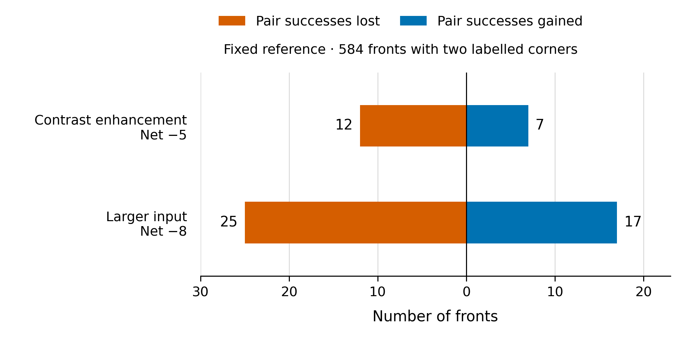

# Cassette Front Detection and Corner Localization

Final Year Project I Report

Department of Electronic Engineering

## 1 Abstract

This project investigates automatic detection of tissue cassette fronts and the location of their two lower corners in camera images. Closely arranged cassettes, partial occlusion, and uncertain object boundaries can produce missed fronts, repeated detections, and inaccurate coordinates. The aim is to improve recognition quality through clearer training annotations and controlled changes to an existing deep learning model.

The work completed for Final Year Project I includes annotation review, model training comparisons, image-processing experiments, and evaluation of the coordinates returned by the system. In an annotation comparison, reviewed training labels reduced extra predictions from 58 to 52 while maintaining 24 missed fronts. A later training change recovered more partial fronts but also produced more extra predictions. Contrast enhancement and a larger inference image each reduced misses from 34 to 33 on the fixed evaluation reference. However, the number of fronts with both corners within five pixels fell from 511 to 506 and 503, respectively. Combining predictions from different processed views also increased extra detections.

These results show why detection and corner accuracy must be considered together. The project establishes a consistent annotation procedure, a reproducible comparison method, and a clear account of the remaining errors. The next phase will investigate local corner refinement and more effective selection of training images for annotation review. Evaluation on new capture sessions will be needed to determine how well the improvements transfer to new scenes.

## 2 Table of Contents

<!-- DOCX_TOC_START -->

- [1 Abstract](#1-abstract)
- [2 Table of Contents](#2-table-of-contents)
- [3 Introduction](#3-introduction)
  - [3.1 The recognition problem](#31-the-recognition-problem)
  - [3.2 Related research](#32-related-research)
  - [3.3 Aim and objectives](#33-aim-and-objectives)
- [4 Background](#4-background)
  - [4.1 Image coordinates and annotations](#41-image-coordinates-and-annotations)
  - [4.2 Matching predicted and annotated fronts](#42-matching-predicted-and-annotated-fronts)
  - [4.3 Measuring corner accuracy](#43-measuring-corner-accuracy)
  - [4.4 Confidence and accepted outputs](#44-confidence-and-accepted-outputs)
- [5 Methodology and Implementation](#5-methodology-and-implementation)
  - [5.1 Images and annotation sets](#51-images-and-annotation-sets)
  - [5.2 Model and training comparisons](#52-model-and-training-comparisons)
  - [5.3 Processing an image](#53-processing-an-image)
  - [5.4 Reproducible measurement](#54-reproducible-measurement)
  - [5.5 Evaluating automatic coordinate pairs](#55-evaluating-automatic-coordinate-pairs)
- [6 Simulation Results](#6-simulation-results)
  - [6.1 Controlled image masking](#61-controlled-image-masking)
  - [6.2 Effect on corner accuracy](#62-effect-on-corner-accuracy)
- [7 Experimental Results](#7-experimental-results)
  - [7.1 Effect of annotation review](#71-effect-of-annotation-review)
  - [7.2 Giving more weight to partial fronts](#72-giving-more-weight-to-partial-fronts)
  - [7.3 Contrast enhancement and larger inputs](#73-contrast-enhancement-and-larger-inputs)
  - [7.4 Changes in individual fronts](#74-changes-in-individual-fronts)
  - [7.5 Combining predictions from two views](#75-combining-predictions-from-two-views)
  - [7.6 Accepting coordinate pairs by confidence](#76-accepting-coordinate-pairs-by-confidence)
  - [7.7 Feasibility of local corner refinement](#77-feasibility-of-local-corner-refinement)
- [8 Discussions](#8-discussions)
  - [8.1 Findings from Final Year Project I](#81-findings-from-final-year-project-i)
  - [8.2 Interpreting the available evidence](#82-interpreting-the-available-evidence)
  - [8.3 Horizontal reflection experiment in progress](#83-horizontal-reflection-experiment-in-progress)
  - [8.4 Plan for Final Year Project II](#84-plan-for-final-year-project-ii)
- [9 Conclusions](#9-conclusions)
- [10 References](#10-references)
- [11 Appendices](#11-appendices)
  - [11.1 Additional annotation comparisons](#111-additional-annotation-comparisons)
  - [11.2 Repeating an experiment](#112-repeating-an-experiment)

<!-- DOCX_TOC_END -->

## 3 Introduction

### 3.1 The recognition problem

The images in this project show tissue cassettes arranged close together in a rack. Each cassette has a front face that can be identified in the image. The system must find each front and estimate the positions of its lower-left and lower-right corners. These coordinates provide a compact description of where the front is located and how its lower edge is oriented.

The task becomes difficult when a front is partly covered, cut by the image boundary, or close to a similar neighbouring front. A model may miss a cassette, return several boxes for it, or place a corner on the rack or another object. Finding the correct front and placing its corners accurately are therefore separate requirements.

Figure 1 shows the target and its annotations. The supplied dataset includes colour images, manually specified object locations, and an existing trained model [1]. An annotation is the reference information used to train and evaluate the model: here, one rectangle around the front and up to two known corner locations.

Figure 1. A complete camera image and an enlarged view of one cassette front. The blue rectangle marks the annotated front, and the orange points mark its two lower corners. The same source pixels are shown at different display sizes. The rack and neighbouring objects provide context but are not part of the selected front.

### 3.2 Related research

An object detector predicts the locations and categories of objects in an image. You Only Look Once, commonly called YOLO, is an established approach that performs this task with one neural-network pipeline [2]. The existing model used here also predicts two corner points for each detected front.

A single accuracy score can hide different errors. The TIDE evaluation framework separates missed objects, duplicate predictions, background responses, and localization errors [3]. This motivates examining which fronts are gained or lost when a method changes, as well as reporting overall counts.

Training annotations also influence the result. ObjectLab uses model predictions to identify images that may contain annotation errors [4]. Research on annotation uncertainty shows that small differences in box boundaries can change evaluation scores, particularly for small objects [5]. These findings support reviewing uncertain cases in the original images and recording accepted corrections.

Image processing offers another possible improvement. Contrast-limited adaptive histogram equalization, abbreviated CLAHE, adjusts local contrast while limiting excessive amplification [6]. Image-Adaptive YOLO combines learned image processing with detection under difficult imaging conditions [7]. Slicing Aided Hyper Inference uses overlapping image crops to improve small-object detection [8]. The present experiments begin with two simpler changes: fixed contrast enhancement and a larger whole-image input.

### 3.3 Aim and objectives

The aim is to improve cassette-front detection and lower-corner localization with a clear, reproducible processing pipeline. Recognition quality is the main priority.

The objectives for Final Year Project I are to establish consistent annotations, reproduce the existing model's results, compare selected training and image-processing changes, and identify the most useful directions for the next phase. Table 1 states the working requirements.

Table 1. Working requirements for cassette recognition. The five- and ten-pixel tolerances provide consistent measures for comparing corner predictions.

| Item | Requirement |
| --- | --- |
| Input | Colour images of 1280 by 720 pixels |
| Detection target | Each identifiable cassette front, including an identifiable partial front |
| Corner output | Actual lower-left and lower-right corners in image coordinates |
| Unclear corner in an annotation | Record the point as unavailable |
| Detection evaluation | Assign at most one prediction to each annotated front |
| Corner evaluation | Measure distance from each known reference corner in original-image pixels |
| Overall improvement | Reduce missed fronts while checking extra predictions, duplicates, and corner accuracy |

## 4 Background

### 4.1 Image coordinates and annotations

A pixel is a sample in the digital image. Horizontal coordinate x increases from left to right, and vertical coordinate y increases from top to bottom. A bounding box is a rectangle described by its left, top, right, and bottom coordinates. A keypoint is a particular landmark; the two keypoints in this project are the lower corners of the cassette front.

The annotation box follows the cassette's own front material, including a continuous frontal rim, tab, or cap. It excludes the rack, gripper, and neighbouring cassettes when determining the box boundaries. Because the box is rectangular, some background pixels may still lie inside it. A shadow on the cassette's own surface does not remove that surface from the front [9].

The corner points mark the actual lower corners. When only one can be located reliably, that point is retained and the other is marked unavailable. The supplied annotation format uses a visibility value of 2 for a visible point and the triplet 0 0 0 for an unavailable point [1].

The files store normalized coordinates between zero and one. Equation (1) converts them into pixels, where W and H are the image width and height:

$$
x=W x_n, \qquad y=H y_n. \tag{1}
$$

For example, a normalized horizontal coordinate of 0.5 in a 1280-pixel-wide image corresponds to x = 640 pixels. All errors reported here are measured after predictions have been returned to the original image coordinates.

### 4.2 Matching predicted and annotated fronts

A predicted rectangle is compared with an annotated rectangle using intersection over union, abbreviated IoU. This is the shared area divided by the total area covered by the two rectangles [3]:

$$
\operatorname{IoU}(B,G)=\frac{|B\cap G|}{|B\cup G|}. \tag{2}
$$

A perfect overlap gives 1, and no overlap gives 0. The evaluation processes predictions from highest to lowest confidence and assigns each prediction to the best available reference box with IoU at least 0.50. Each reference can be assigned only once [10].

A **missed front** is an annotated front without an assigned prediction. An **extra prediction** is a retained prediction without an assigned reference. A **duplicate** is an extra prediction with IoU of at least 0.50 with a front already assigned another prediction. Duplicates are a subset of extra predictions.

A displaced prediction can produce both a missed front and an extra prediction. Thus, an extra prediction does not necessarily correspond to empty background. The original image and the box geometry help distinguish a false response from a poor match.

Using TP for matched fronts, FN for missed fronts, and FP for extra predictions, detection precision P and recall R are:

$$
P=\frac{TP}{TP+FP}, \qquad R=\frac{TP}{TP+FN}. \tag{3}
$$

Precision describes the proportion of retained predictions that match a reference. Recall describes the proportion of annotated fronts that are found.

Thin boxes are especially sensitive to displacement. If two equal-width boxes have height h and a vertical displacement d, with $0\leq d<h$, their overlap is:

$$
\operatorname{IoU}=\frac{h-d}{h+d}. \tag{4}
$$

For h = 8 pixels and d = 3 pixels, IoU is approximately 0.455. A three-pixel shift can therefore cause a match to fail. This explains why boundary consistency matters for the small fronts in these images [5].

### 4.3 Measuring corner accuracy

For a predicted point p and an annotated point g, the Euclidean error is the straight-line distance between them:

$$
e_k=\sqrt{(p_{x,k}-g_{x,k})^2+(p_{y,k}-g_{y,k})^2}. \tag{5}
$$

A successful corner pair requires a matched front, two valid points within the image, and both point scores at or above the specified acceptance threshold. Both errors must then be within the tolerance epsilon:

$$
\max(e_L,e_R)\leq\epsilon. \tag{6}
$$

The reported pair-success count uses all annotated fronts with two known corners as its denominator. A missed front therefore cannot disappear from the corner evaluation. Error averages calculated only from successfully returned points are reported with care because difficult missing cases would otherwise be omitted [10].

### 4.4 Confidence and accepted outputs

The model returns confidence scores for the front and its corners. A higher score is useful for ranking predictions, but it does not by itself establish that a corner is accurate. Calibration research examines how model scores relate to observed correctness [11]. Selective classification studies the tradeoff between accepting more outputs and reducing errors among accepted outputs [12].

For this project, a coordinate pair is accepted when its box and both point scores meet the chosen thresholds and both coordinates are valid. An accepted pair is **confirmed** at a given tolerance when it matches a front with two annotated corners and satisfies Equation (6).

Let A be the number of accepted pairs, $G_2$ the number of fronts with two annotated corners, and $S_\epsilon$ the number of confirmed pairs. Two useful fractions are:

$$
F_\epsilon=\frac{S_\epsilon}{A}, \qquad C_\epsilon=\frac{S_\epsilon}{G_2}. \tag{7}
$$

The confirmed fraction F describes how many accepted outputs can be verified by the annotations. Coverage C describes how many of the available two-corner targets are successfully returned. Pairs without complete reference coordinates remain unconfirmed, rather than being assigned an invented error. F is undefined when no pairs are accepted.

## 5 Methodology and Implementation

### 5.1 Images and annotation sets

The supplied dataset contains 137 training images and 20 evaluation images [1]. Later training comparisons use 142 full images and 3,999 annotated fronts, after adding five eligible photographs. Both arms of the partial-front training comparison use the same photographs and annotation bytes [13].

The 20 evaluation images have been reviewed during development. To make the effect of annotation changes visible, the main results use two clearly named references:

- **Fixed reference:** the fixed set of 666 annotated fronts used for the main comparison; 584 have two known corners.
- **Reviewed reference:** the later set of 654 fronts after annotation review; 583 have two known corners, 54 have one, and 17 have neither corner available.

Two intermediate annotation sets are retained for additional checks in the appendix. The earlier annotation-training experiment uses its own 661-front reference and is labelled separately in its results table. An annotation change and a model change are recorded independently so that a revised score can be traced to its cause.

### 5.2 Model and training comparisons

The model is an existing YOLO26s-Pose network with one object category and two corner points per front [14]. A saved set of learned parameters is called a checkpoint. All training comparisons start from the supplied cassette checkpoint, rather than learning every parameter from a new random initialization.

The annotation comparison trains one model with the original labels and another with reviewed labels. Its reviewed-label model is also used in the digital masking experiment. A later baseline trained on the expanded dataset is used for the image contrast and input-size tests [14]. Each results table identifies the model and control being compared.

During training, a loss function measures the difference between the model output and the annotations. The training algorithm adjusts the learned parameters to reduce this loss. An epoch is one pass through the training images, and a batch is the group processed together. The classification loss measures errors in recognizing cassette fronts. A random seed makes the chosen random sequence repeatable.

The partial-front training experiment compares ordinary training with a version that doubles the classification-loss weight for predictions assigned to fronts with unavailable corners. This makes errors in recognizing those assigned partial fronts contribute more strongly to training. The two arms use seed 46, 30 epochs, input size 1280, batches of four images, 32-bit floating-point arithmetic, and the AdamW parameter-update algorithm. Each completes 1,080 batches and 80 parameter updates; several batches are accumulated before each update. The box and corner loss formulas remain unchanged [13].

### 5.3 Processing an image

The image-processing sequence is: read the colour image, apply the selected input treatment, predict front boxes and corners, return coordinates to the original image, remove sufficiently overlapping predictions, and evaluate the remaining outputs.

Non-maximum suppression, abbreviated NMS, keeps higher-confidence predictions when boxes overlap strongly. The fixed input experiments use box confidence 0.13, NMS IoU 0.70, a maximum of 300 predictions, and corner confidence 0.50. The existing additional suppression after boxes are clipped to the image boundary is retained [14].

The camera viewer sends its colour image to the model without a separate CLAHE step. Its display threshold controls which points are drawn, while exported records retain the underlying predictions [15]. The application uses the returned outputs automatically, so the rule for accepting a complete corner pair must be explicit.

For contrast enhancement, the image is converted to Lab colour space, which separates lightness from colour components. CLAHE is applied to the lightness channel with clip limit 2.0 and an 8 by 8 grid, then the image is converted back. The model weights, image dimensions, and input-size setting remain fixed.

For the larger-input experiment, the setting changes from 1280 to 1600. Aspect-preserving interpolation enlarges the image by a factor of 1.25, and padding makes the dimensions compatible with the network. Boxes and points are mapped back before scoring [16]. Interpolation changes the sampled input supplied to the network; the original camera image remains the source of scene detail.

Table 2. Experiments and analyses completed or in progress for Final Year Project I. Each comparison changes one declared ingredient.

| Comparison | Control | Change | Status |
| --- | --- | --- | --- |
| Annotation review | Original training labels | Reviewed labels with the same training recipe | Completed |
| Partial-front training | Ordinary classification weight | Double weight for assigned partial fronts | Completed |
| Contrast enhancement | Original image | CLAHE on lightness | Completed |
| Larger input | Input size 1280 | Input size 1600 | Completed |
| Combined views | Original-view predictions | Add one processed view and apply fixed suppression | Completed analysis |
| Pair acceptance | Saved model predictions | Change the corner-score threshold | Completed analysis |
| Local crop feasibility | Saved boxes and corner references | Check a fixed crop around each predicted front | Completed analysis |
| Horizontal reflection | Original image | Reflected image with inverse coordinate mapping | Results pending |

### 5.4 Reproducible measurement

Each input experiment first reruns the unchanged model on the same images. The result must agree with the saved baseline in detection assignments and corner-success decisions before the treatment is interpreted. Three repeated predictions per arm then check numerical stability.

The contrast and input-size returns pass these checks. The input images, labels, model weights, and prediction files were verified, and the scores were independently recomputed from the saved outputs. Within each run, all three repeated outputs are identical [17], [16].

The contrast experiment used an NVIDIA L4 graphics processor, and the size experiment used an NVIDIA A100. Each treatment has its own control on the same runtime. The software records include the model library, numerical settings, and source versions needed to repeat the comparison. Timing excludes image acquisition and file reading.

### 5.5 Evaluating automatic coordinate pairs

The acceptance analysis retains a front prediction when its box score exceeds the selected threshold. A complete pair is accepted when both corner coordinates are finite, lie inside the image, and meet the corner-score threshold. Matching is then recomputed between accepted predictions and all annotated fronts [18].

Accepted outputs are counted in four groups: confirmed pairs, measured errors on fronts with two known corners, matches to fronts with incomplete corner annotations, and predictions without a reference match. This keeps uncertain outputs visible in the results. It also allows a front to remain detected when a complete corner pair is withheld.

## 6 Simulation Results

### 6.1 Controlled image masking

To test the effect of missing image information, the reviewed-label model was evaluated on 30 selected fronts from four photographs. Both corner coordinates were known in each intact image. Separate digital masks covered the left corner, right corner, or centre of the front, while the original coordinates remained the measurement reference [19].

The masks replace pixels with equal red, green, and blue values of 127. A side mask extends from five percent of the box width outside its side to one quarter of the width inside. The centre mask covers the middle 30 percent of the width. Each mask extends six pixels above and below the box and is clipped to the image boundary.

The model receives the complete altered image. The input size is 1280, with box and corner thresholds of 0.13 and 0.50. The reference corner coordinates are used only for evaluation.

### 6.2 Effect on corner accuracy

All 30 designated fronts remain detected in every condition. Corner accuracy changes as shown in Table 3 and Figure 2 [19].

Table 3. Corner-pair success before and after digital masking. The same 30 fronts are included in every denominator.

| Image condition | Both corners within 5 pixels | Both within 10 pixels |
| --- | ---: | ---: |
| Intact image | 27/30 | 30/30 |
| Left corner covered | 21/30 | 28/30 |
| Right corner covered | 22/30 | 26/30 |
| Centre covered | 22/30 | 30/30 |

Figure 2. Both-corner success for the reviewed-label model on the same 30 fronts. The reference positions come from the intact images. Centre masking also reduces five-pixel success, although the two target-corner neighbourhoods remain uncovered. All 30 fronts remain detected in each condition.

All 60 covered-corner predictions have scores above 0.85, yet six exceed 10 pixels of error across five objects. High corner scores therefore do not reliably identify the errors introduced by these masks.

The centre mask is a useful location control because it preserves the two target-corner neighbourhoods while removing other front information. Some masks also affect neighbouring objects: 51 of 90 cover another annotated endpoint centre. These interactions are considered when interpreting the experiment.

## 7 Experimental Results

### 7.1 Effect of annotation review

The annotation experiment compares the supplied model with two models trained for a further 30 epochs: one with original labels and one with reviewed labels. Table 4 uses this experiment's 661-front reference and box confidence 0.25 [20].

Table 4. Annotation-training comparison. The evaluation reference contains 584 fronts with two known corners. Both trained models start from the same supplied checkpoint and use the same recipe.

| Model | Missed fronts | Extra predictions | Both corners within 5 pixels | Both within 10 pixels |
| --- | ---: | ---: | ---: | ---: |
| Supplied model | 27 | 54 | 528/584 | 575/584 |
| Original-label model | 24 | 58 | 527/584 | 578/584 |
| Reviewed-label model | 24 | 52 | 529/584 | 577/584 |

Compared with the original-label model, the reviewed-label model removes six extra predictions and maintains the same missed count. It gains two five-pixel pair successes and loses one ten-pixel success. Annotation review therefore produces a useful reduction in extra outputs, with mixed effects on corner accuracy.

The comparison with the supplied model also includes the effect of further training. The paired trained models provide the clearer measurement of the annotation change.

### 7.2 Giving more weight to partial fronts

On the reviewed 654-front reference, doubling the classification weight for assigned partial fronts reduces misses from 15 to 11. Extra predictions increase from 84 to 112, including a duplicate increase from 13 to 23. Both-corner five-pixel success changes from 566 to 567 out of 583, while ten-pixel success stays at 582 [13].

Both models detect all 583 fronts with two annotated corners. Their remaining misses concern fronts with one or both corners unavailable. The result identifies partial fronts as a useful focus, while showing that stronger training emphasis can also increase unwanted responses. The net five-pixel gain comes from one case moving from about 5.094 to 4.984 pixels.

### 7.3 Contrast enhancement and larger inputs

Table 5 compares the input treatments with the unchanged baseline [17], [16]. Both treatments recover one net detection on the fixed reference, but their corner-success counts decrease.

Table 5. Input-processing results at box confidence 0.13. Duplicates are included in extra predictions. The fixed and reviewed references describe the same 20 images.

| Reference and input | Missed fronts | Extra predictions | Duplicates | Both corners within 5 pixels | Both within 10 pixels |
| --- | ---: | ---: | ---: | ---: | ---: |
| Fixed, unchanged | 34 | 91 | 17 | 511/584 | 575/584 |
| Fixed, contrast enhanced | 33 | 92 | 19 | 506/584 | 573/584 |
| Fixed, size 1600 | 33 | 82 | 20 | 503/584 | 566/584 |
| Reviewed, unchanged | 15 | 84 | 13 | 566/583 | 582/583 |
| Reviewed, contrast enhanced | 14 | 85 | 22 | 564/583 | 582/583 |
| Reviewed, size 1600 | 16 | 77 | 17 | 557/583 | 581/583 |

Contrast enhancement recovers three fixed-reference targets and newly misses two. The larger input recovers four and newly misses three. Each treatment newly misses one front with two known corners. All three images without annotated fronts remain free of predictions.

The larger input reduces the total number of extra predictions, but increases the duplicate subset. This illustrates why the different error counts must be examined together.

### 7.4 Changes in individual fronts

Figure 3 separates gained and lost five-pixel corner successes. Contrast enhancement gains seven and loses twelve. The larger input gains seventeen and loses twenty-five [17], [16].

Figure 3. Changes in both-corner five-pixel success across the 584 eligible fronts in the fixed reference. A gain is a front that fails under the unchanged input and succeeds after processing; a loss is the reverse. The net changes are minus five for contrast enhancement and minus eight for the larger input.

One front in the larger-input experiment retains a high-confidence prediction, but its IoU falls from approximately 0.50516 to 0.48961. It becomes a scored miss because the box crosses the 0.50 matching threshold. The example demonstrates a geometry problem that confidence filtering alone cannot correct.

### 7.5 Combining predictions from two views

A fixed analysis combines the original-view predictions with either the contrast-enhanced or larger-input predictions. All coordinates are already in the original image frame. Predictions are ordered by confidence, suppressed at IoU 0.70, and capped at 300. Each retained box keeps its own pair of corners [21].

Table 6. Two-view combination results from saved predictions. These records have already passed the model's ordinary suppression stage.

| Reference and views | Missed fronts | Extra predictions | Duplicates | Both corners within 5 pixels |
| --- | ---: | ---: | ---: | ---: |
| Fixed, unchanged | 34 | 91 | 17 | 511/584 |
| Fixed, plus contrast | 33 | 111 | 25 | 510/584 |
| Fixed, plus larger input | 33 | 135 | 34 | 506/584 |
| Reviewed, unchanged | 15 | 84 | 13 | 566/583 |
| Reviewed, plus contrast | 12 | 102 | 23 | 565/583 |
| Reviewed, plus larger input | 10 | 124 | 28 | 557/583 |

The combined views recover some missed fronts, but increase extra predictions and duplicates. They also reduce the number of five-pixel corner successes compared with the unchanged view. These results do not support adding this combination to the processing pipeline.

### 7.6 Accepting coordinate pairs by confidence

The pair-acceptance analysis uses the partial-front-weighted model with box score strictly above 0.20. It is a separate operating point from the input-processing experiments. Of 722 retained front predictions, a corner threshold of 0.50 accepts 709 pairs [18].

Against the reviewed reference, 567 of those pairs meet five-pixel accuracy. Another 16 fail that tolerance on a front with two known corners, 53 match incomplete corner references, and 73 have no assigned reference.

Raising the corner threshold to 0.80 accepts 650 pairs. The same 567 confirmed pairs and 16 measured localization failures remain. Matches to incomplete references fall to 35 and unmatched accepted predictions fall to 32. Table 7 and Figure 4 show the quality-and-coverage tradeoff.

Table 7. Pair acceptance against the reviewed reference. Coverage uses all 583 fronts with two annotated corners. The confirmed fraction uses all accepted pairs.

| Corner threshold | Accepted pairs | Confirmed within 5 pixels | Confirmed fraction | Coverage |
| --- | ---: | ---: | ---: | ---: |
| 0.50 | 709 | 567 | 79.97% | 97.26% |
| 0.80 | 650 | 567 | 87.23% | 97.26% |
| 0.95 | 116 | 111 | 95.69% | 19.04% |

Figure 4. Confirmed five-pixel pairs as a proportion of accepted outputs and of fronts with two annotated corners. Labels show the corner-confidence threshold. Both curves use the same predictions against different annotation sets. The lines connect measured settings. A threshold of 0.99 accepts no pairs, so its confirmed fraction is undefined and is omitted.

The 0.80 threshold removes 59 pairs without complete five-pixel confirmation while preserving every confirmed target. It does not fix the 16 measured corner errors. Increasing confidence can therefore improve the composition of accepted outputs without improving the coordinates themselves.

### 7.7 Feasibility of local corner refinement

A local refinement model would examine a crop around a detected front. Before training that model, a fixed crop was checked against the saved baseline predictions. Each predicted rectangle was expanded about its centre to 1.5 times its width and height. The crop boundaries were rounded outwards to whole pixels and clipped to the image. Reference coordinates were used only to measure containment [22].

Table 8. Containment of both annotated corners in a fixed local crop. The baseline and box-confidence setting are the same as in the input-processing experiments. A pair fails the five-pixel criterion when either corner exceeds the tolerance.

| Reference | Fronts with two known corners | Matched fronts | Pairs failing 5 pixels | Failing pairs with both corners in crop |
| --- | ---: | ---: | ---: | ---: |
| Fixed | 584 | 577 | 66 | 66/66 |
| Reviewed | 583 | 583 | 17 | 17/17 |

Both corners lie inside the crop for every matched two-corner front: 577 of 577 under the fixed reference and 583 of 583 under the reviewed reference. In each case, 34 crops are clipped by an image boundary. The fixed reference also contains seven complete fronts without a matched detection; a refiner applied only to detected boxes would not recover these.

This check shows that the proposed crops contain the annotated locations of all observed matched failures. A trained comparison is still needed to determine whether the local image information improves coordinate accuracy.

## 8 Discussions

### 8.1 Findings from Final Year Project I

Annotation review reduced extra predictions in the matched training comparison. Giving more training weight to partial fronts recovered additional targets, but also increased extra responses. Contrast enhancement and a larger input produced different gains and losses across individual fronts, with an overall reduction in corner success. The tested two-view combinations added further extra predictions.

These findings support evaluating the complete output: whether the front is found, whether it is counted once, and whether its corners are accurate. Optimizing only the missed count can hide additional outputs or poorer coordinates. The project's main contribution so far is a consistent annotation procedure and a reproducible way to measure these competing effects.

### 8.2 Interpreting the available evidence

The experiments reuse 20 development images. Objects in the same photograph share lighting, background, and camera conditions, so the number of annotated fronts is larger than the number of independent scenes. The fixed and reviewed references also label the same images. Their differences show sensitivity to annotation choices.

The digital masks preserve known corner coordinates, which allows direct measurement after local image information is removed. Natural occlusion may have different shapes, texture, and context. The observed mask response is useful evidence about the model, but transfer to new images needs further testing.

Five- and ten-pixel errors provide consistent comparison thresholds. The appropriate final acceptance tolerance depends on how the coordinates will be used. A later evaluation should use a fixed annotation policy, agreed tolerances, and new capture sessions.

### 8.3 Horizontal reflection experiment in progress

The current notebook compares original images with horizontally reflected images at the same input size. Pose-estimation research provides a precedent for testing reflected views [23], while work on unbiased data processing explains why accurate coordinate mapping is essential [24].

After prediction, a reflected point and horizontal box limits are returned to the original continuous image coordinates using Equation (8):

$$
x_o=W-x_f, \qquad [x_{\min},x_{\max}]_o=[W-x_{\max,f},W-x_{\min,f}]. \tag{8}
$$

The left and right corner slots are also exchanged, together with their scores. The implementation checks the unchanged baseline and retains both views for a paired comparison [25]. Results are pending. Each view will first be assessed separately, since research on test-time augmentation and the present combination results show that aggregation can introduce new errors [26].

### 8.4 Plan for Final Year Project II

Two investigations follow directly from the current findings.

The first is more effective annotation review. A training image could be prioritized when its predictions change substantially under a controlled transformation. Consistency-based active learning uses this principle to select informative detection examples [27]. A practical comparison would review the same number of cases chosen by prediction disagreement, existing geometry checks, and seeded random selection. Confirmed corrections and review time would be measured before testing their effect on matched training runs.

The second is local corner refinement. The detector would first locate a front, then a separate model would examine a crop around it to test whether corner accuracy improves. PoseFix studies refinement of an initial pose using image information [28], and high-resolution pose networks provide a way to retain spatial detail for landmark prediction [29]. The completed crop check shows that both reference locations are retained for the observed matched failures. Inspection and a training comparison would establish whether the crop provides enough useful visual context. Holding the detected boxes fixed would allow the effect of refinement to be measured on the same targets.

New capture sessions will provide the final evaluation of transfer. The acquisition settings, annotation rules, and acceptance criteria should be fixed before examining those results. This will turn the present development findings into a clearer assessment of performance on unfamiliar scenes.

## 9 Conclusions

Final Year Project I established a working procedure for detecting cassette fronts and evaluating their lower-corner coordinates. The work includes annotation review, matched training comparisons, controlled image-processing experiments, and analysis of accepted coordinate pairs.

Reviewed training labels reduced extra predictions from 58 to 52 while maintaining the same missed count in the annotation comparison. Later experiments showed that recovering more fronts can also increase extra outputs, and that contrast or scale changes can reduce corner accuracy. The larger input and contrast enhancement each recovered one net detection on the fixed reference but lost eight and five five-pixel corner successes, respectively.

The results favour targeted improvement guided by individual failure cases. Local corner refinement and measured annotation-review strategies are the proposed next steps. The completed evaluation procedure will support these comparisons and the later assessment on new capture sessions.

## 10 References

[1] an94-doll, “Dataset and annotation specification,” embedding_vision dataset documentation. Accessed: Nov. 27, 2026. [Online]. Available: https://github.com/an94-doll/embedding_vision/blob/351eb3cf960ccc34829e2bc72e1fa4645acc6295/data/README.md

[2] J. Redmon, S. Divvala, R. Girshick, and A. Farhadi, “You only look once: Unified, real-time object detection,” in Proc. IEEE Conf. Computer Vision and Pattern Recognition (CVPR), 2016, pp. 779–788, doi: 10.1109/CVPR.2016.91.

[3] D. Bolya, S. Foley, J. Hays, and J. Hoffman, “TIDE: A general toolbox for identifying object detection errors,” in Computer Vision – ECCV 2020, Lecture Notes in Computer Science, vol. 12348. Springer, 2020, pp. 558–573, doi: 10.1007/978-3-030-58580-8_33.

[4] U. Tkachenko, A. Thyagarajan, and J. Mueller, “ObjectLab: Automated diagnosis of mislabeled images in object detection data,” in ICML Workshop on Data-centric Machine Learning Research, 2023. [Online]. Available: https://arxiv.org/abs/2309.00832

[5] J. Murrugarra-Llerena and C. R. Jung, “Noise-aware evaluation of object detectors,” in Proc. IEEE/CVF Winter Conf. Applications of Computer Vision (WACV), 2025, doi: 10.1109/WACV61041.2025.00903.

[6] K. Zuiderveld, “Contrast limited adaptive histogram equalization,” in Graphics Gems IV, P. S. Heckbert, Ed. Academic Press, 1994, pp. 474–485.

[7] W. Liu, G. Ren, R. Yu, S. Guo, J. Zhu, and L. Zhang, “Image-adaptive YOLO for object detection in adverse weather conditions,” in Proc. AAAI Conf. Artificial Intelligence, vol. 36, 2022, pp. 1792–1800, doi: 10.1609/aaai.v36i2.20072.

[8] F. C. Akyon, S. O. Altinuc, and A. Temizel, “Slicing aided hyper inference and fine-tuning for small object detection,” in Proc. IEEE Int. Conf. Image Processing (ICIP), 2022, pp. 966–970, doi: 10.1109/ICIP46576.2022.9897990.

[9] Siuuuers/dl project, “Cassette-front annotation policy,” project documentation, 2026. Accessed: Nov. 27, 2026. [Online]. Available: https://github.com/Siuuuers/dl/blob/5001d83439eaf31c7ecae378c27a0de847e65686/docs/annotation-policy.md

[10] Siuuuers/dl project, “Cassette pose scoring implementation,” project documentation, 2026. Accessed: Nov. 27, 2026. [Online]. Available: https://github.com/Siuuuers/dl/blob/5001d83439eaf31c7ecae378c27a0de847e65686/scripts/pose_scoring.py

[11] C. Guo, G. Pleiss, Y. Sun, and K. Q. Weinberger, “On calibration of modern neural networks,” in Proc. 34th Int. Conf. Machine Learning (ICML), Proceedings of Machine Learning Research, vol. 70, 2017, pp. 1321–1330. [Online]. Available: https://proceedings.mlr.press/v70/guo17a.html

[12] Y. Geifman and R. El-Yaniv, “Selective classification for deep neural networks,” in Advances in Neural Information Processing Systems, vol. 30, 2017, pp. 4878–4887. [Online]. Available: https://proceedings.neurips.cc/paper/2017/hash/4a8423d5e91fda00bb7e46540e2b0cf1-Abstract.html

[13] Siuuuers/dl project, “Partial-front training comparison,” project documentation, 2026. Accessed: Nov. 27, 2026. [Online]. Available: https://github.com/Siuuuers/dl/blob/5001d83439eaf31c7ecae378c27a0de847e65686/docs/partial-classification-r51-results.md

[14] Siuuuers/dl project, “Contrast enhancement and input-size experiment protocol,” project documentation, 2026. Accessed: Nov. 27, 2026. [Online]. Available: https://github.com/Siuuuers/dl/blob/5001d83439eaf31c7ecae378c27a0de847e65686/docs/inference-ablation-r53.md

[15] Siuuuers/dl project, “Camera image and prediction pipeline,” project documentation, 2026. Accessed: Nov. 27, 2026. [Online]. Available: https://github.com/Siuuuers/dl/blob/5001d83439eaf31c7ecae378c27a0de847e65686/docs/camera-pipeline-r53.md

[16] Siuuuers/dl project, “Larger-input experiment results,” project documentation, 2026. Accessed: Nov. 27, 2026. [Online]. Available: https://github.com/Siuuuers/dl/pull/150

[17] Siuuuers/dl project, “Contrast-enhancement experiment results,” project documentation, 2026. Accessed: Nov. 27, 2026. [Online]. Available: https://github.com/Siuuuers/dl/pull/149

[18] Siuuuers/dl project, “Coordinate-pair acceptance analysis,” project documentation, 2026. Accessed: Nov. 27, 2026. [Online]. Available: https://github.com/Siuuuers/dl/blob/codex/thesis-r56-report-and-flip-probe-20261127/docs/thesis/evidence/automatic-pair-results.md

[19] Siuuuers/dl project, “Corner prediction after controlled image masking,” project documentation, 2026. Accessed: Nov. 27, 2026. [Online]. Available: https://github.com/Siuuuers/dl/blob/5001d83439eaf31c7ecae378c27a0de847e65686/docs/pixel-occlusion-2026-11-13.md

[20] Siuuuers/dl project, “Training comparison with reviewed annotations,” project documentation, 2026. Accessed: Nov. 27, 2026. [Online]. Available: https://github.com/Siuuuers/dl/blob/5001d83439eaf31c7ecae378c27a0de847e65686/docs/annotation-confirmation-2026-11-11.md

[21] Siuuuers/dl project, “Combination of predictions from processed image views,” project documentation, 2026. Accessed: Nov. 27, 2026. [Online]. Available: https://github.com/Siuuuers/dl/blob/codex/thesis-r56-report-and-flip-probe-20261127/docs/thesis/evidence/cached-fusion-results.md

[22] Siuuuers/dl project, “Corner quality and local crop feasibility,” project documentation, 2026. Accessed: Nov. 28, 2026. [Online]. Available: https://github.com/Siuuuers/dl/blob/codex/thesis-r56-report-and-flip-probe-20261127/docs/thesis/research-corner-quality.md

[23] B. Xiao, H. Wu, and Y. Wei, “Simple baselines for human pose estimation and tracking,” in Proc. European Conf. Computer Vision (ECCV), 2018, pp. 466–481. [Online]. Available: https://openaccess.thecvf.com/content_ECCV_2018/html/Bin_Xiao_Simple_Baselines_for_ECCV_2018_paper.html

[24] J. Huang, Z. Zhu, F. Guo, and G. Huang, “The devil is in the details: Delving into unbiased data processing for human pose estimation,” in Proc. IEEE/CVF Conf. Computer Vision and Pattern Recognition (CVPR), 2020, pp. 5700–5709. [Online]. Available: https://openaccess.thecvf.com/content_CVPR_2020/html/Huang_The_Devil_Is_in_the_Details_Delving_Into_Unbiased_Data_CVPR_2020_paper.html

[25] Siuuuers/dl project, “Horizontal reflection experiment protocol,” project documentation, 2026. Accessed: Nov. 27, 2026. [Online]. Available: https://github.com/Siuuuers/dl/blob/dc7eec630bb0b613fc1fe784e4d9818a0893658e/docs/thesis/flip-experiment-r56.md

[26] D. Shanmugam, D. Blalock, G. Balakrishnan, and J. Guttag, “Better aggregation in test-time augmentation,” in Proc. IEEE/CVF Int. Conf. Computer Vision (ICCV), 2021, pp. 1214–1223. [Online]. Available: https://openaccess.thecvf.com/content/ICCV2021/html/Shanmugam_Better_Aggregation_in_Test-Time_Augmentation_ICCV_2021_paper.html

[27] W. Yu, S. Zhu, T. Yang, and C. Chen, “Consistency-based active learning for object detection,” in Proc. IEEE/CVF Conf. Computer Vision and Pattern Recognition Workshops (CVPRW), 2022, pp. 3951–3960. [Online]. Available: https://openaccess.thecvf.com/content/CVPR2022W/L3D-IVU/html/Yu_Consistency-Based_Active_Learning_for_Object_Detection_CVPRW_2022_paper.html

[28] G. Moon, J. Y. Chang, and K. M. Lee, “PoseFix: Model-agnostic general human pose refinement network,” in Proc. IEEE/CVF Conf. Computer Vision and Pattern Recognition (CVPR), 2019, pp. 7773–7781.

[29] K. Sun, B. Xiao, D. Liu, and J. Wang, “Deep high-resolution representation learning for human pose estimation,” in Proc. IEEE/CVF Conf. Computer Vision and Pattern Recognition (CVPR), 2019, pp. 5693–5703.

## 11 Appendices

### 11.1 Additional annotation comparisons

Table 9. Input-processing results for two intermediate annotation sets. The earlier reference contains 663 fronts with 584 known corner pairs. The intermediate review contains 654 fronts with 583 pairs [17], [16].

| Reference and input | Missed fronts | Extra predictions | Duplicates | Both corners within 5 pixels | Both within 10 pixels |
| --- | ---: | ---: | ---: | ---: | ---: |
| Earlier, unchanged | 30 | 90 | 17 | 511/584 | 575/584 |
| Earlier, contrast enhanced | 31 | 93 | 18 | 506/584 | 573/584 |
| Earlier, size 1600 | 29 | 81 | 20 | 503/584 | 566/584 |
| Intermediate, unchanged | 15 | 84 | 14 | 566/583 | 582/583 |
| Intermediate, contrast enhanced | 14 | 85 | 23 | 564/583 | 582/583 |
| Intermediate, size 1600 | 15 | 76 | 18 | 557/583 | 581/583 |

### 11.2 Repeating an experiment

Each experiment preserves the source code, input settings, image and label checks, model identity, prediction arrays, and scoring results. The technical records are provided through the cited project documentation [14], [18], [21], [25]. The record for each model identifies its training data and the reference used for evaluation.

A new comparison should first reproduce its unchanged control, apply one declared treatment, and retain both outputs. Scores can then be recomputed from the saved predictions, with every gained and lost target available for inspection. This provides a practical check that a reported difference follows from the intended change.
