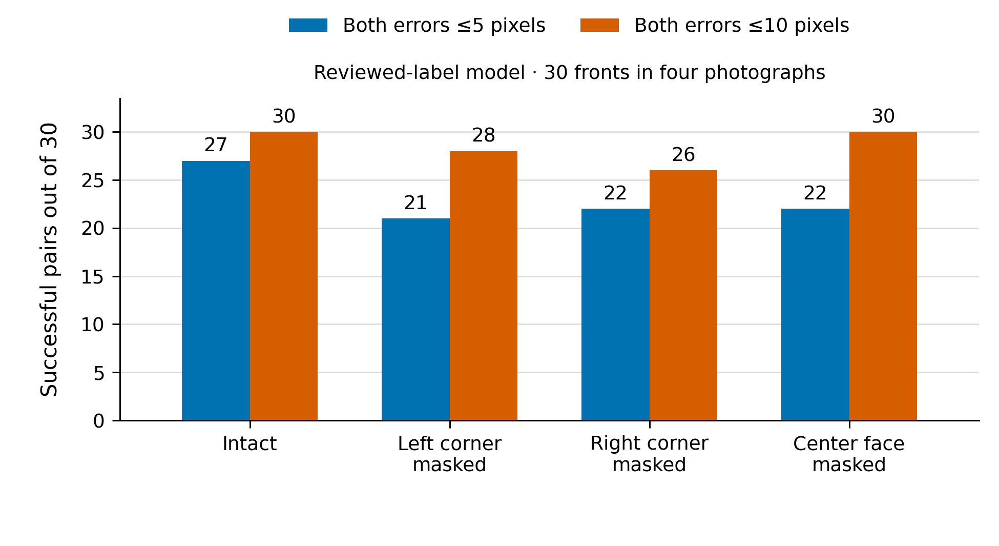
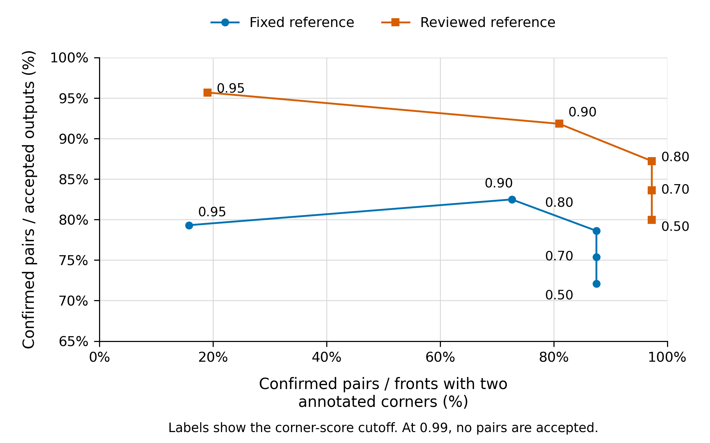

# Cassette Front Detection and Corner Localization

Final Year Project I Report

Department of Electronic Engineering

## 1 Abstract

This project investigates automatic detection of tissue cassette fronts and the location of their two lower corners in camera images. Closely arranged cassettes, partial occlusion, and uncertain object boundaries can produce missed fronts, repeated detections, and inaccurate coordinates. The aim is to improve recognition quality through clearer training annotations and controlled changes to an existing deep learning model.

The work completed for Final Year Project I includes annotation review, model training comparisons, image-processing experiments, and evaluation of the coordinates returned by the system. In an annotation comparison, reviewed training labels reduced extra predictions from 58 to 52 while maintaining 24 missed fronts. A later training change recovered more partial fronts but also produced more extra predictions. Contrast enhancement and a larger inference image each reduced misses from 34 to 33 on the fixed evaluation reference. However, the number of fronts with both corners within five pixels fell from 511 to 506 and 503, respectively. Combining predictions from different processed views also increased extra detections. Horizontal reflection changed five-pixel successes from 511 to 518 under the fixed annotations and from 566 to 562 under the reviewed annotations, while increasing duplicates in both. Averaging associated corner coordinates then improved five-pixel success under both references, with one lost ten-pixel success under the fixed reference.

These results show why detection and corner accuracy must be considered together. The project establishes a consistent annotation procedure, a reproducible comparison method, and a clear account of the remaining errors. The next phase will investigate local corner refinement and more effective selection of training images for annotation review. Evaluation on new capture sessions will be needed to determine how well the findings transfer to new scenes.

## 2 Table of Contents

<!-- DOCX_TOC_START -->

- [1 Abstract](#1-abstract)
- [2 Table of Contents](#2-table-of-contents)
- [3 Introduction](#3-introduction)
  - [3.1 The recognition problem](#31-the-recognition-problem)
  - [3.2 Related research](#32-related-research)
  - [3.3 Aim and objectives](#33-aim-and-objectives)
- [4 Background](#4-background)
  - [4.1 Image coordinates and annotations](#41-image-coordinates-and-annotations)
  - [4.2 Matching predicted and annotated fronts](#42-matching-predicted-and-annotated-fronts)
  - [4.3 Measuring corner accuracy](#43-measuring-corner-accuracy)
  - [4.4 Confidence and accepted outputs](#44-confidence-and-accepted-outputs)
- [5 Methodology and Implementation](#5-methodology-and-implementation)
  - [5.1 Images and annotation sets](#51-images-and-annotation-sets)
  - [5.2 Model and training comparisons](#52-model-and-training-comparisons)
  - [5.3 Processing an image](#53-processing-an-image)
  - [5.4 Reproducible measurement](#54-reproducible-measurement)
  - [5.5 Evaluating automatic coordinate pairs](#55-evaluating-automatic-coordinate-pairs)
- [6 Simulation Results](#6-simulation-results)
  - [6.1 Controlled image masking](#61-controlled-image-masking)
  - [6.2 Effect on corner accuracy](#62-effect-on-corner-accuracy)
- [7 Experimental Results](#7-experimental-results)
  - [7.1 Effect of annotation review](#71-effect-of-annotation-review)
  - [7.2 Giving more weight to partial fronts](#72-giving-more-weight-to-partial-fronts)
  - [7.3 Contrast enhancement and larger inputs](#73-contrast-enhancement-and-larger-inputs)
  - [7.4 Changes in individual fronts](#74-changes-in-individual-fronts)
  - [7.5 Combining predictions from two views](#75-combining-predictions-from-two-views)
  - [7.6 Accepting coordinate pairs by confidence](#76-accepting-coordinate-pairs-by-confidence)
  - [7.7 Feasibility of local corner refinement](#77-feasibility-of-local-corner-refinement)
  - [7.8 Horizontal reflection](#78-horizontal-reflection)
  - [7.9 Averaging corners while preserving detections](#79-averaging-corners-while-preserving-detections)
- [8 Discussions](#8-discussions)
  - [8.1 Findings from Final Year Project I](#81-findings-from-final-year-project-i)
  - [8.2 Interpreting the available evidence](#82-interpreting-the-available-evidence)
  - [8.3 Choosing the next experiment](#83-choosing-the-next-experiment)
  - [8.4 Plan for Final Year Project II](#84-plan-for-final-year-project-ii)
- [9 Conclusions](#9-conclusions)
- [10 References](#10-references)
- [11 Appendices](#11-appendices)
  - [11.1 Additional annotation comparisons](#111-additional-annotation-comparisons)
  - [11.2 Shared training settings and measurement records](#112-shared-training-settings-and-measurement-records)

<!-- DOCX_TOC_END -->

## 3 Introduction

### 3.1 The recognition problem

The images in this project show tissue cassettes arranged close together in a rack. Each cassette has a front face that can be identified in the image. The system must find each front and estimate the positions of its lower-left and lower-right corners. These coordinates provide a compact description of where the front is located and how its lower edge is oriented.

The task becomes difficult when a front is partly covered, cut by the image boundary, or close to a similar neighbouring front. A model may miss a cassette, return several boxes for it, or place a corner on the rack or another object. Finding the correct front and placing its corners accurately are therefore separate requirements.

Figure 1 shows the target and its annotations. The project begins with a supplied collection of colour camera images, manually specified object locations, and an existing trained cassette model. An annotation is the reference information used to train and evaluate the model: here, one rectangle around the front and up to two known corner locations.

Figure 1. A complete camera image and an enlarged view of one cassette front. The blue rectangle marks the annotated front, and the orange points mark its two lower corners. The same source pixels are shown at different display sizes. The rack and neighbouring objects provide context but are not part of the selected front.

### 3.2 Related research

An object detector predicts the locations and categories of objects in an image. You Only Look Once, commonly called YOLO, is an established approach that performs this task with one neural-network pipeline [1]. The existing model used here also predicts two corner points for each detected front.

A single accuracy score can hide different errors. The TIDE evaluation framework separates missed objects, duplicate predictions, background responses, and localization errors [2]. This motivates examining which fronts are gained or lost when a method changes, as well as reporting overall counts.

Training annotations also influence the result. ObjectLab uses model predictions to identify images that may contain annotation errors [3]. Research on annotation uncertainty shows that small differences in box boundaries can change evaluation scores, particularly for small objects [4]. These findings support reviewing uncertain cases in the original images and recording accepted corrections.

Image processing offers another possible improvement. Contrast-limited adaptive histogram equalization, abbreviated CLAHE, adjusts local contrast while limiting excessive amplification [5]. Image-Adaptive YOLO combines learned image processing with detection under difficult imaging conditions [6]. Slicing Aided Hyper Inference uses overlapping image crops to improve small-object detection [7]. The present experiments begin with two simpler changes: fixed contrast enhancement and a larger whole-image input.

### 3.3 Aim and objectives

The aim is to improve cassette-front detection and lower-corner localization with a clear, reproducible processing pipeline. Recognition quality is the main priority.

The objectives for Final Year Project I are to establish consistent annotations, reproduce the existing model's results, compare selected training and image-processing changes, and identify the most useful directions for the next phase. Table 1 states the working requirements.

Table 1. Working requirements for cassette recognition. The five- and ten-pixel tolerances provide consistent measures for comparing corner predictions.

| Item | Requirement |
| --- | --- |
| Input | Colour images of 1280 by 720 pixels |
| Detection target | Each identifiable cassette front, including an identifiable partial front |
| Corner output | Actual lower-left and lower-right corners in image coordinates |
| Unclear corner in an annotation | Record the point as unavailable |
| Detection evaluation | Assign at most one prediction to each annotated front |
| Corner evaluation | Measure distance from each known reference corner in original-image pixels |
| Overall improvement | Reduce missed fronts while checking extra predictions, duplicates, and corner accuracy |

## 4 Background

### 4.1 Image coordinates and annotations

A pixel is a sample in the digital image. Horizontal coordinate x increases from left to right, and vertical coordinate y increases from top to bottom. A bounding box is a rectangle described by its left, top, right, and bottom coordinates. A keypoint is a particular landmark; the two keypoints in this project are the lower corners of the cassette front.

The annotation box follows the cassette's own front material, including a continuous frontal rim, tab, or cap. It excludes the rack, gripper, and neighbouring cassettes when determining the box boundaries. Because the box is rectangular, some background pixels may still lie inside it. A shadow on the cassette's own surface does not remove that surface from the front.

The corner points mark the actual lower corners. When only one can be located reliably, that point is retained and the other is marked unavailable. The supplied annotation format uses a visibility value of 2 for a visible point and the triplet 0 0 0 for an unavailable point.

The files store normalized coordinates between zero and one. Equation (1) converts them into pixels, where W and H are the image width and height:

$$
x=W x_n, \qquad y=H y_n. \tag{1}
$$

For example, a normalized horizontal coordinate of 0.5 in a 1280-pixel-wide image corresponds to x = 640 pixels. All errors reported here are measured after predictions have been returned to the original image coordinates.

### 4.2 Matching predicted and annotated fronts

A predicted rectangle is compared with an annotated rectangle using intersection over union, abbreviated IoU. This is the shared area divided by the total area covered by the two rectangles [2]:

$$
\operatorname{IoU}(B,G)=\frac{|B\cap G|}{|B\cup G|}. \tag{2}
$$

A perfect overlap gives 1, and no overlap gives 0. The evaluation processes predictions from highest to lowest confidence and assigns each prediction to the best available reference box with IoU at least 0.50. Each reference can be assigned only once.

A **missed front** is an annotated front without an assigned prediction. An **extra prediction** is a retained prediction without an assigned reference. A **duplicate** is an extra prediction with IoU of at least 0.50 with a front already assigned another prediction. Duplicates are a subset of extra predictions.

A displaced prediction can produce both a missed front and an extra prediction. Thus, an extra prediction does not necessarily correspond to empty background. The original image and the box geometry help distinguish a false response from a poor match.

Using TP for matched fronts, FN for missed fronts, and FP for extra predictions, detection precision P and recall R are:

$$
P=\frac{TP}{TP+FP}, \qquad R=\frac{TP}{TP+FN}. \tag{3}
$$

Precision describes the proportion of retained predictions that match a reference. Recall describes the proportion of annotated fronts that are found.

Thin boxes are especially sensitive to displacement. Consider two rectangles with the same horizontal extent and height h, separated vertically by d, where $0\leq d<h$. Their intersection has height h minus d and their union has height h plus d. Cancelling their common width gives:

$$
\operatorname{IoU}=\frac{h-d}{h+d}. \tag{4}
$$

For h = 8 pixels and d = 3 pixels, IoU is approximately 0.455. A three-pixel shift can therefore cause a match to fail. This explains why boundary consistency matters for the small fronts in these images [4].

### 4.3 Measuring corner accuracy

For a predicted point p and an annotated point g, the Euclidean error is the straight-line distance between them:

$$
e_k=\sqrt{(p_{x,k}-g_{x,k})^2+(p_{y,k}-g_{y,k})^2}. \tag{5}
$$

A successful corner pair requires a matched front, two valid points within the image, and both point scores at or above the specified acceptance threshold. Both errors must then be within the tolerance epsilon:

$$
\max(e_L,e_R)\leq\epsilon. \tag{6}
$$

The reported pair-success count uses all annotated fronts with two known corners as its denominator. A missed front therefore cannot disappear from the corner evaluation. Error averages calculated only from successfully returned points are reported with care because difficult missing cases would otherwise be omitted.

### 4.4 Confidence and accepted outputs

The model returns confidence scores for the front and its corners. These scores are used to rank or accept outputs; their relationship to coordinate error must be measured. Calibration research examines how model scores relate to observed correctness [8]. Selective classification studies the tradeoff between accepting more outputs and reducing errors among accepted outputs [9].

For this project, a coordinate pair is accepted when its box and both point scores meet the chosen thresholds and both coordinates are valid. An accepted pair is **confirmed** at a given tolerance when it matches a front with two annotated corners and satisfies Equation (6).

Let A be the number of accepted pairs, $G_2$ the number of fronts with two annotated corners, and $S_\epsilon$ the number of confirmed pairs. Two useful fractions are:

$$
F_\epsilon=\frac{S_\epsilon}{A}, \qquad C_\epsilon=\frac{S_\epsilon}{G_2}. \tag{7}
$$

The confirmed fraction F describes how many accepted outputs can be verified by the annotations. Coverage C describes how many of the available two-corner targets are successfully returned. Pairs without complete reference coordinates remain unconfirmed, rather than being assigned an invented error. F is undefined when no pairs are accepted.

## 5 Methodology and Implementation

### 5.1 Images and annotation sets

The supplied dataset contains 137 training photographs and 20 evaluation photographs, each with 1280 by 720 colour pixels. Thirteen training photographs and three evaluation photographs contain no annotated fronts. These empty scenes are retained so that predictions on background remain visible in the evaluation.

The annotation-training comparison uses the same 137 photographs in both arms. A review of 32 training photographs identified five omitted fronts, six incorrect or redundant object entries, and three retained entries requiring modification across eight photographs. The corrections add the omitted fronts, remove or consolidate the six entries, and preserve the previously available corner coordinates. The control contains 3,772 fronts and 6,839 known corners; the reviewed set contains 3,771 fronts and 6,841 known corners. The two added corner marks belong to a newly annotated front.

A later training stage adds five eligible photographs, giving 142 full images and 3,999 fronts. Of these fronts, 3,397 have two known corners, 465 have one, and 137 have neither available. Both arms of the partial-front training comparison use exactly these photographs and annotations.

Both training comparisons use the supplied 20-image validation labels, containing 664 fronts, to monitor training. The separately versioned references below are applied when reporting the final predictions. These 20 evaluation images have been reviewed during development. To make the effect of annotation changes visible, the main results use two clearly named references:

- **Fixed reference:** the fixed set of 666 annotated fronts used for the main comparison; 584 have two known corners.
- **Reviewed reference:** the later set of 654 fronts after annotation review; 583 have two known corners, 54 have one, and 17 have neither corner available.

Two intermediate annotation sets are retained for additional checks in the appendix. The earlier annotation-training experiment uses its own 661-front reference and is labelled separately in its results table. An annotation change and a model change are recorded independently so that a revised score can be traced to its cause.

### 5.2 Model and training comparisons

The model is an existing YOLO26s-Pose network configured for one object category and two corner points per front. The YOLO26 family supports pose estimation as well as object detection [10]. For each prediction it returns a box, an object score, two point coordinates, and two point scores. A saved set of learned parameters is called a checkpoint. Each training arm starts independently from the supplied cassette checkpoint saved after epoch 173 and adapts those parameters to its declared training data.

The annotation comparison trains one model with the original labels and another with the reviewed labels described in Section 5.1. Both use the same images, initialization, random seed, training settings, and original validation input. The final checkpoint after 30 epochs is evaluated for each arm. The reviewed-label model is also used in the digital masking experiment. A later baseline trained on the expanded dataset is used for the contrast, input-size, and reflection tests. Each results table identifies its model and control.

During training, a loss function measures the difference between the model output and the annotations. The training algorithm adjusts the learned parameters to reduce this loss. An epoch is one pass through the training images, and a batch is the group processed together. The classification loss measures errors in recognizing cassette fronts. A random seed makes the chosen random sequence repeatable.

The partial-front training experiment compares ordinary training with a version that doubles the classification-loss weight for predictions assigned to fronts with unavailable corners. This makes errors in recognizing those assigned partial fronts contribute more strongly to training. Both training comparisons use seed 46, 30 epochs, input size 1280, batches of four images, 32-bit floating-point arithmetic, and the AdamW parameter-update algorithm [11]. The nominal initial learning rate is 0.0001, the final learning-rate factor is 0.01, and weight decay is 0.0005. The first three epochs use the common warmup schedule. The final epoch is selected in advance, so the comparison does not choose different checkpoints according to evaluation results.

The annotation comparison completes 1,050 batches and 78 parameter updates per arm; the expanded-data comparison completes 1,080 batches and 80 updates. Several batches contribute to each update. The native box, corner, and point-availability loss formulas remain unchanged. The model also retains its residual log-likelihood term, which models the distribution of coordinate errors during training [12]. Appendix 11.2 records the shared image transformations and remaining numerical settings.

### 5.3 Processing an image

The image-processing sequence is: read the colour image, apply the selected input treatment, predict front boxes and corners, return coordinates to the original image, remove sufficiently overlapping predictions, and evaluate the remaining outputs.

Non-maximum suppression, abbreviated NMS, removes competing overlapping predictions. The procedure processes boxes from highest to lowest object score. A lower-scoring box is suppressed when its IoU with an already retained box exceeds 0.70. The fixed input experiments retain object scores strictly above 0.13, use a maximum of 300 predictions, and require corner scores of at least 0.50. A second suppression pass uses the same overlap threshold on the final boxes clipped to the image boundary. Each retained box keeps its own two corners; suppression does not average their positions.

The camera viewer sends its colour image to the model without a separate CLAHE step. Its display threshold controls which points are drawn, while exported records retain the underlying predictions. The application uses the returned outputs automatically, so the rule for accepting a complete corner pair must be explicit.

For contrast enhancement, the image is converted to Lab colour space, which separates lightness from colour components. CLAHE is applied to the lightness channel with clip limit 2.0 and an 8 by 8 grid, then the image is converted back. The model weights, image dimensions, and input-size setting remain fixed.

For the larger-input experiment, the setting changes from 1280 to 1600. Aspect-preserving interpolation enlarges the image by a factor of 1.25, and padding makes the dimensions compatible with the network. The unchanged input becomes 1280 by 736 pixels after padding; the enlarged image becomes 1600 by 928 pixels. Boxes and points are mapped back before scoring. Interpolation changes the sampled input supplied to the network; the original camera image remains the source of scene detail.

The reflection experiment reverses the image columns while keeping the input size at 1280. Reflected views are used in human-pose studies [13], and consistent coordinate processing is important when combining image transformations with landmark prediction [14]. Each image view is evaluated separately before considering any combination, because aggregation itself can change prediction quality [15].

The pixel array reverses column j to column W minus 1 minus j. The model's predicted coordinates use a continuous image-width convention. After prediction, the reflected point and horizontal box limits are returned to the original coordinate system using Equation (8):

$$
x_o=W-x_f, \qquad [x_{\min},x_{\max}]_o=[W-x_{\max,f},W-x_{\min,f}]. \tag{8}
$$

The left and right corner slots are also exchanged, together with their scores. The usual clipping takes place in the reflected prediction frame before this inverse mapping; the additional suppression then uses boxes in the original frame. This comparison changes the view only and uses the same model parameters for both arms.

A follow-up analysis uses the saved original and reflected predictions to test coordinate averaging. Each original box is associated with a reflected-view box only when they have the same class, each is the other's highest-IoU candidate, and their IoU is at least 0.50. Output order resolves exact ties. The association uses predicted boxes only, without consulting reference boxes or corners.

If both associated predictions have two finite, in-image corner coordinates with scores of at least 0.50, each pair of corresponding points is averaged in the original image frame:

$$
\mathbf{p}_{a}=\frac{\mathbf{p}_{o}+\mathbf{p}_{r}}{2}. \tag{9}
$$

Here $\mathbf{p}_{o}$ is an original-view point and $\mathbf{p}_{r}$ is its reflected-view counterpart after inverse mapping. All original boxes, object scores, point scores, and prediction identities are retained. A record without an eligible counterpart keeps its original coordinates. Holding confidence selection and box matching fixed isolates the effect of changing corner positions. The equal weights and association threshold are fixed before calculating the averaging results; they are not fitted to the reference coordinates.

Table 2. Experiments and analyses completed for Final Year Project I. Each comparison changes one declared ingredient.

| Comparison | Control | Change | Status |
| --- | --- | --- | --- |
| Annotation review | Original training labels | Reviewed labels with the same training recipe | Completed |
| Partial-front training | Ordinary classification weight | Double weight for assigned partial fronts | Completed |
| Contrast enhancement | Original image | CLAHE on lightness | Completed |
| Larger input | Input size 1280 | Input size 1600 | Completed |
| Combined views | Original-view predictions | Add one processed view and apply fixed suppression | Completed analysis |
| Pair acceptance | Saved model predictions | Change the corner-score threshold | Completed analysis |
| Local crop feasibility | Saved boxes and corner references | Check a fixed crop around each predicted front | Completed analysis |
| Horizontal reflection | Original image | Reflected image with inverse coordinate mapping | Completed |
| Corner averaging | Original-view coordinates | Equal average of eligible associated original and reflected points | Completed analysis |

### 5.4 Reproducible measurement

Each input experiment first reruns the unchanged model on the same images. File checks confirm identical images, labels, and model parameters. Every image must retain the same detection assignments, missed targets, duplicate classifications, and five- and ten-pixel corner-success decisions as the saved baseline. Small numerical differences are allowed only within 0.05 pixel for coordinate components, 0.00001 for confidence scores, and 0.075 pixel for corner-to-reference distances. A change in a discrete success decision fails the check even if its numerical difference is small.

Three repeated predictions per arm then check numerical stability. The two arms alternate execution order across images and repetitions. Predictions from before and after the additional suppression are retained. The results are recomputed independently using the matching and distance calculations in Section 4, so a summary table can be checked against its individual outputs.

The contrast, input-size, and reflection experiments pass these checks. Within each experiment, all three measured repetitions of each arm produce identical saved predictions. In the reflection experiment, the largest coordinate-component difference between the fresh control and its earlier saved baseline is approximately 0.000122 pixel, with every discrete scoring decision unchanged.

The model library is Ultralytics 8.4.182. The contrast experiment uses an NVIDIA L4 graphics processor, and the input-size and reflection experiments use an NVIDIA A100. Each treatment and its control share the same runtime, arithmetic, and software implementation. Inference uses one full image at a time with aspect-preserving resizing and padding. Timing excludes image acquisition and file reading.

### 5.5 Evaluating automatic coordinate pairs

The acceptance analysis reuses predictions after the additional suppression pass. It retains a front when its box score is strictly above 0.20. A complete pair is accepted when both corner coordinates are finite, satisfy $0\leq x<1280$ and $0\leq y<720$, and have scores at or above the tested corner threshold. The tested thresholds are 0.50, 0.70, 0.80, 0.90, 0.95, and 0.99. The confidence-ordered matching procedure in Section 4.2 is recomputed between these accepted predictions and all annotated fronts for each threshold. This accounts for a lower-ranked prediction becoming the assigned match after another prediction is withheld.

Accepted outputs are counted in four groups: confirmed pairs, measured errors on fronts with two known corners, matches to fronts with incomplete corner annotations, and predictions without a reference match. This keeps uncertain outputs visible in the results. It also allows a front to remain detected when a complete corner pair is withheld.

## 6 Simulation Results

### 6.1 Controlled image masking

To test the effect of missing image information, the reviewed-label model was evaluated on 30 fronts from four development photographs. The targets were selected before examining masked-image predictions, and both corner coordinates were known in every intact image. Each target received three separate image treatments: a mask over its left corner, a mask over its right corner, and a mask over its centre. Four intact-image predictions provided the controls, and 90 altered full-image predictions supplied the treatments. Each variant began from the intact photograph.

The masks replace pixels with equal red, green, and blue values of 127 on the 0-to-255 channel scale. A side mask extends from five percent of the reference-box width outside its side to one quarter of the width inside. The centre mask covers the middle 30 percent of the width. Each mask extends six pixels above the top and below the bottom of the box. Minimum boundaries are rounded down, maximum boundaries are rounded up, and the rectangle is clipped to the image. Pixel checks confirm that each side mask covers a three-pixel-radius neighbourhood of its designated corner and preserves the opposite neighbourhood. Centre masks preserve both target-corner neighbourhoods. Pixels outside the selected rectangle remain unchanged.

The model receives the complete altered image, without the reference box, coordinates, or target identity as inputs. The input size is 1280, with box and corner thresholds of 0.13 and 0.50. Inference uses 32-bit arithmetic on the CPU. The original boxes remain the fixed matching reference, and the original corner coordinates remain the distance reference. This allows the position error to be measured after the relevant image pixels have been covered.

### 6.2 Effect on corner accuracy

All 30 designated fronts remain detected in every condition. Corner accuracy changes as shown in Table 3 and Figure 2.

Table 3. Corner-pair success before and after digital masking. The same 30 fronts are included in every denominator.

| Image condition | Both corners within 5 pixels | Both within 10 pixels |
| --- | ---: | ---: |
| Intact image | 27/30 | 30/30 |
| Left corner covered | 21/30 | 28/30 |
| Right corner covered | 22/30 | 26/30 |
| Centre covered | 22/30 | 30/30 |

Figure 2. Both-corner success for the reviewed-label model on the same 30 fronts. The reference positions come from the intact images. Centre masking also reduces five-pixel success, although the two target-corner neighbourhoods remain uncovered. All 30 fronts remain detected in each condition.

All 60 covered-corner predictions have scores above 0.85, yet six exceed 10 pixels of error across five objects. High corner scores therefore do not reliably identify the errors introduced by these masks.

The centre mask is a useful location control because it preserves the two target-corner neighbourhoods while removing other front information. Some masks also affect neighbouring objects: 51 of 90 cover another annotated endpoint centre. These interactions are considered when interpreting the experiment.

## 7 Experimental Results

### 7.1 Effect of annotation review

The annotation experiment compares the supplied model with two models trained for a further 30 epochs: one with original labels and one with reviewed labels. Table 4 uses this experiment's 661-front reference and box confidence 0.25.

Table 4. Annotation-training comparison. The evaluation reference contains 584 fronts with two known corners. Both trained models start from the same supplied checkpoint and use the same recipe.

| Model | Missed fronts | Extra predictions | Both corners within 5 pixels | Both within 10 pixels |
| --- | ---: | ---: | ---: | ---: |
| Supplied model | 27 | 54 | 528/584 | 575/584 |
| Original-label model | 24 | 58 | 527/584 | 578/584 |
| Reviewed-label model | 24 | 52 | 529/584 | 577/584 |

Compared with the original-label model, the reviewed-label model removes six extra predictions and maintains the same missed count. It gains two five-pixel pair successes and loses one ten-pixel success. Annotation review therefore produces a useful reduction in extra outputs, with mixed effects on corner accuracy.

The comparison with the supplied model also includes the effect of further training. The paired trained models provide the clearer measurement of the annotation change.

### 7.2 Giving more weight to partial fronts

On the reviewed 654-front reference, doubling the classification weight for assigned partial fronts reduces misses from 15 to 11. Extra predictions increase from 84 to 112, including a duplicate increase from 13 to 23. Both-corner five-pixel success changes from 566 to 567 out of 583, while ten-pixel success stays at 582.

Both models detect all 583 fronts with two annotated corners. Their remaining misses concern fronts with one or both corners unavailable. The result identifies partial fronts as a useful focus, while showing that stronger training emphasis can also increase unwanted responses. The net five-pixel gain comes from one case moving from about 5.094 to 4.984 pixels.

### 7.3 Contrast enhancement and larger inputs

Table 5 compares the input treatments with the unchanged baseline. Both treatments recover one net detection on the fixed reference, but their corner-success counts decrease.

Table 5. Input-processing results at box confidence 0.13. Duplicates are included in extra predictions. The fixed and reviewed references describe the same 20 images.

| Reference and input | Missed fronts | Extra predictions | Duplicates | Both corners within 5 pixels | Both within 10 pixels |
| --- | ---: | ---: | ---: | ---: | ---: |
| Fixed, unchanged | 34 | 91 | 17 | 511/584 | 575/584 |
| Fixed, contrast enhanced | 33 | 92 | 19 | 506/584 | 573/584 |
| Fixed, size 1600 | 33 | 82 | 20 | 503/584 | 566/584 |
| Reviewed, unchanged | 15 | 84 | 13 | 566/583 | 582/583 |
| Reviewed, contrast enhanced | 14 | 85 | 22 | 564/583 | 582/583 |
| Reviewed, size 1600 | 16 | 77 | 17 | 557/583 | 581/583 |

Contrast enhancement recovers three fixed-reference targets and newly misses two. The larger input recovers four and newly misses three. Each treatment newly misses one front with two known corners. All three images without annotated fronts remain free of predictions.

The larger input reduces the total number of extra predictions, but increases the duplicate subset. This illustrates why the different error counts must be examined together.

### 7.4 Changes in individual fronts

Figure 3 separates gained and lost five-pixel corner successes. Contrast enhancement gains seven and loses twelve. The larger input gains seventeen and loses twenty-five.

Figure 3. Changes in both-corner five-pixel success across the 584 eligible fronts in the fixed reference. A gain is a front that fails under the unchanged input and succeeds after processing; a loss is the reverse. The net changes are minus five for contrast enhancement and minus eight for the larger input.

One front in the larger-input experiment retains a high-confidence prediction, but its IoU falls from approximately 0.50516 to 0.48961. It becomes a scored miss because the box crosses the 0.50 matching threshold. The example demonstrates a geometry problem that confidence filtering alone cannot correct.

### 7.5 Combining predictions from two views

A fixed analysis combines the original-view predictions with either the contrast-enhanced or larger-input predictions. All coordinates are already in the original image frame. Predictions are ordered by confidence, suppressed at IoU 0.70, and capped at 300. Each retained box keeps its own pair of corners.

Table 6. Two-view combination results from saved predictions. These records have already passed the model's ordinary suppression stage.

| Reference and views | Missed fronts | Extra predictions | Duplicates | Both corners within 5 pixels |
| --- | ---: | ---: | ---: | ---: |
| Fixed, unchanged | 34 | 91 | 17 | 511/584 |
| Fixed, plus contrast | 33 | 111 | 25 | 510/584 |
| Fixed, plus larger input | 33 | 135 | 34 | 506/584 |
| Reviewed, unchanged | 15 | 84 | 13 | 566/583 |
| Reviewed, plus contrast | 12 | 102 | 23 | 565/583 |
| Reviewed, plus larger input | 10 | 124 | 28 | 557/583 |

The combined views recover some missed fronts, but increase extra predictions and duplicates. They also reduce the number of five-pixel corner successes compared with the unchanged view. These results do not support adding this combination to the processing pipeline.

### 7.6 Accepting coordinate pairs by confidence

The pair-acceptance analysis uses the partial-front-weighted model with box score strictly above 0.20. It is a separate operating point from the input-processing experiments. Of 722 retained front predictions, a corner threshold of 0.50 accepts 709 pairs.

Against the reviewed reference, 567 of those pairs meet five-pixel accuracy. Another 16 fail that tolerance on a front with two known corners, 53 match incomplete corner references, and 73 have no assigned reference.

Raising the corner threshold to 0.80 accepts 650 pairs. The same 567 confirmed pairs and 16 measured localization failures remain. Matches to incomplete references fall to 35 and unmatched accepted predictions fall to 32. Table 7 and Figure 4 show the quality-and-coverage tradeoff.

Table 7. Pair acceptance against the reviewed reference. Coverage uses all 583 fronts with two annotated corners. The confirmed fraction uses all accepted pairs.

| Corner threshold | Accepted pairs | Confirmed within 5 pixels | Confirmed fraction | Coverage |
| --- | ---: | ---: | ---: | ---: |
| 0.50 | 709 | 567 | 79.97% | 97.26% |
| 0.80 | 650 | 567 | 87.23% | 97.26% |
| 0.95 | 116 | 111 | 95.69% | 19.04% |

Figure 4. Confirmed five-pixel pairs as a proportion of accepted outputs and of fronts with two annotated corners. Labels show the corner-confidence threshold. Both curves use the same predictions against different annotation sets. The lines connect measured settings. A threshold of 0.99 accepts no pairs, so its confirmed fraction is undefined and is omitted.

The 0.80 threshold removes 59 pairs without complete five-pixel confirmation while preserving every confirmed target. It does not fix the 16 measured corner errors. Increasing confidence can therefore improve the composition of accepted outputs without improving the coordinates themselves.

### 7.7 Feasibility of local corner refinement

A local refinement model would examine a crop around a detected front. Before training that model, a fixed crop was checked against the saved baseline predictions. Each predicted rectangle was expanded about its centre to 1.5 times its width and height. The crop boundaries were rounded outwards to whole pixels and clipped to the image. Reference coordinates were used only to measure containment. A corner is contained when its x and y coordinates lie within the integer crop boundaries; the left and top limits are included and the right and bottom limits are excluded. The expansion factor is fixed for every prediction, without adjusting it for individual failures.

Table 8. Containment of both annotated corners in a fixed local crop. The baseline and box-confidence setting are the same as in the input-processing experiments. A pair fails the five-pixel criterion when either corner exceeds the tolerance.

| Reference | Fronts with two known corners | Matched fronts | Pairs failing 5 pixels | Failing pairs with both corners in crop |
| --- | ---: | ---: | ---: | ---: |
| Fixed | 584 | 577 | 66 | 66/66 |
| Reviewed | 583 | 583 | 17 | 17/17 |

Both corners lie inside the crop for every matched two-corner front: 577 of 577 under the fixed reference and 583 of 583 under the reviewed reference. In each case, 34 crops are clipped by an image boundary. The fixed reference also contains seven complete fronts without a matched detection; a refiner applied only to detected boxes would not recover these.

This check shows that the proposed crops contain the annotated locations of all observed matched failures. A trained comparison is still needed to determine whether the local image information improves coordinate accuracy.

### 7.8 Horizontal reflection

Table 9 compares the original and reflected views using the method in Section 5.3. Both run the same baseline model at input size 1280 and box confidence 0.13. All three evaluation photographs without annotated fronts remain free of predictions in both views.

Table 9. Horizontal-reflection results after inverse coordinate mapping and the additional suppression pass. Duplicates are included in extra predictions. Both-corner counts retain all eligible targets in each denominator.

| Reference and view | Missed fronts | Extra predictions | Duplicates | Both corners within 5 pixels | Both within 10 pixels |
| --- | ---: | ---: | ---: | ---: | ---: |
| Fixed, original | 34 | 91 | 17 | 511/584 | 575/584 |
| Fixed, reflected | 32 | 84 | 23 | 518/584 | 572/584 |
| Reviewed, original | 15 | 84 | 13 | 566/583 | 582/583 |
| Reviewed, reflected | 11 | 75 | 22 | 562/583 | 583/583 |

On the fixed reference, reflection recovers four previously missed fronts and newly misses two. Its five-pixel pair count gains 21 targets and loses 14, for a net increase of seven. At ten pixels, it loses three successes and gains none. The number of detected fronts with two known corners falls from 577 to 576; thus fewer total misses can coincide with a new miss among complete corner targets.

On the reviewed reference, reflection recovers six fronts and newly misses two, while all 583 fronts with two known corners remain detected. Five-pixel pair success gains eight targets and loses twelve, for a net decrease of four. Ten-pixel success gains one and loses none, reaching 583 of 583 eligible pairs on these images.

Reflection reduces total extra predictions under both references, but its duplicate subset increases from 17 to 23 and from 13 to 22. It therefore changes several aspects of the output in opposing directions. The five-pixel corner improvement under the fixed reference does not carry over to the reviewed annotations.

One newly missed complete target illustrates the role of box geometry. Its reflected prediction keeps an object score of about 0.877, and both predicted corners lie within one pixel of their annotations. However, its box IoU falls from about 0.50516 to 0.47744, crossing the 0.50 matching threshold. The measured corner-pair success is therefore lost because no box is assigned to the target. Accurate-looking points cannot replace the declared matching rule after a result is known.

### 7.9 Averaging corners while preserving detections

The coordinate-averaging analysis in Section 5.3 modifies 666 of the 723 original prediction records. The remaining 57 records retain their original coordinates. Every box assignment, missed target, extra prediction, and duplicate identity remains the same as for the original view. Table 10 therefore measures a coordinate change on the existing detection set.

Table 10. Corner accuracy after equal averaging of eligible original-view and reflected-view points. These results are calculated from saved outputs. The fixed and reviewed references retain 584 and 583 eligible two-corner targets, respectively.

| Reference and coordinates | Both corners within 5 pixels | Both within 10 pixels |
| --- | ---: | ---: |
| Fixed, original | 511/584 | 575/584 |
| Fixed, averaged | 525/584 | 574/584 |
| Reviewed, original | 566/583 | 582/583 |
| Reviewed, averaged | 569/583 | 583/583 |

Under the fixed reference, averaging gains 19 five-pixel successes and loses five, giving a net increase of 14. It also loses one ten-pixel success and gains none. Under the reviewed reference, it gains six five-pixel successes and loses three, giving a net increase of three. It gains one ten-pixel success and loses none.

Averaging thus improves five-pixel success under both references in these saved predictions, while preserving all detection outcomes. The fixed-reference ten-pixel loss remains an adverse result. The calculation provides a candidate coordinate treatment to evaluate further; it does not show that every individual corner becomes more accurate.

## 8 Discussions

### 8.1 Findings from Final Year Project I

Annotation review reduced extra predictions in the matched training comparison. Giving more training weight to partial fronts recovered additional targets, but also increased extra responses. Contrast enhancement and a larger input produced different gains and losses across individual fronts, with an overall reduction in corner success. The tested two-view combinations added further extra predictions. Reflection reduced misses and total extras, while increasing duplicates and producing opposite five-pixel corner changes under the two annotation references. A subsequent fixed-box coordinate average improved five-pixel success under both references, with one lost ten-pixel success under the fixed reference.

These findings support evaluating the complete output: whether the front is found, whether it is counted once, and whether its corners are accurate. Optimizing only the missed count can hide additional outputs or poorer coordinates. The project's main contribution so far is a consistent annotation procedure and a reproducible way to measure these competing effects.

### 8.2 Interpreting the available evidence

The experiments reuse 20 development images. Objects in the same photograph share lighting, background, and camera conditions, so the number of annotated fronts is larger than the number of independent scenes. The fixed and reviewed references also label the same images. Their differences show sensitivity to annotation choices.

The digital masks preserve known corner coordinates, which allows direct measurement after local image information is removed. Natural occlusion may have different shapes, texture, and context. The observed mask response is useful evidence about the model, but transfer to new images needs further testing.

Five- and ten-pixel errors provide consistent comparison thresholds. The appropriate final acceptance tolerance depends on how the coordinates will be used. A later evaluation should use a fixed annotation policy, agreed tolerances, and new capture sessions.

### 8.3 Choosing the next experiment

Reflection reduces missed fronts and total extra predictions under both main references, but it increases duplicates. Its five-pixel corner result improves under the fixed annotations and worsens under the reviewed annotations. This disagreement shows why a treatment should be assessed against the declared references and complete set of output requirements. The averaging result demonstrates that useful coordinate information can be extracted from the second view while keeping the original detections. Its five-pixel improvement and fixed-reference ten-pixel loss should both be retained when deciding whether to continue with this treatment.

The crop result in Section 7.7 motivates a more focused coordinate experiment. Keeping the detector's boxes fixed allows any change in corner success to be attributed to the added refinement stage. The seven complete targets without matched boxes under the fixed reference remain detection failures in that experiment. Partial-front misses and extra predictions require separate attention to recognition and assignment.

### 8.4 Plan for Final Year Project II

Two investigations follow directly from the current findings.

The first is more effective annotation review. A training image could be prioritized when its predictions change substantially under a controlled transformation. Consistency-based active learning uses this principle to select informative detection examples [16]. A practical comparison would review the same number of cases chosen by prediction disagreement, existing geometry checks, and seeded random selection. Confirmed corrections and review time would be measured before testing their effect on matched training runs.

The second is local corner refinement. The detector would first locate a front, then a separate model would examine a crop around it to test whether corner accuracy improves. PoseFix studies refinement of an initial pose using image information [17], and high-resolution pose networks provide a way to retain spatial detail for landmark prediction [18]. The completed crop check shows that both reference locations are retained for the observed matched failures. Inspection and a training comparison would establish whether the crop provides enough useful visual context. Holding the detected boxes fixed would allow the effect of refinement to be measured on the same targets.

New capture sessions will provide the final evaluation of transfer. The acquisition settings, annotation rules, and acceptance criteria should be fixed before examining those results. This will turn the present development findings into a clearer assessment of performance on unfamiliar scenes.

## 9 Conclusions

Final Year Project I established a working procedure for detecting cassette fronts and evaluating their lower-corner coordinates. The work includes annotation review, matched training comparisons, controlled image-processing experiments, and analysis of accepted coordinate pairs.

Reviewed training labels reduced extra predictions from 58 to 52 while maintaining the same missed count in the annotation comparison. Later experiments showed that recovering more fronts can also increase extra outputs, and that contrast or scale changes can reduce corner accuracy. The larger input and contrast enhancement each recovered one net detection on the fixed reference but lost eight and five five-pixel corner successes, respectively. Reflection recovered more fronts and reduced total extra predictions, but increased duplicates. Its five-pixel corner result improved under the fixed annotations and worsened under the reviewed annotations. Averaging associated coordinates while preserving the original boxes increased five-pixel pair success from 511 to 525 and from 566 to 569 under the fixed and reviewed references. One fixed-reference ten-pixel success was lost.

The results favour targeted improvement guided by individual failure cases. Local corner refinement and measured annotation-review strategies are the proposed next steps. The completed evaluation procedure will support these comparisons and the later assessment on new capture sessions.

## 10 References

[1] J. Redmon, S. Divvala, R. Girshick, and A. Farhadi, “You only look once: Unified, real-time object detection,” in Proc. IEEE Conf. Computer Vision and Pattern Recognition (CVPR), 2016, pp. 779–788, doi: 10.1109/CVPR.2016.91.

[2] D. Bolya, S. Foley, J. Hays, and J. Hoffman, “TIDE: A general toolbox for identifying object detection errors,” in Computer Vision – ECCV 2020, Lecture Notes in Computer Science, vol. 12348. Springer, 2020, pp. 558–573, doi: 10.1007/978-3-030-58580-8_33.

[3] U. Tkachenko, A. Thyagarajan, and J. Mueller, “ObjectLab: Automated diagnosis of mislabeled images in object detection data,” in ICML Workshop on Data-centric Machine Learning Research, 2023. [Online]. Available: https://arxiv.org/abs/2309.00832

[4] J. Murrugarra-Llerena and C. R. Jung, “Noise-aware evaluation of object detectors,” in Proc. IEEE/CVF Winter Conf. Applications of Computer Vision (WACV), 2025, doi: 10.1109/WACV61041.2025.00903.

[5] K. Zuiderveld, “Contrast limited adaptive histogram equalization,” in Graphics Gems IV, P. S. Heckbert, Ed. Academic Press, 1994, pp. 474–485.

[6] W. Liu, G. Ren, R. Yu, S. Guo, J. Zhu, and L. Zhang, “Image-adaptive YOLO for object detection in adverse weather conditions,” in Proc. AAAI Conf. Artificial Intelligence, vol. 36, 2022, pp. 1792–1800, doi: 10.1609/aaai.v36i2.20072.

[7] F. C. Akyon, S. O. Altinuc, and A. Temizel, “Slicing aided hyper inference and fine-tuning for small object detection,” in Proc. IEEE Int. Conf. Image Processing (ICIP), 2022, pp. 966–970, doi: 10.1109/ICIP46576.2022.9897990.

[8] C. Guo, G. Pleiss, Y. Sun, and K. Q. Weinberger, “On calibration of modern neural networks,” in Proc. 34th Int. Conf. Machine Learning (ICML), Proceedings of Machine Learning Research, vol. 70, 2017, pp. 1321–1330. [Online]. Available: https://proceedings.mlr.press/v70/guo17a.html

[9] Y. Geifman and R. El-Yaniv, “Selective classification for deep neural networks,” in Advances in Neural Information Processing Systems, vol. 30, 2017, pp. 4878–4887. [Online]. Available: https://proceedings.neurips.cc/paper/2017/hash/4a8423d5e91fda00bb7e46540e2b0cf1-Abstract.html

[10] Ultralytics, “Ultralytics YOLO26,” Ultralytics Docs. Accessed: Nov. 28, 2026. [Online]. Available: https://docs.ultralytics.com/models/yolo26/

[11] I. Loshchilov and F. Hutter, “Decoupled weight decay regularization,” in Proc. Int. Conf. Learning Representations (ICLR), 2019. [Online]. Available: https://arxiv.org/abs/1711.05101

[12] J. Li et al., “Human pose regression with residual log-likelihood estimation,” in Proc. IEEE/CVF Int. Conf. Computer Vision (ICCV), 2021, pp. 11025–11034.

[13] B. Xiao, H. Wu, and Y. Wei, “Simple baselines for human pose estimation and tracking,” in Proc. European Conf. Computer Vision (ECCV), 2018, pp. 466–481. [Online]. Available: https://openaccess.thecvf.com/content_ECCV_2018/html/Bin_Xiao_Simple_Baselines_for_ECCV_2018_paper.html

[14] J. Huang, Z. Zhu, F. Guo, and G. Huang, “The devil is in the details: Delving into unbiased data processing for human pose estimation,” in Proc. IEEE/CVF Conf. Computer Vision and Pattern Recognition (CVPR), 2020, pp. 5700–5709. [Online]. Available: https://openaccess.thecvf.com/content_CVPR_2020/html/Huang_The_Devil_Is_in_the_Details_Delving_Into_Unbiased_Data_CVPR_2020_paper.html

[15] D. Shanmugam, D. Blalock, G. Balakrishnan, and J. Guttag, “Better aggregation in test-time augmentation,” in Proc. IEEE/CVF Int. Conf. Computer Vision (ICCV), 2021, pp. 1214–1223. [Online]. Available: https://openaccess.thecvf.com/content/ICCV2021/html/Shanmugam_Better_Aggregation_in_Test-Time_Augmentation_ICCV_2021_paper.html

[16] W. Yu, S. Zhu, T. Yang, and C. Chen, “Consistency-based active learning for object detection,” in Proc. IEEE/CVF Conf. Computer Vision and Pattern Recognition Workshops (CVPRW), 2022, pp. 3951–3960. [Online]. Available: https://openaccess.thecvf.com/content/CVPR2022W/L3D-IVU/html/Yu_Consistency-Based_Active_Learning_for_Object_Detection_CVPRW_2022_paper.html

[17] G. Moon, J. Y. Chang, and K. M. Lee, “PoseFix: Model-agnostic general human pose refinement network,” in Proc. IEEE/CVF Conf. Computer Vision and Pattern Recognition (CVPR), 2019, pp. 7773–7781.

[18] K. Sun, B. Xiao, D. Liu, and J. Wang, “Deep high-resolution representation learning for human pose estimation,” in Proc. IEEE/CVF Conf. Computer Vision and Pattern Recognition (CVPR), 2019, pp. 5693–5703.

## 11 Appendices

### 11.1 Additional annotation comparisons

Table 11. Input-processing results for two intermediate annotation sets. The earlier reference contains 663 fronts with 584 known corner pairs. The intermediate review contains 654 fronts with 583 pairs.

| Reference and input | Missed fronts | Extra predictions | Duplicates | Both corners within 5 pixels | Both within 10 pixels |
| --- | ---: | ---: | ---: | ---: | ---: |
| Earlier, unchanged | 30 | 90 | 17 | 511/584 | 575/584 |
| Earlier, contrast enhanced | 31 | 93 | 18 | 506/584 | 573/584 |
| Earlier, size 1600 | 29 | 81 | 20 | 503/584 | 566/584 |
| Intermediate, unchanged | 15 | 84 | 14 | 566/583 | 582/583 |
| Intermediate, contrast enhanced | 14 | 85 | 23 | 564/583 | 582/583 |
| Intermediate, size 1600 | 15 | 76 | 18 | 557/583 | 581/583 |

### 11.2 Shared training settings and measurement records

Both training comparisons use the same 30-epoch recipe described in Section 5.2. The warmup lasts three epochs, with initial warmup momentum 0.8 and initial bias learning rate 0.0001. The momentum setting is 0.937, the nominal batch-size setting is 64, and weight decay is 0.0005. The learning rate decreases linearly to a factor of 0.01 of its initial value. All layers are trainable, and the finalized epoch-30 model is evaluated.

The shared training transformations permit rotations of up to five degrees, translation up to five percent of the image size, scale variation of 0.15, and horizontal reflection with probability 0.5. Vertical reflection, shear, perspective distortion, and mixed-image transformations are disabled. Hue, saturation, and brightness augmentation settings are 0.01, 0.2, and 0.2. These transformations and the loading order use the same declared seed in both arms. The loss weights are 7.5 for boxes, 0.5 for classification, 12.0 for corner coordinates, and 1.0 for point availability; the native residual likelihood term retains weight 1.0. The partial-front treatment modifies only the classification contribution of predictions assigned to incomplete-corner targets, as explained in Section 5.2.

For each inference experiment, the measurement record contains the image identity, image dimensions, reference boxes and available corners, predicted boxes and point scores, and coordinates before and after the additional suppression pass. It also contains the selected model, preprocessing settings, numerical precision, and repeated outputs. Matching uses box geometry only; a favourable corner distance cannot choose a different prediction after the match has been assigned.

To repeat a comparison, first reproduce the unchanged control using the tolerances in Section 5.4. Apply the declared treatment to the same inputs, return all coordinates to the original image, and recompute the measurements in Section 4. Record every gained and lost target alongside the aggregate counts. This makes it possible to distinguish a change in object matching from a change in corner position.
