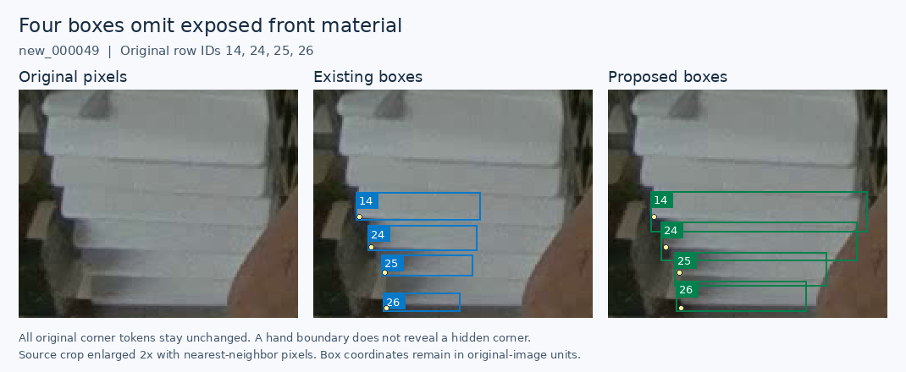
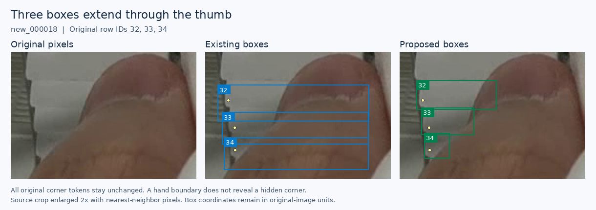

# Six-image training consistency review

**The bounded review is complete. It proposes 14 box-only replacements in three existing training images and preserves the selected PR35 model.** No object is added or removed, and no existing corner coordinate or visibility token changes in the new delta. This is an annotation result; no new model performance has been measured.

The [candidate](../data/candidates/consistency-2026-11-11/README.md) contains the exact eight-file overlay used for PR35 plus this separately reviewed delta. It does not accumulate the non-adopted PR40 or PR43 extensions. The [adjudication](../results/review/baomai-training-consistency-20261111/adjudication.json), [scope](../results/review/baomai-training-consistency-20261111/scope.json) and [evidence capsule](../results/review/baomai-training-consistency-20261111/README.md) preserve the accepted and unresolved decisions.

Review began **2026-11-11, Asia/Hong_Kong**, after the [completed PR43 experiment](visible-extent-results-2026-11-11.md). The current reviewed-proposal setting remains **PR35 seed46 / 1280 / box confidence 0.13 / NMS 0.70 / endpoint cutoff 0.50**. Use the existing [folder command](predict-pose-folder.md#assistant-reviewed-proposals).

## 1. Why these six images

The preceding targeted review records covered a union of **55 of 137 training image IDs**. That is a review-history count, not complete annotation certification. The remaining 82 contained 70 nonempty and 12 empty label files.

Before inspecting their pixels, we sorted the 70 nonempty IDs lexicographically, divided them into five contiguous strata of 14, and chose the largest missing-endpoint count in each stratum, breaking ties lexicographically. We also selected the first remaining empty-labelled ID. The last two strata have no missing endpoints, so those selected images act as ordinary positive examples. Filename strata are not acquisition sessions, and this selection is neither random nor representative enough to estimate an error rate for the dataset.

| Training image | Existing objects | Visible / missing endpoint slots | Objects with 0 / 1 / 2 visible corners | Outcome |
| --- | ---: | ---: | --- | --- |
| `new_000018` | 34 | 51 / 17 | 3 / 11 / 20 | 6 box replacements; ambiguous thin fragments retained |
| `new_000034` | 57 | 95 / 19 | 3 / 13 / 41 | 3 box replacements; opening and roof/front ambiguities retained |
| `new_000049` | 26 | 41 / 11 | 3 / 5 / 18 | 5 box replacements, including four boxes expanded to exposed material |
| `old_000007` | 10 | 20 / 0 | 0 / 0 / 10 | Ten retained fronts; no accepted edit |
| `old_000057` | 8 | 16 / 0 | 0 / 0 / 8 | Eight retained fronts; uncertain top material not added |
| `new_000132` | 0 | 0 / 0 | 0 / 0 / 0 | Full original supports the empty-negative label |
| **Total** | **135** | **223 / 47** | **9 / 29 / 97** | **14 box-only replacements** |

All six originals were viewed before label overlays. The root and an independent assistant reviewer covered all 135 existing rows and whole-image completeness. A separate reviewer examined the difficult identity cases. Enlargements retained original pixels; no generated image, model prediction or neighboring-frame inference supplied a label.

The independent reviewer made its first record without root coordinates. Root received early qualitative peer observations during detailed review, so the full process is not described as completely blinded. Initial proposals, disagreements, later reconciliation and final root adjudication remain distinct in the evidence. These are assistant reviews under the existing authorization, not supervisor or human certification.

## 2. What the images support

### Exposed material excluded by four boxes

In `new_000049`, source rows **14, 24, 25 and 26** stop partway across visible fronts beside the thumb. Their right bounds are approximately **424, 422, 419 and 412 px**. The original pixels show those same fronts continuing farther right before meeting the hand. The proposed boxes enclose that observed material; their unavailable right corners remain canonical `0 0 0`.

The hand boundary does not reveal a hidden physical corner. Expanding a box to an exposed face and marking a corner as visible are separate decisions. All four original left-corner triples are preserved exactly.

### Hidden width and neighboring material included by other boxes

Several existing boxes in `new_000018` and `new_000034` continue through the hand or gripper after the observed front has ended. The accepted replacements follow the visible fragment, retaining the source instance and all corner tokens. A separate left-edge clipped front in `new_000049` also has an excessive right extent.

The correction is not a rule that every box should shrink. The same visible-front policy requires expansion when exposed material is omitted and contraction when a bound describes hidden width. An axis-aligned box may still contain occluder or background pixels beside a slanted face or between visible portions of one object.

| Image | Source row | Proposed `[x1, y1, x2, y2]` in original pixels |
| --- | ---: | --- |
| `new_000018` | 24 | `[793, 454, 924, 495]` |
| `new_000018` | 25 | `[807, 488, 918, 524]` |
| `new_000018` | 26 | `[815, 521, 910, 552]` |
| `new_000018` | 32 | `[452, 579, 534, 609]` |
| `new_000018` | 33 | `[457, 607, 511, 635]` |
| `new_000018` | 34 | `[460, 633, 486, 659]` |
| `new_000034` | 55 | `[574, 659, 616, 685]` |
| `new_000034` | 56 | `[578, 679, 601, 703]` |
| `new_000034` | 57 | `[580, 698, 593, 720]` |
| `new_000049` | 9 | `[0, 439, 140, 495]` |
| `new_000049` | 14 | `[350, 645, 478, 669]` |
| `new_000049` | 24 | `[356, 663, 472, 686]` |
| `new_000049` | 25 | `[364, 681, 454, 701]` |
| `new_000049` | 26 | `[365, 698, 442, 716]` |

The exact old and proposed pixel bounds, row text, reasons and review IDs are in the candidate's [review record](../data/candidates/consistency-2026-11-11/review.json). Integer extrema are manual judgments at soft boundaries, approximately 1–4 px in these images; this is not a calibrated uncertainty interval or an annotation-accuracy guarantee. The numerical geometry tolerance remains the existing 0.0001 px serialization allowance.

## 3. Uncertainty was preserved

No new front or duplicate deletion was established confidently enough for this proposal. In particular:

- `new_000018:27` remains an unresolved bottom-frame roof/front fragment. The narrow lower pale strip beside the central gripper is a possible additional front, but no row is added from expected stack spacing.
- `new_000034:15` remains unresolved at the top frame, including its legacy near-border visible point. The three source rows 48–50 cannot be confidently mapped to three distinct faces from the opening alone. Lower frame-edge roofs do not establish additional fronts.
- `new_000049:18` does not show a secure separate front/seam within its roughly four-pixel strip. Row21 has a separate bright fragment, but its front-versus-lip identity remains uncertain. Row6 behind the gripper and the lowest border-adjacent strip also remain unresolved. These cases are not treated as equivalent merely because their corners are missing.
- `old_000057` has bright material above its first clear face, but that does not establish another target front.

Of the 23 initial box proposals, **nine complete replacements are held unchanged**: `018:23,28–31` and `034:43–45,54`. Their roof/front transitions or slanted row seams were not settled well enough to accept all four bounds. The clearer fourteen proposals were reconciled against the pixels and inspected individually by root. Holding a complete replacement does not erase the separately recorded evidence of excess hidden width.

No unresolved positive image is converted to a negative. Keeping an old row is not a claim that its box or endpoints are correct. Some ordinary legacy padding and physical-corner localization questions remain beyond this bounded correction. Every retained class and corner token in the new delta is unchanged, including both missing slots and existing visible points.

The targeted review-history union now reaches **61 distinct training image IDs**, leaving **76 outside those recorded passes**. This does not mean 61 images are fully relabelled, independently tested or certified. The six-image stopping rule is fulfilled; it does not automatically expand the review cohort.

## 4. Candidate composition and verification

The candidate is cumulative against the frozen original labels:

| Component | Treatment |
| --- | --- |
| Selected PR35 overlay `annotations-2026-11-10` | Exact eight label files, manifest change objects and accepted decision objects inherited |
| This review | 14 bbox replacements in `018`, `034`, `049`; zero added/deleted rows; every source corner token preserved |
| PR40 partial-front extension | Not inherited |
| PR43 visible-extent extension | Preserved separately, not inherited |
| Original images, labels and split | Unchanged |
| Validation / post-training corrected reference | Both remain unchanged and separately versioned |

The resulting overlay has **11 training label files**. Effective training counts remain those of the selected PR35 overlay: **137 images, 3,771 objects, 6,841 visible endpoints, 701 missing endpoint slots and 13 empty images**. The new delta does not change any of these counts.

In-training validation remains the original **20 images / 664 objects / 1,227 visible endpoints / 101 missing slots / three empty images**. The separately corrected **663-object** development reference remains reserved for post-training scoring. These denominators describe different versioned label sets and must not be interchanged.

The unchanged annotation verifier checks all 157 frozen label hashes, declared operations, exact unmodified row bytes, full row maps, geometry and totals. A separate auditor additionally verifies the six actual original PNG hashes, the prospectively frozen selection, existence of source Git objects, exact inheritance, bbox-only delta, unchanged corner tokens including zeros, and declared edit counts. These checks establish mechanical and provenance integrity; the visual judgments remain documented review decisions.

See [verification.json](../data/candidates/consistency-2026-11-11/verification.json) and [composition-verification.json](../data/candidates/consistency-2026-11-11/composition-verification.json). No inference, training, new checkpoint, threshold search or training/validation split change was performed for this review.

## 5. What this means for improving the model

This pass establishes a concrete supervision inconsistency in existing data, including boxes that cut off exposed fronts. It does **not** establish that those training labels cause the twenty current development-reference misses, or that training on these corrections will improve recovery. The PR43 experiment already demonstrates why visual label fidelity and measured model benefit require separate evidence.

Preserve this candidate and the current PR35 workflow. Any future experiment should name this exact candidate manifest, compare it with the exact selected eight-file control, and fix its recipe, reference, matching rules and settings before results are seen. Require image-supported additional front recovery and check corner regressions and extras. This candidate combines expansion and contraction corrections, so an eventual result would concern the combined delta; it would not isolate either subtype by itself.

The present review does not request another GPU job. A new study, if selected, needs its own fixed protocol; the completed PR43 wrapper is specific to its historical candidate and must not be silently repurposed. Repeated development-image measurements still cannot establish reliability on unseen capture sessions.
