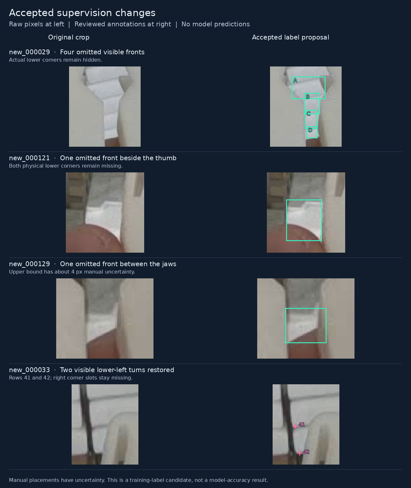
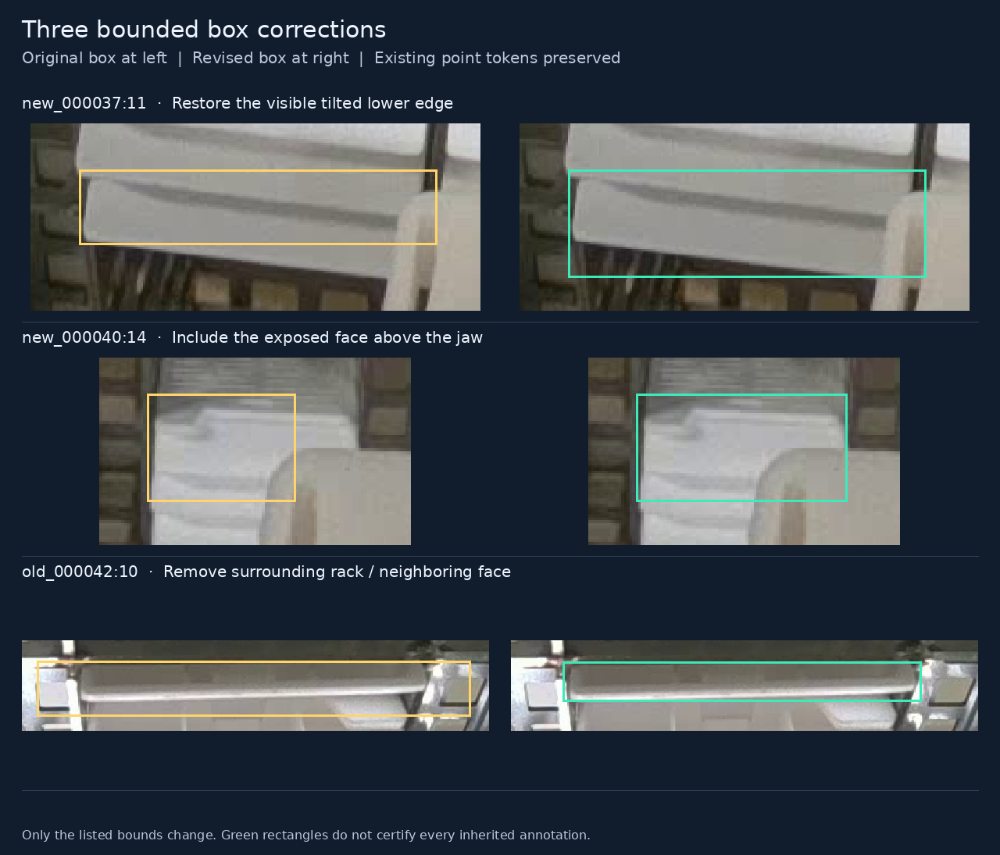

# Remaining training originals reviewed; PR35 remains selected

Date: 2026-11-14, Asia/Hong_Kong. Source: published PR61 revision
`1b71e8158e0594ee4c72ba845fa7b514a78b9e0d`.

**Latest follow-up:** [reconciled labels before the next GPU run](label-refinement-2026-11-14.md)
combines the compatible accepted historical corrections and a now-reviewed
`new_000038` three-front/clipped-front repair in a separate candidate. The exact
17-file payload described below remains unchanged as historical evidence. The
new revision retains explicit unresolved cases and is not a complete approved
training release.

**Subsequent correction:** the [ownership review](target-clarification-2026-11-14.md)
confirms three separate fronts near the thumb in `new_000038`. The earlier held
suggestion to move row 1's point to the lowest turn is withdrawn because those
locations belong to different cassettes. A three-instance coverage/geometry
repair remains open. The target and permission to show confidence-gated hidden
estimates were already documented in PR55/56; no new requirement choice is needed.
The candidate payload and earlier review evidence below remain unchanged.

**The fixed 57-image original-first pass is complete.** Its separate training
candidate adds six visible front faces, restores two directly observed corner
slots, and repairs three boxes. No model was trained on these changes. Retain
PR35 seed46 at input 1280, box confidence 0.13, NMS IoU 0.70 and endpoint
confidence 0.50 for assistant-reviewed image proposals.

[Candidate and exact labels](../data/candidates/remaining-fronts-2026-11-14/README.md)
· [Review evidence](../results/review/remaining-training-20261114/README.md)
· [Current inference instructions](predict-pose-folder.md)

## What was recovered and completed

The interrupted continuation had already fixed the remaining cohort, restored
its original images and divided it into three groups. The published PR62 result
and its replay were already complete in PR61; they did not need another GPU run.
This continuation reused the existing image selection and verified its source
identities before continuing the unfinished visual work.

The cohort contains 57 nonempty training originals, 1,590 original object rows
and 203 missing endpoint slots. Of those rows, 1,410 have two locatable source
points, 157 have one, and 23 have neither. The three groups contain 19 images
each, with 531/530/529 rows and 71/66/66 missing slots. Selection and grouping
used source metadata, not model scores or a search for favorable examples.

Three assistant reviewers viewed their full originals before the corresponding
source-label overlays, then inspected suspicious regions using original-pixel
crops. The root reconciled nominated changes against the full images and crops.
The root was informed of the nominations; this is not described as a blind root
review or independent human certification.

All 137 training IDs now occur in a documented targeted pass: the prior union of
80 plus this disjoint set of 57. **That is review membership, not a statement
that every row, box and corner in all 137 images is correct.** The records retain
unresolved questions, including images with no accepted edit.

## Accepted changes

Coordinates are in the original 1280×720 image. Boxes are
`[xmin, ymin, xmax, ymax]`; row numbers are one-based original source rows unless
an append position is explicitly given.

| Image / operation | Accepted change | Corner treatment |
| --- | --- | --- |
| `new_000029`, append rows 43–46 | Four separate front bands: `[683,470,726,499]`, `[699,491,719,518]`, `[700,513,715,537]`, `[702,534,716,549]` | Both actual lower corners remain missing for all four objects |
| `new_000121`, append row 57 | One exposed front beside thumb and jaw: `[568,508,605,551]` | Both actual lower corners remain missing |
| `new_000129`, append row 50 | One exposed front between jaws: `[700,516,729,541]` | Both actual lower corners remain missing |
| `new_000033`, row 41 | Restore visible left lower-front turn at `(613,453)` | Left `v=2`; right stays `0 0 0` |
| `new_000033`, row 42 | Restore visible left lower-front turn at `(617,477)` | Left `v=2`; right stays `0 0 0` |
| `new_000037`, row 11 | Extend only `ymax: 456 → 471` to include the visible tilted lower edge | Existing endpoint tokens preserved |
| `new_000040`, row 14 | Extend only `xmax: 632.10 → 655` to include exposed material above the jaw | Existing endpoint tokens preserved |
| `old_000042`, row 10 | Replace rack-inclusive box with `[575,294,873,327]` | Existing endpoint tokens preserved |

The four new `029` objects are distinguished by visible separating seams. The
first new box overlaps the loose rectangle of source row 35, but it represents
a different physical face. Rectangle overlap alone does not establish a duplicate.

The six new objects add twelve literal `0 0 0` endpoint slots. Object presence
is supported by their visible fronts; the jaw or hand boundaries are not their
physical lower corners. No point is extrapolated from a box, a neighboring
cassette or stack spacing.

The `033` turns are visible beside the inter-column gap and outside the jaw
silhouette. Their approximate manual placement uncertainty is 2 px. The second
exact nomination followed exposure to root suggestions, which the evidence
explicitly records. Most nominated box edges have roughly 2–3 px of manual
uncertainty; the upper extent in `129` has approximately 4 px. These descriptive
ranges are not calibrated confidence intervals or claims of subpixel truth.





## A disagreement that prevented false supervision

An initial review nominated three white rectangles at the top of `new_000015`
as omitted cassette fronts, with apparently precise box and corner coordinates.
A second reviewer challenged the target identity. Complete originals
`new_000017` and `new_000029` show the rack-top backer/retainer and its fastening
posts; those structural divisions explain the three apparent rectangles.

The original reviewer and root withdrew all three additions. Their nominations,
the dissent and the subsequent correction remain in the record. None of those
rows enters the candidate. This is a concrete example of why a plausible shape
and precise-looking coordinates cannot establish the correct physical class.

Other proposals remain held:

- `new_000038` has a supported bottom-clipped front, but the upper transition
  between perforated top, rounded shoulder and front remains uncertain around
  y=692–700. Its exact added box is not exported. Separately, the thumb-adjacent
  region has three fronts but only source row 1; the follow-up withdraws the
  one-point A-to-B move and records a per-instance coverage/geometry repair.
- Suggested first-row top expansions in `old_000013`, `old_000069`,
  `old_000079`, `old_000093` and `old_000101` were retracted because the excluded
  pixels may belong to a preceding projecting lip. An earlier decision on a
  different image is not sufficient evidence for these changes.
- Possible redundancy in `new_000006:53/59`, identity behind the jaws in
  `new_000041:9`, and other narrow or occluded regions remain in the individual
  review records. Missing slots are not automatically annotation mistakes.

## Candidate composition and verification

The new `remaining-fronts-2026-11-14` overlay extends the previously held
`border-fronts-2026-11-13` candidate. It preserves all ten parent label files,
ten change records and fifteen accepted decisions exactly, and adds seven
complete label files containing the eleven new operations above. It does not
silently accumulate the other historical endpoint, box or corruption candidates.

| Training supervision | Images | Objects | Locatable endpoints | Missing slots | Empty images |
| --- | ---: | ---: | ---: | ---: | ---: |
| Selected PR35 parent | 137 | 3,771 | 6,841 | 701 | 13 |
| Previously held border-front candidate | 137 | 3,773 | 6,844 | 702 | 13 |
| This reviewed candidate | 137 | 3,779 | 6,846 | 712 | 13 |

The greater missing-slot count is intentional: six newly included objects have
visible identity but hidden lower corners. It does not mean ten existing
visible points were removed; two existing missing slots become visible instead.

All twenty original training-validation label files remain unchanged at 664
objects, 1,227 locatable endpoints and 101 missing slots. The separately
adjudicated **663-object development scoring reference** is also unchanged.
Those are different versioned label sets; do not substitute one denominator
for the other or place corrected scoring labels into training unnoticed.

The existing, unmodified verifier checks the candidate:

```bash
python -B scripts/verify_pose_annotation_candidate.py \
  --candidate data/candidates/remaining-fronts-2026-11-14/manifest.json
```

It verifies all 157 frozen source-label identities, exact declared operations,
full row maps, canonical missing slots, geometry, preservation of unaffected
bytes and unchanged validation. Separate image checks bind all 57 original PNGs
to their frozen SHA-256 values. The evidence includes an independent composition
check and the actual command receipt. Mechanical success does not itself verify
physical identity; the original-image review provides that separate evidence.

The README's outdated working-branch name was also aligned with the current
folder-inference guide. PR61 contains the developed workflow; PR62 is a
results-only branch. PR35 is still selected explicitly by its checkpoint
manifest. Generic epoch173/0.25 runtime defaults remain a historical workflow.

## What this means for model quality

The [completed PR62 comparison](occlusion-results-2026-11-14.md) still selects
PR35. Its current development results are 643/663 matched objects, 20 misses,
85 unmatched proposals, 529/584 eligible pairs within 5 px and 577/584 within
10 px. Only 3/17 nonempty development images have no scored miss. The three
reference-empty images produce no PR35 output at the chosen setting.

The 584-pair denominator comprises objects with two locatable reference corners.
The remaining 79 objects have one or no locatable corner. Thus 577/584 is not
the fraction of all objects, images or hidden corners that can be handled
automatically. The repeated development scenes also do not establish performance
on independent future captures.

PR62 improved the fixed synthetic covered-side probe from 54/60 to 58/60, but
clean misses stayed at 20, extras increased to 86 and an empty scene gained a
background output. Its loss of two scored endpoints comes from one box crossing
the fixed association threshold while its corner coordinates remain accurate;
that scoring effect is distinct from the genuine clean-corner displacement and
empty-background error. The prior report already preserves that distinction.

This continuation improves the recorded supervision and finishes a previously
unreviewed cohort. **It does not show an improvement in trained-model accuracy.**
The chosen architecture remains one class and two observed lower-front corners;
camera calibration, physical robot coordinates and grasp control remain outside
the current image-localization deliverable.

## The next bounded experiment

First reconcile the held coupled point/box cases and decide which supported
corrections belong in the final training revision. This candidate is a concrete,
verifiable starting point, not certification that every historical annotation
has now been migrated to the policy.

If this exact supervision revision is chosen for a training comparison, use one
declared matched pair: the exact PR35-label control versus this candidate, with
the same initialization, recipe, runtime, seed, input size and training budget.
The question is whether the revised supervision recovers actual physical fronts
while preserving the selected clean behavior. Keep the scoring reference and
operating thresholds fixed, and inspect object identities behind any reported
gain. An IoU boundary crossing or duplicate-ranking change is not automatically
a newly recovered cassette.

The existing partial-front, visible-extent, consistency, endpoint, composed-front
and pixel-corruption comparisons are completed evidence. Repeating them or
searching more thresholds without a new diagnosed cause is not the next step.
Augmentations and new runs of these same images would not create an independent
test set. No new GPU run, recipe, model promotion or merge accompanies this review.
