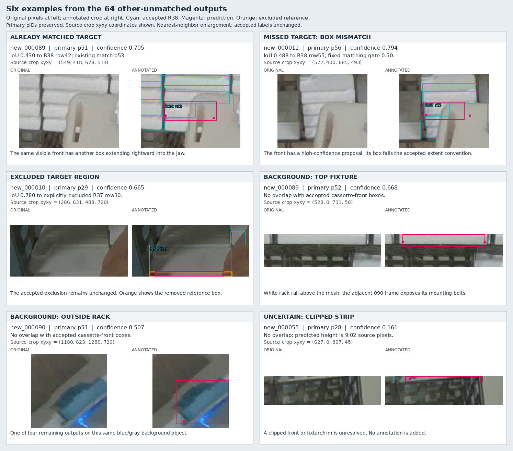

# R40: fewer unmatched outputs, with the useful detections preserved

26 November 2026, Asia/Hong_Kong.

**The immediate improvement is now usable: `--postclip-nms` adds the measured R39 filter to ordinary folder prediction.** A fresh CPU run of the PR123 candidate on all 20 originals reproduced the saved result exactly: **94 → 85 unmatched outputs, with the same 643 matched fronts and 11 misses**. Every retained coordinate, confidence, corner and original prediction identity agrees with the R39 cache. This is an optional output filter, not a newly trained model or an independent-scene accuracy claim.

The user's clarified priority is fewer unwanted prediction labels while retaining useful cassette detections. The next learning priority is therefore **visible-front localization and repeated proposals around occlusion**, with missed targets checked alongside unwanted outputs. We have enough guidance to continue the existing reviewed still-image workflow; there is no need to add a new target class or a robot-specific architecture for this work.

## PR125 is a successful return of the R39 replay

[PR125](https://github.com/Siuuuers/dl/pull/125) contains the exact expected 286,874-byte, 12-member R39 archive. Its ordinary Git blob identity and SHA-256 match our published notebook verification. The return records an unchanged standard-CPU Colab execution. It establishes that the notebook replay completed successfully; it contains no new model weights or new training result.

The [return audit](../results/evaluation/pr123-r40-unmatched-20261126/pr125-return-audit.json) preserves those identities. There is no reason to repeat that notebook merely to obtain the same scores. R40 separately performed fresh inference to verify the new ordinary prediction command.

## The implemented change and measured outcome

| PR123 on accepted R38, same 20 images | Existing output | With `--postclip-nms` |
| --- | ---: | ---: |
| Returned predictions | 737 | 728 |
| Matched reference fronts | 643 | 643 |
| Missed reference fronts | 11 | 11 |
| All unmatched predictions | 94 | 85 |
| Formal duplicate subset | 29 | 21 |
| Other unmatched predictions | 65 | 64 |
| Both observed corners within 5 px | 570/583 | 570/583 |
| Both observed corners within 10 px | 582/583 | 582/583 |
| Outputs on the three empty scenes | 0 | 0 |

Nine of 94 unmatched outputs are removed, a **9.6% reduction on this batch**. The 643 reference-to-original-prediction associations are identical, not just equal in count. Frozen666 also preserves its 631 matches and 35 misses while unmatched outputs fall from 106 to 97. These two references describe the same reused photographs under different annotation histories; they are not two independent test sets.

Ordinary NMS compares boxes before clipping to the image. Two edge proposals can disagree outside the photograph and become nearly identical after clipping. The extra pass compares the final clipped rectangles, in descending confidence order, and suppresses a same-class box only when overlap is **strictly greater than 0.70**. It does not move boxes or average corners. The earlier [nine-removal physical review](../results/evaluation/pr123-r39-diagnosis-20261126/clip-nms-visual-review.json) supports eight repeated top-clipped cassette outputs and one repeated background output.

The new option is off by default. Its fixed 0.70 threshold is separate from ordinary `--nms-iou`. Retained overlay labels use the **original one-based primary prediction ID**, with intentional gaps after filtering. Each image's JSON retains the suppressed records, their suppressors and overlaps, so the complete original output array remains recoverable. IDs are local to an image and checkpoint/run; `p57` alone is not a persistent object identity across models.

## What the remaining unmatched predictions mean

There are 85 remaining unmatched outputs: **21 formal duplicates plus 64 other outputs**. A formal duplicate is an unmatched prediction with IoU at least 0.50 to an already matched reference. The other category is broader than background: an extent variant can overlap the same physical front yet fail that numerical duplicate rule.

All 64 other outputs received assistant review of the relevant original full-frame context and exact-coordinate crops. All 14 relevant source-image hashes agree with R38. This is a diagnostic classification, not a new human-approved annotation round.

| Review group among those 64 | Outputs | What the evidence supports |
| --- | ---: | --- |
| Around already matched accepted target regions | 35 | Extent, seam or occlusion variants around 23 best-associated references; two explicitly mix front and jaw. Not all are asserted to be physically proven duplicates. |
| Around currently missed accepted target regions | 14 | Alternative boxes associated with six missed reference targets. Fourteen proposals do not mean fourteen separate cassettes. |
| On explicitly excluded target regions | 4 | Three outputs at excluded `009 / R37 row52`, and one at excluded `010 / R37 row30`. The exclusions remain accepted. |
| On clear background or fixture regions | 8 | Two at the `054` base support, two at the `089` top fixture, and four on one blue/gray peripheral in `090`. |
| Uncertain | 3 | `008 p40`, `053 p22`, `055 p28`; ownership or clipped-front identity remains uncertain. |

Thus 49 of these 64 outputs are associated with existing accepted target regions, either already matched or currently missed. That is a reason to focus the investigation on localization and instance grouping. It is not a proof that every association is a physical duplicate, or that the labels are all perfect. No independent additional unlabeled cassette was established by this review, and three uncertain cases remain.



The [complete case review](../results/evaluation/pr123-r40-unmatched-20261126/triage/REVIEW.md) and [64-case ledger](../results/evaluation/pr123-r40-unmatched-20261126/triage/review.json) retain every primary prediction ID, crop, association, uncertainty and source hash.

### Six misses already have nearby output proposals

| Image | R38 row | Other-unmatched primary IDs | Best reference IoU |
| --- | ---: | --- | ---: |
| `new_000010` | 30 | p35, p36 | 0.3741 |
| `new_000011` | 55 | p56, p58, p63 | 0.4878 |
| `new_000011` | 56 | p57, p64, p67 | 0.4065 |
| `new_000011` | 57 | p61, p62, p66 | 0.3388 |
| `new_000088` | 51 | p56, p57 | 0.4566 |
| `new_000090` | 39 | p48 | 0.4897 |

These remain misses at the fixed 0.50 matching gate. For example, `090 p48` has confidence about 0.773 but reference overlap only 0.4897. A single poorly aligned output can therefore contribute both one unmatched prediction and one missed reference. Deleting it removes the unwanted output but does not recover the target; improving its geometry could address both outcomes. Changing the scoring threshold would change the measurement, not improve the prediction.

This complements the R39 raw-proposal diagnosis: six misses fail the confidence gate, four lack any decoded box reaching reference IoU 0.50, and one loses a qualifying proposal during ordinary NMS. Those are pipeline stages, while the table above describes nearby final outputs. The classifications answer different questions and should not be added together.

## Is the cause the labels or the model?

The evidence supports several causes together.

**The target convention matters.** The accepted [R33 boundary guidance](annotation-boundaries-r33.md) boxes observed frontal material, including the cassette's own rim or lip. An all-jaw or rack-only boundary strip is excluded. A prediction extending beneath the gripper may suggest a plausible hidden extent, but it does not satisfy that observed-front box convention. These pixels cannot establish the hidden boundary.

`new_000088:51` is an explicit historical example. Its accepted left edge moved from x749 to x802 to remove a jaw-only strip. Current p56/p57 repeat the broad-envelope pattern and fall below the matching gate. This does not establish a missing physical object or a need to undo the accepted amendment.

**The model also produces repeated and background responses.** The eight clear background outputs are supported by the source context: the rack base, the top fixture and one blue/gray object outside the rack. Several other outputs are alternative extents around the same target region. Those are useful specifications for training and prediction improvements.

**Exclusion decisions change the target population.** Four outputs cover two regions the user explicitly removed. An excluded partial cassette can still have cassette-like pixels. Its exclusion does not itself prove that the region is background, and removing a development label does not teach the trained model to stop proposing it. Keep these case-specific decisions intact rather than silently re-adding labels or creating ignore masks.

The R38 edits changed development labels only; all 137 training label files remained unchanged. They can change a reported score without changing the model. New training would need an actual eligible supervision or recipe change to test a new hypothesis.

The endpoint contract remains separate: predicted hidden corners are allowed through the existing per-slot confidence and in-frame display gates. Unlocatable reference corners stay unavailable, and prediction confidence does not establish physical visibility or coordinate accuracy.

## Why stronger global filtering is not the next default

Six other-unmatched extent variants score higher than the currently matched prediction for their associated target. Five of these pairs overlap each other at IoU at least 0.50. Lowering the NMS threshold can therefore prefer the worse-aligned rectangle and remove a useful match. The [ledger](../results/evaluation/pr123-r40-unmatched-20261126/triage/review.json) records the exact pairs.

The opposite strategy also has a measured cost: R39's confidence 0.13 → 0.05 probe recovered five matches but added 68 unmatched outputs. That does not fit the clarified priority for cleaner output. Raising confidence likewise needs a missed-target check; simply returning fewer rectangles is not a sufficient success condition.

For an output-only filter, retain the current useful matches and corner outcomes while reducing unwanted outputs. Compare original prediction identities as well as totals, so a removed useful match cannot be hidden by a newly matched alternative. For a newly trained model, inspect changed object identities and corner quality; prediction IDs from different model runs are not interchangeable.

## Rack context and existing data

Keep the target boxes tight around the accepted cassette-front material. The model already receives the full 1280×720 original image, including rack, gripper and neighboring cassettes. Adding those structures to a cassette label would change the object boundary rather than add input context. An additional rack class is not required for this improvement.

A general rack locator might eventually support a separate region filter, but the observed background cases include fixture regions inside or attached to the rack as well as the external blue/gray item. A hand-drawn mask for these development photographs would not establish a general solution. The diagnostic reference associations in this report must never become inputs to runtime filtering.

The live [upstream audit](../results/evaluation/pr123-r40-unmatched-20261126/upstream-update-audit.json), checked at **15:38 Hong Kong time on 26 November**, found all three branch heads identical to our saved 7 November intake:

| Upstream branch | Current commit prefix | New tracked material since that intake |
| --- | --- | --- |
| `baomai` | `351eb3cf960c` | None |
| `grasp-vision` | `9a6bf2432582` | None |
| `yolo-pose` | `72a99dafa1b14` | None |

The existing 320-frame `grasp-vision` pool is still available; it is old recovered material, not a fresh update. The [earlier three-image pilot](additional-annotation-pilot-2026-11-07.md) remained quarantined and left 317 images without complete review in that pilot. Its old unresolved rim questions should be reconsidered under the now-established ownership guidance, rather than assumed resolved automatically. The alternative 450-image front/back five-keypoint task is not a drop-in dataset for this two-corner task.

The next meaningful data experiment is a bounded, complete-image review of existing extra frames showing the observed failure patterns: narrow fronts beside the gripper, clipped fronts and cassette-like fixture material. Keep all identifiable targets in each admitted image consistently annotated; a negative region in a target-containing image is not a reason to erase its other targets. Freeze the eligible image IDs and exact label bytes before training. If review produces no changed eligible supervision, do not rerun an identical comparison.

Keep development images out of training. Related frames need to stay together when splitting, and zero identical image hashes do not prove separate capture sessions. With no independent capture session available, report improvement on the existing development material honestly and leave new-scene performance unmeasured. An upstream commit date is not a camera capture date.

## Use and verification

Use the [folder-prediction guide](predict-pose-folder.md#optional-nms-after-framework-clipping) on the R40 working branch. The complete PR123 candidate bundle is required. Its R36/R37 provenance checks also require the original dataset image payloads, so a checkout containing only Git LFS pointers must first run the documented image fetch. No verification is bypassed.

The actual prediction invocation is:

```bash
python scripts/predict_pose_folder.py \
  --checkpoint-manifest /path/to/pr123/candidate/checkpoint-manifest.json \
  --input /path/to/original-images \
  --output /path/to/new-pr123-filtered-results \
  --device cpu --threads 4 \
  --conf 0.13 --nms-iou 0.70 --endpoint-conf 0.50 \
  --postclip-nms
```

The [verification record](../results/evaluation/pr123-r40-unmatched-20261126/runtime-verification.json) documents the real CPU execution, exact source hashes, checkpoint identity, original-image verification and rescoring against R38 and frozen666. All 20 images completed, all 728 retained arrays match R39 exactly, the audit reconstructs all 737 original outputs, and JSON/CSV/overlay counts agree. The 18 focused folder checks also pass, including legacy disabled behavior and the full cached R39 regression. An independent source review found no concrete compatibility defects.

PR35 remains selected by the historical frozen-reference gate; this optional PR123 command makes the current-target experiment usable without silently changing that gate. PR123 is stronger on accepted R38 in these photographs, while the historical frozen666 ranking favors PR35. Keep those scopes explicit. The next GPU notebook should follow a concrete reviewed data or recipe change, not repeat PR125's completed replay.
