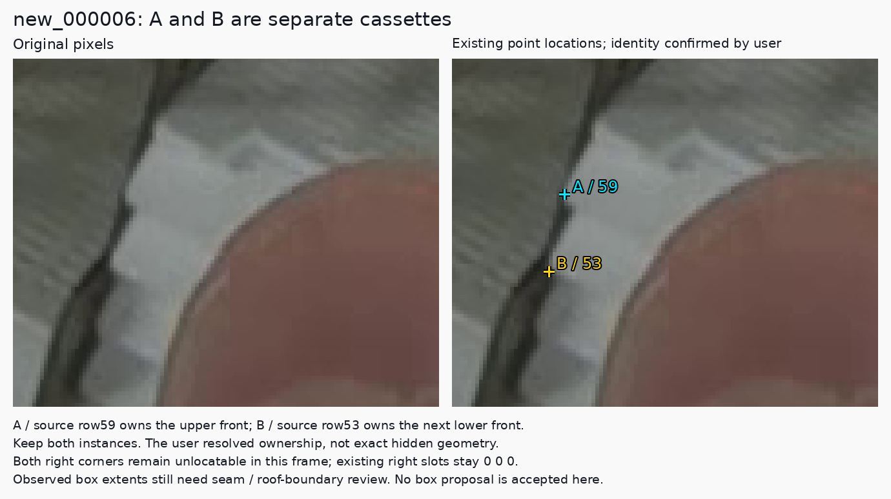

# Visible-front labels and hidden-corner predictions

Date: 2026-11-14, Asia/Hong_Kong.

**Later physical clarification:** the user has now confirmed identical cassette
dimensions, no seated sliding/tilting, and equal rack widths. The
[subsequent observed-label review](fixed-geometry-label-review-2026-11-14.md)
records that constraint and the accepted numeric repairs. The hypothetical
independent movement discussed below is therefore no longer an unresolved
design assumption for these seated cassettes. Exact front/lip ownership and
hidden-coordinate evidence remain separate questions.

**Identifiable partly occluded fronts remain eligible objects under the current working convention, and the current model may predict hidden corners.** The small boxes in `new_000038` encode the observed front-face extent of each cassette. They do not encode its complete physical size. Rack structure and neighboring cassettes can support instance identification and conditional geometry estimates, but do not automatically establish exact hidden coordinates.

The user's follow-up also resolves the `new_000006` A/B identity question: **A/source59 and B/source53 are two separate cassettes. Keep both.** Precise visible-face boxes remain a separate review task.

## 1. What the upstream sources actually say

Fresh checks found the upstream heads unchanged: `baomai` at `351eb3cf960ccc34829e2bc72e1fa4645acc6295`, and `yolo-pose` at `72a99dafa1b14bfabd101e639b9ddb5f5aa38d52`. Both branches belong to `an94-doll/embedding_vision`, but define different annotation tasks. The [source index](../results/review/visible-and-hidden-20261114/upstream-sources.json) records immutable URLs and byte/blob hashes.

| Primary source | Supported reading | Boundary of that evidence |
| --- | --- | --- |
| [Current baomai data README](https://github.com/an94-doll/embedding_vision/blob/351eb3cf960ccc34829e2bc72e1fa4645acc6295/data/README.md#L31-L39) | One cassette-front class, two actual lower-front corners ordered by image X; independently retain a visible endpoint and use canonical missing coordinates for an unreliable location. | It does not explicitly specify the complete box-extent policy or a fully-unobstructed-only inclusion rule. |
| [Historical annotation-editor guide](https://github.com/an94-doll/embedding_vision/blob/6f7112a553e1759fc755bda1f18ee56cb34dd315/detect/data/data_last/picture/work/ANNOTATION_EDITOR.md#L19-L20) | The adding-object instruction says **“拖出可见正面范围”**: draw the visible front-face extent. | This is the older 277-image/frame83 workflow. It informs our convention; it does not certify every later epoch173 annotation. |
| [yolo-pose annotation guide](https://github.com/an94-doll/embedding_vision/blob/72a99dafa1b14bfabd101e639b9ddb5f5aa38d52/annotations/README.md#L34-L40) | Its box includes the whole object and side thickness while its five landmarks lie on one specified face. | That front/back, five-point task is separate from baomai. The passage does not instruct filling hidden extents behind a hand. |
| [baomai data configuration](https://github.com/an94-doll/embedding_vision/blob/351eb3cf960ccc34829e2bc72e1fa4645acc6295/data/data.yaml) and [yolo-pose schema](https://github.com/an94-doll/embedding_vision/blob/72a99dafa1b14bfabd101e639b9ddb5f5aa38d52/annotations/pose_schema.yaml) | The class lists, point counts and point orderings differ. | A box convention from the five-point task cannot silently redefine the selected two-point training target. |

**Attribution correction:** the detailed visible-front box convention is an explicit adopted decision in this project, supported by the historical editor guide. It is not a universal YOLO rule or a complete box policy stated by the current baomai README. The existing annotation policy already records that source distinction; this explanation makes it explicit in the current review discussion. No pinned policy bytes are edited.

## 2. Three different meanings of “full visible cassette”

| Intended meaning | Consequence |
| --- | --- |
| Label only completely unobstructed instances | This would exclude currently supported partial fronts. No such restriction was found in the inspected baomai requirements. |
| Enclose all observed portions of one cassette front | This is the adopted convention. Most of a front can be hidden, leaving a narrow valid observed box. |
| Enclose the complete projected front/object, including hidden extent | This is an amodal target: a box representing the whole object despite occlusion. It is a possible task choice, but is not established as required by these sources. |

The observed box encloses every supported visible portion of the same front. A valid enclosing rectangle can contain an occluder between two visible portions; the presence of hand pixels inside a rectangle alone does not prove an annotation error. Its outer bounds come from observed target material rather than an assumed hidden width. Front-surface extent is also different from the entire three-dimensional cassette, including roof or side thickness.

Thus `new_000038` rows1/16/17 are partly visible, individually identifiable fronts. Their visible left strips support their inclusion. Their right corners remain naturally hidden. The narrow rectangles should be read as observed-front extents, not measurements of full cassette width or a prohibition on prediction.

The current upstream [`new_000006` label](https://github.com/an94-doll/embedding_vision/blob/351eb3cf960ccc34829e2bc72e1fa4645acc6295/data/labels/train/new_000006.txt) already contains separate rows53/59 with left points present and right points missing. Together with the user's confirmed identities, this is a concrete partial-object example. It does not certify the exact old box coordinates.

## 3. Hidden-point prediction already exists

The [upstream viewer](https://github.com/an94-doll/embedding_vision/blob/351eb3cf960ccc34829e2bc72e1fa4645acc6295/scripts/view_d405_yolo.py#L255-L265) displays an endpoint when its score reaches the cutoff and its coordinates are inside the image; model output is also checked for finite values. It draws the line when both endpoints qualify. It has no independent physical-visibility test and no rack-completion stage.

The current [folder runner](../scripts/predict_pose_folder.py) uses the same score/finite/in-image distinction. **The renderer does not require a predicted point to lie inside its predicted box.** Consequently, a small observed-front box does not impose a rendering restriction against a hidden-corner prediction elsewhere in the image. This establishes display behavior, not a guarantee of accurate hidden-coordinate learning.

Observed training labels and predictions therefore have different meanings. A visible label is evidence from the original pixels. A model coordinate with a high score is a proposal. A point whose natural location is unobservable cannot become observed truth merely because the proposal is plausible.

## 4. What context can establish

The user's reasoning legitimately helps identify physical instances. The next step—recovering exact hidden width or a hidden corner—needs additional constraints. Equal manufactured widths do not imply equal image widths when depth or orientation differs. Under a simple front-parallel pinhole model, projected width is `f_x * physical_width / depth`; a different depth changes the projection. A rack's rear lattice also need not share the cassette front plane.

If the covered cassette can shift or tilt while its neighbors remain fixed, the visible anchors can support different hidden coordinates. Verified seating stops, dimensions, calibration/depth, or another view of the same unchanged pose can reduce that ambiguity. The current images do not establish those mechanical constraints.

This idea has already been tested in the [context-corner pilot](context-corners-2026-11-12.md). With observed donor coordinates and manually supplied stack/rank assignments, projective interpolation achieved both corners within5px in24/26 scenarios and within10px in26/26; extrapolation achieved5/8 and8/8. These are selected development cases with known withheld coordinates, not measured accuracy on every naturally hidden point. The two actual hidden-left examples have no known error.

The [follow-up using PR35 anchors](context-model-anchors-2026-11-12.md) did not improve the tested strict pair successes: direct PR35 achieved24/26 interpolation and7/8 extrapolation pairs within5px, versus23/26 and6/8 after the tested geometry variants. The current recommendation remains direct PR35 output, with explicit geometry estimates available separately for review.

The [pixel-occlusion diagnostic](pixel-occlusion-2026-11-13.md) supplies another useful check. PR35 recovered28/30 covered-left and26/30 covered-right points within10px. All60 covered-point scores exceeded0.85, yet six errors exceeded10px. This supports the ability to estimate covered points and shows why confidence cannot establish coordinate correctness. Synthetic masking retains known pre-mask coordinates; naturally hidden corners do not supply that independent truth.

An amodal labeling revision could be valid if its target and coordinate evidence were deliberately specified. It would also change the box reference used for evaluation. The present question does not silently migrate the dataset or reinterpret earlier box scores.

## 5. Record the user's new006 decision

- A/source59 belongs to the upper cassette; B/source53 belongs to the next lower cassette. The duplicate/one-front question is closed.
- Keep both existing rows and their point tokens. Both right slots remain canonical missing.
- Source53's box reaches into the hand and upper-cassette region; source59's short box may omit visible continuation. The weak oblique seam still prevents this pass from accepting exact complete box replacements.
- This decision applies to rows53/59; it does not adjudicate the separate rows51/52/60 concerns.

The [identity record](../results/review/visible-and-hidden-20261114/new006-identity-resolution.json) binds the exact original image and label bytes. The [current field-specific status](../results/review/visible-and-hidden-20261114/review-status.json) supersedes the instance-count question in frozen ledger case `new_000006-096`, while keeping its geometry review open. The previous ledger remains a reproducible historical snapshot; its88-case count is not silently decremented when another field of the same case still needs review.

The practical continuation is to retain the one-class/two-corner task, keep identifiable partial fronts, refine their observed geometry where the pixels support it, and preserve confidence-gated predictions of hidden points. No new label candidate, model inference, training, automatic geometry fallback or change of runtime settings occurred in this follow-up.
