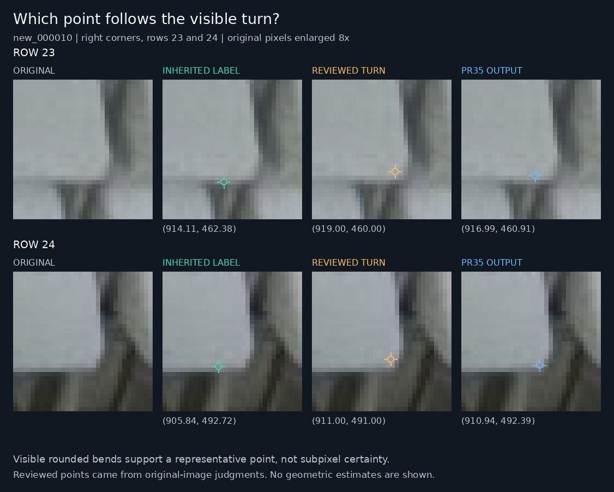
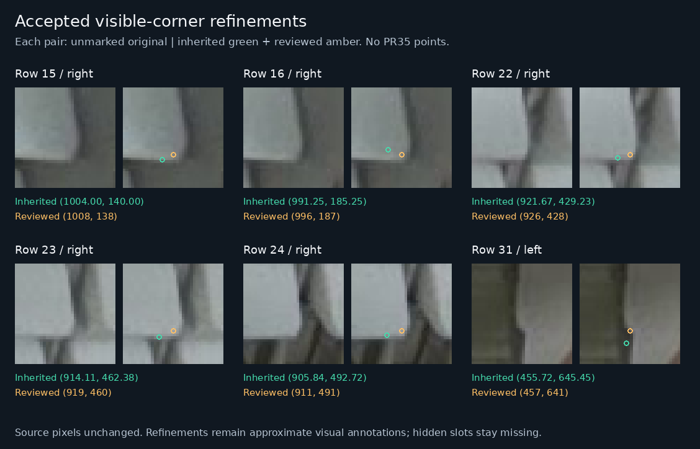
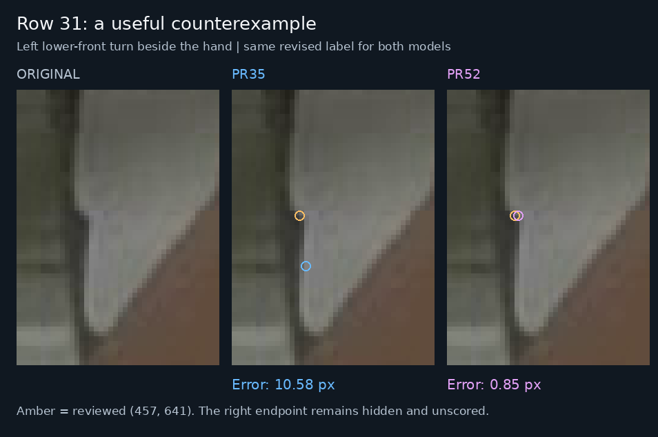
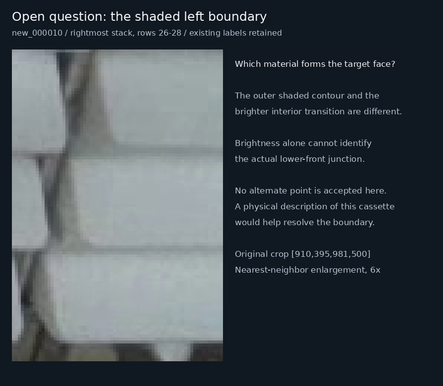

# Visible corner review: new_000010

**Later follow-up:** the [two-point adjudication](corner-adjudication-2026-11-12.md) completes the targeted review of left points 25–28, 31 and 32. It refines row 28, marks row 32 unlocatable with reviewer dissent recorded, and retains the other four points. Use the [latest complete reference](../data/references/visible-front-adjudication-2026-11-12/README.md) for a new review. The six-point decisions and scores below remain the historical record for their own reference version.

**The user's observation is supported: PR35's right points on rows 23 and 24 are closer to the visible lower-front turns than the inherited label placements. This review refines six visible endpoints in a separately versioned development reference. PR35 remains selected, with a newly documented local failure beside the hand.**

Review date: **2026-11-12, Asia/Hong_Kong**. Source revision: [`c55a7160df0b9ce0fa32a2bfb6df61dbf4cfd128`](https://github.com/Siuuuers/dl/commit/c55a7160df0b9ce0fa32a2bfb6df61dbf4cfd128). The [review record](../results/review/visible-corners-20261112/review.json) contains the original-image judgments, exact before/after rows, uncertainty, exposure history and unresolved cases. The [new complete reference](../data/references/visible-front-corners-2026-11-12/README.md) is ready for inspection or explicit use in a new comparison.

## What the target means

The [upstream baomai definition](https://github.com/an94-doll/embedding_vision/blob/351eb3cf960ccc34829e2bc72e1fa4645acc6295/data/README.md) identifies the two actual lower-front corners of the white front face, ordered by image X. The [working policy](annotation-policy.md) preserves that feature and excludes the upper lip, tray, rack and occlusion boundary. A visible rounded junction is allowed when it can be located reliably.

The physical feature was agreed. A unique mathematical point on a rounded arc was not specified. Neither the upstream text nor the working policy establishes a universal curvature maximum, tangent intersection, first departure from a straight edge, or subpixel annotation rule. This review chooses reproducible integer representatives within the observed bends, following the same physical target. It does not introduce a fitted sharp-corner or hidden-corner target.

The entire original `new_000010` label file and the 2026-11-10/11 reference copies are byte-identical: SHA256 `9a0cc16ca96d094b1c7849b829ec67625d7569666d5753bd660006c9eecbf3c6`. The original-to-reference mapping is identity for all 32 rows. Thus the two disputed coordinates were inherited, not newly established by those reference reviews. The earlier statement that no supported revision was available was too strong; a retained reference is not proof of exact physical truth.

## How the review reduced anchoring

The case was selected after the user saw model output, and the primary assistant had seen the old coordinates and predictions. That exposure is recorded. Two additional assistant reviews first inspected unmarked original pixels:

- Reviewer A recorded the four lowest right turns before reading labels or predictions. Its row 23/24 nominees were `(920,460)` and `(911,491)`.
- Reviewer B recorded all ten right turns of the tall stack before reading labels or predictions. Its row 23/24 nominees were `(917,460)` and `(910,491)`.
- Reviewer A separately recorded left-turn judgments for the rightmost and bottom partial stacks before reading those label rows. Reviewer B's image-wide follow-up saw labels but never predictions. The upper-row 15/16 secondary judgments from reviewer A were not coordinate-blinded.

The primary assistant reviewed the source pixels, selected six modest refinements, and froze their coordinates at **2026-11-12 12:50:55 UTC / 20:50:55 Hong Kong**, before rescoring the amended reference. Reviewer A confirmed that all six selected representatives fall within its actual visual support. Reviewer B supported rows 23/24/31 and supplied earlier blind visual regions for the other selected right turns, while being more conservative about moving them. The records preserve that difference in judgment.

These are assistant visual judgments, not independent physical measurements or human certification. Enlargements use nearest-neighbor sampling with no enhancement. A plausible visual region expresses ambiguity; it is not a calibrated confidence interval. The original image is SHA256 `31f944700b81891b8444ef140dba8441232bef6e704c8e5f448c9b23e548d6e9` at 1280×720.

## Six accepted refinements

Coordinates are in the original image. Row numbers are one-based and unchanged. Only the listed endpoint's x/y tokens change; all boxes, visibility flags, other points, objects and row order are preserved.

| Row | Endpoint | Inherited coordinate | Reviewed representative | Movement |
| --- | --- | --- | --- | ---: |
| 15 | Right | `(1004.00,140.00)` | **`(1008,138)`** | 4.47 px |
| 16 | Right | `(991.25,185.25)` | **`(996,187)`** | 5.06 px |
| 22 | Right | `(921.67,429.23)` | **`(926,428)`** | 4.50 px |
| 23 | Right | `(914.11,462.38)` | **`(919,460)`** | 5.44 px |
| 24 | Right | `(905.84,492.72)` | **`(911,491)`** | 5.44 px |
| 31 | Left | `(455.72,645.45)` | **`(457,641)`** | 4.63 px |

The right-side changes place the representative within the visible side/lower bend instead of along the lower contour before it or inside the front. Row 31's inherited point lies below the visible lower-left step, toward the next front. The selected point follows that exposed step. These are bounded localization refinements; the evidence does not support calling every old coordinate a gross wrong-feature error.

Rows 17–21 retain their existing right points. Their alternative visual representatives do not establish a need to shift every blurred junction. The left corners of rows 23/24 and the right corner of row 31 remain missing because the actual junctions are occluded.



PR35's saved right outputs remain `(916.99,460.91)` and `(910.94,492.39)`. Their distances to the reviewed points are **2.21 px** and **1.39 px**, versus 3.23 px and 5.11 px against the inherited points. Neither reviewed coordinate copies the model output. The appropriate interpretation is that the original-image evidence supports the user's observation, with several-pixel annotation uncertainty still present.



## A counterexample that matters for model improvement

Correcting a reference must also be allowed to make the selected model look worse. Row 31 does that:

| Saved model | Left output | Error to inherited point | Error to reviewed point |
| --- | --- | ---: | ---: |
| PR35 selected model | `(458.29,651.50)` | 6.57 px | **10.58 px** |
| PR52 matched control | `(458.50,651.02)` | 6.23 px | **10.13 px** |
| PR52 endpoint candidate | `(457.85,641.08)` | 4.86 px | **0.85 px** |

The PR52 candidate follows this exposed left turn much more closely than PR35. This is a meaningful local localization advantage under the reviewed feature; it is not an additional recovered object. It also shows why the completed PR52 experiment should not be summarized as evidence that further training can never help. Its overall tradeoffs and promotion decision remain separate from the usefulness of this particular change.



The hidden right endpoint excludes row 31 from the strict both-visible-corner denominator. A both-corner headline can therefore remain unchanged while a valid single visible endpoint gets better or worse. Track both individual visible endpoints and eligible pairs.

## Fair replay against both reference versions

The [saved-prediction replay](../results/review/visible-corners-20261112/replay.json) evaluates all three published PR53 roles on all 20 images under both references. Inference remains at box confidence 0.13, input size 1280 and NMS IoU 0.70; scoring uses matching IoU 0.50 and endpoint confidence 0.50. No new inference, training or checkpoint selection occurs.

All three models retain exactly the same box matching identities, misses/extras and returned endpoint coverage. Their strict pair counts also happen to remain unchanged:

| Model | Matches | Misses | Extras | Both ≤5 px | Both ≤10 px |
| --- | ---: | ---: | ---: | ---: | ---: |
| **PR35 selected** | **643** | **20** | **85** | **529/584** | **577/584** |
| PR52 matched control | 641 | 22 | 88 | 527/584 | 578/584 |
| PR52 endpoint candidate | 643 | 20 | 86 | 528/584 | 578/584 |

The individual visible-endpoint totals show the changes that the pair metric misses. Every fraction below keeps all 1,228 locatable reference endpoints in the denominator, including endpoints on missed objects.

| Model | Endpoints ≤5 px: inherited → reviewed | Endpoints ≤10 px: inherited → reviewed |
| --- | --- | --- |
| PR35 | 1137 → **1139** / 1228 | 1205 → **1204** / 1228 |
| PR52 matched control | 1138 → **1140** / 1228 | 1205 → **1204** / 1228 |
| PR52 endpoint candidate | 1142 → **1144** / 1228 | 1207 → **1207** / 1228 |

PR35's conditional median changes from 1.56307 to 1.55803 px; its conditional p95 changes from 5.13062 to 5.11757 px. These tiny aggregate changes do not override the row 31 failure. Row 15's right point becomes a 5 px success, but its unchanged left error is 5.69 px, so its pair remains a 5 px failure. Rows 23/24/31 have only one locatable endpoint and do not enter the pair denominator.

**Retain PR35 as the selected model.** The revised reference does not establish an additional recovered front for PR52, and its extra count remains one higher with mixed pair results. The row 31 advantage deserves to remain in the error inventory. No unchanged model has learned from a reference edit, and these reused development images do not become an independent test set.

## Questions left open

The existing 32 rows received a visual pass, but this is not certification of every box, object identity or omitted instance.

| Case | Disposition | What remains uncertain |
| --- | --- | --- |
| Rows 26–28, left corners | Retain existing labels with explicit uncertainty | A shaded outer strip, rack/neighbor material and a brighter interior transition are difficult to separate. Choosing the bright stripe alone could move to the wrong feature. Row 25's existing point remains defensible. |
| Row 32, left corner | Retain existing label as unresolved | The hand meets a small white tip near the possible junction. Reviewers disagree whether the actual corner is visible or the apparent tip is an occlusion boundary. |
| Row 13, left corner | Keep missing | The pale sliver by the holder does not establish a reliably locatable actual corner. |
| Row 14 | Preserve earlier identity/extent uncertainty | Material seen around the holder aperture is not newly adjudicated by this corner pass. |
| Row 30 | Keep both points missing | The lower frame clips the front; exact fragment extent remains unresolved. |



The useful question for the user is: **on the rightmost stack, is the narrow shaded strip on the cassette's left part of the intended front face, a side/overhang, or the rack?** A description of the physical cassette shape may resolve this from existing images. If it remains uncertain, preserve the review issue rather than shifting the points to the brighter stripe.

## Files, verification and replay

The new reference ID is `baomai-visible-front-corners-2026-11-12`. It contains the same 20 images' label files, 663 objects, 1,228 locatable endpoints, 98 missing slots, and 584 both-locatable objects. Nineteen label files are byte-identical to the 2026-11-11 parent. The one changed file preserves 26 rows byte-for-byte and alters only x/y tokens in the other six. No original, training or historical-reference file is overwritten.

- New manifest SHA256: `28ba06fe7183ebbfa6f295639194a67c4b473c17a8d67c28a9733eb359bdba92`.
- Revised `new_000010.txt` SHA256: `241c75463f8bf5d6d5c70de67deb89a4bf14209237855e0f21e6ebc6e35db01c`.
- Review-record SHA256: `959a9e62ffc8933961d38f30018947c7fee8184f073f67a2aa5c68daa0d4a4ff`.

The new [replay driver](../scripts/replay_corner_reference.py) reuses the unchanged scorers and verifies the original images, both complete references, all six published prediction/scoring files, source helper hashes, row mappings and exact scope of coordinate edits. Its replay of the parent reference matches all 15,591 saved scalar checks with zero difference. All 60 model-image matching traces are unchanged. The [verification record](../results/review/visible-corners-20261112/verification.json) checks the manifest lineage, preserved evidence, review-to-label correspondence and integrity of the final inputs.

Obtain the saved predictions from the pinned [PR53 capsule](../results/verification/baomai-endpoint-results-20261112/README.md); its relevant files are under `evaluation/`. With the actual 20 original PNGs present, run from the new checkout:

```bash
python scripts/replay_corner_reference.py \
  --repo-root . \
  --parent-reference data/references/visible-front-2026-11-11 \
  --reference-dir data/references/visible-front-corners-2026-11-12 \
  --prediction-dir /path/to/extracted-capsule/evaluation \
  --output /tmp/corner-reference-replay.json

python scripts/render_corner_review.py \
  --repo-root . \
  --review-root . \
  --output-dir /tmp/corner-review-figures
```

Use fresh output paths. The figure renderer uses Pillow and DejaVu Sans; its [figure index](images/visible-corner-figure-index-20261112.json) records source, review, replay, renderer and output identities. The old PR52 comparison and PR55 geometry studies remain pinned to their original reference bytes and remain replayable as written.

## Recommended next work

Use the visible-turn examples to review training annotations consistently, keeping known occlusions missing and unresolved material boundaries explicit. Consolidate already accepted training corrections into one coherent candidate before another matched training comparison. This pass changes validation references, so it improves measurement and error diagnosis; it does not alter the model's learned weights. The original train/validation split stays intact.

Keep the current model and inference settings while doing that data work. Preserve failures such as row 31 alongside successes such as rows 23/24. Define the tolerable visible-corner error and missed/extra-object tradeoff for the actual use before claiming that a model is good enough. No additional architecture is supported by this six-point reference review alone.
