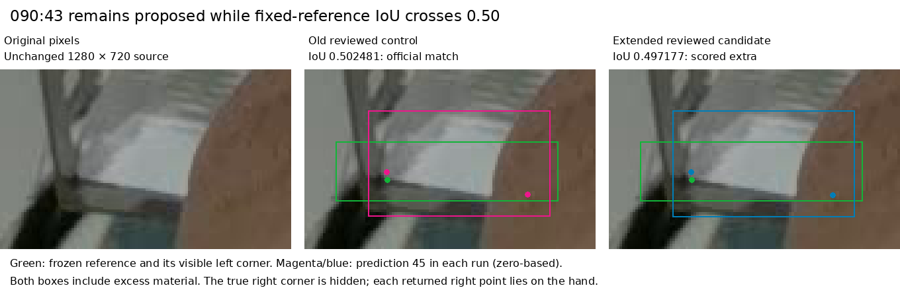
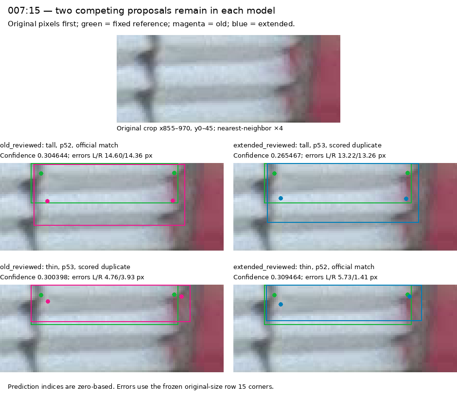

# Visible-extent training result: keep PR35

**PR43 completes a valid matched experiment, but its new model does not meet the declared promotion criterion.** At the primary confidence 0.13, misses change **20→21/663**, scored extras **85→87**, and both-corner successes **529→526/584 at 5 px** and **577→578/584 at 10 px**. There is no gained reference object. Original-image review establishes no separately supported additional front among the changed proposals.

The practical selection remains **PR35 seed46, input 1280, confidence 0.13, NMS 0.70 and endpoint cutoff 0.50** for assistant-reviewed proposals. Use the [folder workflow](predict-pose-folder.md#assistant-reviewed-proposals). Preserve the [reviewed annotation candidate](../data/candidates/visible-extent-2026-11-11/README.md) and close this experiment; the result does not request another GPU run.

This report evaluates the [PR43 returned archive](https://github.com/Siuuuers/dl/pull/43) against the prospectively frozen [protocol](../experiments/visible-extent-2026-11-11.json), prepared in [PR42](https://github.com/Siuuuers/dl/pull/42). Report date: **2026-11-11, Asia/Hong_Kong**. The [compact numerical summary](../results/verification/baomai-visible-extent-results-20261111/summary.json) and [reproduction instructions](../results/verification/baomai-visible-extent-results-20261111/README.md) preserve the detailed evidence.

## 1. The returned training is eligible

The PR43 archive at commit `a964b9bc5437c47fe76a11cfd02e15c467e4da0d` is **39,776,639 bytes**, with SHA-256:

```text
e415c0ccbd07806851e9221ced6df6cd43d2ae54857ae7e3a6d7938ec56dcfca
```

The published packager's read-only `--verify-existing` check passes from clean implementation commit `d43a58b9456a782ace14e20f0bf7ed2da3572ca1`. All thirteen ZIP members pass CRC; all twelve declared payload sizes and hashes agree. Checkpoint manifests, training receipts, staging manifests, logs and epoch CSVs agree with the source, protocol and completed recipe. Both inner arms truthfully remain `candidate`; `old_reviewed` and `extended_reviewed` distinguish their outer roles.

| Training evidence | Old reviewed | Extended reviewed |
| --- | ---: | ---: |
| Completed epochs | 30 | 30 |
| Completed batches | 1,050 | 1,050 |
| Image presentations | 4,110 | 4,110 |
| Actual optimizer steps | 78 | 78 |
| Training images / empty images | 137 / 13 | 137 / 13 |
| Training objects | 3,771 | 3,772 |
| Visible training endpoints | 6,841 | 6,841 |
| Missing training endpoints | 701 | 703 |

Both runs independently initialize from the original epoch173 checkpoint, use seed46 and the same A100-SXM4-40GB runtime and recipe, and return finalized epoch30 `last.pt`. Training records Python 3.13.16, PyTorch 2.14.1+cu130 and Ultralytics 8.4.182. The matched data difference is exactly **11 box replacements and one front addition across 061/079/082/094**. The eight prior annotation files and every existing class/corner token in the new delta are preserved. Reviewed images 062/063 receive no edit; the five recorded uncertain rows remain uncertain.

All 157 original PNGs and the original initialization checkpoint bytes were independently verified. Original in-training validation is unchanged: 20 images, 664 objects, 1,227 visible endpoints and 101 missing endpoints. The separate corrected reference is used only for post-training evaluation.

PR43 says a fresh A100 session restored both completed runs from Drive after the first runtime was lost. The supplied artifacts establish completion and consistency. The ZIP does not contain the Drive completion markers or a restoration transcript, so it does not independently prove that interruption timeline. A repeat training run is unnecessary to evaluate the verified completed models.

The 78 optimizer steps reflect the pinned trainer's gradient accumulation. They do not mean that the weights were frozen, and this result does not establish that more epochs would improve the model.

## 2. The old-reviewed control reproduces PR35 exactly

| Role | Final checkpoint SHA-256 |
| --- | --- |
| Current PR35 | `420c00f73eeba24e587342400878b7d96371d3e745772113809aa705ec8163b1` |
| Returned old reviewed | `db0e8c625aa0261d32f8af0f48b5362ab66e5c51a06d2b6f45b046798bd4184f` |
| Returned extended reviewed | `d7cc62189743e7c2750035fc2b98e8b499e9ca160489407dc11e0002c8f01fd0` |

The serialized checkpoint files differ, but the current PR35 model and returned old-reviewed control have **879/879 identical loaded state tensors**, measured before prediction/fusion. Their **40/40 ordered prediction arrays** are also exactly equal across twenty images and both declared thresholds. Fresh PR35 predictions additionally equal the corresponding forty arrays in the previously hash-pinned 0.13/0.15 evidence.

The extended model changes **705/879 loaded tensors**. This is a real trained intervention with a negative/mixed measured outcome. The control agreement strengthens this particular comparison; it does not establish universal determinism across arbitrary software or hardware.

Fresh evaluation uses one shared CPU environment: Python 3.12.14, PyTorch 2.10.0+cpu, torchvision 0.25.0+cpu, Ultralytics 8.4.182 and NumPy 2.2.6. Inference is FP32, four PyTorch threads, one inter-op thread, rectangular preprocessing and ordinary NMS. The exact driver makes **120 fresh image predictions** and scores **240 image/reference/threshold combinations**. Three blank warmups are excluded; no network attempt occurs during inference.

## 3. Fixed primary result

The corrected reference remains **663 objects / 1,228 visible endpoints / 98 missing endpoints** in twenty images. Box matching uses IoU 0.50; endpoint availability uses confidence 0.50 and valid image coordinates. Corner error is Euclidean distance in the original 1280×720 pixels. The two-corner denominator includes all 584 eligible reference objects, including misses.

| Measure at box confidence 0.13 | PR35 / old reviewed | Extended reviewed |
| --- | ---: | ---: |
| Returned proposals | 728 | 729 |
| Matched objects / 663 | 643 | 642 |
| Missed objects | 20 | 21 |
| Scored extras | 85 | 87 |
| Duplicate / other extras | 31 / 54 | 30 / 57 |
| Returned visible endpoints / 1,228 | 1,208 | 1,207 |
| Both corners returned / 584 | 578 | 578 |
| Both corners within 2 px / 584 | 261 | 264 |
| Both corners within 5 px / 584 | 529 | 526 |
| Both corners within 10 px / 584 | 577 | 578 |
| Visible endpoints within 5 px / 1,228 | 1,137 | 1,138 |
| Visible endpoints within 10 px / 1,228 | 1,205 | 1,206 |
| Conditional median corner error, px | 1.563073 | 1.575336 |
| Conditional p95 corner error, px | 5.130618 | 5.125095 |
| Miss-free nonempty images / 17 | 3 | 3 |
| Predictions in the three empty images | 0 | 0 |

The same nonempty images, `010/054/058`, remain miss-free. Each empty image, `146/147/148`, returns zero proposals in all three models at both thresholds. These are observed development-set outcomes, not a guarantee for future scenes.

The corner groups partition the full-image matching; they are not matched independently. Extras have no known reference-corner group.

| Locatable reference corners | Reference objects | PR35 / old matched | Extended matched |
| --- | ---: | ---: | ---: |
| Zero | 19 | 12 | 12 |
| One | 60 | 53 | 52 |
| Two | 584 | 578 | 578 |

There is **no gained reference identity** at either threshold. The sole lost corrected-reference match is `090:43`, examined below. All nineteen inherited uncertain reference rows and the separate `011:61` caveat remain recorded. They are not removed from denominators, resolved by model agreement, or silently certified by absence from a review queue.

### Diagnostic confidence 0.15

| Measure | PR35 / old reviewed | Extended reviewed |
| --- | ---: | ---: |
| Proposals | 718 | 717 |
| Matches / misses | 642 / 21 | 641 / 22 |
| Extras: duplicate / other | 76: 28 / 48 | 76: 25 / 51 |
| Returned visible endpoints / 1,228 | 1,207 | 1,206 |
| Both corners within 5 / 10 px, out of 584 | 529 / 577 | 526 / 578 |

The object gain/loss identity, corner-pair changes, miss-free images and empty-image outcomes are the same. This diagnostic does not replace the predeclared primary confidence or select a new threshold.

## 4. What the changed scores mean in the images

### 090:43: the proposal survives, but crosses the matching cutoff

The partially hand-occluded front is still proposed by both models. At confidence 0.13, both outputs have zero-based prediction index 45. Their mutual box IoU is **0.985079** and the largest corresponding edge change is less than **0.46 px**. Their overlap with the frozen corrected reference changes from **0.502481 to 0.497177**, crossing the fixed 0.50 cutoff.



The original supports a partial front, with its right physical corner hidden by the hand. Both predictions still include too much upper material and return a right-side coordinate on the hand. The official result is one lost reference match, not a cassette disappearing from the proposal list. The prior observed-front boundary has a soft transition; the reference and cutoff remain frozen rather than being adjusted after this result.

### 007:15: a better-ranked existing proposal wins the match

The 10 px pair gain comes from a top-clipped front with two competing proposals. The old model already returns a thin box as well as a taller box. The scorer processes confidence-ranked detections, so a small change in their relative scores changes which box is assigned to this reference row.

| Proposal | Old confidence | New confidence | Assignment |
| --- | ---: | ---: | --- |
| Taller box | 0.304644 | 0.265467 | Wins the old match; remains an extra in the new output |
| Thin box | 0.300398 | 0.309464 | Already present in the old output; wins the new match |

The selected old pair has corner errors **14.596 / 14.356 px**. The newly selected pair has **5.734 / 1.411 px**, giving one additional 10 px pair success. The thin old proposal already had errors **4.757 / 3.928 px**, both within 5 px of the reference, but it did not win that reference assignment. Thus this change concerns ranking and match selection among existing alternatives. It is not a newly discovered object or proof that the candidate created a previously unavailable accurate corner proposal.



All point comparisons use the exact frozen reference tokens. No alternate matching rule is substituted in the official scores. Figure proposal indices are zero-based within each model/image/threshold; reference rows are one-based.

### Five-pixel pair changes are mixed

The candidate gains two 5 px pair successes and loses five. The table gives the endpoint that crosses 5 px; the other endpoint remains within 5 px in both models.

| Reference identity | Changed endpoint | Old error, px | New error, px | Pair outcome |
| --- | --- | ---: | ---: | --- |
| `008:22` | Left | 6.03377 | 4.47439 | Gain |
| `087:53` | Right | 5.00918 | 4.87430 | Gain |
| `008:10` | Left | 4.87956 | 5.10930 | Loss |
| `008:20` | Left | 4.75161 | 5.11075 | Loss |
| `008:21` | Left | 4.83125 | 5.06024 | Loss |
| `058:7` | Left | 3.69384 | 5.50224 | Loss |
| `059:8` | Left | 4.72704 | 5.00559 | Loss |

Several crossings are small relative to a manually marked soft boundary; `058:7` changes more substantially. These exact threshold counts should not be described as seven independently obvious physical improvements or failures. The full saved predictions retain continuous errors and all 2/5/10 px identity changes.

### Two unavailable endpoints are suppressed on a retained front

At confidence 0.13, the headline count of outputs on reference-unlocatable sides changes **69/77→66/76**. The denominator changes because `090:43` no longer matches. That alone removes one old returned endpoint and one opportunity from the diagnostic.

On the **642 commonly matched objects**, the comparable count is **68/76→66/76**. Both changed outputs belong to `090:48`, a front visible through the gripper gap whose outer lower corners cannot be located. Its left/right endpoint confidences change **0.56517/0.61250→0.48592/0.45582**, so both fall below 0.50 while the object remains matched. The new duplicate of this front also returns neither endpoint at that cutoff.

Original-image inspection supports suppressing these unavailable endpoints. It does not establish accurate coordinates for hidden corners or a general solution to occlusion. At confidence 0.15 the same decomposition holds: common matched opportunities are 75, with **68→66** returned outputs; the raw totals are **69/76→66/75**. The apparent three-output reduction therefore consists of two output changes plus a removed match opportunity.

### The two intended partial-front targets

- **`008:33`:** remains matched at 0.13 in all three models and unmatched at 0.15. Its left-corner error changes only **6.93276→6.91478 px**. Both boxes still extend roughly twenty pixels below the reviewed front; the right coordinate lies at x1280 and is not an in-frame returned endpoint. This preserves the earlier low-confidence recovery without fixing its geometry.
- **`009:57`:** remains unmatched, with no overlap from any retained proposal at either threshold. No new recovery of the small jaw-side fragment is established.

These are observations of the saved outputs. This experiment does not repeat the already completed pre-NMS trace or infer an unobserved reason for a proposal being absent.

## 5. Review workload and changed proposals

A deterministic same-class cross-model spatial association at IoU 0.50 pairs **722** primary proposals and leaves **six old-only / seven new-only** outputs. This pairing is a review aid: the word “unpaired” does not establish a new physical object, and a prediction can overlap an alternative already paired elsewhere.

The visual review covers all thirteen unpaired outputs, all six paired status changes, and the 090:48 endpoint change across nine full originals and fifteen crop groups. Root and an independent assistant reviewer inspected original pixels before comparison overlays. The capsule retains the queue, coordinates, associations, original hashes, decisions and figures.

| Changed region | Original-image interpretation |
| --- | --- |
| Top edges in `007/009/055` | Alternative boxes for already represented clipped fronts; no separately supported new front |
| Occluded regions in `009/010/011/089/090` | Existing fronts have overlapping alternatives; some predictions span the tool or hand |
| Bottom stack in `054` | Repeated coverage of the lowest front and unsupported extension over the rack base |
| Device background in `090` | One old background proposal disappears, while other background proposals remain |
| Paired changes in `007/089/059/090` | Ranking, assignment or overlap-class changes; include the 007 pair gain and 090 lost match discussed above |

No addition establishes further supported recovery. The net proposal count rises by one. Scored extras rise by two: one from that net increase and one because a formerly matched proposal becomes an extra. Duplicate and “other” counts are scorer categories; they are not a complete physical taxonomy of mistakes. Full original-image review remains necessary because reviewing only returned proposals cannot reveal every miss.

## 6. The original reference remains a separate historical view

The unchanged original reference has **664 objects / 1,227 visible endpoints**. These scores are reported separately from the corrected 663-object primary result.

| Original-reference measure | Old at 0.13 | New at 0.13 | Old at 0.15 | New at 0.15 |
| --- | ---: | ---: | ---: | ---: |
| Matches | 632 | 632 | 631 | 631 |
| Misses | 32 | 32 | 33 | 33 |
| Extras | 96 | 97 | 87 | 86 |
| Both corners within 5 px / 584 | 522 | 519 | 522 | 519 |
| Both corners within 10 px / 584 | 570 | 571 | 570 | 571 |

There is no gained or lost object identity under that historical reference. The 090:43 primary change depends on the separately corrected visible-front box. Both reference versions were fixed before training; neither is selected after the result. Only image010 is miss-free under the original reference, and the three empty images remain empty.

## 7. Decision, limits and the next useful work

The predeclared rule requires supported additional recovery while preserving existing supported matches and 5/10 px pair successes, with no empty-scene detections. This candidate establishes no recovery gain and loses three net 5 px pairs. Even after explaining the boundary-sensitive 090 match loss, the evidence does not support promotion. **Keep PR35 and its explicit 0.13 reviewed-proposal setting.**

The [annotation review](visible-extent-review-2026-11-11.md) remains useful evidence about the images. Its eleven box replacements and additional front do not become incorrect because this particular training recipe fails to produce a better operational model. Conversely, cleaner annotation geometry does not guarantee an improvement in the learned weights. This mixed intervention cannot attribute its changes uniquely to box geometry or the single added instance.

The model remains a useful review aid, with only **3/17 nonempty development scenes miss-free**. Reusing these twenty correlated views across experiments does not create an independent test. Pixel tolerances do not establish physical positioning accuracy, and confidence values are not calibrated probabilities of correctness.

The next improvement effort should use the existing data to settle a concrete remaining supervision issue before another training job. The recorded targeted-review union is 55 of 137 training image IDs; that is review history, not complete annotation certification. A bounded whole-image consistency pass can inspect remaining material for omitted fronts, box extent, identity and genuine corner visibility, record unresolved cases, and preserve accepted corrections separately. It should have a defined cohort and stopping rule. Any future model change should address a documented failure mechanism and keep one fixed comparison.

The 320-image upstream intake and its three-image pilot are already recorded. The pilot still has 36 unresolved rows and no eligible supplementary scoring images; neither those correlated frames nor more augmentation supplies unseen-scene evidence automatically. Do not repeat the intake or relabel it as an independent test. If future new-scene reliability becomes the goal, reserve a genuinely separate, appropriately grouped evaluation set before tuning on it.

No automatic seed, epoch, threshold, resolution or architecture search follows this report. The completed 1920 experiment and prior label studies remain closed. The current operational path stays simple: one selected checkpoint, one explicit proposal command, and review against the complete original image.

## 8. Reproduction and verification

The [evidence directory](../results/verification/baomai-visible-extent-results-20261111/README.md) contains the exact executed driver, compact summary, archive and payload inventory. The capsule includes saved prediction arrays, both reference score sets, full comparison identities, training metadata, independent audits, visual decisions and reproduction commands. Final model weights and full original PNGs remain bound to their immutable existing sources.

The exact driver SHA-256 is `01da5a0f067d3734cdaa990674d9092c768febc4a089dbb35f8ad3e19ef74b8f`. It uses the unchanged repository scorers and fixed protocol; no confidence override is exposed. A separate numerical audit independently checks all 240 per-image scores and quality records, twelve full aggregates, 72 subset aggregates, twelve corner-group summaries and every recorded object/pair gain or loss. The audit also verifies model-state equality, saved prediction equality and the common-match endpoint denominator correction.

The evidence README distinguishes three reproducibility paths: saved-prediction numerical replay using only included labels/helper source and the Python standard library; full provenance-aware driver replay requiring the external final checkpoint bundles and original validation PNGs; and fresh inference in the pinned CPU environment. The first path does not reverify unavailable external weight/image bytes. Neither replay trains a model or changes the frozen reference.
