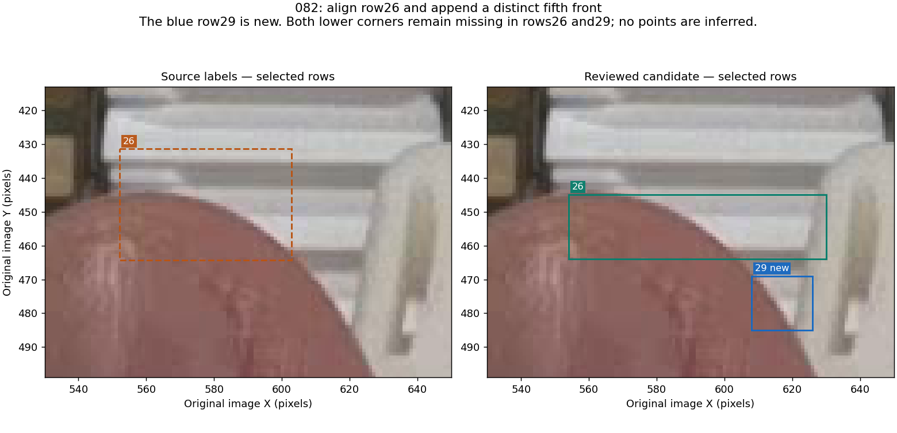
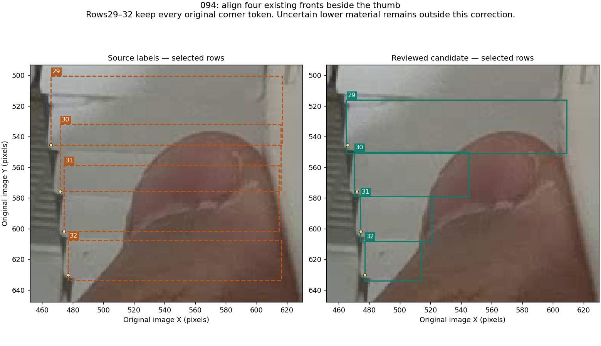
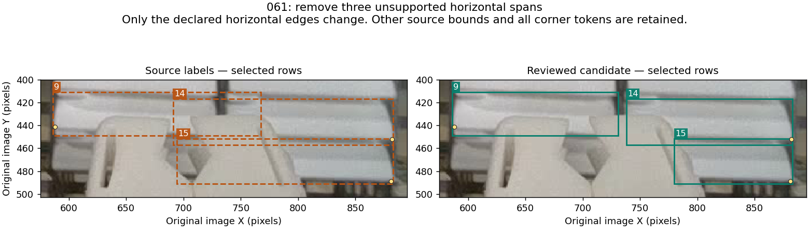

# A bounded review of cassette fronts beside hands and grippers

**Result: 11 box corrections and one supported front addition across four existing training images, with five other selected rows retained as uncertain.** The [cumulative candidate](../data/candidates/visible-extent-2026-11-11/README.md) preserves the selected PR35 model's eight-file annotation overlay exactly. The subsequent [PR43 matched training evaluation](visible-extent-results-2026-11-11.md) is complete and does not support model promotion. Preserve these annotation decisions and continue using the PR35 [reviewed-proposal command](predict-pose-folder.md#assistant-reviewed-proposals).

This review follows the [one-image 079 proposal](../data/candidates/visible-extent-079-2026-11-11/README.md). The bounded cohort is `061/062/063/079/082/094`, selected from previously recorded hand/gripper extent issues. Six images is a practical review limit, not a statistical minimum or a requirement to accept six changes. All six were already in the earlier 32-image targeted pass, so this deepens that review; it does not increase the recorded union of 55 reviewed training image IDs.

## What the originals support

Full original PNGs were inspected before overlays. Root and an independent assistant reviewer examined every accepted change; a second independent reviewer also examined the five unresolved jaw-gap cases. No model predictions, fresh inference, new training or validation edits were used to choose the new labels. Boundaries are approximate original-pixel judgments. An AABB around a triangular visible fragment can contain hand or background inside the rectangle; its outer extrema still come from the observed front, not guessed hidden width.

| Image | Accepted delta | Reason and limit |
| --- | --- | --- |
| `061` | Rows 9, 14 and 15: one horizontal bound each | Remove large unsupported spans into the gripper or neighboring column. Other source bounds and all corner tokens stay unchanged; the remaining vertical edges are not newly certified. |
| `079` | Rows 34, 15 and 16: three box replacements | Preserve the earlier proposal exactly, associating three retained row slots with distinct observed bands. No additional lower sliver is inferred. |
| `082` | Row 26: box replacement; append row 29 | The old row 26 box overlaps the preceding band and hand while clipping its own face. A fifth front is separately visible below it, separated by a dark seam, and absent from all 28 original labels. |
| `094` | Rows 29–32: four box replacements | Each front is distinct beside the thumb. Source top edges overlap preceding bands and right edges extend far into the hand/gripper. Unresolved lower identities are outside this amendment. |
| `062`, `063` | No label edit | Visible left strips support the existing fronts, but gray or dark material inside the jaw opening does not establish a sufficiently certain final right boundary. |

### 082: one misplaced box and one omitted observed front

Row 26 becomes `[554, 445, 630, 464]` in original 1280×720 coordinates. The new row 29 is `[608, 469, 626, 485]`. Both rows have two missing corner slots. The hand and gripper hide the actual physical lower-front corners; the edge where a face disappears under an occluder is not a replacement corner.

The independent reviewer estimated the left bounds one pixel farther right. The selected integer extrema lie within the soft transition visible in the original; that agreement is approximate, not evidence of subpixel accuracy. No sixth front is inferred from the pale material below approximately y485.

### 094: preserve four identities and their existing corner marks

The selected boxes are row 29 `[465, 516, 609, 551]`, row 30 `[470, 550, 545, 579]`, row 31 `[474, 579, 521, 608]` and row 32 `[477, 608, 514, 634]`. The existing four left-corner token groups are retained exactly; all four right slots remain missing. Soft edges allow roughly 2–3 px of manual judgment, especially against the similarly colored gripper. That is a qualitative observation, not a calibrated error interval.

The lower pale wedge and unresolved rows 23/24/28 are not absorbed, deleted or newly certified. Row 32's original lower bound of approximately 633.70 and the chosen integer 634 represent the same soft boundary at this review precision.

### 061: three bounded horizontal corrections

Only `row 9 xmax → 731`, `row 14 xmin → 738` and `row 15 xmin → 780` change. Source vertical coordinate tokens and all class/corner tokens are retained. These edits remove unsupported spans behind the gripper while leaving the existing less certain seam/lip judgments explicit.

The initial independent suggestion for row 15 was xmin790. Final figure inspection found plausible pale/gray front material around x780–789 immediately to the right of the jaw. The reviewers could not justify excluding it as roof or rim, so the final bound is 780. Selecting only the brightest lower band would have removed supported material. The review record preserves this disagreement and its resolution.

### 079: the previous proposal is unchanged

The [original 079 report and figure](../data/candidates/visible-extent-079-2026-11-11/README.md) remain the provenance for its three replacements. Its label file, three change objects and accepted decisions are copied exactly into this cumulative candidate. The 11-box total includes those three replacements; only eight replacements and the additional 082 front are new since that one-image proposal.

## What remains uncertain

| Selected row | Retained finding | Disposition |
| --- | --- | --- |
| `061:10` | A front is visible left of the jaw; a central pale patch may continue it. | Preserve the row. Its separation from the inner gripper and exact extent remain unresolved. |
| `062:8` | A visible left front and a pale band through part of the aperture are plausible. | Preserve the row. Instance correspondence and the lower/right extent are not sufficiently clear. |
| `062:9` | The lower left strip supports a partial front. | Preserve the row. Dark material in the opening does not establish a matching front portion. |
| `063:8` | A left strip and a pale patch are visible. | Preserve the row. The patch meets a gray wedge plausibly belonging to the tool. |
| `063:9` | The left front is identifiable. | Preserve the row. The lower aperture does not establish its corresponding right-hand region. |

Both root and independent reviews declined to select convenient final coordinates for these five rows. They are **reviewed but unresolved**, not approved original boxes. Neither darkness nor expected stack spacing resolves their material or instance identity. Other pre-existing uncertainties also remain in the candidate's provenance.

## Composition and verification

The comparison's control is the exact eight-file `annotations-2026-11-10` overlay used for PR35. The candidate adds only accepted changes in `061/079/082/094`. It does not substitute the standalone 079 overlay for the current training labels or silently accumulate PR40's separate five-image extension.

| Check | Result |
| --- | --- |
| Cumulative changed training files | 12: exact eight inherited files plus four new files |
| New delta relative to the current overlay | 11 bbox replacements, one addition, zero deletions |
| Prior 079 proposal | Byte-identical label; exact operations and decisions |
| Existing class/corner tokens in the new delta | All preserved |
| Added endpoint slots | Two canonical missing slots; no guessed visible corner |
| Effective training totals | 137 images, 3,772 objects, 6,841 visible endpoints, 703 missing endpoints, 13 empty images |
| Original validation used inside training | Unchanged: 20 images, 664 objects, 1,227 visible endpoints, 101 missing endpoints, three empty images |
| Post-training scoring reference | Separate fixed 663-object amendment; not inserted into training |

The [manifest](../data/candidates/visible-extent-2026-11-11/manifest.json), [review](../data/candidates/visible-extent-2026-11-11/review.json), [mechanical verification](../data/candidates/visible-extent-2026-11-11/verification.json) and [composition verification](../data/candidates/visible-extent-2026-11-11/composition-verification.json) bind the source, edits, inherited files and counts. Independent inspection recomputed all 157 source label hashes, the 12 candidate label hashes, all eight inherited change objects and 12 inherited decision objects, exact 079 inheritance, the six reviewed original-image hashes, and the preservation of all five uncertain source rows. The [full staging check](../data/candidates/visible-extent-2026-11-11/staging-verification.json) verified all 157 original PNGs and both copied variants in the recovered working checkout. It did not run training or claim clean-source execution; the pinned notebook repeats input verification before any GPU work.

## The completed model question

The [one-pair training protocol](training-visible-extent-2026-11-11.md) asked whether this revised supervision improves recovery of partial fronts. Both arms started independently from epoch173 with the unchanged seed46 / 30-epoch recipe and returned finalized `last.pt`. The primary operating point is the currently selected 0.13; 0.15 is retained only as a historical diagnostic. Original images, split, training validation, recipe and runtime are matched. The [result report](visible-extent-results-2026-11-11.md) records completed artifact verification, fresh inference, independent scoring audit and original-image review; it retains PR35.

This is a mixed annotation intervention: mostly observed-extent corrections plus one independently supported instance addition. It can test the effect of that complete delta; it cannot attribute a gain uniquely to one row or to box geometry alone. Even a favorable result on the reused development images would not establish unseen-scene reliability.

The completed comparison reports object identities, misses, extras, 5/10 px both-corner success, unlocatable-side outputs, empty scenes and miss-free nonempty images. Changed proposals were inspected against the originals and inherited reference uncertainties remain recorded. The result establishes no additional supported recovery; the annotation work is preserved and this experiment is closed. No automatic search over seeds, epochs or thresholds follows.

The [preparation verification record](visible-extent-preparation-verification-2026-11-11.json) records the six passing focused packaging/recovery checks, actual notebook input preflight and independent code/data audit. These establish a checked handoff, not completed GPU training or improved accuracy.
