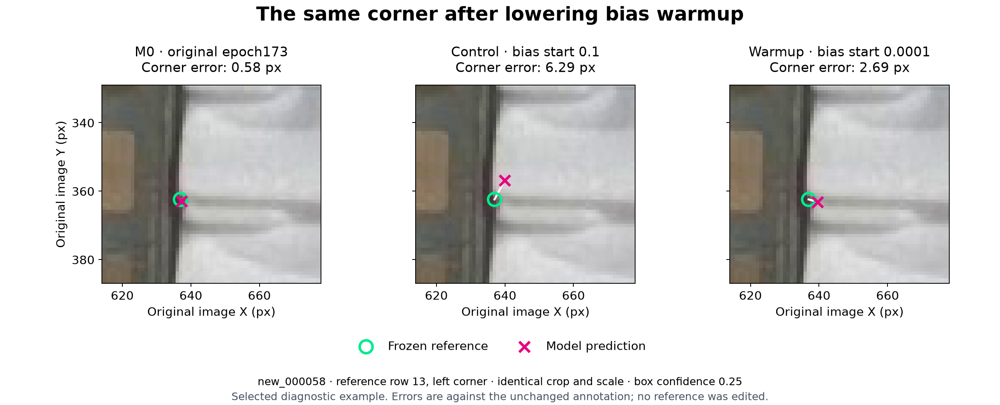
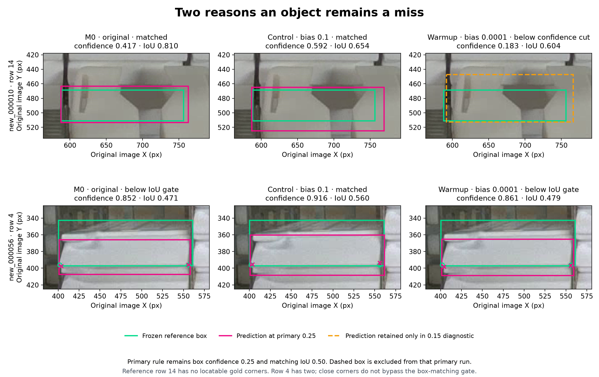

# Baomai bias warmup: promising recovery; retain epoch173

**Decision on 2026-11-07 (Asia/Hong_Kong): retain M0 epoch173 as the default and preserve the lower-bias warmup model as a promising candidate.** Warmup improves all five primary measures against M0. It does not satisfy the predeclared requirement to pass against the fresh original-recipe control as well: it misses 37 objects versus the control's 36.

The important positive result is that lowering bias warmup largely removes the corner-precision regression observed after the original fine-tune. Its gain over the original M0 is much smaller. The strict adoption rule is a project selection rule, not a statistical significance test; one additional miss against the control does not establish that warmup is generally inferior.

The new GPU artifacts are in [PR #16](https://github.com/Siuuuers/dl/pull/16), commit `dc388867bb3b59ab376c8cdc1875d96e1665f99d`. This report records fresh inference on all three models with one common runtime, the frozen reference annotations, and the existing image-space two-corner task. It follows the [original GPU comparison](gpu-comparison-2026-11-07.md) and the [predeclared warmup handoff](https://github.com/Siuuuers/dl/blob/b9a12a02c970bf8c0f43addb5648e0d54e26ab6b/docs/gpu-warmup-handoff.md).

## What changed in the experiment

| Model | Training recipe | Checkpoint evaluated |
| --- | --- | --- |
| M0 | No additional training | Supplied epoch173 |
| Fresh control | Original reference labels; `warmup_bias_lr=0.1` | Finalized epoch-30 `control/fit/weights/last.pt` |
| Warmup | Same reference labels; `warmup_bias_lr=0.0001` | Finalized epoch-30 `warmup/fit/weights/last.pt` |

Both new runs started from the same M0 bytes. They used the original 137 training images and 3,772 objects, seed 42, 30 epochs, batch 4, image size 1280, FP32 and AdamW. Apart from run paths, the recorded training settings differ only in `warmup_bias_lr`. The nominal learning rate remains `lr0=0.0001`. The separate eleven-row label-cleanup candidate was not used in this experiment.

At the primary box confidence of **0.25**, the declared rule requires no increase in FN, total FP, missing visible endpoints, conditional median error or conditional p95 error, with at least one strict improvement. Warmup must pass against **both M0 and the fresh control**, using unrounded values. Matching IoU is **0.50**, and endpoint confidence is **0.50**.

## Primary measured result

Pixel errors below are conditional on a reference-visible endpoint being returned on a matched object. The separate missing-endpoint count includes reference-visible endpoints lost through detection or endpoint filtering.

| Measure | M0 epoch173 | Fresh control | Lower-bias warmup |
| --- | ---: | ---: | ---: |
| Missed objects, FN | 39 | 36 | **37** |
| Extra detections, total FP | 63 | 80 | **60** |
| Duplicate FP, included in total FP | 17 | 28 | **13** |
| Missing visible endpoints | 43 | 43 | **37** |
| Median corner error, px | 1.611790 | 2.468005 | **1.610761** |
| 95th-percentile corner error, px | 5.161683 | 6.326759 | **5.004297** |
| Matched objects / 664 | 625 | 628 | 627 |
| Returned visible endpoints / 1,227 | 1,184 | 1,184 | 1,190 |
| False detections across three empty scenes | 0 | 0 | 0 |

Against M0, warmup has two fewer missed objects, three fewer extra detections, six fewer missing visible endpoints and lower median/p95 errors. It therefore passes the original five-metric comparison against M0.

Against the fresh control, warmup removes 20 extra detections, returns six more visible endpoints and substantially reduces corner error, but has one more missed object. That one metric prevents it from passing the second required comparison. The recorded decision is `retain-M0`, with `baseline_rule_passers: ["warmup"]` and `predeclared_adoption_eligible: []`.

The median improvement over M0 is only **0.0010295 px**. That is a very small numerical change and should not be presented as a material improvement in ordinary corner precision. The larger recovery is from the control's regression.

Full unrounded values, comparisons and object IDs are in [the comparison JSON](warmup-comparison-2026-11-07.json). [The verification record](warmup-comparison-verification-2026-11-07.json) and [compact evidence archive](../results/evaluation/baomai-warmup-a100-001/evaluation.zip) preserve the inputs and replay checks.

## Tight corner accuracy and the same-endpoint check

The following success rate requires both corresponding corners of the same object to be returned within the radius. Its denominator is all **584 objects with both reference corners visible**, including missed objects. The radii are illustrative diagnostics, not adopted application tolerances.

| Both corners within radius | M0 | Fresh control | Warmup |
| --- | ---: | ---: | ---: |
| 2 px | 263 / 584 = 45.03% | 94 / 584 = 16.10% | 270 / 584 = 46.23% |
| 5 px | 521 / 584 = 89.21% | 479 / 584 = 82.02% | 524 / 584 = 89.73% |
| 10 px | 568 / 584 = 97.26% | 569 / 584 = 97.43% | 573 / 584 = 98.12% |

At 5 px, warmup changes 13 M0 failures into successes and 10 M0 successes into failures: a net gain of three. Against the control it gains 52 and loses seven, for a net gain of 45. M0 and the control each return both endpoints on 570 fully visible objects; warmup does so on 573.

Different models can match different objects, so the aggregate errors have different endpoint membership. On the **1,176 endpoint IDs returned by all three models**, the comparison is:

| Metric on the identical subset | M0 | Fresh control | Warmup |
| --- | ---: | ---: | ---: |
| Mean error, px | 1.979754 | 2.788515 | 1.991221 |
| Median error, px | 1.609879 | 2.461262 | 1.608066 |
| p95 error, px | 5.054094 | 6.336479 | 5.008545 |
| Mean signed Y error, prediction minus reference, px | -0.334207 | -1.872966 | +0.204455 |

Warmup improves the common-endpoint image median in 16 of 17 nonempty images against the control, but only nine of 17 against M0. Negative Y is upward in the original image. The large upward residual seen in the control is reduced in warmup; this is a description of the measured residuals, not a reason to apply an empirical pixel offset.

The **pairwise** M0/warmup subset contains 1,184 endpoints. Warmup retains every visible endpoint returned by M0 and adds six. Within those same 1,184 endpoints, 588 errors improve and 596 worsen; mean error change is **+0.00727 px**. Thus, the small pooled improvements over M0 do not imply uniformly better corner coordinates. On the 1,178 endpoints shared with the control, warmup improves 867 errors and worsens 311.

### Revisit the previously selected corner



This reuses the original report's selected case: `new_000058`, label row 13, left endpoint, reference coordinate `(636.96, 362.43)`. The identical raw-image crop and original-pixel scale show errors of **0.582 / 6.289 / 2.687 px** for M0/control/warmup. Warmup recovers much of the control's error in this case; M0 remains better here. The green ring is the unchanged reference, and the magenta cross is the prediction.

This is a diagnostic illustration, not a representative random sample. The aggregate and common-endpoint calculations above account for the complete validation set.

## Where the remaining object misses come from

Warmup loses **nine** matches found by the control and gains **eight** that the control misses. The net FN difference of one therefore involves several objects. Against M0, warmup loses one match and gains three.

The table lists every lost control match, using **one-based label-file rows**. The main comparison JSON stores zero-based `gold_index` values; the archived `warmup-object-transition-details.json` packet also preserves the actual label-line mapping as `reference_row_1based`. A zero visibility value means the reference corner is unlocatable; it does not remove that reference object from the object-detection metric.

| Image | Label row | Reference corner visibility | Observed warmup gate |
| --- | ---: | --- | --- |
| `new_000009` | 8 | 0, 2 | Top-clipped box; highest recorded IoU 0.238852, below 0.50 |
| `new_000009` | 52 | 2, 0 | Matches at the 0.15 diagnostic, but confidence 0.247085 is below primary 0.25 |
| `new_000009` | 57 | 0, 2 | No overlapping recorded prediction at either 0.15 or 0.25 |
| `new_000010` | 14 | 0, 0 | Matches at 0.15; confidence 0.182684, IoU 0.603651 |
| `new_000011` | 15 | 0, 0 | Top-clipped box; highest recorded IoU 0.251788 |
| `new_000011` | 61 | 0, 0 | Matches at 0.15; confidence 0.206216, IoU 0.599462 |
| `new_000053` | 1 | 2, 0 | Top-clipped box matches at 0.15; confidence 0.184437, IoU 0.556552 |
| `new_000056` | 4 | 2, 2 | Confidence 0.860986, but IoU 0.479266 is below 0.50 |
| `new_000059` | 1 | 0, 0 | Top-clipped box; highest recorded IoU 0.208968 at 0.15 |

These are four confidence-filtered cases, four box-IoU failures, and one case with no overlapping recorded prediction. A nearby prediction that belongs to a neighboring cassette is not a recovered detection of the target. In particular, the nearest-box tie-break in a zero-overlap case does not establish that the prediction represents the same physical object.

Eight of these nine objects were already missed by M0. The sole M0-detected loss is **`new_000010`, row 14**, which is largely covered by the gripper and has neither reference corner locatable. It still counts as an object miss under the frozen annotation and matching contract. This explains how warmup can retain all of M0's returned visible endpoints while losing an M0 object match.



The top row shows that occluded object. The orange dashed warmup box comes from the **0.15 diagnostic only**; it is absent from the primary 0.25 predictions. The bottom row shows `new_000056`, row 4: warmup's corners are near the visible lower corners, but its box has insufficient overlap with the frozen reference. Close corners do not bypass the box-matching gate. M0 also misses this second object, whereas the fresh control matches it.

The original PNGs were inspected before these figures were constructed. The evidence archive includes every lost/gained object ID, the nine-case detail packet, exact predicted/reference coordinates, confidences, IoUs, label-line mappings and figure rendering inputs. These observations support a focused box-extent and occlusion review; they do not justify retroactively removing objects, changing labels, or loosening the matching rule in this comparison.

## Secondary confidence thresholds

| Box confidence | Model | FN | FP | Missing endpoints | Median error, px | p95 error, px |
| --- | --- | ---: | ---: | ---: | ---: | ---: |
| 0.15 | M0 | 33 | 90 | 38 | 1.616650 | 5.238279 |
| 0.15 | Control | 31 | 111 | 39 | 2.471899 | 6.347772 |
| 0.15 | Warmup | 30 | 83 | 34 | 1.617623 | 5.017441 |
| 0.40 | M0 | 42 | 44 | 46 | 1.610708 | 5.173750 |
| 0.40 | Control | 46 | 52 | 51 | 2.461262 | 6.316113 |
| 0.40 | Warmup | 40 | 44 | 40 | 1.610551 | 5.004953 |

At **0.40**, warmup passes both comparisons. At **0.15**, it passes against the control but fails against M0 because its median is higher by 0.0009722 px. Both findings remain secondary diagnostics. Selecting 0.40 after observing this result would change the declared primary procedure; it cannot be used to claim that the original adoption rule passed.

All three empty scenes have zero false detections for every model at every threshold. At 0.25, coordinates are returned on 61/66 reference-unlocatable endpoints on matched objects for M0, 65/72 for the control and 59/64 for warmup. Those changing denominators reflect different object matches. They measure availability disagreement, not hidden-coordinate accuracy.

## Verified training and control reproduction

The PR #16 ZIP is **39,776,499 bytes**, with SHA-256 `2e8ca425c585a17468d8c651014e811681ccefe2a0f1a6a579a920178d560a6a`. Its 13-member inventory, archive CRC, sidecar checksum, and all 12 payload hashes were verified before use. The returned source blob and each checkpoint were also checked against the recorded identities.

Both complete bundles passed the public checkpoint validator and the paired-run consistency check. Independent auditing matched all six receipt source-file hashes to clean training revision `679b87b38e7b0bca5fbd02fb1519a90fb2379541`. Recorded data inventories, runtime and initialization match. Among 114 resolved settings, the only differences are the declared bias setting and three run-specific paths. The first four augmented batch identities, shapes and object counts match exactly; the first forward loss and its components also match before parameter updates. Both learning-rate traces match the declared schedules.

| Execution evidence | Fresh control | Warmup |
| --- | ---: | ---: |
| Completed epochs | 1-30 | 1-30 |
| Completed training batches | 1,050 | 1,050 |
| Image presentations | 4,110 | 4,110 |
| Actual optimizer updates | 78 | 78 |
| Training wall time | 381.41 s | 377.73 s |
| Sampled process-tree host RAM peak | 3,018.10 MiB | 2,982.85 MiB |
| Worker exit code | 0 | 0 |

The 78 updates are consistent with the pinned gradient accumulation and warmup schedule. Training used the same recorded NVIDIA A100-SXM4-40GB, PyTorch 2.14.1+cu130 and Ultralytics 8.4.182 environment. The finalized epoch-30 `last.pt` files are the comparison checkpoints, independent of the training validator's `best.pt` selection.

The **fresh control reproduces the historical M1 predictions exactly**: all 60 image/threshold prediction records and 2,122 detections across the three sweeps match after excluding only timing fields. Boxes, confidences, keypoints and record identities match. The 30 training CSV rows also match the historical control in every non-time field. Checkpoint file hashes differ, so this establishes the recorded training/prediction agreement, not byte-identical model tensors or checkpoints.

This matched intervention supports the hypothesis that reducing bias warmup recovered precision in this experiment. It does not establish general causality across other seeds, data, or training environments. The independent audit reconstructs the expected staged YAML bytes from the recorded paths and verifies their hashes; the original YAML files were not returned. The evaluation used all original validation PNGs but did not independently redownload every training image.

| Model | SHA-256 |
| --- | --- |
| M0 | `e0aab1b377491700318e0b14cd4c558ec3c1684087a13b7dde2298ebdbf2847e` |
| Fresh control | `3f617ec3f6b5ad89f1472c43546796459ff80d4cf3127e8466b16b5fb2512335` |
| Warmup | `aab940375edc0f8915f6949e56e61c4805797e2cbeb8e6780ae7d5e5c94538bd` |

## Inference, replay, and the notebook repair

Fresh inference for all three models used clean revision `679b87b38e7b0bca5fbd02fb1519a90fb2379541`, Python 3.12.14, PyTorch 2.10.0+cpu, torchvision 0.25.0+cpu, Ultralytics 8.4.182, NumPy 2.5.4, Pillow 13.0.0 and OpenCV 5.0.0.93. Backend checks established CPU, FP32, ordinary NMS and four Torch threads. Inference fixed image size 1280, rectangular preprocessing, batch 1, NMS IoU 0.70 and `max_det=300`, with the same ordered images and excluded blank-image warmup for every model.

All three inference runs and three quality runs completed with exit 0. No runtime or NMS time-limit warning was found. The comparison replays all **180 scoring pairs and 180 quality pairs** from saved predictions. An independent reviewer also recounted the primary 60 image/model pairs and checked the same-endpoint statistics, object transitions and adoption rule. Swapped recipe bundles and a fabricated favorable median were both rejected, with no comparison output created. The comparison was generated using clean published revision `2f0260c19835fcd60eb2f12040b7c77ebd2ca890`; the historical scorer and evaluation procedure are unchanged.

PR #16 reported a setup-cell syntax error in the supplied notebook. The nested `python -c` f-string acquired an unescaped newline before pip installation. That was a defect in the handoff notebook. The reported in-process constraint-file workaround preserved the installed Torch versions and allowed the run to complete; the actual returned training settings and source identities passed the audits above.

The [current notebook](../notebooks/baomai_bias_warmup.ipynb) now writes the version constraints directly with `importlib.metadata.version` and `Path.write_text`, avoiding the nested Python program. Two focused checks execute the actual setup cell with safe substitutes, verify the exact CUDA version pins before pip, and ensure missing metadata stops setup before installation. The old notebook fails the same valid-input check. All seven code cells compile, with empty saved outputs. Training source remains pinned to `679b87b38e7b0bca5fbd02fb1519a90fb2379541`.

The original fix proof records its pre-status-edit notebook hash; the final verification record separately identifies the published notebook hash and confirms that only status Markdown subsequently changed. **The successful GPU pair does not need to be repeated merely because this setup repair was made.** The return does not include the user's exact repaired notebook or constraints file, so no byte-for-byte claim is made about that workaround.

## Reproduce the comparison without training or inference

From this report's branch, obtain the original validation PNGs and extract the compact evidence archive into a new directory:

```bash
git lfs pull --include='data/images/val/*.png' --exclude=''
python -m zipfile -e results/evaluation/baomai-warmup-a100-001/evaluation.zip ../baomai-warmup-evidence
python scripts/summarize_warmup_comparison.py \
  --root . --evidence ../baomai-warmup-evidence \
  --output ../baomai-warmup-recomputed.json
```

This path uses the Python standard library and does not load model weights. It checks completion, reference identities, matched recipes, source/settings and raw-prediction replay before calculating the result. A fresh extraction of the preserved archive was replayed successfully against the clean comparison-code revision; all result fields matched apart from invocation and creation time.

The capsule contains predictions, per-image and aggregate scores, quality reports, runtime freeze, execution logs, the small checkpoint provenance bundles, training and independent comparison audits, historical control verification, notebook-fix evidence, the object-transition packet, and exact figure inputs/renderers. Its inventory records every payload's SHA-256. Model weights remain in PR #16's original ZIP, and M0 remains in Git LFS. Automatically generated overlays are reproducible and omitted from this capsule. The selected figures are preserved in this report.

For a fresh model run, use the original returned ZIP, M0 from Git LFS and the explicit checkpoint manifests with the [evaluation guide](evaluate-pose.md). The evidence records exact commands and environment versions. CPU timings in those records describe this offline evaluation only.

## Next useful step

Keep M0 as the current default and preserve the warmup checkpoint unchanged. The next bounded task is to use the nine-case packet to review clipped top edges, gripper occlusion and box extent under the existing annotation policy, then evaluate the frozen candidate on **fresh held-out scenes** that include those conditions. Define any prospective label-policy clarification or acceptance change before scoring new data, and preserve this development comparison as recorded.

The existing results already justify taking warmup forward as a candidate. Another blind hyperparameter sweep or a rerun solely for the notebook repair is not the immediate evidence gap. We need to learn whether the observed precision recovery and detection tradeoffs persist beyond these 20 development images.

This remains a one-seed comparison on validation data already used for checkpoint selection and analysis. Related images, objects and endpoints are not independent trials. The result does not establish an independent-test improvement, millimeter accuracy, or physical grasp readiness. The project's present scope remains image-space cassette and lower-corner localization.
