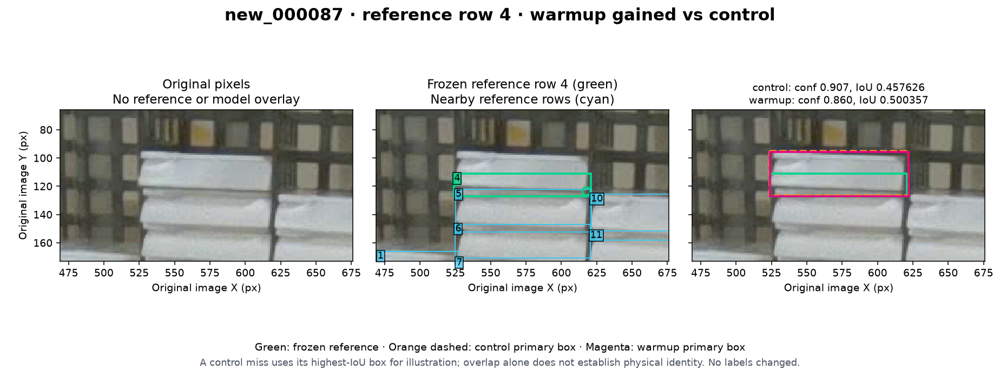
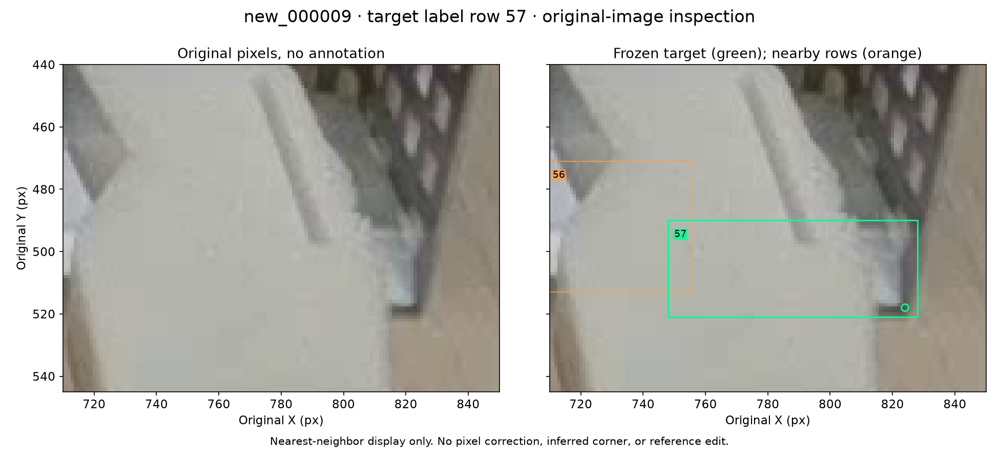
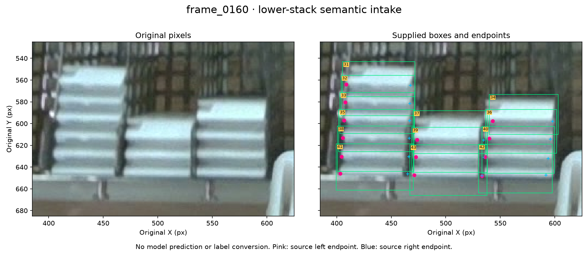

# Warmup detection review and additional-image intake

**2026-11-07 (Asia/Hong_Kong).** The targeted review is complete for all **nine lost and eight gained matches** between warmup and the fresh control. It shows that box extent contributes substantially to the detection tradeoff. We also recovered an upstream package of **320 additional frames and their labels**. A three-image semantic pilot found excessive box extents into the rack, so these supplied annotations require a separately versioned adaptation before supplementary scoring.

M0 epoch173 remains the default under the [completed comparison](warmup-comparison-2026-11-07.md). This follow-up preserves that comparison and adds physical case review, a point-availability breakdown and data provenance. It does not report new model inference or a new accuracy result.

## What the one-object FN difference contains

At the unchanged primary box confidence 0.25 and matching IoU 0.50, the frozen reference partitions as follows:

| Reference point availability | Objects | M0 misses | Control misses | Warmup misses |
| --- | ---: | ---: | ---: | ---: |
| Both corners visible | 584 | 14 | 14 | **11** |
| One corner visible | 59 | 15 | 15 | **15** |
| Neither corner locatable | 21 | 10 | 7 | **11** |
| Total | 664 | 39 | 36 | **37** |

Warmup has three fewer misses on objects with two visible corners and four more misses on objects with neither corner locatable than the control. The one-visible-corner count is unchanged. These are reference point-availability groups, not automatically inferred occlusion categories. An identifiable front still counts as an object when its corners are unlocatable, as required by the existing annotation policy.

This is a post-hoc explanation of the recorded result. It neither removes difficult objects from the denominator nor changes the predeclared adoption rule. The [review record](warmup-detection-review-2026-11-07.json) identifies the saved scores used for the counts.

## Most gains cross the box-matching threshold

Seven of the eight warmup gains have a high-confidence control prediction overlapping the target reference region, but its IoU is below 0.50. Their warmup overlaps are only **0.500357–0.533900**. In clearly identifiable cases, the control already depicts the same physical front; thin-fragment identity is less certain. These gains should not be described as seven objects for which the control produced no prediction. They primarily concern whether the recorded boxes qualify under the matching rule.

| Image / one-based label row | Control best primary IoU | Warmup matched IoU | Main review question |
| --- | ---: | ---: | --- |
| `new_000008` / 7 | 0.160949 | 0.944757 | Confidence recovery; the control primary box belongs to neighboring row 8 |
| `new_000009` / 51 | 0.490172 | 0.533900 | Narrow front beside gripper; visible box width |
| `new_000055` / 23 | 0.499282 | 0.524812 | Thin top-clipped fragment |
| `new_000056` / 3 | 0.485333 | 0.524333 | Front versus upper-surface extent |
| `new_000056` / 14 | 0.488700 | 0.515915 | Visible left fragment beside a hand; hidden extent |
| `new_000057` / 10 | 0.494870 | 0.521106 | Small height difference on the same isolated front |
| `new_000087` / 4 | 0.457626 | 0.500357 | Reference upper edge appears to cut through the visible front |
| `new_000087` / 15 | 0.482857 | 0.505123 | Upper-rim/front boundary |

The first case is different: at diagnostic confidence 0.15, the control has a matching box with confidence **0.163644** and IoU **0.898806**. Warmup returns a matching box at primary confidence with confidence **0.562409**. `new_000009` row 51 also has a lower-confidence control alternative that matches at 0.15; the table describes its stronger remaining box at primary 0.25. All of these distinctions are preserved in the case packet.

### A match can change after a subpixel box movement

For `new_000087`, row 4, every control-to-warmup box edge changes by less than one original-image pixel, yet IoU crosses from **0.457626 to 0.500357**. The raw image shows connected white front material above the frozen upper edge at y=111.24. That raises a legacy box-extent question under the adopted visible-front rule. Agreement between model boxes is not independent annotation truth; the figure supports review, not automatic replacement of the reference.

The opposite question occurs in `new_000056`, row 3: the frozen box begins at y=304.97 across the gray upper surface, whereas the white front boundary is lower. Both predictions also extend below the frozen bottom. Reference and prediction extents each require their own physical judgment.

## The lost cases also mix confidence, extent and uncertainty

The earlier numerical packet correctly identified four low-confidence matching alternatives, four IoU failures, and one case without an overlapping recorded warmup prediction. Original-image review adds qualifications to those gate labels.

**`new_000009`, row 52:** a narrow front is distinguishable beside the gripper. Warmup has a primary prediction with confidence **0.823233**, but its wider box reaches into the gripper and has IoU **0.402243**. A different, lower-confidence prediction has confidence **0.247085**, IoU **0.553562**, and matches only in the 0.15 diagnostic. The target region is not simply devoid of a confident prediction; both confidence filtering and box geometry matter.

**`new_000009`, row 57:** only a narrow pale right-hand fragment is supported beside the gripper, while the frozen rectangle extends left to x=748 across opaque gripper material. The image does not establish another same-front visible portion near that left bound.

This is a concrete visible-extent review item. It is not a confirmed duplicate, grounds for deleting the instance, or a reason to remove its miss from the completed comparison. The visible region's approximate bounds in the review are observations, not approved replacement coordinates.

**`new_000056`, row 4:** the cassette front is clearly distinct from the following front. The reference upper edge includes ribbed upper-surface material, while both trained predictions extend downward toward the next cassette. Warmup's nearby corners do not establish that its box is correct.

The thin strips in `new_000009` row 8, `new_000011` row 15 and `new_000059` row 1 remain conservative identity/extent review items. The gripper-aperture material in `new_000010` row 14 and `new_000011` row 61 also cannot certify every legacy instance assignment from this one image. No duplicate was confirmed among these nine cases. The existing missing-point sentinels are preserved.

## Apply the existing annotation rule consistently

The [adopted policy](annotation-policy.md) already separates three decisions: which physical front is identifiable, the extrema of its observed front surface, and whether each actual lower-front corner is locatable.

An enclosing rectangle may contain an occluder between two supported visible portions of the same front. Merely containing gripper pixels is therefore not an error. The review question is whether the rectangle's outer bounds and the identity joining those portions are supported by the image. Upper surfaces, neighboring cassettes and guessed hidden edges do not define those extrema.

These cases support applying that convention in a separately versioned annotation review. They do not require a new minimum fragment size, a different IoU gate, or hidden corners inferred from the model. Unresolved identity should be documented and adjudicated or quarantined before releasing a new reference set.

The case selection came from known model disagreements, so this review is not blinded and does not estimate how common annotation problems are across the dataset. Occlusion and box extent were already discussed in earlier work; this contribution is their precise localization and documentation on both sides of this particular model tradeoff.

## Additional data found and recovered

The current repository's frozen reference remains **137 training plus 20 validation images**. Its README says that five final-test images, nineteen gap images and 49 unconfirmed old images were excluded; their IDs are not supplied in the frozen manifest. This investigation did not recover a certified copy of that original five-image final test.

The separate upstream [grasp-vision source](https://github.com/an94-doll/embedding_vision/tree/9a6bf2432582af517d789c94eab2ac27e03a304b/box_in_basket/white_box_pose) contains a reviewed **320-image** package. The actual ZIP has been downloaded and checked:

- Path: `box_in_basket/white_box_pose_reviewed_320_images_20261028_145012.zip`.
- Size: **43,424,432 bytes**.
- SHA-256: `b28bcce5fffe91f3e486ff11ec3085a67c868fe09e65c14788bc6fe494af4dd0`.
- All 320 original JPEGs and 320 label files match the pinned source manifest; all images decode as 1280×720.
- The package contains **12,987 objects**, **24,949 visible endpoints** and **1,025 missing endpoints**. Independent structural checks found no violations of the 11-field, class-0, canonical visibility, image-X order, coordinate and containment requirements checked.

The [intake inventory](additional-frame-intake-2026-11-07.json) preserves every original image and label hash, source revision, current-data overlap mapping and payload verification. The raw package remains in its source repository; it is not duplicated in this result PR.

### Why the upstream test split cannot be adopted directly

Upstream's 477-source-image pool consists of the current **157 original images plus these 320 additional frames**. Its historical random 334/95/48 [split manifest](https://github.com/an94-doll/embedding_vision/blob/9a6bf2432582af517d789c94eab2ac27e03a304b/box_in_basket/dataset_0/split_manifest.csv) re-encodes the old PNGs as JPEGs. The 48-test listing contains **18 current-data images: 15 training and three validation**, alongside 30 additional frames. The three reused validation IDs are `new_000087`, `new_000088` and `new_000147`.

Comparing only the re-encoded JPEG hashes would miss that overlap. The audit follows the split manifest back to the original source image and its frozen identity. It also distinguishes a listed split member from an actually tracked output file: the pinned `dataset_0` tree omits the 48 test image outputs, although their source originals can be found through the original pools.

The 320 additional raw files have no exact raw-hash overlap with the frozen 157. They are not globally unused: upstream already used them in another model's random frame split. Its [split summary](https://github.com/an94-doll/embedding_vision/blob/9a6bf2432582af517d789c94eab2ac27e03a304b/box_in_basket/dataset_0/split_summary.json) explicitly warns that neighboring frames may occur in different splits. No capture/session timing was recovered from their EXIF fields. Exact byte uniqueness is not proof of independent scenes or absence of near duplicates.

Three raw examples, `frame_0001`, `frame_0160` and `frame_0383`, show the same kind of cassette/rack target, but also shared background and rack-fill patterns across the sample. The source names its class `white_box` and its points left/right endpoints. Treat this as an **additional-frame review pool**, not an approved independent test set.

The alternative upstream yolo-pose material uses front/back classes and five points, including cropped groups. It is not a direct two-corner replacement dataset.

### Semantic pilot: the supplied boxes are not ready for scoring

The three full original images were inspected before their supplied-label overlays, without any model predictions. Each has 43 supplied rows. This is a compatibility pilot, not approval of all 129 rows or the other 317 images.

| Pilot image | Physical finding | Required disposition |
| --- | --- | --- |
| `frame_0001` | The front identity and lower-front endpoint intent appear compatible. Rows 42 and 43 retain opposite single endpoints beside the gripper. | Review observed box extrema near the gripper and upper-surface boundaries; preserve independently unlocatable corners. |
| `frame_0160` | Bottom-stack boxes 41–43 extend below the white fronts into the metal rack/base. | Adapt the boxes in a separate annotation version; do not delete supported objects or snap boxes automatically to endpoints. |
| `frame_0383` | Lower-stack boxes are appreciably tighter than in `frame_0160`. | Review small margins, soft corners and front/upper-surface distinctions; this frame does not certify the whole pool. |

In `frame_0160`, row 43, the supplied box reaches **y=666.12 px**, while its two lower-front endpoints are at **y=647.36 and 647.93 px**. The crop shows that the extra area is rack/base. The finding rests on the physical image, not merely a numerical gap between a box and its points. Exact replacement extrema and endpoint reliability remain unadjudicated.

The target and endpoint intent are promising, but structural validity is insufficient to import these labels as approved `baomai-visible-front-v1` annotations. Preserve the source bytes and one-based source row IDs, then review front identity, observed box extent and each endpoint independently. The full pilot record and reproducible overlay inputs are preserved in the review capsule.

## Concrete next assignment

**Goal:** prepare a separately versioned annotation-adaptation candidate from the recovered additional frames, then freeze a supplementary reference before model scoring. The supplied labels are not ready as-is under the current visible-front policy.

**Scope:** the 320-source package and its pinned per-file inventory. Exclude all 157 old-image families even when re-encoded. Keep the original development reference and its reported scores intact. Do not silently inherit upstream's train/val/test labels as proof of held-out status.

**Acceptance before scoring:** preserve source hashes and row identities; adjudicate each included front's box extent and actual endpoint states against the existing policy; record ambiguous image dispositions; freeze the eligible image IDs and exact adapted label bytes. Extend the pilot findings through a consistent review of the selected reference rather than automatically renaming the source class or using model boxes as labels. Identify capture groups if provenance becomes available. Otherwise describe the result as supplementary frame validation, with correlated-scene and prior-use limits.

**Implementation boundary:** the existing `preflight_dataset` deliberately requires the frozen 20-image reference. A future supplementary evaluator should accept an explicit separate manifest and reuse the existing scorer and checkpoint provenance. It must not replace that manifest, weaken the default guard, or turn source class names into an implicit conversion. Compare the frozen M0, control and warmup checkpoints in one common runtime with the same primary confidence, IoU and endpoint settings, and preserve predictions for replay.

**Decision:** retain M0 until the declared comparison and data qualification support a change. A supplementary result on these frames will not by itself establish independent-scene generalization. No additional training is needed to prepare or run this checkpoint comparison.

## Evidence and verification

The [review record](warmup-detection-review-2026-11-07.json) links the complete 17-case findings, point-availability counts, selected figures and intake audit to their source hashes. The [review capsule](../results/review/baomai-warmup-detection-20261107/review.zip) preserves the detailed numerical/visual records and render helpers. Raw predictions remain in the earlier evaluation capsule; original validation PNGs remain in Git LFS.

Ten distinct validation originals were inspected across the two case reviews, before their diagnostic crops. A separate three-image intake pilot used only original pixels and supplied annotations, with no predictions. The selected figures reproduce original pixels and their respective source annotations. The review proposes no corrected coordinate, hidden point or duplicate deletion. Verification covers case identities, numerical accounting, source/payload hashes, archive readback, reproducible figures and the relevant annotation-format checks; it does not rerun training or the broad execution test suite.
