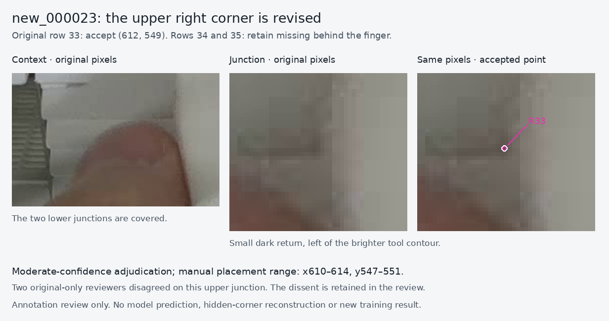

# Rechecking the lower-right corners in new_000023

Date: 2026-11-12, Asia/Hong_Kong  
Source: original 1280 × 720 PNG, SHA256 `3bb858735aa80fb8c07e19eb6c05c35cd601ef7a355bd5de0f9446d2625e895b`

The user questioned whether the right corners shown as missing in the earlier comparison could still be determined. The full original and larger unaltered crops were inspected again. **The upper of the three affected fronts, original row 33, is revised to visible at approximately `(612,549)`. Rows 34 and 35 remain missing.**



## Why only the upper point changes

The upper front's lower boundary reaches a small dark rounded bend just above the fingertip. A short return rises a few pixels left of the brighter, more continuous gripper contour. The accepted point is on that bend, not at the farther-right place where the face shading terminates against the tool. The descriptive placement range is **x610–614, y547–551** in original pixels.

For the next two fronts, the finger covers the lower boundary before its junction with the right edge can be seen. Their remaining fragments can constrain an estimate, but do not expose those actual corners. The [existing annotation policy](../../../docs/annotation-policy.md) permits rounded or mildly soft visible junctions and requires an unlocatable actual corner to remain `0 0 0`.

| Original row | Right slot | Evidence and limitation |
| --- | --- | --- |
| 33 | Visible, `(612,549)` | Small rounded return left of the tool; moderate confidence because it is soft and close to an occluder. |
| 34 | Missing | Finger covers the lower-right junction. |
| 35 | Missing | Hand covers the lower-right target region. |

## Review disagreement is preserved

Two reviewers inspected only the original PNG and exact-pixel crops before reading labels or prior review conclusions. Reviewer A held the upper feature as ambiguous, judging its apparent upright boundary too close to the tool silhouette to establish ownership. Reviewer B accepted `(612,549)`, identifying a short cassette-owned return left of the tool contour. Both retained missing status for the lower two right slots.

The root reviewer knew the earlier annotation and the user's question. The final decision accepts reviewer B's interpretation with **moderate confidence**, and retains reviewer A's dissent in [adjudication.json](adjudication.json). This is an explicit manual adjudication, not unanimous agreement, independent human sign-off, or an assertion of indisputable pixel truth. The placement range is descriptive, not a statistical confidence interval or physical tolerance.

## Exact effect on the candidate

Relative to PR50, only original row 33's right triple changes:

```text
Before: 0.00000000 0.00000000 0
After:  0.47812500 0.76250000 2
```

The original row number stays 33. Every class/box token, other point, row count and object identity remains unchanged. The left-point amendments and image 031 were not reopened in this follow-up.

The cumulative candidate now contains **ten changed endpoint slots on six rows**, with **6,842 visible endpoints and 700 missing slots** across the same **3,771 training objects**. The exact PR35 parent retains 6,841/701. Original validation and the corrected development scoring reference are unchanged. The earlier PR49 recovery and PR50 evidence remain preserved in their original records and Git history.

The [dedicated matched-comparison handoff](../../../docs/training-endpoint-visibility-2026-11-12.md) uses this revised candidate. Neither the recheck nor the preparation checks establish a model improvement; PR35 remains selected pending a measured result.
