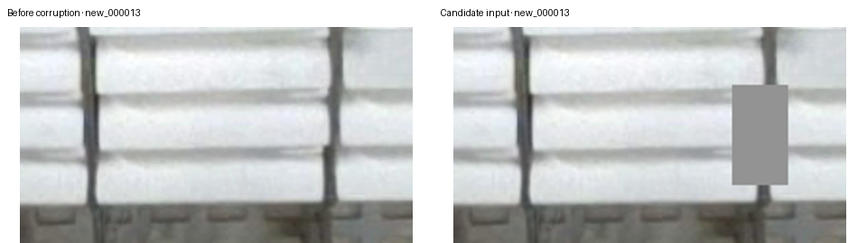

# Occlusion-training preparation: what has actually been checked

**Status: implementation prepared and locally checked; full GPU training and accuracy comparison have not run. Keep PR35.**

Start with the [experiment and Colab instructions](../../../docs/training-occlusion-2026-11-13.md). The [fixed protocol](../../../experiments/occlusion-training-2026-11-13.json) declares the single intervention, exact PR35 labels, paired training settings and prospective comparison rules. The final notebook pins the implementation commit and protocol hash.

## Completed checks

| Check | Evidence and practical meaning |
| --- | --- |
| Exact source and effective labels | Metadata preflight verifies the frozen protocol, original label inventory, eight PR35 overrides, historical-policy validation and current development reference. It does not certify all original image or initialization-weight bytes on this machine. |
| Transform behavior | [Focused report](focused-checks.json): control pixels unchanged; candidate alters only planned rectangles; targets and missing slots unchanged; private randomness; deterministic planning; intended coverage and protected opposite neighborhood; collateral coverage counted. |
| Actual training-input pipeline | Six hash-verified original training images passed through the pinned Ultralytics pose augmentation, Format, collation and preprocessing. One valid mask was applied, with four covered known endpoints including three collateral endpoints; one image was empty and four were probability skips. Control and candidate planning digests agree. |
| Actual model integration | One actually corrupted image at `[1, 3, 736, 1280]` passed a CPU forward/backward computation through the verified PR35 checkpoint. Loss was 2.091611862182617; 498 parameter-gradient tensors were finite and 442 contained nonzero values. No optimizer step or checkpoint write occurred. |
| Return-bundle eligibility | [Packaging report](packaging-checks.json): eight synthetic-fixture checks accept the valid pair/exact existing archive and reject swapped roles, missing hook evidence, changed protocol, changed training labels, CPU full-run receipts and incomplete exposure. Fake fixture weight bytes and runtime fields do not establish model validity or GPU execution. |
| Previous diagnostic preserved | The unchanged PR60 runner replays all 94 saved predictions successfully after the optional training-hook change. This checks reproducibility, not new model accuracy. |
| Notebook handoff | All seven code cells compile. The final notebook contains an exact implementation commit and the frozen protocol hash. GPU execution is still required. |

The [machine-readable preparation record](verification.json) binds the published source/report hashes and records the limits of these checks.

## Actual training-input illustration



This is a crop of the actual transformed `new_000013` training input. The right image contains the candidate's gray rectangle. It is not a model prediction, a new captured scene, or a claim that masked pixels still reveal a corner. The known source geometry is retained as a reconstruction target.

## What remains unverified

The earlier four-image full-resolution CPU forward/backward attempt terminated with exit code **137** before completion. The successful single-image check does **not** verify batch-four capacity. The exit code alone does not establish the operating-system cause.

There is no connected CUDA device here. This preparation did not restore all 157 original image files, restore the epoch173 initialization bytes, run the four-batch GPU resource trial, execute either 30-epoch training arm, or measure any new checkpoint's accuracy. The notebook checks the full inputs and GPU capacity before training.

The current operational PR35 checkpoint and source annotations are unchanged. A returned candidate must preserve clean-image performance and meet the predeclared synthetic-occlusion benefit against both its fresh matched control and PR35. A pass remains development evidence, not certification of natural hidden-point accuracy or deployment readiness.

## Reproduce the focused checks

With the pinned source and Ultralytics 8.4.182, the metadata and synthetic packaging checks require no GPU:

```bash
python -B scripts/occlusion_experiment.py verify --root .
python -B scripts/check_occlusion_experiment.py --repo-root . --output /tmp/occlusion-packaging-checks.json
python -B scripts/check_pose_input_corruption.py --help
```

The transform checker documents its optional real-image and verified-checkpoint inputs in `--help`. Its real-image/model checks require actual original PNG and checkpoint bytes; Git LFS pointer files are not substitutes. The original [PR60 replay instructions](../baomai-pixel-occlusion-20261113/README.md) remain valid.

After the GPU notebook completes, return **`baomai-occlusion-seed46-results.zip`**. The 14-member archive contains both complete six-file checkpoint bundles, the protocol and the index. Packaging verifies provenance and completed-run eligibility; accuracy is assessed separately.
